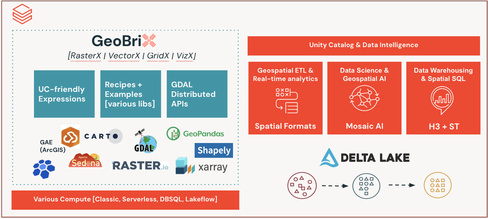

import CodeFromTest from '@site/src/components/CodeFromTest';
import overviewExamples from '!!raw-loader!../../tests/python/api/overview.py';
import packagesExamples from '!!raw-loader!../../tests/python/packages/examples.py';
import RasterXIcon from '../../../resources/images/brand/RasterX.png';
import GridXIcon from '../../../resources/images/brand/GridX.png';
import VectorXIcon from '../../../resources/images/brand/VectorX.png';
import VizXIcon from '../../../resources/images/brand/VizX.png';

# Functions Overview

GeoBrix provides four specialized packages for different spatial processing needs. All packages expose SQL and Python APIs. The GeoBrix JAR is the performance tier: it speeds up some functions on a dedicated cluster. See [Functions the JAR speeds up](./jar-functions).



## Available Packages

###  {#rasterx}

Full-spectrum raster processing for Databricks. It is the successor to Mosaic raster. It adds terrain analysis, spectral indices, tile publishing, vector↔raster bridging, and memory-safe large-raster processing (virtual tiles + a COG-preparation lane).

- Process GeoTIFF and other GDAL-supported raster formats
- Raster algebra, transformations, clipping, reprojection
- Metadata extraction, band operations, NoData handling
- Resample, IDW interpolation, build overviews
- Terrain analysis (slope, aspect, hillshade, TRI, TPI, roughness, color-relief)
- Spectral indices (EVI, SAVI, NDWI, NBR, NDVI, plus a generic dispatcher)
- Vector↔raster bridge (`rasterize` / `polygonize`)
- Web-mercator XYZ tile output (`to_webmercator`, `tilexyz`, `xyzpyramid`)
- Grid aggregations to H3 or CARTO quadbin v0 cells
- COG output, proximity, contour, viewshed
- Virtual tiles — bytes-free windowed reads for multi-gigabyte rasters; COG-preparation lane (`file_gbx` + `cog_gbx`) and VRT mosaics

[Raster Function Reference →](./raster-functions)

---

###  {#gridx}

Spatial indexing across multiple discrete-global-grid systems: **BNG** (British National Grid) for Great Britain workloads, **CARTO quadbin v0** for web-mercator-aligned analytics, and **custom user-defined grids**. It pairs with the product's native H3 for global hex.

- British National Grid (BNG) — 21 functions covering cell math, kring/kloop, polyfill, tessellation, aggregators, and generators
- CARTO Quadbin v0 — 9 functions (`pointascell`, `aswkb`, `centroid`, `resolution`, `polyfill`, `kring`, `tessellate`, `cellunion`, `distance`); cell IDs are 64-bit Long, aligned with the web-mercator XYZ tile grid
- Custom user-defined grids — define a regional or equal-area grid and get cell math, polyfill, and tessellation on it
- Cell area calculations, k-ring / k-loop neighborhoods, geometry-to-cell tessellation

[GridX Function Reference →](./gridx-functions)

---

###  {#vectorx}

Augments the product's native `ST_*` functions with vector-tile encoding, TIN surface modeling, authority-string CRS transforms, antimeridian handling, and distributed-shapely geometry validity, cleaning, and coverage-validity. It also handles legacy-geometry migration.

- Mapbox Vector Tile (MVT) encoding via `st_asmvt` aggregator + `st_asmvt_pyramid` generator (composes with `pmtiles_agg` for end-to-end publishing)
- TIN surface modeling — `st_triangulate`, `st_interpolateelevationbbox`, `st_interpolateelevationgeom` (constrained-Delaunay triangulation and grid elevation interpolation from Z-valued points)
- CRS strings — `st_crs` / `st_setcrs` / `st_transformcrs` read, stamp, and reproject by authority-string CRS (ESRI codes, WKT, PROJ4 — not just an EPSG integer)
- Geometry validity & cleaning — `st_makevalid`, `st_explainvalidity`, and topology-safe cleaning (`st_simplifypreservetopology`, `st_removerepeatedpoints`, `st_reduceprecision`, `st_node`, `st_snap`)
- Coverage validity — `st_coverageisvalid`, `st_coverageinvalidedges`, `coverage_simplify`
- Antimeridian handling — `st_shiftlongitude`, `st_wrapx`, `st_split`
- Legacy Mosaic geometry conversion (migrate without installing Mosaic)
- OGR-based reader data sources (Shapefile, GeoJSON, GeoPackage, FileGDB)

[VectorX Function Reference →](./vectorx-functions)

---

###  {#vizx}

Tier-agnostic visualization helpers for inspecting GeoBrix outputs in a notebook. They render rasters and mosaics, and turn Spark geometry / H3-cell / grid DataFrames into GeoPandas for static & interactive maps. Python-only, no SQL functions.

- Raster plotting (`plot_raster` / `plot_file`) with auto-decimation and percentile stretch, including coverage-depth and mask-layer composites for multi-band presence stacks
- VRT mosaic rendering (`plot_mosaic`) — a whole mini-COG mosaic (from the `cog_gbx` `vrtMosaic` writer) as one memory-safe image, with a bbox viewport and optional h3 cell overlay
- Multi-layer compositor (`plot_static` / `plot_interactive`) and PMTiles/COG viewers (`plot_pmtiles`, `plot_cog`, `pmtiles_info`)
- Spark DataFrame → GeoPandas adapters (`as_gdf` / `cells_as_gdf` / `grid_as_gdf`) for `.plot()` / `.explore()` maps

[VizX Reference →](./vizx)

---

### PMTiles

Container format for serving raster (PNG / JPEG / WebP) or vector (MVT) tile pyramids from a single static file via HTTP range requests. Native Scala v3 encoder — no GDAL/OGR dependency.

- `gbx_pmtiles_agg` UDAF — aggregator returning a `BINARY` PMTile blob; fits tilesets up to ~100 MiB tile payload / 2 GiB cell limit
- `.write.format("pmtiles_gbx").save(path)` DataSource (Python) — writes larger pyramids with spatial sharding
- Auto-detects `tile_type` from magic bytes (PNG / JPEG / WebP / otherwise MVT)
- Composes with `gbx_rst_xyzpyramid` (raster) and `gbx_st_asmvt_pyramid` (vector) upstream

---

### STAC

Helpers for discovering and loading imagery from **SpatioTemporal Asset Catalog (STAC)** APIs (such as the Microsoft Planetary Computer) directly into GeoBrix raster workflows.

[STAC Reference →](./stac)

---

## Package Comparison

| Feature | RasterX | GridX | VectorX | PMTiles | VizX |
|---------|---------|-------|---------|---------|------|
| **Primary Use** | Raster processing | Discrete global grids | Vector encoding + legacy | Tile pyramid packaging | Notebook visualization |
| **Product Gap** | Full gap-filling | Specialized grids (BNG, quadbin) | Vector-tile encoding, legacy migration | Net-new | Supporting layer |
| **GDAL Required** | Yes | No | Yes (readers + MVT) | No | No |
| **Output Format** | Tile (struct) + arrays | Cell IDs (Long / String) + WKB | BINARY (MVT bytes), WKB | BINARY (PMTile blob) or file | Matplotlib figure / GeoDataFrame |
| **Spark Surface** | 166 SQL functions | 41 SQL functions | 21 SQL functions + DataSources | 1 UDAF + 1 DataSource | Python only (no SQL) |

## Choosing the Right Package

**Use RasterX when:** working with satellite imagery, DEMs, or aerial photography; performing terrain analysis, spectral indices, or per-pixel transforms. Also use it for aggregating raster pixels to H3 or quadbin cells, bridging vector geometries to/from rasters, and generating web-mercator XYZ tiles.

**Use GridX when:** working with British National Grid data; indexing global data into web-mercator-aligned quadbin cells. Also use it for cell math (area, k-ring, polyfill, tessellation) and for building grid-aware aggregations or join keys.

**Use VectorX when:** encoding features as Mapbox Vector Tiles; generating per-tile MVT layers; building TIN surfaces / interpolating elevation from Z-valued points. Also use it for handling CRS by authority string or normalizing antimeridian-crossing geometries; repairing, cleaning, or coverage-validating geometry. Use it too for reading vector formats (Shapefile, GeoJSON, GeoPackage, FileGDB) and migrating from DBLabs Mosaic.

**Use PMTiles when:** publishing a tile pyramid (raster or vector) as a single static file; serving from S3/ABFS/GCS without a tile server. Also use it for aggregating `(z, x, y, bytes)` rows into a deployable map.

**Use VizX when:** inspecting GeoBrix raster tiles or files in a notebook (single-band, RGB, coverage-depth, or mask-layer composites). Also use it for turning Spark geometry / H3-cell / gridspec DataFrames into GeoPandas for `.plot()` / `.explore()` maps. VizX is a Python-only supporting layer for visualization, not a spatial-processing package.

## Function Naming Convention

All GeoBrix SQL functions use the `gbx_` prefix:

| Package | Prefix | Example |
|---------|--------|---------|
| **RasterX** | `gbx_rst_` | `gbx_rst_boundingbox` |
| **GridX/BNG** | `gbx_bng_` | `gbx_bng_cellarea` |
| **GridX/Quadbin** | `gbx_quadbin_` | `gbx_quadbin_pointascell` |
| **VectorX** | `gbx_st_` | `gbx_st_asmvt` |
| **PMTiles** | `gbx_pmtiles_` | `gbx_pmtiles_agg` |

The `gbx_` prefix distinguishes GeoBrix functions from Databricks built-in `st_*` functions.

## Registration

Before using GeoBrix functions in Python or SQL, register them with the Spark session.

### Register all packages

<CodeFromTest code={packagesExamples} language="python" functionName="register_all_packages" testFile="docs/tests/python/packages/test_examples.py" validationLevel="compile" />

### Register selectively

Pass `only=` to register a few functions. GeoBrix still picks the implementation level for each. See [Surfaces & Levels](./execution-tiers).

<CodeFromTest code={packagesExamples} language="python" functionName="register_only_rasterx" testFile="docs/tests/python/packages/test_examples.py" validationLevel="compile" />

### SQL

Call `gbx.register(spark)` from Python to register the SQL functions. The JAR registers no SQL names. A JVM job can call the registered names too: see [SQL from a JVM job](/docs/installation#jvm-sql). Once registered, the functions are available in any SQL context:

<CodeFromTest code={overviewExamples} functionName="SQL_DESCRIBE_FUNCTION" language="sql" source="docs/tests/python/api/overview.py" testFile="docs/tests/python/api/test_overview.py" outputConstant="SQL_DESCRIBE_FUNCTION_output" />

## API Languages

GeoBrix provides the same functionality in SQL and Python. See [Language Bindings](./language-bindings) for the registration and import patterns each surface uses. See [Surfaces & Levels](./execution-tiers) for how GeoBrix picks the level that runs each function.

## Scalar values vs `lit(...)` wrapping

In 0.3.0, plain scalars are accepted across Python and SQL bindings — no `f.lit(...)` wrapping required for non-string values.

**Python** — wrappers accept `Column` or scalar (`bool`/`int`/`float`/`bytes`); non-string scalars are auto-wrapped with `f.lit(...)`. Strings still follow pyspark's column-reference convention (bare string ≈ `f.col(name)`); wrap in `f.lit("...")` to pass a string literal.

```python
# ✅ Before 0.3.0 — required f.lit for every value
rx.rst_clip("tile", "geom", f.lit(True))
rx.rst_transform("tile", f.lit(4326))
bx.bng_pointascell("pt", f.lit(1))
bx.bng_pointascell("pt", f.lit("1km"))

# ✅ 0.3.0 — scalars accepted directly
rx.rst_clip("tile", "geom", True)
rx.rst_transform("tile", 4326)
bx.bng_pointascell("pt", 1)
bx.bng_pointascell("pt", f.lit("1km"))   # string literal — still wrap in f.lit
```

**SQL** — values are already natively accepted by Spark SQL; no change needed:

```sql
SELECT gbx_rst_clip(tile, geom, true) FROM ...;
SELECT gbx_bng_pointascell(pt, 1) FROM ...;
SELECT gbx_bng_pointascell(pt, '1km') FROM ...;
```

**When you still need `f.lit(...)` in Python:**
- **String literals**: `rx.rst_fromfile(f.lit("/path/to.tif"), f.lit("GTiff"))` — a bare string is treated as a column reference.
- **Nulls / explicit typing**: e.g. `f.lit(None).cast("double")`.

## Next Steps

- [Raster Function Reference](./raster-functions)
- [GridX Function Reference](./gridx-functions)
- [VectorX Function Reference](./vectorx-functions)
- [VizX Reference](./vizx)
- [PMTiles Functions](./pmtiles-functions)
- [Zarr Functions](./zarr-functions)
- [STAC](./stac)
- [Language Bindings](./language-bindings)
- [Performance](./performance) and [Benchmarking](./benchmarking)
- [Examples](../examples/overview)
