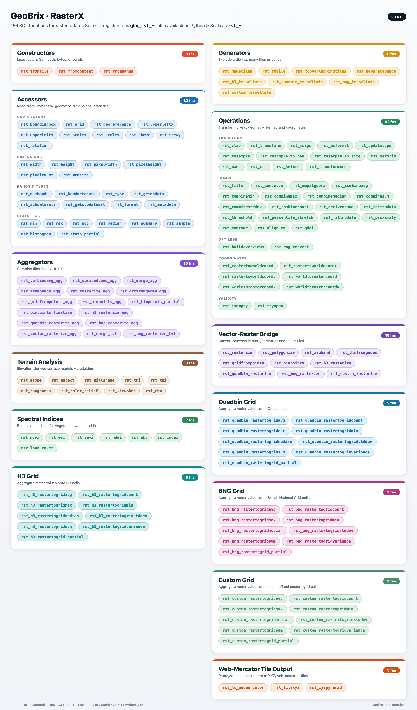

import Tabs from '@theme/Tabs';
import TabItem from '@theme/TabItem';
import CodeFromTest from '@site/src/components/CodeFromTest';
import Tier from '@site/src/components/Tier';
import Surfaces from '@site/src/components/Surfaces';
import { Impl } from '@site/src/components/Tier';
import RasterXIcon from '../../../resources/images/brand/RasterX.png';
import rasterxCode from '!!raw-loader!../../tests/python/api/rasterx_functions.py';
import pyrxCode from '!!raw-loader!../../tests/python/api/pyrx_functions.py';
import rasterxSqlCode from '!!raw-loader!../../tests/python/api/rasterx_functions_sql.py';
import scalaApiExamplesCode from '!!raw-loader!../../tests/scala/api/ScalaApiExamples.scala';
import rasterxLightCode from '!!raw-loader!../../tests/python/api/rasterx_functions_python_light.py';
import rasterxAccessorsLightCode from '!!raw-loader!../../tests/python/api/rasterx_accessors_python_light.py';
import rasterxTileopsLightCode from '!!raw-loader!../../tests/python/api/rasterx_tileops_python_light.py';
import rasterxAggregatorsLightCode from '!!raw-loader!../../tests/python/api/rasterx_aggregators_python_light.py';
import rasterxBandmathLightCode from '!!raw-loader!../../tests/python/api/rasterx_bandmath_python_light.py';
import rasterxTerrainLightCode from '!!raw-loader!../../tests/python/api/rasterx_terrain_python_light.py';
import rasterxTransformsLightCode from '!!raw-loader!../../tests/python/api/rasterx_transforms_python_light.py';
import rasterxGeneratorsLightCode from '!!raw-loader!../../tests/python/api/rasterx_generators_python_light.py';
import rasterxGridaggLightCode from '!!raw-loader!../../tests/python/api/rasterx_gridagg_python_light.py';
import FunctionExamples from '@site/src/components/FunctionExamples';
import VirtualTileOverrides from '../_partials/_virtual-tile-overrides.mdx';

#  Function Reference

RasterX functions run in two execution tiers — **lightweight** (pure-Python `pyrx`) and **heavyweight** (`rasterx`). As of v0.4.0, **every RasterX function is available in both tiers** (badged `<Tier both/>` per function below); per-function notes call out where the lightweight implementation differs. See [Choosing an Execution Tier](./execution-tiers) for the comparison and the lightweight install.

Complete reference for all RasterX functions with detailed descriptions, parameters, return values, and examples.

:::tip Built on rasterio
RasterX's lightweight tier is, in large part, **distributed rasterio** + a best-of-breed raster stack. See [Rasterio Distributed](./rasterio-distributed) for the coverage matrix and honest gaps.
:::

## Overview

RasterX is GeoBrix's raster data processing package, providing comprehensive tools for working with raster datasets such as satellite imagery, elevation models, and other gridded spatial data. It is a refactor and improvement of Mosaic raster functions, extended through v0.5.0 with terrain analysis, spectral indices, vector-raster bridging, web-mercator tile output, H3/quadbin/BNG grid aggregations, and — in v0.5.0 — **virtual tiles**, a **COG-preparation lane**, and **VRT mosaics** for memory-safe processing of multi-gigabyte rasters. Since the Databricks product does not (yet) support anything built-in specifically for raster processing, RasterX provides a gap-filling capability for raster operations on the Databricks platform.

## Key Features

- **GDAL-Powered**: Leverages GDAL for robust raster format support
- **Distributed Processing**: Built on Spark for scalable raster operations
- **Multiple Format Support**: GeoTIFF, COG, NetCDF, and other GDAL-supported formats
- **Metadata Extraction**: Comprehensive raster metadata access
- **Raster Operations**: Clipping, resampling, transformations, map algebra
- **Band Operations**: Multi-band raster support, single-band extraction
- **Terrain Analysis**: Slope, aspect, hillshade, TRI, TPI, roughness, color-relief
- **Spectral Indices**: EVI, SAVI, NDWI, NBR, NDVI, plus a generic dispatcher
- **Vector-Raster Bridge**: Rasterize geometries, polygonize value regions
- **Tile Publishing**: Web-mercator XYZ tile generation (PNG / JPEG / WebP)
- **Grid Aggregations**: H3, CARTO quadbin v0, and BNG cell aggregations
- **Virtual Tiles**: Bytes-free windowed reads — process multi-gigabyte rasters without materializing them into executor memory
- **COG Preparation & VRT Mosaics**: `file_gbx` + `cog_gbx` prepare spec-valid Cloud-Optimized GeoTIFFs and portable VRT mosaics for cheap windowed reads

:::note Coordinate reference systems
Many RasterX functions accept CRS parameters. Use `srid` / `out_srid` (integer EPSG or ESRI code) or `crs` / `out_crs` (CRS string — EPSG, ESRI, OGC, WKT, PROJ4) to declare or project CRS. Functions that consume a clip polygon or sample geometry accept `clip_crs` / `crs` as a source-CRS fallback. `rst_srid` returns the stored SRID integer; `rst_crs` returns the canonical CRS string and always returns a value. See [Coordinate reference systems](./coordinate-reference-systems) for the full model, the EPSG→ESRI resolution order, and the ESRI/OGC authority-preservation behavior.
:::

## Function Categories

RasterX exposes 129 SQL functions (registered as `gbx_rst_*`; available in Python and Scala as `rst_*`), organized into the following categories (see [rasterx/functions.scala](https://github.com/databrickslabs/geobrix/blob/main/src/main/scala/com/databricks/labs/gbx/rasterx/functions.scala)):



- **Accessor Functions**: Read raster properties and metadata (bounds, dimensions, CRS, bands, pixel size, georeference, format, type, NoData, subdatasets, summary, etc.)
- **Aggregator Functions**: Combine or merge rasters in group-by (combineavg_agg, derivedband_agg, merge_agg, h3_rasterize_agg)
- **Constructor Functions**: Create or load rasters from paths, binary content, or bands
- **Generator Functions**: Produce multiple tiles or bands (h3_tessellate, maketiles, retile, separatebands, tooverlappingtiles)
- **Grid Functions (H3)**: Aggregate raster values to H3 cells (rastertogrid avg/count/max/min/median/sum/variance/stddev)
- **Grid Functions (quadbin)**: Aggregate raster values to CARTO quadbin v0 cells (rastertogrid avg/count/max/min/median/sum/variance/stddev; tessellate; rasterize_agg)
- **Grid Functions (BNG)**: Aggregate raster values to British National Grid cells (rastertogrid avg/count/max/min/median/sum/variance/stddev; tessellate; rasterize_agg)
- **Operations**: Transform and analyze rasters (clip, transform, merge, asformat, ndvi, filter, convolve, map algebra, coordinate conversion, isEmpty, tryOpen, initNoData, updateType, combineavg, derivedband)
- **Web-Mercator Tile Output**: Reproject to EPSG:3857 and emit slippy-map XYZ tiles (to_webmercator, tilexyz, xyzpyramid)
- **Vector-raster bridge**: Burn polygons into rasters and trace contiguous regions back to polygons (rasterize, polygonize)
- **Terrain Analysis**: DEM-derived surfaces from `gdal.DEMProcessing` (slope, aspect, hillshade, TRI, TPI, roughness, color relief)
- **Spectral Indices**: Multi-band satellite math (EVI, SAVI, NDWI, NBR, plus the generic `rst_index` dispatcher)

## Tile payload

Every RasterX (heavyweight) function returns a **materialized** tile whose `raster` field is a **self-contained, in-memory raster** (GTiff by default) — safe to serialize between Spark stages and executors, persist to Delta, hand off to `rasterio` / `gdal`, or write back out via the `gdal` writer. The bytes are never an XML reference to a per-executor `/vsimem/` tempfile or to a path that only exists on the producing node.

See **[Tile structure](./tile-structure)** for the full tile-struct schema (the shared `cellid` / `raster` / `path` / `window` / … struct), and **[Virtual Tiles](./virtual-tiles)** for the bytes-free lightweight-tier variant and how tiles move between materialized and virtual.

Functions that internally build via an intermediate VRT — `gbx_rst_merge`, `gbx_rst_merge_agg`, `gbx_rst_frombands`, `gbx_rst_combineavg`, `gbx_rst_combineavg_agg`, `gbx_rst_derivedband`, `gbx_rst_derivedband_agg` — materialize the result to GTiff before returning, so downstream stages on different executors see real raster bytes. Inspect a tile's payload format from `tile.metadata.driver`; for any of the functions above, it will read `GTiff` (not `VRT`). See [Release Notes](../release-notes-0-5-and-earlier#whats-new-in-v030) for the v0.3.0 correctness fix that introduced this invariant. See [Tile structure](./tile-structure) for the full tile-struct schema.

## Virtual-tile force-output params {#virtual-tile-overrides}

<VirtualTileOverrides />

## Setup

With the geobrix library already installed ([Installation](../installation)), pick your execution tier and run this once. Both tiers alias the module as `rx`, so every example below is identical regardless of tier — only this setup differs. (See [Choosing an Execution Tier](./execution-tiers) for the comparison.)

The examples on this page read from **four temp views**, each a raster loaded as a `tile` column. Point the four path placeholders at your own rasters:

| Placeholder | Sample file | Reader (light&nbsp;/&nbsp;heavy) — Temp view | Backs |
|---|---|---|---|
| `GTIFF_SAMPLE_DIR` | single-band GeoTIFF | `gtiff_gbx` / `gtiff_gdal` — `rasters` | **Default** — most accessor, tile-ops, transform, and generator examples |
| `GTIFF_MULTI_DIR` | multi-band GeoTIFF (red/NIR/green) | `gtiff_gbx` / `gtiff_gdal` — `multiband_rasters` | band-math and spectral-index examples, `rst_numbands`, `rst_bandmetadata` |
| `DTM_DIR` | digital elevation model | `gtiff_gbx` / `gtiff_gdal` — `dem_rasters` | terrain examples (`rst_slope`, `rst_aspect`, …) |
| `NETCDF_DIR` | NetCDF with subdatasets | `netcdf_gbx` / `netcdf_gdal` — `netcdf_rasters` | `rst_subdatasets`, `rst_getsubdataset` |

Each format has a named reader in **both** tiers (light `*_gbx` / heavy `*_gdal`); the setup for each tier below uses its own. The generic readers (`raster_gbx` light, `gdal` heavy) also read any raster their tier's engine supports.

The four `*_DIR` placeholders in the code below are wired to small sample rasters **committed in the GeoBrix repo** under [`src/test/resources/binary/`](https://github.com/databrickslabs/geobrix/tree/main/src/test/resources/binary) (resolved by the `_SAMPLE_PATHS[...]` / `*_path()` helpers you'll see in the snippet). To run the examples yourself, stage those sample files — or your own rasters — in a Unity Catalog Volume directory and set each placeholder to its Volume path.

The setup below loads `GTIFF_SAMPLE_DIR` into `rasters` and then loads the other three the same way — swap the path and view name (and, for NetCDF, the reader). Every example on the page assumes these four views exist.

<Tabs groupId="gbx-tier" queryString="tier" className="gbx-tier-tabs">
<TabItem value="lightweight" label="Lightweight (pyrx)">

<CodeFromTest
  language="python"
  title="Lightweight setup (pyrx)"
  source="docs/tests/python/api/pyrx_functions.py"
  testFile="python/geobrix/test/pyrx/test_docs_examples.py"
  functionName="pyrx_setup_example"
  outputConstant="pyrx_setup_example_output"
  code={pyrxCode}
/>

</TabItem>
<TabItem value="heavyweight" label="Heavyweight (rasterx)">

<CodeFromTest
  language="python"
  title="Heavyweight setup (rasterx)"
  source="docs/tests/python/api/rasterx_functions.py"
  testFile="docs/tests/python/api/test_rasterx_functions.py"
  functionName="rasterx_setup_example"
  outputConstant="rasterx_setup_example_output"
  code={rasterxCode}
/>

**Scala** uses this same heavyweight (`rasterx`) setup: create the four views with `spark.read.format("gtiff_gdal").load(...).createOrReplaceTempView("rasters")` (and `netcdf_gdal` for the NetCDF view), then each Scala example reads `val df = spark.table("multiband_rasters")`. Registration is only needed for the SQL functions — the Scala `rx.*` Column API works without it.

Prefer pure SQL? Register RasterX (Python: `rx.register(spark)`), then create the same four views directly so the SQL examples can use `FROM rasters`, `FROM multiband_rasters`, and so on:

<CodeFromTest
  language="sql"
  title="SQL view setup"
  source="docs/tests/python/api/rasterx_functions_sql.py"
  testFile="docs/tests/python/api/test_rasterx_functions_sql.py"
  functionName="RASTERX_SQL_SETUP"
  outputConstant="RASTERX_SQL_SETUP_output"
  code={rasterxSqlCode}
/>

</TabItem>
</Tabs>

## Tier availability

As of v0.4.0, **all RasterX functions run in both execution tiers** — the lightweight `pyrx` (pure-Python) and heavyweight `rasterx` tiers share the same `rst_*` / `gbx_rst_*` names, and each function below carries a `:::note Lightweight tier (pyrx)` admonition with its backing library and any behavioral differences. For the heavyweight VRT Python pixel-function configuration (used by `gbx_rst_combineavg` / `gbx_rst_derivedband`), see **[VRT Python pixel functions](#vrt-python-pixel-functions)** at the end of this page.

## Examples — Conventions

Every function on this page shows one example, expressed identically across four tabs. This section defines the shared setup so each function tab contains only its invocation — nothing more.

### Canonical sample files

Each function uses one of four canonical files, chosen by what the function demonstrates:

| File | What it demonstrates | Used by |
|---|---|---|
| `nyc_sentinel2_red.tif` | Single-band GeoTIFF (Sentinel-2 red band, NYC area) | **Default** — most accessor, tile-ops, transform, and generator functions |
| `rgb_nir_small.tif` | 3-band GeoTIFF with per-band metadata (red, NIR, green — 8×8 px) | Band-math and spectral-index functions (`rst_ndvi`, `rst_evi`, …), `rst_numbands`, `rst_bandmetadata` |
| `srtm_n40w073.tif` | Digital Elevation Model (SRTM, NYC area) | Terrain functions (`rst_slope`, `rst_aspect`, `rst_hillshade`, …) |
| CMIP5 NetCDF (`prAdjust_day_…nc`) | Multi-variable NetCDF with two subdatasets | `rst_subdatasets`, `rst_getsubdataset` only |

### The `tile`-column convention

In every example on this page:

- **SQL:** `rasters` is a temporary view whose `tile` column holds the canonical sample loaded via the reader. `FROM rasters` means "the sample as tiles."
- **Python (light and heavy):** `df` is a DataFrame with a `tile` column loaded from the canonical file. `df.select(...)` means "apply this function to the sample tiles."
- **Scala:** `rasters` is a DataFrame with the same `tile` column. `rasters.select(...)` is identical in intent to the Python form.

Each function's example therefore shows only the invocation — the load is the convention, not the code.

### How to read the four tabs

| Tab | Tier | Color |
|---|---|---|
| **SQL** | Both (default) | — |
| **Python (light)** | `pyrx` lightweight tier | — |
| **Python (heavy)** | `rasterx` heavyweight tier | Blue badge |
| **Scala** | `rasterx` heavyweight tier | Blue badge |

All four tabs show the **same operation** on the **same file**. Where a tier's output genuinely differs in form, a short note explains why — for example:

- Geometry-returning functions (`rst_boundingbox`, `rst_georeference`): SQL returns WKT; Python and Scala return a binary column. The note reads `...` `(WKB binary)`.
- Subdataset maps (`rst_subdatasets`): SQL returns `map<string,string>`; rendered as `{SUBDATASET_1_NAME -> ..., SUBDATASET_1_DESC -> ...}`. A note clarifies the key pattern.
- Band-metadata maps (`rst_bandmetadata`): similarly noted where the rendering differs between tiers.

Scalar values are **identical across all tabs** — same fixture, same function, same result.

Tile-returning functions (`rst_clip`, `rst_resample`, `rst_transform`, the aggregators, the constructors, …) return a **[v2 Tile](./tile-structure)**. Their output is shown as a representative struct — `{0, <raster bytes>, <virtual path>, {driver -> GTiff, ...}}` — rather than a literal byte dump. Tiles loaded via `rst_fromcontent` / `rst_fromfile` (as in [Setup](#setup)) are **materialized**: the `raster` field holds the encoded bytes and `path` is null. [**Virtual tiles**](./virtual-tiles) — a populated `path` with lazily-read bytes — arise from the force-output parameters, not from the default load.

**SQL naming and arguments:** in the SQL tab, RasterX functions carry the **`gbx_`** prefix (e.g. `gbx_rst_boundingbox`, `gbx_rst_width`); Python and Scala use the bare `rst_*` name via `rx`. In the lightweight tier the registered `gbx_rst_*` SQL functions require **every argument to be passed explicitly** — optional defaults are honored only through the Python `rx.*` API. See [Language Bindings](./language-bindings) for more.

### Per-function notes

Functions that use a non-default fixture (multiband GeoTIFF, DEM, or NetCDF) carry a one-line note immediately before their code example flagging the file. Functions that produce a tile rather than consuming one (constructors: `rst_fromfile`, `rst_fromcontent`, `rst_frombands`, …) show a fuller load/build example with a note — the bare-invocation model does not apply when there is no input `tile` yet.

## Accessor Functions

Functions to read raster properties and metadata (29 total).

### rst_avg

{/* BEGIN GENERATED gbx_rst_avg: edit manifest/functions.json, then run gbx:manifest:gen */}
<Surfaces session python scala />

| Surface | Call | Returns |
|---|---|---|
| SQL (session) | `gbx_rst_avg(tile)` | `array<double>` |
| Python | `rasterx.functions.rst_avg(tile)` | Column |

| Parameter | SQL type | Default | Description |
|---|---|---|---|
| `tile` | `TILE` |  | The raster tile. |
{/* END GENERATED gbx_rst_avg */}

:::note Lightweight tier (pyrx)
Powered by **rasterio** + **NumPy**. Per-band mean over valid (non-NoData) pixels.
:::

Per-band average pixel values.

Returns `NULL` for a band with zero valid pixels (all NoData) on both tiers.

_Examples use the multiband fixture (`rgb_nir_small.tif`, 3 bands: red, NIR, green); the canonical single-band sentinel2 tile is all-NoData for this function._

<FunctionExamples
  name="rst_avg"
  sql={rasterxSqlCode}                  sqlSource="docs/tests/python/api/rasterx_functions_sql.py"
  python={rasterxAccessorsLightCode} pythonSource="docs/tests/python/api/rasterx_accessors_python_light.py"
  scala={scalaApiExamplesCode}          scalaSource="docs/tests/scala/api/ScalaApiExamples.scala"
  testFile="docs/tests/python/api/test_rasterx_functions_sql.py"
/>

### rst_bandmetadata

{/* BEGIN GENERATED gbx_rst_bandmetadata: edit manifest/functions.json, then run gbx:manifest:gen */}
<Surfaces session python scala />

| Surface | Call | Returns |
|---|---|---|
| SQL (session) | `gbx_rst_bandmetadata(tile, band)` | `map<string,string>` |
| Python | `rasterx.functions.rst_bandmetadata(tile, band)` | Column |

| Parameter | SQL type | Default | Description |
|---|---|---|---|
| `tile` | `TILE` |  | The raster tile. |
| `band` | `INT` |  | The 1-based band number. |
{/* END GENERATED gbx_rst_bandmetadata */}

:::note Lightweight tier (pyrx)
Powered by **rasterio**.
:::

Band metadata map.

_Examples use the multiband fixture (`rgb_nir_small.tif`, 3 bands with per-band GDAL metadata tags); plain single-band GeoTIFFs without tags return an empty map `{}`._

<FunctionExamples
  name="rst_bandmetadata"
  sql={rasterxSqlCode}                  sqlSource="docs/tests/python/api/rasterx_functions_sql.py"
  python={rasterxAccessorsLightCode} pythonSource="docs/tests/python/api/rasterx_accessors_python_light.py"
  scala={scalaApiExamplesCode}          scalaSource="docs/tests/scala/api/ScalaApiExamples.scala"
  testFile="docs/tests/python/api/test_rasterx_functions_sql.py"
/>

### rst_boundingbox

{/* BEGIN GENERATED gbx_rst_boundingbox: edit manifest/functions.json, then run gbx:manifest:gen */}
<Surfaces session python scala />

| Surface | Call | Returns |
|---|---|---|
| SQL (session) | `gbx_rst_boundingbox(tile)` | `BINARY` |
| Python | `rasterx.functions.rst_boundingbox(tile)` | Column |

| Parameter | SQL type | Default | Description |
|---|---|---|---|
| `tile` | `TILE` |  | The raster tile. |
{/* END GENERATED gbx_rst_boundingbox */}

:::note Lightweight tier (pyrx)
Powered by **rasterio**.
:::

Bounding box geometry.

<FunctionExamples
  name="rst_boundingbox"
  sql={rasterxSqlCode}                  sqlSource="docs/tests/python/api/rasterx_functions_sql.py"
  python={rasterxAccessorsLightCode} pythonSource="docs/tests/python/api/rasterx_accessors_python_light.py"
  scala={scalaApiExamplesCode}          scalaSource="docs/tests/scala/api/ScalaApiExamples.scala"
  testFile="docs/tests/python/api/test_rasterx_functions_sql.py"
/>

### rst_crs

{/* BEGIN GENERATED gbx_rst_crs: edit manifest/functions.json, then run gbx:manifest:gen */}
<Surfaces session python scala />

| Surface | Call | Returns |
|---|---|---|
| SQL (session) | `gbx_rst_crs(tile)` | `STRING` |
| Python | `rasterx.functions.rst_crs(tile)` | Column |

| Parameter | SQL type | Default | Description |
|---|---|---|---|
| `tile` | `TILE` |  | The raster tile. |
{/* END GENERATED gbx_rst_crs */}

:::note Lightweight tier (pyrx)
Powered by **rasterio** + **pyproj**.
:::

The CRS of the tile as a string: `EPSG:4326`, `ESRI:54008` or, with no authority code, its WKT. Every raster with a CRS gets a value, including an authority-less one that `rst_srid` cannot name. A raster with no CRS gives `NULL`. See [Coordinate Reference Systems](./coordinate-reference-systems).

Returns the authority string (`AUTHORITY:CODE`, e.g. `EPSG:4326` or `ESRI:54008`) when the CRS has one, otherwise its WKT. `rst_srid` gives the integer authority code, and `NULL` when the CRS has none. `rst_crs` names every CRS a raster has, including an authority-less one defined by WKT or PROJ4.

:::tip CRS: SRID int vs CRS string
- **`rst_srid`** returns the integer authority code, EPSG or ESRI (for example `4326`, or `54008` for `ESRI:54008`). It returns `NULL` for a raster with no CRS, an authority-less WKT or PROJ4 CRS, or a code that is not a number (such as `OGC:CRS84`). Use it when you need the numeric SRID for the native ST bridge.
- **`rst_crs`** returns the CRS string and never loses a non-EPSG CRS.
- **`rst_setcrs`** / **`rst_transformcrs`** take a CRS *string*. An int-castable string is treated as an EPSG SRID (`'4326'` behaves like SRID `4326`); otherwise the string is parsed as an authority code (`EPSG:`/`ESRI:`), WKT, or PROJ4. This is how ESRI codes, WKT, and PROJ4 definitions survive a round trip.
:::

<FunctionExamples
  name="rst_crs"
  sql={rasterxSqlCode}                  sqlSource="docs/tests/python/api/rasterx_functions_sql.py"
  python={rasterxAccessorsLightCode} pythonSource="docs/tests/python/api/rasterx_accessors_python_light.py"
  scala={scalaApiExamplesCode}          scalaSource="docs/tests/scala/api/ScalaApiExamples.scala"
  testFile="docs/tests/python/api/test_rasterx_functions_sql.py"
/>

### rst_format

{/* BEGIN GENERATED gbx_rst_format: edit manifest/functions.json, then run gbx:manifest:gen */}
<Surfaces session python scala />

| Surface | Call | Returns |
|---|---|---|
| SQL (session) | `gbx_rst_format(tile)` | `STRING` |
| Python | `rasterx.functions.rst_format(tile)` | Column |

| Parameter | SQL type | Default | Description |
|---|---|---|---|
| `tile` | `TILE` |  | The raster tile. |
{/* END GENERATED gbx_rst_format */}

:::note Lightweight tier (pyrx)
Powered by **rasterio**.
:::

GDAL format name.

<FunctionExamples
  name="rst_format"
  sql={rasterxSqlCode}                  sqlSource="docs/tests/python/api/rasterx_functions_sql.py"
  python={rasterxAccessorsLightCode} pythonSource="docs/tests/python/api/rasterx_accessors_python_light.py"
  scala={scalaApiExamplesCode}          scalaSource="docs/tests/scala/api/ScalaApiExamples.scala"
  testFile="docs/tests/python/api/test_rasterx_functions_sql.py"
/>

### rst_georeference

{/* BEGIN GENERATED gbx_rst_georeference: edit manifest/functions.json, then run gbx:manifest:gen */}
<Surfaces session python scala />

| Surface | Call | Returns |
|---|---|---|
| SQL (session) | `gbx_rst_georeference(tile)` | `map<string,double>` |
| Python | `rasterx.functions.rst_georeference(tile)` | Column |

| Parameter | SQL type | Default | Description |
|---|---|---|---|
| `tile` | `TILE` |  | The raster tile. |
{/* END GENERATED gbx_rst_georeference */}

:::note Lightweight tier (pyrx)
Powered by **rasterio**.
:::

Georeference parameters as a map.

The result is a **MapType** with the following keys, corresponding to [GDAL's 6-element geotransform](https://gdal.org/en/stable/tutorials/geotransforms_tut.html):

| Key | Geotransform index | Meaning |
|-----|--------------------|---------|
| `upperLeftX` | GT(0) | X of the upper-left corner of the upper-left pixel |
| `upperLeftY` | GT(3) | Y of the upper-left corner of the upper-left pixel |
| `scaleX` | GT(1) | Pixel width (west–east resolution) |
| `scaleY` | GT(5) | Pixel height (north–south resolution; often negative for north-up) |
| `skewX` | GT(2) | Row rotation (typically 0) |
| `skewY` | GT(4) | Column rotation (typically 0) |

See the [GDAL geotransform tutorial](https://gdal.org/en/stable/tutorials/geotransforms_tut.html) and [raster data model](https://gdal.org/en/stable/user/raster_data_model.html) for details.

<FunctionExamples
  name="rst_georeference"
  sql={rasterxSqlCode}                  sqlSource="docs/tests/python/api/rasterx_functions_sql.py"
  python={rasterxAccessorsLightCode} pythonSource="docs/tests/python/api/rasterx_accessors_python_light.py"
  scala={scalaApiExamplesCode}          scalaSource="docs/tests/scala/api/ScalaApiExamples.scala"
  testFile="docs/tests/python/api/test_rasterx_functions_sql.py"
/>

### rst_getnodata

{/* BEGIN GENERATED gbx_rst_getnodata: edit manifest/functions.json, then run gbx:manifest:gen */}
<Surfaces session python scala />

| Surface | Call | Returns |
|---|---|---|
| SQL (session) | `gbx_rst_getnodata(tile)` | `array<double>` |
| Python | `rasterx.functions.rst_getnodata(tile)` | Column |

| Parameter | SQL type | Default | Description |
|---|---|---|---|
| `tile` | `TILE` |  | The raster tile. |
{/* END GENERATED gbx_rst_getnodata */}

:::note Lightweight tier (pyrx)
Powered by **rasterio**. Returns the dataset NoData value repeated once per band.
:::

NoData values per band.

<FunctionExamples
  name="rst_getnodata"
  sql={rasterxSqlCode}                  sqlSource="docs/tests/python/api/rasterx_functions_sql.py"
  python={rasterxAccessorsLightCode} pythonSource="docs/tests/python/api/rasterx_accessors_python_light.py"
  scala={scalaApiExamplesCode}          scalaSource="docs/tests/scala/api/ScalaApiExamples.scala"
  testFile="docs/tests/python/api/test_rasterx_functions_sql.py"
/>

### rst_getsubdataset

{/* BEGIN GENERATED gbx_rst_getsubdataset: edit manifest/functions.json, then run gbx:manifest:gen */}
<Surfaces session python scala />

| Surface | Call | Returns |
|---|---|---|
| SQL (session) | `gbx_rst_getsubdataset(tile, subset_name)` | `TILE` |
| Python | `rasterx.functions.rst_getsubdataset(tile, subset_name)` | Column |

| Parameter | SQL type | Default | Description |
|---|---|---|---|
| `tile` | `TILE` |  | A tile whose raster is a container with subdatasets, such as a NetCDF file. |
| `subset_name` | `STRING` |  | The name of the subdataset (the last part of its GDAL name, such as `'prAdjust'`). A name that matches none raises. |
{/* END GENERATED gbx_rst_getsubdataset */}

:::note Lightweight tier (pyrx)
Powered by **rasterio**. Subdataset availability depends on rasterio's bundled GDAL driver set.
:::

Extract a subdataset of a container file. A tile that holds no subdataset of that name raises an error that names it.

_Examples use the CMIP5 NetCDF fixture (`prAdjust_day_HadGEM2-CC_*.nc`) which has two subdatasets: `time_bnds` and `prAdjust`. Subdatasets require a multi-layer format such as NetCDF; plain GeoTIFFs return no subdatasets._

<FunctionExamples
  name="rst_getsubdataset"
  sql={rasterxSqlCode}                  sqlSource="docs/tests/python/api/rasterx_functions_sql.py"
  python={rasterxAccessorsLightCode} pythonSource="docs/tests/python/api/rasterx_accessors_python_light.py"
  scala={scalaApiExamplesCode}          scalaSource="docs/tests/scala/api/ScalaApiExamples.scala"
  testFile="docs/tests/python/api/test_rasterx_functions_sql.py"
/>

### rst_height

{/* BEGIN GENERATED gbx_rst_height: edit manifest/functions.json, then run gbx:manifest:gen */}
<Surfaces session python scala />

| Surface | Call | Returns |
|---|---|---|
| SQL (session) | `gbx_rst_height(tile)` | `INT` |
| Python | `rasterx.functions.rst_height(tile)` | Column |

| Parameter | SQL type | Default | Description |
|---|---|---|---|
| `tile` | `TILE` |  | The raster tile. |
{/* END GENERATED gbx_rst_height */}

:::note Lightweight tier (pyrx)
Powered by **rasterio**.
:::

Height in pixels.

<FunctionExamples
  name="rst_height"
  sql={rasterxSqlCode}                  sqlSource="docs/tests/python/api/rasterx_functions_sql.py"
  python={rasterxAccessorsLightCode} pythonSource="docs/tests/python/api/rasterx_accessors_python_light.py"
  scala={scalaApiExamplesCode}          scalaSource="docs/tests/scala/api/ScalaApiExamples.scala"
  testFile="docs/tests/python/api/test_rasterx_functions_sql.py"
/>

### rst_max

{/* BEGIN GENERATED gbx_rst_max: edit manifest/functions.json, then run gbx:manifest:gen */}
<Surfaces session python scala />

| Surface | Call | Returns |
|---|---|---|
| SQL (session) | `gbx_rst_max(tile)` | `array<double>` |
| Python | `rasterx.functions.rst_max(tile)` | Column |

| Parameter | SQL type | Default | Description |
|---|---|---|---|
| `tile` | `TILE` |  | The raster tile. |
{/* END GENERATED gbx_rst_max */}

:::note Lightweight tier (pyrx)
Powered by **rasterio** + **NumPy**. Per-band maximum over valid (non-NoData) pixels.
:::

Maximum pixel values per band.

Returns `NULL` for a band with zero valid pixels (all NoData) on both tiers.

_Examples use the multiband fixture (`rgb_nir_small.tif`, 3 bands); the canonical single-band sentinel2 tile is all-NoData for this function._

<FunctionExamples
  name="rst_max"
  sql={rasterxSqlCode}                  sqlSource="docs/tests/python/api/rasterx_functions_sql.py"
  python={rasterxAccessorsLightCode} pythonSource="docs/tests/python/api/rasterx_accessors_python_light.py"
  scala={scalaApiExamplesCode}          scalaSource="docs/tests/scala/api/ScalaApiExamples.scala"
  testFile="docs/tests/python/api/test_rasterx_functions_sql.py"
/>

### rst_median

{/* BEGIN GENERATED gbx_rst_median: edit manifest/functions.json, then run gbx:manifest:gen */}
<Surfaces session python scala />

| Surface | Call | Returns |
|---|---|---|
| SQL (session) | `gbx_rst_median(tile)` | `array<double>` |
| Python | `rasterx.functions.rst_median(tile)` | Column |

| Parameter | SQL type | Default | Description |
|---|---|---|---|
| `tile` | `TILE` |  | The raster tile. |
{/* END GENERATED gbx_rst_median */}

:::note Lightweight tier (pyrx)
Powered by **rasterio** + **NumPy**. Per-band median over valid (non-NoData) pixels.
:::

Median pixel values per band.

Returns `NULL` for a band with zero valid pixels (all NoData) on both tiers.

_Examples use the multiband fixture (`rgb_nir_small.tif`, 3 bands); the canonical single-band sentinel2 tile is all-NoData for this function._

<FunctionExamples
  name="rst_median"
  sql={rasterxSqlCode}                  sqlSource="docs/tests/python/api/rasterx_functions_sql.py"
  python={rasterxAccessorsLightCode} pythonSource="docs/tests/python/api/rasterx_accessors_python_light.py"
  scala={scalaApiExamplesCode}          scalaSource="docs/tests/scala/api/ScalaApiExamples.scala"
  testFile="docs/tests/python/api/test_rasterx_functions_sql.py"
/>

### rst_memsize

{/* BEGIN GENERATED gbx_rst_memsize: edit manifest/functions.json, then run gbx:manifest:gen */}
<Surfaces session python scala />

| Surface | Call | Returns |
|---|---|---|
| SQL (session) | `gbx_rst_memsize(tile)` | `BIGINT` |
| Python | `rasterx.functions.rst_memsize(tile)` | Column |

| Parameter | SQL type | Default | Description |
|---|---|---|---|
| `tile` | `TILE` |  | The raster tile. |
{/* END GENERATED gbx_rst_memsize */}

:::note Lightweight tier (pyrx)
Powered by **rasterio**. Returns the serialized raster size in bytes.
:::

In-memory size in bytes.

<FunctionExamples
  name="rst_memsize"
  sql={rasterxSqlCode}                  sqlSource="docs/tests/python/api/rasterx_functions_sql.py"
  python={rasterxAccessorsLightCode} pythonSource="docs/tests/python/api/rasterx_accessors_python_light.py"
  scala={scalaApiExamplesCode}          scalaSource="docs/tests/scala/api/ScalaApiExamples.scala"
  testFile="docs/tests/python/api/test_rasterx_functions_sql.py"
/>

### rst_metadata

{/* BEGIN GENERATED gbx_rst_metadata: edit manifest/functions.json, then run gbx:manifest:gen */}
<Surfaces session python scala />

| Surface | Call | Returns |
|---|---|---|
| SQL (session) | `gbx_rst_metadata(tile)` | `map<string,string>` |
| Python | `rasterx.functions.rst_metadata(tile)` | Column |

| Parameter | SQL type | Default | Description |
|---|---|---|---|
| `tile` | `TILE` |  | The raster tile. |
{/* END GENERATED gbx_rst_metadata */}

:::note Lightweight tier (pyrx)
Powered by **rasterio**.
:::

Metadata map.

<FunctionExamples
  name="rst_metadata"
  sql={rasterxSqlCode}                  sqlSource="docs/tests/python/api/rasterx_functions_sql.py"
  python={rasterxAccessorsLightCode} pythonSource="docs/tests/python/api/rasterx_accessors_python_light.py"
  scala={scalaApiExamplesCode}          scalaSource="docs/tests/scala/api/ScalaApiExamples.scala"
  testFile="docs/tests/python/api/test_rasterx_functions_sql.py"
/>

### rst_min

{/* BEGIN GENERATED gbx_rst_min: edit manifest/functions.json, then run gbx:manifest:gen */}
<Surfaces session python scala />

| Surface | Call | Returns |
|---|---|---|
| SQL (session) | `gbx_rst_min(tile)` | `array<double>` |
| Python | `rasterx.functions.rst_min(tile)` | Column |

| Parameter | SQL type | Default | Description |
|---|---|---|---|
| `tile` | `TILE` |  | The raster tile. |
{/* END GENERATED gbx_rst_min */}

:::note Lightweight tier (pyrx)
Powered by **rasterio** + **NumPy**. Per-band minimum over valid (non-NoData) pixels.
:::

Minimum pixel values per band.

Returns `NULL` for a band with zero valid pixels (all NoData) on both tiers.

_Examples use the multiband fixture (`rgb_nir_small.tif`, 3 bands); the canonical single-band sentinel2 tile is all-NoData for this function._

<FunctionExamples
  name="rst_min"
  sql={rasterxSqlCode}                  sqlSource="docs/tests/python/api/rasterx_functions_sql.py"
  python={rasterxAccessorsLightCode} pythonSource="docs/tests/python/api/rasterx_accessors_python_light.py"
  scala={scalaApiExamplesCode}          scalaSource="docs/tests/scala/api/ScalaApiExamples.scala"
  testFile="docs/tests/python/api/test_rasterx_functions_sql.py"
/>

### rst_numbands

{/* BEGIN GENERATED gbx_rst_numbands: edit manifest/functions.json, then run gbx:manifest:gen */}
<Surfaces session python scala />

| Surface | Call | Returns |
|---|---|---|
| SQL (session) | `gbx_rst_numbands(tile)` | `INT` |
| Python | `rasterx.functions.rst_numbands(tile)` | Column |

| Parameter | SQL type | Default | Description |
|---|---|---|---|
| `tile` | `TILE` |  | The raster tile. |
{/* END GENERATED gbx_rst_numbands */}

:::note Lightweight tier (pyrx)
Powered by **rasterio**.
:::

Number of bands.

_Examples use the multiband fixture (`rgb_nir_small.tif`, 3 bands: red, NIR, green)._

<FunctionExamples
  name="rst_numbands"
  sql={rasterxSqlCode}                  sqlSource="docs/tests/python/api/rasterx_functions_sql.py"
  python={rasterxAccessorsLightCode} pythonSource="docs/tests/python/api/rasterx_accessors_python_light.py"
  scala={scalaApiExamplesCode}          scalaSource="docs/tests/scala/api/ScalaApiExamples.scala"
  testFile="docs/tests/python/api/test_rasterx_functions_sql.py"
/>

### rst_pixelcount

{/* BEGIN GENERATED gbx_rst_pixelcount: edit manifest/functions.json, then run gbx:manifest:gen */}
<Surfaces session python scala />

| Surface | Call | Returns |
|---|---|---|
| SQL (session) | `gbx_rst_pixelcount(tile)` | `array<bigint>` |
| Python | `rasterx.functions.rst_pixelcount(tile)` | Column |

| Parameter | SQL type | Default | Description |
|---|---|---|---|
| `tile` | `TILE` |  | The raster tile. |
{/* END GENERATED gbx_rst_pixelcount */}

:::note Lightweight tier (pyrx)
Powered by **rasterio** + **NumPy**. Per-band count of valid (non-NoData) pixels.
:::

Total pixel count.

_Examples use the multiband fixture (`rgb_nir_small.tif`, 8×8, 3 bands, no NoData set), yielding 64 valid pixels per band; the canonical single-band sentinel2 tile has NoData=0 with all pixels equal zero, returning `[0]`._

<FunctionExamples
  name="rst_pixelcount"
  sql={rasterxSqlCode}                  sqlSource="docs/tests/python/api/rasterx_functions_sql.py"
  python={rasterxAccessorsLightCode} pythonSource="docs/tests/python/api/rasterx_accessors_python_light.py"
  scala={scalaApiExamplesCode}          scalaSource="docs/tests/scala/api/ScalaApiExamples.scala"
  testFile="docs/tests/python/api/test_rasterx_functions_sql.py"
/>

### rst_pixelheight

{/* BEGIN GENERATED gbx_rst_pixelheight: edit manifest/functions.json, then run gbx:manifest:gen */}
<Surfaces session python scala />

| Surface | Call | Returns |
|---|---|---|
| SQL (session) | `gbx_rst_pixelheight(tile)` | `DOUBLE` |
| Python | `rasterx.functions.rst_pixelheight(tile)` | Column |

| Parameter | SQL type | Default | Description |
|---|---|---|---|
| `tile` | `TILE` |  | The raster tile. |
{/* END GENERATED gbx_rst_pixelheight */}

:::note Lightweight tier (pyrx)
Powered by **rasterio**.
:::

Pixel height in ground units.

<FunctionExamples
  name="rst_pixelheight"
  sql={rasterxSqlCode}                  sqlSource="docs/tests/python/api/rasterx_functions_sql.py"
  python={rasterxAccessorsLightCode} pythonSource="docs/tests/python/api/rasterx_accessors_python_light.py"
  scala={scalaApiExamplesCode}          scalaSource="docs/tests/scala/api/ScalaApiExamples.scala"
  testFile="docs/tests/python/api/test_rasterx_functions_sql.py"
/>

### rst_pixelwidth

{/* BEGIN GENERATED gbx_rst_pixelwidth: edit manifest/functions.json, then run gbx:manifest:gen */}
<Surfaces session python scala />

| Surface | Call | Returns |
|---|---|---|
| SQL (session) | `gbx_rst_pixelwidth(tile)` | `DOUBLE` |
| Python | `rasterx.functions.rst_pixelwidth(tile)` | Column |

| Parameter | SQL type | Default | Description |
|---|---|---|---|
| `tile` | `TILE` |  | The raster tile. |
{/* END GENERATED gbx_rst_pixelwidth */}

:::note Lightweight tier (pyrx)
Powered by **rasterio**.
:::

Pixel width in ground units.

<FunctionExamples
  name="rst_pixelwidth"
  sql={rasterxSqlCode}                  sqlSource="docs/tests/python/api/rasterx_functions_sql.py"
  python={rasterxAccessorsLightCode} pythonSource="docs/tests/python/api/rasterx_accessors_python_light.py"
  scala={scalaApiExamplesCode}          scalaSource="docs/tests/scala/api/ScalaApiExamples.scala"
  testFile="docs/tests/python/api/test_rasterx_functions_sql.py"
/>

### rst_rotation

{/* BEGIN GENERATED gbx_rst_rotation: edit manifest/functions.json, then run gbx:manifest:gen */}
<Surfaces session python scala />

| Surface | Call | Returns |
|---|---|---|
| SQL (session) | `gbx_rst_rotation(tile)` | `DOUBLE` |
| Python | `rasterx.functions.rst_rotation(tile)` | Column |

| Parameter | SQL type | Default | Description |
|---|---|---|---|
| `tile` | `TILE` |  | The raster tile. |
{/* END GENERATED gbx_rst_rotation */}

:::note Lightweight tier (pyrx)
Powered by **rasterio**.
:::

Rotation in radians.

<FunctionExamples
  name="rst_rotation"
  sql={rasterxSqlCode}                  sqlSource="docs/tests/python/api/rasterx_functions_sql.py"
  python={rasterxAccessorsLightCode} pythonSource="docs/tests/python/api/rasterx_accessors_python_light.py"
  scala={scalaApiExamplesCode}          scalaSource="docs/tests/scala/api/ScalaApiExamples.scala"
  testFile="docs/tests/python/api/test_rasterx_functions_sql.py"
/>

### rst_scalex

{/* BEGIN GENERATED gbx_rst_scalex: edit manifest/functions.json, then run gbx:manifest:gen */}
<Surfaces session python scala />

| Surface | Call | Returns |
|---|---|---|
| SQL (session) | `gbx_rst_scalex(tile)` | `DOUBLE` |
| Python | `rasterx.functions.rst_scalex(tile)` | Column |

| Parameter | SQL type | Default | Description |
|---|---|---|---|
| `tile` | `TILE` |  | The raster tile. |
{/* END GENERATED gbx_rst_scalex */}

:::note Lightweight tier (pyrx)
Powered by **rasterio**.
:::

Scale (pixel size) in X/Y.

<FunctionExamples
  name="rst_scalex"
  sql={rasterxSqlCode}                  sqlSource="docs/tests/python/api/rasterx_functions_sql.py"
  python={rasterxAccessorsLightCode} pythonSource="docs/tests/python/api/rasterx_accessors_python_light.py"
  scala={scalaApiExamplesCode}          scalaSource="docs/tests/scala/api/ScalaApiExamples.scala"
  testFile="docs/tests/python/api/test_rasterx_functions_sql.py"
/>

### rst_scaley

{/* BEGIN GENERATED gbx_rst_scaley: edit manifest/functions.json, then run gbx:manifest:gen */}
<Surfaces session python scala />

| Surface | Call | Returns |
|---|---|---|
| SQL (session) | `gbx_rst_scaley(tile)` | `DOUBLE` |
| Python | `rasterx.functions.rst_scaley(tile)` | Column |

| Parameter | SQL type | Default | Description |
|---|---|---|---|
| `tile` | `TILE` |  | The raster tile. |
{/* END GENERATED gbx_rst_scaley */}

:::note Lightweight tier (pyrx)
Powered by **rasterio**.
:::

Scale (pixel size) in X/Y.

<FunctionExamples
  name="rst_scaley"
  sql={rasterxSqlCode}                  sqlSource="docs/tests/python/api/rasterx_functions_sql.py"
  python={rasterxAccessorsLightCode} pythonSource="docs/tests/python/api/rasterx_accessors_python_light.py"
  scala={scalaApiExamplesCode}          scalaSource="docs/tests/scala/api/ScalaApiExamples.scala"
  testFile="docs/tests/python/api/test_rasterx_functions_sql.py"
/>

### rst_skewx

{/* BEGIN GENERATED gbx_rst_skewx: edit manifest/functions.json, then run gbx:manifest:gen */}
<Surfaces session python scala />

| Surface | Call | Returns |
|---|---|---|
| SQL (session) | `gbx_rst_skewx(tile)` | `DOUBLE` |
| Python | `rasterx.functions.rst_skewx(tile)` | Column |

| Parameter | SQL type | Default | Description |
|---|---|---|---|
| `tile` | `TILE` |  | The raster tile. |
{/* END GENERATED gbx_rst_skewx */}

:::note Lightweight tier (pyrx)
Powered by **rasterio**.
:::

Skew in X/Y.

<FunctionExamples
  name="rst_skewx"
  sql={rasterxSqlCode}                  sqlSource="docs/tests/python/api/rasterx_functions_sql.py"
  python={rasterxAccessorsLightCode} pythonSource="docs/tests/python/api/rasterx_accessors_python_light.py"
  scala={scalaApiExamplesCode}          scalaSource="docs/tests/scala/api/ScalaApiExamples.scala"
  testFile="docs/tests/python/api/test_rasterx_functions_sql.py"
/>

### rst_skewy

{/* BEGIN GENERATED gbx_rst_skewy: edit manifest/functions.json, then run gbx:manifest:gen */}
<Surfaces session python scala />

| Surface | Call | Returns |
|---|---|---|
| SQL (session) | `gbx_rst_skewy(tile)` | `DOUBLE` |
| Python | `rasterx.functions.rst_skewy(tile)` | Column |

| Parameter | SQL type | Default | Description |
|---|---|---|---|
| `tile` | `TILE` |  | The raster tile. |
{/* END GENERATED gbx_rst_skewy */}

:::note Lightweight tier (pyrx)
Powered by **rasterio**.
:::

Skew in X/Y.

<FunctionExamples
  name="rst_skewy"
  sql={rasterxSqlCode}                  sqlSource="docs/tests/python/api/rasterx_functions_sql.py"
  python={rasterxAccessorsLightCode} pythonSource="docs/tests/python/api/rasterx_accessors_python_light.py"
  scala={scalaApiExamplesCode}          scalaSource="docs/tests/scala/api/ScalaApiExamples.scala"
  testFile="docs/tests/python/api/test_rasterx_functions_sql.py"
/>

### rst_srid

{/* BEGIN GENERATED gbx_rst_srid: edit manifest/functions.json, then run gbx:manifest:gen */}
<Surfaces session python scala />

| Surface | Call | Returns |
|---|---|---|
| SQL (session) | `gbx_rst_srid(tile)` | `INT` |
| Python | `rasterx.functions.rst_srid(tile)` | Column |

| Parameter | SQL type | Default | Description |
|---|---|---|---|
| `tile` | `TILE` |  | The raster tile. |
{/* END GENERATED gbx_rst_srid */}

:::note Lightweight tier (pyrx)
Powered by **rasterio**.
:::

The stored spatial reference ID integer (an EPSG or ESRI code), or NULL when the tile has none. Returns the code as stored; it is classified only when applied. See [Coordinate Reference Systems](./coordinate-reference-systems) for the SRID-vs-CRS-string model and the epsg→esri resolution rule.

<FunctionExamples
  name="rst_srid"
  sql={rasterxSqlCode}                  sqlSource="docs/tests/python/api/rasterx_functions_sql.py"
  python={rasterxAccessorsLightCode} pythonSource="docs/tests/python/api/rasterx_accessors_python_light.py"
  scala={scalaApiExamplesCode}          scalaSource="docs/tests/scala/api/ScalaApiExamples.scala"
  testFile="docs/tests/python/api/test_rasterx_functions_sql.py"
/>

### rst_subdatasets

{/* BEGIN GENERATED gbx_rst_subdatasets: edit manifest/functions.json, then run gbx:manifest:gen */}
<Surfaces session python scala />

| Surface | Call | Returns |
|---|---|---|
| SQL (session) | `gbx_rst_subdatasets(tile)` | `map<string,string>` |
| Python | `rasterx.functions.rst_subdatasets(tile)` | Column |

| Parameter | SQL type | Default | Description |
|---|---|---|---|
| `tile` | `TILE` |  | The raster tile. |
{/* END GENERATED gbx_rst_subdatasets */}

:::note Lightweight tier (pyrx)
Powered by **rasterio**. Empty for single-dataset rasters (e.g. a plain GeoTIFF).
:::

List of subdataset names.

_Examples use the CMIP5 NetCDF fixture (`prAdjust_day_HadGEM2-CC_*.nc`) which has two subdatasets: `time_bnds` and `prAdjust`. Subdatasets require a multi-layer format; plain GeoTIFFs return an empty map._

<FunctionExamples
  name="rst_subdatasets"
  sql={rasterxSqlCode}                  sqlSource="docs/tests/python/api/rasterx_functions_sql.py"
  python={rasterxAccessorsLightCode} pythonSource="docs/tests/python/api/rasterx_accessors_python_light.py"
  scala={scalaApiExamplesCode}          scalaSource="docs/tests/scala/api/ScalaApiExamples.scala"
  testFile="docs/tests/python/api/test_rasterx_functions_sql.py"
/>

### rst_summary

{/* BEGIN GENERATED gbx_rst_summary: edit manifest/functions.json, then run gbx:manifest:gen */}
<Surfaces session python scala />

| Surface | Call | Returns |
|---|---|---|
| SQL (session) | `gbx_rst_summary(tile)` | `STRING` |
| Python | `rasterx.functions.rst_summary(tile)` | Column |

| Parameter | SQL type | Default | Description |
|---|---|---|---|
| `tile` | `TILE` |  | The raster tile. |
{/* END GENERATED gbx_rst_summary */}

:::note Lightweight tier (pyrx)
Powered by **rasterio** + **NumPy**. Returns a JSON summary (driver, size, CRS, geotransform, per-band statistics); the lightweight JSON shape differs from the heavyweight `gdalinfo -json` output.
:::

Statistical summary of values.

_Examples use the multiband fixture (`rgb_nir_small.tif`, 3 bands) which has real pixel data._

<FunctionExamples
  name="rst_summary"
  sql={rasterxSqlCode}                  sqlSource="docs/tests/python/api/rasterx_functions_sql.py"
  python={rasterxAccessorsLightCode} pythonSource="docs/tests/python/api/rasterx_accessors_python_light.py"
  scala={scalaApiExamplesCode}          scalaSource="docs/tests/scala/api/ScalaApiExamples.scala"
  testFile="docs/tests/python/api/test_rasterx_functions_sql.py"
/>

### rst_type

{/* BEGIN GENERATED gbx_rst_type: edit manifest/functions.json, then run gbx:manifest:gen */}
<Surfaces session python scala />

| Surface | Call | Returns |
|---|---|---|
| SQL (session) | `gbx_rst_type(tile)` | `array<string>` |
| Python | `rasterx.functions.rst_type(tile)` | Column |

| Parameter | SQL type | Default | Description |
|---|---|---|---|
| `tile` | `TILE` |  | The raster tile. |
{/* END GENERATED gbx_rst_type */}

:::note Lightweight tier (pyrx)
Powered by **rasterio**.
:::

Data type per band.

_Examples use the multiband fixture (`rgb_nir_small.tif`, 3 bands, `UInt16`)._

<FunctionExamples
  name="rst_type"
  sql={rasterxSqlCode}                  sqlSource="docs/tests/python/api/rasterx_functions_sql.py"
  python={rasterxAccessorsLightCode} pythonSource="docs/tests/python/api/rasterx_accessors_python_light.py"
  scala={scalaApiExamplesCode}          scalaSource="docs/tests/scala/api/ScalaApiExamples.scala"
  testFile="docs/tests/python/api/test_rasterx_functions_sql.py"
/>

### rst_upperleftx

{/* BEGIN GENERATED gbx_rst_upperleftx: edit manifest/functions.json, then run gbx:manifest:gen */}
<Surfaces session python scala />

| Surface | Call | Returns |
|---|---|---|
| SQL (session) | `gbx_rst_upperleftx(tile)` | `DOUBLE` |
| Python | `rasterx.functions.rst_upperleftx(tile)` | Column |

| Parameter | SQL type | Default | Description |
|---|---|---|---|
| `tile` | `TILE` |  | The raster tile. |
{/* END GENERATED gbx_rst_upperleftx */}

:::note Lightweight tier (pyrx)
Powered by **rasterio**.
:::

Upper-left corner coordinates.

<FunctionExamples
  name="rst_upperleftx"
  sql={rasterxSqlCode}                  sqlSource="docs/tests/python/api/rasterx_functions_sql.py"
  python={rasterxAccessorsLightCode} pythonSource="docs/tests/python/api/rasterx_accessors_python_light.py"
  scala={scalaApiExamplesCode}          scalaSource="docs/tests/scala/api/ScalaApiExamples.scala"
  testFile="docs/tests/python/api/test_rasterx_functions_sql.py"
/>

### rst_upperlefty

{/* BEGIN GENERATED gbx_rst_upperlefty: edit manifest/functions.json, then run gbx:manifest:gen */}
<Surfaces session python scala />

| Surface | Call | Returns |
|---|---|---|
| SQL (session) | `gbx_rst_upperlefty(tile)` | `DOUBLE` |
| Python | `rasterx.functions.rst_upperlefty(tile)` | Column |

| Parameter | SQL type | Default | Description |
|---|---|---|---|
| `tile` | `TILE` |  | The raster tile. |
{/* END GENERATED gbx_rst_upperlefty */}

:::note Lightweight tier (pyrx)
Powered by **rasterio**.
:::

Upper-left corner coordinates.

<FunctionExamples
  name="rst_upperlefty"
  sql={rasterxSqlCode}                  sqlSource="docs/tests/python/api/rasterx_functions_sql.py"
  python={rasterxAccessorsLightCode} pythonSource="docs/tests/python/api/rasterx_accessors_python_light.py"
  scala={scalaApiExamplesCode}          scalaSource="docs/tests/scala/api/ScalaApiExamples.scala"
  testFile="docs/tests/python/api/test_rasterx_functions_sql.py"
/>

### rst_width

{/* BEGIN GENERATED gbx_rst_width: edit manifest/functions.json, then run gbx:manifest:gen */}
<Surfaces session python scala />

| Surface | Call | Returns |
|---|---|---|
| SQL (session) | `gbx_rst_width(tile)` | `INT` |
| Python | `rasterx.functions.rst_width(tile)` | Column |

| Parameter | SQL type | Default | Description |
|---|---|---|---|
| `tile` | `TILE` |  | The raster tile. |
{/* END GENERATED gbx_rst_width */}

:::note Lightweight tier (pyrx)
Powered by **rasterio**.
:::

Width in pixels.

<FunctionExamples
  name="rst_width"
  sql={rasterxSqlCode}                  sqlSource="docs/tests/python/api/rasterx_functions_sql.py"
  python={rasterxAccessorsLightCode} pythonSource="docs/tests/python/api/rasterx_accessors_python_light.py"
  scala={scalaApiExamplesCode}          scalaSource="docs/tests/scala/api/ScalaApiExamples.scala"
  testFile="docs/tests/python/api/test_rasterx_functions_sql.py"
/>

---

## Aggregator Functions

Combine or merge rasters in group-by (7 total).

### rst_bng_rasterize_agg

{/* BEGIN GENERATED gbx_rst_bng_rasterize_agg: edit manifest/functions.json, then run gbx:manifest:gen */}
<Surfaces session python scala />

| Surface | Call | Returns |
|---|---|---|
| SQL (session) | `gbx_rst_bng_rasterize_agg(cellid, value, out_srid, pixel_size, xmin, ymin, xmax, ymax, width, height, mode, kring_pad, [out_crs])` | `BINARY` |
| Python | `rasterx.functions.rst_bng_rasterize_agg(cellid, value, out_srid, pixel_size, xmin, ymin, xmax, ymax, width, height, mode, kring_pad, out_crs=None)` | Column |

| Parameter | SQL type | Default | Description |
|---|---|---|---|
| `cellid` | `STRING` |  | The BNG cell id, for example `'TQ3080'`. |
| `value` | `DOUBLE` |  | The value burned for the cell. A repeated cell burns its largest value; a NULL value in a typed column never wins against a number, and a cell of nothing but NULL burns NaN. An untyped NULL (the argument left out, or `None` in Python) is the presence mask and burns 1.0. |
| `out_srid` | `INT` |  | Not read: the output is always EPSG:27700. |
| `pixel_size` | `DOUBLE` |  | The pixel size in metres. |
| `xmin` | `DOUBLE` |  | The west edge of the canvas in EPSG:27700 metres. |
| `ymin` | `DOUBLE` |  | The south edge of the canvas in EPSG:27700 metres. |
| `xmax` | `DOUBLE` |  | The east edge of the canvas in EPSG:27700 metres. |
| `ymax` | `DOUBLE` |  | The north edge of the canvas in EPSG:27700 metres. |
| `width` | `INT` |  | The canvas width in pixels. |
| `height` | `INT` |  | The canvas height in pixels. |
| `mode` | `STRING` |  | How the canvas is derived when no extent is given, for example `'centroids'`. |
| `kring_pad` | `INT` |  | Cells of padding around the derived canvas. |
| `out_crs` | `STRING` | `NULL` | Must be NULL. Reproject the tile with `gbx_rst_transformcrs` instead. |
{/* END GENERATED gbx_rst_bng_rasterize_agg */}

<Impl groupedAgg/>

If a cell id repeats in a group with different values, the **largest** value is burned, whatever order the rows arrive in. In the lightweight tier a null value (or `NaN`) never wins against a number. A cell whose values are all null burns `NaN`, also when the whole `value` column is null. Only an omitted `value` (or an untyped `NULL`) is the presence mask and burns `1.0`. A `DECIMAL` column reaches the aggregate without its type, so a column of `DECIMAL` nulls counts as omitted too: cast it to `DOUBLE` first. A `NaN` that is a real value, not a null, is ignored the same way on both tiers. Beside a number in one cell, the number is burned. A cell whose values are all `NaN` burns `NaN`.

:::note Lightweight tier (pyrx)
The lightweight implementation is backed by `pygx._bng` cell math and `rasterio`. BNG cell IDs (**STRING**) are parsed via `pygx._bng` to EPSG:27700-native cell geometries and burned into the output band — the output canvas is EPSG:27700 throughout with no warp step (this aggregator takes cellid+value rows, not a raster tile).
:::

:::warning NoData sentinel is -9999.0
Pixels not covered by any geometry in the group are set to **`-9999.0`** (band-registered NoData). Filter or mask downstream via `gbx_rst_getnodata` or `IS NULL` on the extracted band value.
:::

:::warning `gbx_rst_bng_rasterize_agg` returns BINARY
In SQL and Python the aggregate returns the raster as `BINARY` (the GeoTIFF bytes), not a tile. A grouped aggregate cannot return the tile struct there. The Scala function `rst_bng_rasterize_agg` keeps returning the tile struct. Wrap the SQL or Python result with `gbx_rst_fromcontent` to get a tile back:

```sql
SELECT
  cell_id AS cellid,
  gbx_rst_fromcontent(gbx_rst_bng_rasterize_agg(cellid, burn_value), 'GTiff') AS tile
FROM bng_cell_values
GROUP BY cell_id
```

The Python call `rx.rst_bng_rasterize_agg(...)` returns the same `BINARY` column. Pass it to `rx.rst_fromcontent(col, "GTiff")` for a tile.
:::

Streaming aggregator that burns BNG cell geometry/value pairs (one row per cell) into a single rasterized tile per group. The output tile is always in EPSG:27700 (British National Grid). BNG cell IDs are **STRING**. The inverse of `rst_bng_rastertogrid*`: where those functions reduce raster pixels to per-cell statistics, this one synthesizes a raster from per-cell values.

:::note Optional trailing `out_crs` parameter (refused when non-NULL, on both tiers)
Both tiers accept an optional trailing `out_crs` (string CRS) argument so the signature matches on each, but a non-NULL value is refused with a parameter error on either tier. The output is always EPSG:27700: pass `NULL` for `out_crs`, and reproject the tile with `rst_transformcrs` when another CRS is wanted. `out_srid` is not read on either tier (it exists for signature parity with the H3/quadbin aggregators).
:::

_Multi-row fixture: 3 BNG 1km STRING cell rows near central London (EPSG:27700) with burn values 1.0/2.0/3.0. All tabs use the same grouped-agg rasterize invocation._

<FunctionExamples
  name="rst_bng_rasterize_agg"
  sql={rasterxSqlCode}                  sqlSource="docs/tests/python/api/rasterx_functions_sql.py"
  python={rasterxAggregatorsLightCode} pythonSource="docs/tests/python/api/rasterx_aggregators_python_light.py"
  scala={scalaApiExamplesCode}          scalaSource="docs/tests/scala/api/ScalaApiExamples.scala"
  testFile="docs/tests/python/api/test_rasterx_aggregators_python_light.py"
/>

### rst_bng_rasterize_tvf

{/* BEGIN GENERATED gbx_rst_bng_rasterize_tvf: edit manifest/functions.json, then run gbx:manifest:gen */}
<Surfaces session python />

| Surface | Call | Returns |
|---|---|---|
| SQL (session) | `gbx_rst_bng_rasterize_tvf(rows, xmin, ymin, xmax, ymax, width, height)` | rows |
| Python | `rasterx.functions.rst_bng_rasterize_tvf(df, xmin, ymin, xmax, ymax, width, height)` | DataFrame |

Rows: `key` `STRING`, `raster` `BINARY`.

| Parameter | SQL type | Default | Description |
|---|---|---|---|
| `rows` | `TABLE` |  | The cells, as `TABLE(SELECT key, cellid, value FROM ...) PARTITION BY (key)`: one canvas per key. `cellid` is the BNG cell id (for example `'TQ3080'`) and `value` the value burned for it. A repeated cell burns its largest value; a NULL value never wins against a number, and a cell of nothing but NULL burns NaN. A NULL cell id is skipped. A partition that holds more than one key raises. A NULL canvas value raises and names the value. |
| `xmin` | `DOUBLE` |  | The west edge of the canvas in EPSG:27700 metres. |
| `ymin` | `DOUBLE` |  | The south edge of the canvas in EPSG:27700 metres. |
| `xmax` | `DOUBLE` |  | The east edge of the canvas in EPSG:27700 metres. |
| `ymax` | `DOUBLE` |  | The north edge of the canvas in EPSG:27700 metres. |
| `width` | `INT` |  | The canvas width in pixels. |
| `height` | `INT` |  | The canvas height in pixels. |
{/* END GENERATED gbx_rst_bng_rasterize_tvf */}

Use it instead of [`rst_bng_rasterize_agg`](#rst_bng_rasterize_agg) for groups of many cells: `SELECT * FROM gbx_rst_bng_rasterize_tvf(TABLE(SELECT key, cellid, value FROM cells) PARTITION BY (key), xmin, ymin, xmax, ymax, width, height)`. It reads each key's cells a row at a time and keeps only the largest value per cell. It needs less memory than the grouped aggregate and burns the same pixels. The canvas is explicit, and a key with no cell gives no row.

---


### rst_bng_rasterize

{/* BEGIN GENERATED gbx_rst_bng_rasterize: edit manifest/functions.json, then run gbx:manifest:gen */}
<Surfaces session python />

| Surface | Call | Returns |
|---|---|---|
| SQL (session) | `gbx_rst_bng_rasterize(cells, out_srid, pixel_size, xmin, ymin, xmax, ymax, width, height, mode, kring_pad, [out_crs])` | `BINARY` |
| Python | `rasterx.functions.rst_bng_rasterize(cells, out_srid, pixel_size, xmin, ymin, xmax, ymax, width, height, mode, kring_pad, out_crs=None)` | Column |

| Parameter | SQL type | Default | Description |
|---|---|---|---|
| `cells` | `array<struct<cellid:string,value:double>>` |  | The group's cells as an array of structs `(cellid, value)`, for example `collect_list(struct(cellid, value))`. The rules of the aggregate hold: a repeated cell burns its largest value, a NULL cell id is skipped. |
| `out_srid` | `INT` |  | Not read: the output is always EPSG:27700. |
| `pixel_size` | `DOUBLE` |  | The pixel size in metres. |
| `xmin` | `DOUBLE` |  | The west edge of the canvas in EPSG:27700 metres. |
| `ymin` | `DOUBLE` |  | The south edge of the canvas in EPSG:27700 metres. |
| `xmax` | `DOUBLE` |  | The east edge of the canvas in EPSG:27700 metres. |
| `ymax` | `DOUBLE` |  | The north edge of the canvas in EPSG:27700 metres. |
| `width` | `INT` |  | The canvas width in pixels. |
| `height` | `INT` |  | The canvas height in pixels. |
| `mode` | `STRING` |  | How the canvas is derived when no extent is given, for example `'centroids'`. |
| `kring_pad` | `INT` |  | Cells of padding around the derived canvas. |
| `out_crs` | `STRING` | `NULL` | Must be NULL. Reproject the tile with `gbx_rst_transformcrs` instead. |
{/* END GENERATED gbx_rst_bng_rasterize */}

Rasterize an array of BNG cells into one tile, the scalar twin of [`rst_bng_rasterize_agg`](#rst_bng_rasterize_agg). Collect the group's cells first, for example `gbx_rst_bng_rasterize(collect_list(struct(cellid, value)), ...)`. The answer is the same bytes as the aggregate gives. Use it for a group the aggregate's streaming shape cannot take, such as a Serverless finalize or a group from an earlier step. It is a session function, with no Unity Catalog form.

### rst_combineavg_agg

{/* BEGIN GENERATED gbx_rst_combineavg_agg: edit manifest/functions.json, then run gbx:manifest:gen */}
<Surfaces session python scala />

| Surface | Call | Returns |
|---|---|---|
| SQL (session) | `gbx_rst_combineavg_agg(tile)` | `BINARY` |
| Python | `rasterx.functions.rst_combineavg_agg(tile)` | Column |

| Parameter | SQL type | Default | Description |
|---|---|---|---|
| `tile` | `TILE` |  | The tile of one member. An error tile or a tile that cannot be read is skipped. |
{/* END GENERATED gbx_rst_combineavg_agg */}

<Impl groupedAgg/>

:::note Lightweight tier (pyrx)
Powered by **rasterio** + **NumPy**. Aggregate — `groupBy(...).agg(rx.rst_combineavg_agg("tile"))` returns the NoData-aware per-pixel mean as one tile per group; input tiles must share the same grid (shape/extent/CRS).
:::

:::note The aggregate returns BINARY
In SQL and Python the aggregate returns the raster as `BINARY` (the GeoTIFF bytes), on every compute. Wrap it with `gbx_rst_fromcontent(<aggregate>, 'GTiff')` to get a tile back.
:::

Average tiles per group.

_Multi-tile fixture: 3 per-band rows from `rgb_nir_small.tif` (same grid). All tabs use the same grouped-agg invocation on multiple `tile` rows._

<FunctionExamples
  name="rst_combineavg_agg"
  sql={rasterxSqlCode}                  sqlSource="docs/tests/python/api/rasterx_functions_sql.py"
  python={rasterxAggregatorsLightCode} pythonSource="docs/tests/python/api/rasterx_aggregators_python_light.py"
  scala={scalaApiExamplesCode}          scalaSource="docs/tests/scala/api/ScalaApiExamples.scala"
  testFile="docs/tests/python/api/test_rasterx_aggregators_python_light.py"
/>

### rst_derivedband_agg

{/* BEGIN GENERATED gbx_rst_derivedband_agg: edit manifest/functions.json, then run gbx:manifest:gen */}
<Surfaces session python scala />

| Surface | Call | Returns |
|---|---|---|
| SQL (session) | `gbx_rst_derivedband_agg(tile, python_func, func_name)` | `BINARY` |
| Python | `rasterx.functions.rst_derivedband_agg(tile, python_func, func_name)` | Column |

| Parameter | SQL type | Default | Description |
|---|---|---|---|
| `tile` | `TILE` |  | One input band per tile. |
| `python_func` | `STRING` |  | The source of a GDAL VRT pixel function. It runs in the process: pass only trusted code. |
| `func_name` | `STRING` |  | The name of the function in `python_func`. |
{/* END GENERATED gbx_rst_derivedband_agg */}

<Impl groupedAgg/>

:::note Lightweight tier (pyrx)
Powered by **rasterio** with GDAL VRT Python pixel functions. Aggregate — `groupBy(...).agg(rx.rst_derivedband_agg("tile", pyfunc, funcName))` stacks the group's tiles as bands and applies your pixel function, returning one tile per group.
:::

:::note The aggregate returns BINARY
In SQL and Python the aggregate returns the raster as `BINARY` (the GeoTIFF bytes), on every compute. Wrap it with `gbx_rst_fromcontent(<aggregate>, 'GTiff')` to get a tile back.
:::

Apply Python UDF to tiles per group.

_Multi-tile fixture: 3 per-band rows from `rgb_nir_small.tif`. All tabs use the same grouped-agg invocation; pixel function selects band 0 (identity)._

<FunctionExamples
  name="rst_derivedband_agg"
  sql={rasterxSqlCode}                  sqlSource="docs/tests/python/api/rasterx_functions_sql.py"
  python={rasterxAggregatorsLightCode} pythonSource="docs/tests/python/api/rasterx_aggregators_python_light.py"
  scala={scalaApiExamplesCode}          scalaSource="docs/tests/scala/api/ScalaApiExamples.scala"
  testFile="docs/tests/python/api/test_rasterx_aggregators_python_light.py"
/>

### rst_dtmfromgeoms_agg

{/* BEGIN GENERATED gbx_rst_dtmfromgeoms_agg: edit manifest/functions.json, then run gbx:manifest:gen */}
<Surfaces session python />

| Surface | Call | Returns |
|---|---|---|
| SQL (session) | `gbx_rst_dtmfromgeoms_agg(point, breaklines, merge_tolerance, snap_tolerance, xmin, ymin, xmax, ymax, width_px, height_px, [out_srid], [no_data], [out_crs])` | `BINARY` |
| Python | `rasterx.functions.rst_dtmfromgeoms_agg(point, breaklines, merge_tolerance, snap_tolerance, xmin, ymin, xmax, ymax, width_px, height_px, out_srid=None, no_data=None, out_crs=None)` | Column |

| Parameter | SQL type | Default | Description |
|---|---|---|---|
| `point` | `BINARY` or `STRING` |  | A point with a Z coordinate: WKB, EWKB, WKT or EWKT. An empty one is skipped. |
| `breaklines` | `ARRAY<BINARY>` or `ARRAY<STRING>` |  | Breaklines, the same for the whole group. Accepted but not enforced. |
| `merge_tolerance` | `DOUBLE` |  | Accepted, not applied. |
| `snap_tolerance` | `DOUBLE` |  | Accepted, not applied. |
| `xmin` | `DOUBLE` |  | The west edge of the output. |
| `ymin` | `DOUBLE` |  | The south edge. |
| `xmax` | `DOUBLE` |  | The east edge. |
| `ymax` | `DOUBLE` |  | The north edge. |
| `width_px` | `INT` |  | The output width in pixels. |
| `height_px` | `INT` |  | The output height in pixels. |
| `out_srid` | `INT` | `NULL` | The EPSG or ESRI code of the output CRS. NULL leaves the output without a CRS. |
| `no_data` | `DOUBLE` | `-9999.0` | The NoData value. |
| `out_crs` | `STRING` | `NULL` | The output CRS as `EPSG:<n>`, `ESRI:<n>` or WKT. When set it wins over `out_srid`; setting both raises. |
{/* END GENERATED gbx_rst_dtmfromgeoms_agg */}

<Impl groupedAgg/>

:::note Lightweight tier (pyrx)
Powered by **rasterio** + **SciPy** (`scipy.spatial.Delaunay`). Aggregate — builds one TIN DTM tile per group from the group's Z-valued points via barycentric interpolation over an **unconstrained** Delaunay triangulation; `breaklines`, `merge_tolerance`, and `snap_tolerance` are accepted but not enforced (the heavyweight tier builds a constrained TIN). The lightweight Python binding also accepts an optional trailing `out_crs` (string CRS) argument that the SQL/heavyweight tiers do not — the heavyweight builder takes the int `out_srid` only. `out_crs` wins over `out_srid` when both are given. This is a lightweight superset, not a heavyweight regression.
:::

:::note The aggregate returns BINARY
In SQL and Python the aggregate returns the raster as `BINARY` (the GeoTIFF bytes), on every compute. Wrap it with `gbx_rst_fromcontent(<aggregate>, 'GTiff')` to get a tile back.
:::

Streaming aggregator that accepts one Z-valued point WKB per row and produces a TIN/Delaunay DTM raster tile per group; breaklines are supplied as a per-group constant array to enforce hard terrain edges.

_Multi-row fixture: 4 Z-valued WKB POINT rows (elevation 100–250 m) over a `[0,0,1,1]` EPSG:4326 extent. All tabs use the same grouped-agg invocation._

<FunctionExamples
  name="rst_dtmfromgeoms_agg"
  sql={rasterxSqlCode}                  sqlSource="docs/tests/python/api/rasterx_functions_sql.py"
  python={rasterxAggregatorsLightCode} pythonSource="docs/tests/python/api/rasterx_aggregators_python_light.py"
  testFile="docs/tests/python/api/test_rasterx_aggregators_python_light.py"
/>

:::note Memory & scale — thin the points that feed a TIN

A Delaunay TIN must hold **all** of a group's points in memory to triangulate, so peak memory is
**proportional to the points per group** — and, unlike [`rst_binpoints_agg`](#rst_binpoints_agg),
a triangulation is inherently global and **cannot** be made grid-bounded the way
[`bin_points_tiled`](#rst_binpoints_agg) bounds binning. At full LiDAR density a single tile's ground
returns (hundreds of thousands to millions of points) can exhaust worker RAM.

A bare-earth TIN is near-identical from a **representative subset**, so thin the input points before
the aggregate — `df.sample(fraction=…)` down to a bounded per-group count (e.g. ~150 k), or use
smaller tiles. This is standard LiDAR TIN practice and keeps memory bounded regardless of source
density. See the [LiDAR reader](../readers/lidar) and [Performance](./performance).

:::

### rst_frombands_agg

{/* BEGIN GENERATED gbx_rst_frombands_agg: edit manifest/functions.json, then run gbx:manifest:gen */}
<Surfaces session python scala />

| Surface | Call | Returns |
|---|---|---|
| SQL (session) | `gbx_rst_frombands_agg(tile, band_index)` | `BINARY` |
| Python | `rasterx.functions.rst_frombands_agg(tile, band_index)` | Column |

| Parameter | SQL type | Default | Description |
|---|---|---|---|
| `tile` | `TILE` |  | A single-band tile. An error tile or a tile that cannot be read is skipped. |
| `band_index` | `INT` |  | The band the tile becomes, counted up from 1. A NULL index skips the row. |
{/* END GENERATED gbx_rst_frombands_agg */}

<Impl groupedAgg/>

:::note Lightweight tier (pyrx)
Powered by **rasterio**. Aggregate — `groupBy(...).agg(rx.rst_frombands_agg("tile", "band_index"))` stacks the group's tiles into one multi-band tile ordered by ascending `band_index`.
:::

:::note The aggregate returns BINARY
In SQL and Python the aggregate returns the raster as `BINARY` (the GeoTIFF bytes), on every compute. Wrap it with `gbx_rst_fromcontent(<aggregate>, 'GTiff')` to get a tile back.
:::

Streaming aggregator that collects ordered per-band tiles (one row per band) into a single multi-band raster tile per group; use when bands arrive as separate rows rather than a pre-built array.

_Multi-tile fixture: 3 per-band rows from `rgb_nir_small.tif` with `band_index` 1/2/3. All tabs stack via the same grouped-agg invocation._

<FunctionExamples
  name="rst_frombands_agg"
  sql={rasterxSqlCode}                  sqlSource="docs/tests/python/api/rasterx_functions_sql.py"
  python={rasterxAggregatorsLightCode} pythonSource="docs/tests/python/api/rasterx_aggregators_python_light.py"
  scala={scalaApiExamplesCode}          scalaSource="docs/tests/scala/api/ScalaApiExamples.scala"
  testFile="docs/tests/python/api/test_rasterx_aggregators_python_light.py"
/>

### rst_gridfrompoints_agg

{/* BEGIN GENERATED gbx_rst_gridfrompoints_agg: edit manifest/functions.json, then run gbx:manifest:gen */}
<Surfaces session python />

| Surface | Call | Returns |
|---|---|---|
| SQL (session) | `gbx_rst_gridfrompoints_agg(point, value, xmin, ymin, xmax, ymax, width_px, height_px, [out_srid], [power], [max_pts], [out_crs])` | `BINARY` |
| Python | `rasterx.functions.rst_gridfrompoints_agg(point, value, xmin, ymin, xmax, ymax, width_px, height_px, out_srid=None, power=None, max_pts=None, out_crs=None)` | Column |

| Parameter | SQL type | Default | Description |
|---|---|---|---|
| `point` | `BINARY` or `STRING` |  | The point: WKB, EWKB, WKT or EWKT. A row with a NULL value or an empty point is dropped. |
| `value` | `DOUBLE` |  | The point's value. |
| `xmin` | `DOUBLE` |  | The west edge of the output. |
| `ymin` | `DOUBLE` |  | The south edge. |
| `xmax` | `DOUBLE` |  | The east edge. |
| `ymax` | `DOUBLE` |  | The north edge. |
| `width_px` | `INT` |  | The output width in pixels. |
| `height_px` | `INT` |  | The output height in pixels. |
| `out_srid` | `INT` | `NULL` | The EPSG or ESRI code of the output CRS. NULL leaves the output without a CRS. |
| `power` | `DOUBLE` | `2.0` | The inverse-distance exponent, above 0. |
| `max_pts` | `INT` | `12` | The number of nearest points used per pixel, above 0. |
| `out_crs` | `STRING` | `NULL` | The output CRS as `EPSG:<n>`, `ESRI:<n>` or WKT. When set it wins over `out_srid`; setting both raises. |
{/* END GENERATED gbx_rst_gridfrompoints_agg */}

<Impl groupedAgg/>

:::note Lightweight tier (pyrx)
Powered by **rasterio** + **SciPy** (`cKDTree` IDW). Aggregate — `groupBy(...).agg(rx.rst_gridfrompoints_agg(...))` inverse-distance-interpolates the group's points into one Float64 grid tile (NoData −9999). The lightweight Python binding also accepts an optional trailing `out_crs` (string CRS) argument that the SQL/heavyweight tiers do not — the heavyweight builder takes the int `out_srid` only. `out_crs` wins over `out_srid` when both are given. This is a lightweight superset, not a heavyweight regression.
:::

:::note The aggregate returns BINARY
In SQL and Python the aggregate returns the raster as `BINARY` (the GeoTIFF bytes), on every compute. Wrap it with `gbx_rst_fromcontent(<aggregate>, 'GTiff')` to get a tile back.
:::

Streaming IDW-interpolation aggregator that accepts one point geometry and one scalar value per row and produces a Float64 GeoTIFF tile per group; use when observations arrive one per row rather than as pre-built arrays.

_Multi-row fixture: 4 WKB POINT rows with observations 10–40 over a `[0,0,1,1]` EPSG:4326 extent. All tabs use the same grouped-agg IDW invocation._

<FunctionExamples
  name="rst_gridfrompoints_agg"
  sql={rasterxSqlCode}                  sqlSource="docs/tests/python/api/rasterx_functions_sql.py"
  python={rasterxAggregatorsLightCode} pythonSource="docs/tests/python/api/rasterx_aggregators_python_light.py"
  testFile="docs/tests/python/api/test_rasterx_aggregators_python_light.py"
/>

### rst_h3_rasterize_agg

{/* BEGIN GENERATED gbx_rst_h3_rasterize_agg: edit manifest/functions.json, then run gbx:manifest:gen */}
<Surfaces session python scala />

| Surface | Call | Returns |
|---|---|---|
| SQL (session) | `gbx_rst_h3_rasterize_agg(cellid, value, out_srid, pixel_size, xmin, ymin, xmax, ymax, width, height, mode, kring_pad, [out_crs])` | `BINARY` |
| Python | `rasterx.functions.rst_h3_rasterize_agg(cellid, value, out_srid, pixel_size, xmin, ymin, xmax, ymax, width, height, mode, kring_pad, out_crs=None)` | Column |

| Parameter | SQL type | Default | Description |
|---|---|---|---|
| `cellid` | `BIGINT` |  | The H3 cell id. |
| `value` | `DOUBLE` |  | The value burned for the cell. A repeated cell burns its largest value; a NULL value in a typed column never wins against a number, and a cell of nothing but NULL burns NaN. An untyped NULL (the argument left out, or `None` in Python) is the presence mask and burns 1.0. |
| `out_srid` | `INT` |  | The EPSG code of the output CRS. |
| `pixel_size` | `DOUBLE` |  | The pixel size in CRS units; NULL takes it from the cells' resolution. |
| `xmin` | `DOUBLE` |  | The west edge of the canvas; NULL derives the canvas from the cells. |
| `ymin` | `DOUBLE` |  | The south edge of the canvas. |
| `xmax` | `DOUBLE` |  | The east edge of the canvas. |
| `ymax` | `DOUBLE` |  | The north edge of the canvas. |
| `width` | `INT` |  | The canvas width in pixels. |
| `height` | `INT` |  | The canvas height in pixels. |
| `mode` | `STRING` |  | How the canvas is derived when no extent is given: `'centroids'` or `'spatial_envelope'`. |
| `kring_pad` | `INT` |  | Rings of padding around the derived canvas. |
| `out_crs` | `STRING` | `NULL` | The output CRS as `EPSG:<n>`; when set it wins over `out_srid`. |
{/* END GENERATED gbx_rst_h3_rasterize_agg */}

<Impl groupedAgg/>

If a cell id repeats in a group with different values, the **largest** value is burned, whatever order the rows arrive in. In the lightweight tier a null value (or `NaN`) never wins against a number. A cell whose values are all null burns `NaN`, also when the whole `value` column is null. Only an omitted `value` (or an untyped `NULL`) is the presence mask and burns `1.0`. A `DECIMAL` column reaches the aggregate without its type, so a column of `DECIMAL` nulls counts as omitted too: cast it to `DOUBLE` first.

:::note Lightweight tier (pyrx)
Powered by **rasterio** + **h3**. Aggregate — `groupBy(...).agg(rx.rst_h3_rasterize_agg("cellid", "value", ...))` burns each H3 cell's centroid pixel (or spatial-envelope pixels with `mode='spatial_envelope'`) into one raster tile per group. When `value` is omitted (or an untyped `NULL`), all burned pixels carry `1.0` (presence mask); a typed column of nulls burns `NaN` in the lightweight tier. The extent and pixel size are derived automatically from the H3 resolution unless explicit bounds are supplied; `kring_pad` (default 1) expands the canvas by that many rings to avoid clipping edge cells.
:::

:::note The aggregate returns BINARY
In SQL and Python the aggregate returns the raster as `BINARY` (the GeoTIFF bytes), on every compute. Wrap it with `gbx_rst_fromcontent(<aggregate>, 'GTiff')` to get a tile back.
:::

Streaming aggregator that burns H3 cell centroid pixels (or spatial-envelope pixels) into one raster tile per group. This is the **inverse** of [`rst_h3_rastertogrid*`](#rst_h3_rastertogridavg): where those functions reduce raster pixels to per-cell statistics, `rst_h3_rasterize_agg` reconstructs a raster from per-cell values. Use [`rst_frombands_agg`](#rst_frombands_agg) to stack per-threshold rasters (each produced by one `rst_h3_rasterize_agg` call) into a single multi-band output.

:::note Lightweight-only `out_crs` parameter
The aggregate accepts an optional trailing `out_crs` (string CRS) argument. When supplied it overrides the integer `out_srid` for the output CRS. The JVM level takes `EPSG:<n>` (or a bare code) here and refuses other CRS text with a `Fix:`; the lightweight level reads any CRS string.
:::

:::tip Worked example
The [H3 Rasterize notebook](../notebooks/h3-rasterize) walks this through end to end on a San Francisco Bay Area DEM: elevation isobands → H3 polyfill → a shared canvas from [`rst_h3_gridspec`](#h3-grid) → per-band `rst_h3_rasterize_agg` → multi-band stack via [`rst_frombands_agg`](#rst_frombands_agg), visualized with the [`gbx.vizx`](./vizx) helpers. The same pattern maps directly to a telco multi-threshold signal-coverage stack.
:::

_Multi-row fixture: 3 H3 resolution-9 cell rows with burn values 1.0/2.0/3.0. All tabs use the same grouped-agg rasterize invocation._

<FunctionExamples
  name="rst_h3_rasterize_agg"
  sql={rasterxSqlCode}                  sqlSource="docs/tests/python/api/rasterx_functions_sql.py"
  python={rasterxAggregatorsLightCode} pythonSource="docs/tests/python/api/rasterx_aggregators_python_light.py"
  scala={scalaApiExamplesCode}          scalaSource="docs/tests/scala/api/ScalaApiExamples.scala"
  testFile="docs/tests/python/api/test_rasterx_aggregators_python_light.py"
/>


### rst_h3_rasterize

{/* BEGIN GENERATED gbx_rst_h3_rasterize: edit manifest/functions.json, then run gbx:manifest:gen */}
<Surfaces session python />

| Surface | Call | Returns |
|---|---|---|
| SQL (session) | `gbx_rst_h3_rasterize(cells, out_srid, pixel_size, xmin, ymin, xmax, ymax, width, height, mode, kring_pad, [out_crs])` | `BINARY` |
| Python | `rasterx.functions.rst_h3_rasterize(cells, out_srid, pixel_size, xmin, ymin, xmax, ymax, width, height, mode, kring_pad, out_crs=None)` | Column |

| Parameter | SQL type | Default | Description |
|---|---|---|---|
| `cells` | `array<struct<cellid:bigint,value:double>>` |  | The group's cells as an array of structs `(cellid, value)`, for example `collect_list(struct(cellid, value))`. The rules of the aggregate hold: a repeated cell burns its largest value, a NULL cell id is skipped. |
| `out_srid` | `INT` |  | The EPSG code of the output CRS. |
| `pixel_size` | `DOUBLE` |  | The pixel size in CRS units; NULL takes it from the cells' resolution. |
| `xmin` | `DOUBLE` |  | The west edge of the canvas; NULL derives the canvas from the cells. |
| `ymin` | `DOUBLE` |  | The south edge of the canvas. |
| `xmax` | `DOUBLE` |  | The east edge of the canvas. |
| `ymax` | `DOUBLE` |  | The north edge of the canvas. |
| `width` | `INT` |  | The canvas width in pixels. |
| `height` | `INT` |  | The canvas height in pixels. |
| `mode` | `STRING` |  | How the canvas is derived when no extent is given: `'centroids'` or `'spatial_envelope'`. |
| `kring_pad` | `INT` |  | Rings of padding around the derived canvas. |
| `out_crs` | `STRING` | `NULL` | The output CRS as `EPSG:<n>`; when set it wins over `out_srid`. |
{/* END GENERATED gbx_rst_h3_rasterize */}

Rasterize an array of H3 cells into one tile, the scalar twin of [`rst_h3_rasterize_agg`](#rst_h3_rasterize_agg). Collect the group's cells first, for example `gbx_rst_h3_rasterize(collect_list(struct(cellid, value)), ...)`. The answer is the same bytes as the aggregate gives. Use it for a group the aggregate's streaming shape cannot take, such as a Serverless finalize or a group from an earlier step. It is a session function, with no Unity Catalog form.

### rst_merge_agg

{/* BEGIN GENERATED gbx_rst_merge_agg: edit manifest/functions.json, then run gbx:manifest:gen */}
<Surfaces session python />

| Surface | Call | Returns |
|---|---|---|
| SQL (session) | `gbx_rst_merge_agg(tile)` | `BINARY` |
| Python | `rasterx.functions.rst_merge_agg(tile, virtualize_dir=None, virtualize_prefix=None, materialize=None)` | Column |

| Parameter | SQL type | Default | Description |
|---|---|---|---|
| `tile` | `TILE` |  | The tiles of the group. |
{/* END GENERATED gbx_rst_merge_agg */}

<Impl groupedAgg/>

:::note Lightweight tier (pyrx)
Powered by **rasterio** (`rasterio.merge`). Aggregate — `groupBy(...).agg(rx.rst_merge_agg("tile"))` merges the group's tiles into one mosaic tile (output spans the union extent). A tile in a different CRS is reprojected onto the pixel size and the pixel grid of a tile in the reference CRS. A mosaic built in memory and one streamed from disk (when it is too large for memory) then place the tiles on the same pixels. The reprojected tile can grow by up to a pixel on each side to stay on that grid. A tile reprojected from another CRS that declares no NoData (or has its own mask band) gets the footprint of the warp as its mask. The mosaic then has a mask band, and a pixel no tile reaches is invalid in it. A gap between tiles that are all in the reference CRS and declare no NoData is still filled with zeros. The heavyweight `gbx_rst_merge_agg` does not merge tiles in different CRSs: it returns one tile (the one that sorts first) and leaves the others out.
:::

:::warning `gbx_rst_merge_agg` returns BINARY
In SQL and Python the aggregate returns the raster as `BINARY` (the GeoTIFF bytes), not a tile. A grouped aggregate cannot return the tile struct there. The Scala function `rst_merge_agg` keeps returning the tile struct. Wrap the SQL or Python result with `gbx_rst_fromcontent` to get a tile back:

```sql
SELECT
  group_key AS cellid,
  gbx_rst_fromcontent(gbx_rst_merge_agg(tile), 'GTiff') AS tile
FROM tiles
GROUP BY group_key
```

The Python call `rx.rst_merge_agg(...)` returns the same `BINARY` column. Pass it to `rx.rst_fromcontent(col, "GTiff")` for a tile.
:::

Merge tiles per group.

_Multi-tile fixture: 3 per-band rows from `rgb_nir_small.tif`. All tabs use the same grouped-agg mosaic invocation._

<FunctionExamples
  name="rst_merge_agg"
  sql={rasterxSqlCode}                  sqlSource="docs/tests/python/api/rasterx_functions_sql.py"
  python={rasterxAggregatorsLightCode} pythonSource="docs/tests/python/api/rasterx_aggregators_python_light.py"
  testFile="docs/tests/python/api/test_rasterx_aggregators_python_light.py"
/>

### rst_merge_tvf

{/* BEGIN GENERATED gbx_rst_merge_tvf: edit manifest/functions.json, then run gbx:manifest:gen */}
<Surfaces session python />

| Surface | Call | Returns |
|---|---|---|
| SQL (session) | `gbx_rst_merge_tvf(rows)` | rows |
| Python | `rasterx.functions.rst_merge_tvf(df)` | DataFrame |

Rows: `key` `STRING`, `raster` `BINARY`.

| Parameter | SQL type | Default | Description |
|---|---|---|---|
| `rows` | `TABLE` |  | The tiles, as `TABLE(SELECT key, tile FROM ...) PARTITION BY (key)`: one mosaic per key. An error tile, an empty tile and a tile that does not open are left out. The `tile` column is a tile, not BINARY: wrap bytes with `gbx_rst_fromcontent`. A partition that holds more than one key raises. |
{/* END GENERATED gbx_rst_merge_tvf */}

Use it instead of [`rst_merge_agg`](#rst_merge_agg) for large groups: `SELECT * FROM gbx_rst_merge_tvf(TABLE(SELECT key, tile FROM tiles) PARTITION BY (key))`. It merges each key's tiles into the same pixels as the aggregate. It reads them a row at a time, not as one batch of the whole group. A key with no readable tile gives no row. A key whose mosaic is too large to build raises with a Fix that names the [VRT-mosaic](./vrt-mosaic) route (`mint_vrt`).

### rst_quadbin_rasterize_agg

{/* BEGIN GENERATED gbx_rst_quadbin_rasterize_agg: edit manifest/functions.json, then run gbx:manifest:gen */}
<Surfaces session python scala />

| Surface | Call | Returns |
|---|---|---|
| SQL (session) | `gbx_rst_quadbin_rasterize_agg(cellid, value, out_srid, pixel_size, xmin, ymin, xmax, ymax, width, height, mode, kring_pad, [out_crs])` | `BINARY` |
| Python | `rasterx.functions.rst_quadbin_rasterize_agg(cellid, value, out_srid, pixel_size, xmin, ymin, xmax, ymax, width, height, mode, kring_pad, out_crs=None)` | Column |

| Parameter | SQL type | Default | Description |
|---|---|---|---|
| `cellid` | `BIGINT` |  | The quadbin cell id. |
| `value` | `DOUBLE` |  | The value burned for the cell. A repeated cell burns its largest value; a NULL value in a typed column never wins against a number, and a cell of nothing but NULL burns NaN. An untyped NULL (the argument left out, or `None` in Python) is the presence mask and burns 1.0. |
| `out_srid` | `INT` |  | The EPSG code of the output CRS. |
| `pixel_size` | `DOUBLE` |  | The pixel size in CRS units; NULL takes it from the cells' resolution. |
| `xmin` | `DOUBLE` |  | The west edge of the canvas; NULL derives the canvas from the cells. |
| `ymin` | `DOUBLE` |  | The south edge of the canvas. |
| `xmax` | `DOUBLE` |  | The east edge of the canvas. |
| `ymax` | `DOUBLE` |  | The north edge of the canvas. |
| `width` | `INT` |  | The canvas width in pixels. |
| `height` | `INT` |  | The canvas height in pixels. |
| `mode` | `STRING` |  | How the canvas is derived when no extent is given: `'centroids'` or `'spatial_envelope'`. |
| `kring_pad` | `INT` |  | Rings of padding around the derived canvas. |
| `out_crs` | `STRING` | `NULL` | The output CRS as `EPSG:<n>`; when set it wins over `out_srid`. |
{/* END GENERATED gbx_rst_quadbin_rasterize_agg */}

<Impl groupedAgg/>

If a cell id repeats in a group with different values, the **largest** value is burned, whatever order the rows arrive in. In the lightweight tier a null value (or `NaN`) never wins against a number. A cell whose values are all null burns `NaN`, also when the whole `value` column is null. Only an omitted `value` (or an untyped `NULL`) is the presence mask and burns `1.0`. A `DECIMAL` column reaches the aggregate without its type, so a column of `DECIMAL` nulls counts as omitted too: cast it to `DOUBLE` first.

:::note Lightweight tier (pyrx)
The lightweight implementation is backed by `pygx._quadbin` cell math and `rasterio` — it burns each quadbin cell's geometry/value into the output band via `rasterio.features.rasterize`, matching the heavyweight cell set and burn values exactly.
:::

:::warning NoData sentinel is -9999.0
Pixels not covered by any geometry in the group are set to **`-9999.0`** (band-registered NoData). Filter or mask downstream via `gbx_rst_getnodata` or `IS NULL` on the extracted band value.
:::

:::note The aggregate returns BINARY
In SQL and Python the aggregate returns the raster as `BINARY` (the GeoTIFF bytes), on every compute. Wrap it with `gbx_rst_fromcontent(<aggregate>, 'GTiff')` to get a tile back.
:::

Streaming aggregator that burns quadbin cell geometry/value pairs (one row per cell) into a single rasterized tile per group. Quadbin cells are defined in EPSG:4326 lon/lat; their geometry is reprojected to `out_srid`, so the output tile is in that CRS (`pixel_size`, the extent and `width`/`height` are given in it). The cell IDs carry their zoom level (0..26). The inverse of `rst_quadbin_rastertogrid*`: where those functions reduce raster pixels to per-cell statistics, this one synthesizes a raster from per-cell values.

:::note Lightweight-only `out_crs` parameter
The aggregate accepts an optional trailing `out_crs` (string CRS) argument. When supplied it overrides the integer `out_srid` for the output CRS. The JVM level takes `EPSG:<n>` (or a bare code) here and refuses other CRS text with a `Fix:`; the lightweight level reads any CRS string.
:::

_Multi-row fixture: 3 quadbin zoom-12 cell rows near central London with burn values 1.0/2.0/3.0. All tabs use the same grouped-agg rasterize invocation._

<FunctionExamples
  name="rst_quadbin_rasterize_agg"
  sql={rasterxSqlCode}                  sqlSource="docs/tests/python/api/rasterx_functions_sql.py"
  python={rasterxAggregatorsLightCode} pythonSource="docs/tests/python/api/rasterx_aggregators_python_light.py"
  scala={scalaApiExamplesCode}          scalaSource="docs/tests/scala/api/ScalaApiExamples.scala"
  testFile="docs/tests/python/api/test_rasterx_aggregators_python_light.py"
/>


### rst_quadbin_rasterize

{/* BEGIN GENERATED gbx_rst_quadbin_rasterize: edit manifest/functions.json, then run gbx:manifest:gen */}
<Surfaces session python />

| Surface | Call | Returns |
|---|---|---|
| SQL (session) | `gbx_rst_quadbin_rasterize(cells, out_srid, pixel_size, xmin, ymin, xmax, ymax, width, height, mode, kring_pad, [out_crs])` | `BINARY` |
| Python | `rasterx.functions.rst_quadbin_rasterize(cells, out_srid, pixel_size, xmin, ymin, xmax, ymax, width, height, mode, kring_pad, out_crs=None)` | Column |

| Parameter | SQL type | Default | Description |
|---|---|---|---|
| `cells` | `array<struct<cellid:bigint,value:double>>` |  | The group's cells as an array of structs `(cellid, value)`, for example `collect_list(struct(cellid, value))`. The rules of the aggregate hold: a repeated cell burns its largest value, a NULL cell id is skipped. |
| `out_srid` | `INT` |  | The EPSG code of the output CRS. |
| `pixel_size` | `DOUBLE` |  | The pixel size in CRS units; NULL takes it from the cells' resolution. |
| `xmin` | `DOUBLE` |  | The west edge of the canvas; NULL derives the canvas from the cells. |
| `ymin` | `DOUBLE` |  | The south edge of the canvas. |
| `xmax` | `DOUBLE` |  | The east edge of the canvas. |
| `ymax` | `DOUBLE` |  | The north edge of the canvas. |
| `width` | `INT` |  | The canvas width in pixels. |
| `height` | `INT` |  | The canvas height in pixels. |
| `mode` | `STRING` |  | How the canvas is derived when no extent is given: `'centroids'` or `'spatial_envelope'`. |
| `kring_pad` | `INT` |  | Rings of padding around the derived canvas. |
| `out_crs` | `STRING` | `NULL` | The output CRS as `EPSG:<n>`; when set it wins over `out_srid`. |
{/* END GENERATED gbx_rst_quadbin_rasterize */}

Rasterize an array of quadbin cells into one tile, the scalar twin of [`rst_quadbin_rasterize_agg`](#rst_quadbin_rasterize_agg). Collect the group's cells first, for example `gbx_rst_quadbin_rasterize(collect_list(struct(cellid, value)), ...)`. The answer is the same bytes as the aggregate gives. Use it for a group the aggregate's streaming shape cannot take, such as a Serverless finalize or a group from an earlier step. It is a session function, with no Unity Catalog form.

### rst_custom_rasterize_agg

{/* BEGIN GENERATED gbx_rst_custom_rasterize_agg: edit manifest/functions.json, then run gbx:manifest:gen */}
<Surfaces session python scala />

| Surface | Call | Returns |
|---|---|---|
| SQL (session) | `gbx_rst_custom_rasterize_agg(cellid, value, grid, out_srid, pixel_size, xmin, ymin, xmax, ymax, width, height, mode, kring_pad)` | `BINARY` |
| Python | `rasterx.functions.rst_custom_rasterize_agg(cellid, value, grid, out_srid, pixel_size, xmin, ymin, xmax, ymax, width, height, mode, kring_pad)` | Column |

| Parameter | SQL type | Default | Description |
|---|---|---|---|
| `cellid` | `BIGINT` |  | The custom-grid cell id. |
| `value` | `DOUBLE` |  | The value burned for the cell. A repeated cell burns its largest value; a NULL value in a typed column never wins against a number, and a cell of nothing but NULL burns NaN. An untyped NULL (the argument left out, or `None` in Python) is the presence mask and burns 1.0. |
| `grid` | `struct<bound_x_min:bigint,bound_x_max:bigint,bound_y_min:bigint,bound_y_max:bigint,cell_splits:int,root_cell_size_x:int,root_cell_size_y:int,srid:int>` |  | The grid, from `gbx_custom_grid`. The same for every row of the group. |
| `out_srid` | `INT` |  | The EPSG code of the output CRS. |
| `pixel_size` | `DOUBLE` |  | The pixel size in CRS units; NULL takes it from the cells' resolution. |
| `xmin` | `DOUBLE` |  | The west edge of the canvas; NULL derives the canvas from the cells. |
| `ymin` | `DOUBLE` |  | The south edge of the canvas. |
| `xmax` | `DOUBLE` |  | The east edge of the canvas. |
| `ymax` | `DOUBLE` |  | The north edge of the canvas. |
| `width` | `INT` |  | The canvas width in pixels. |
| `height` | `INT` |  | The canvas height in pixels. |
| `mode` | `STRING` |  | How the canvas is derived when no extent is given: `'centroids'` or `'spatial_envelope'`. |
| `kring_pad` | `INT` |  | Rings of padding around the derived canvas. |
{/* END GENERATED gbx_rst_custom_rasterize_agg */}

<Impl groupedAgg/>

If a cell id repeats in a group with different values, the **largest** value is burned, whatever order the rows arrive in. In the lightweight tier a null value (or `NaN`) never wins against a number. A cell whose values are all null burns `NaN`, also when the whole `value` column is null. Only an omitted `value` (or an untyped `NULL`) is the presence mask and burns `1.0`. A `DECIMAL` column reaches the aggregate without its type, so a column of `DECIMAL` nulls counts as omitted too: cast it to `DOUBLE` first.

:::note Lightweight tier (pyrx)
Powered by **rasterio** + **pygx** custom-grid cell math. Aggregate — `groupBy(...).agg(rx.rst_custom_rasterize_agg("cellid", "value", ...))` burns each custom-grid cell's centroid pixel (or spatial-envelope pixels with `mode='spatial_envelope'`) into one raster tile per group. Cell IDs are BIGINT encoded by the custom-grid layout. When `value` is omitted (or an untyped `NULL`), all burned pixels carry `1.0` (presence mask); a typed column of nulls burns `NaN` in the lightweight tier. The extent auto-derives from the cell set when canvas parameters are null.
:::

:::note The aggregate returns BINARY
In SQL and Python the aggregate returns the raster as `BINARY` (the GeoTIFF bytes), on every compute. Wrap it with `gbx_rst_fromcontent(<aggregate>, 'GTiff')` to get a tile back.
:::

Streaming aggregator that burns custom-grid cell values into one raster tile per group. Cell IDs are BIGINT encoded by the `gbx_custom_grid(...)` layout. This is the **inverse** of `rst_custom_rastertogrid*`: where those functions reduce raster pixels to per-cell statistics, `rst_custom_rasterize_agg` reconstructs a raster from per-cell values. Pass the custom-grid struct (from `gbx_custom_grid(...)`) as the third argument; the canvas extent auto-derives from the cell set when all spatial parameters are null.

<FunctionExamples
  name="rst_custom_rasterize_agg"
  sql={rasterxSqlCode}                  sqlSource="docs/tests/python/api/rasterx_functions_sql.py"
  python={rasterxAggregatorsLightCode} pythonSource="docs/tests/python/api/rasterx_aggregators_python_light.py"
  scala={scalaApiExamplesCode}          scalaSource="docs/tests/scala/api/ScalaApiExamples.scala"
  testFile="docs/tests/python/api/test_rasterx_aggregators_python_light.py"
/>


### rst_custom_rasterize

{/* BEGIN GENERATED gbx_rst_custom_rasterize: edit manifest/functions.json, then run gbx:manifest:gen */}
<Surfaces session python />

| Surface | Call | Returns |
|---|---|---|
| SQL (session) | `gbx_rst_custom_rasterize(cells, grid, out_srid, pixel_size, xmin, ymin, xmax, ymax, width, height, mode, kring_pad)` | `BINARY` |
| Python | `rasterx.functions.rst_custom_rasterize(cells, grid, out_srid, pixel_size, xmin, ymin, xmax, ymax, width, height, mode, kring_pad)` | Column |

| Parameter | SQL type | Default | Description |
|---|---|---|---|
| `cells` | `array<struct<cellid:bigint,value:double>>` |  | The group's cells as an array of structs `(cellid, value)`, for example `collect_list(struct(cellid, value))`. The rules of the aggregate hold: a repeated cell burns its largest value, a NULL cell id is skipped. |
| `grid` | `struct<bound_x_min:bigint,bound_x_max:bigint,bound_y_min:bigint,bound_y_max:bigint,cell_splits:int,root_cell_size_x:int,root_cell_size_y:int,srid:int>` |  | The grid, from `gbx_custom_grid`. The same for every row of the group. |
| `out_srid` | `INT` |  | The EPSG code of the output CRS. |
| `pixel_size` | `DOUBLE` |  | The pixel size in CRS units; NULL takes it from the cells' resolution. |
| `xmin` | `DOUBLE` |  | The west edge of the canvas; NULL derives the canvas from the cells. |
| `ymin` | `DOUBLE` |  | The south edge of the canvas. |
| `xmax` | `DOUBLE` |  | The east edge of the canvas. |
| `ymax` | `DOUBLE` |  | The north edge of the canvas. |
| `width` | `INT` |  | The canvas width in pixels. |
| `height` | `INT` |  | The canvas height in pixels. |
| `mode` | `STRING` |  | How the canvas is derived when no extent is given: `'centroids'` or `'spatial_envelope'`. |
| `kring_pad` | `INT` |  | Rings of padding around the derived canvas. |
{/* END GENERATED gbx_rst_custom_rasterize */}

Rasterize an array of custom-grid cells into one tile, the scalar twin of [`rst_custom_rasterize_agg`](#rst_custom_rasterize_agg). Collect the group's cells first, for example `gbx_rst_custom_rasterize(collect_list(struct(cellid, value)), ...)`. The answer is the same bytes as the aggregate gives. Use it for a group the aggregate's streaming shape cannot take, such as a Serverless finalize or a group from an earlier step. It is a session function, with no Unity Catalog form.

### rst_rasterize_agg

{/* BEGIN GENERATED gbx_rst_rasterize_agg: edit manifest/functions.json, then run gbx:manifest:gen */}
<Surfaces session python scala />

| Surface | Call | Returns |
|---|---|---|
| SQL (session) | `gbx_rst_rasterize_agg(geom, value, xmin, ymin, xmax, ymax, width_px, height_px, out_srid)` | `BINARY` |
| Python | `rasterx.functions.rst_rasterize_agg(geom, value, xmin, ymin, xmax, ymax, width_px, height_px, out_srid)` | Column |

| Parameter | SQL type | Default | Description |
|---|---|---|---|
| `geom` | `BINARY` |  | The feature geometry as WKB. A NULL one is skipped. |
| `value` | `DOUBLE` |  | The value burned where the geometry covers a pixel centre. A NULL value skips the row. |
| `xmin` | `DOUBLE` |  | The west edge of the output. |
| `ymin` | `DOUBLE` |  | The south edge. |
| `xmax` | `DOUBLE` |  | The east edge. |
| `ymax` | `DOUBLE` |  | The north edge. |
| `width_px` | `INT` |  | The output width in pixels. |
| `height_px` | `INT` |  | The output height in pixels. |
| `out_srid` | `INT` |  | The EPSG code of the output CRS. |
{/* END GENERATED gbx_rst_rasterize_agg */}

<Impl groupedAgg/>

:::note Lightweight tier (pyrx)
Powered by **rasterio** (`rasterio.features`). Aggregate — burns the group's `(geom, value)` rows into one tile over the given extent/size/SRID (last-wins on overlap).
:::

:::note The aggregate returns BINARY
In SQL and Python the aggregate returns the raster as `BINARY` (the GeoTIFF bytes), on every compute. Wrap it with `gbx_rst_fromcontent(<aggregate>, 'GTiff')` to get a tile back.
:::

Streaming aggregator that burns geometry/value pairs (one row per feature) into a single rasterized tile per group. Use it when features arrive as individual rows, not as a pre-built collection.

_Multi-row fixture: 3 polygon rows burned at values 1.0/2.0/3.0 over a `[0,0,4,4]` EPSG:4326 extent. All tabs use the same grouped-agg burn invocation._

<FunctionExamples
  name="rst_rasterize_agg"
  sql={rasterxSqlCode}                  sqlSource="docs/tests/python/api/rasterx_functions_sql.py"
  python={rasterxAggregatorsLightCode} pythonSource="docs/tests/python/api/rasterx_aggregators_python_light.py"
  scala={scalaApiExamplesCode}          scalaSource="docs/tests/scala/api/ScalaApiExamples.scala"
  testFile="docs/tests/python/api/test_rasterx_aggregators_python_light.py"
/>

## Constructor Functions

Create or load rasters from path, binary content, or bands (4 total).

### rst_dtmfromgeoms

{/* BEGIN GENERATED gbx_rst_dtmfromgeoms: edit manifest/functions.json, then run gbx:manifest:gen */}
<Surfaces session python />

| Surface | Call | Returns |
|---|---|---|
| SQL (session) | `gbx_rst_dtmfromgeoms(points_array, breaklines_array, merge_tolerance, snap_tolerance, xmin, ymin, xmax, ymax, width_px, height_px, [out_srid], [no_data], [out_crs])` | `TILE` |
| Python | `rasterx.functions.rst_dtmfromgeoms(points_array, breaklines_array, merge_tolerance, snap_tolerance, xmin, ymin, xmax, ymax, width_px, height_px, out_srid=None, no_data=None, out_crs=None)` | Column |

| Parameter | SQL type | Default | Description |
|---|---|---|---|
| `points_array` | `ARRAY<BINARY>` or `ARRAY<STRING>` |  | The points, each with a Z value: WKB, EWKB, WKT or EWKT, as an array. |
| `breaklines_array` | `ARRAY<BINARY>` or `ARRAY<STRING>` |  | Break lines, as an array; NULL or empty for none. The light level uses their vertices as extra points and does not enforce them as edges. |
| `merge_tolerance` | `DOUBLE` |  | Accepted for compatibility with the JVM level; not applied. |
| `snap_tolerance` | `DOUBLE` |  | Accepted for compatibility with the JVM level; not applied. |
| `xmin` | `DOUBLE` |  | The west edge of the output in the output CRS. |
| `ymin` | `DOUBLE` |  | The south edge of the output. |
| `xmax` | `DOUBLE` |  | The east edge of the output, above `xmin`. |
| `ymax` | `DOUBLE` |  | The north edge of the output, above `ymin`. |
| `width_px` | `INT` |  | The output width in pixels, above 0. |
| `height_px` | `INT` |  | The output height in pixels, above 0. |
| `out_srid` | `INT` | `NULL` | The EPSG or ESRI code of the output CRS. NULL leaves the output without a CRS, or with the geometry's own when `out_crs` is NULL too. |
| `no_data` | `DOUBLE` | `-9999.0` | The value of a pixel outside the points' hull. |
| `out_crs` | `STRING` | `NULL` | The output CRS as `EPSG:<n>`, `ESRI:<n>` or WKT. When set it wins over `out_srid`; setting both raises. |
{/* END GENERATED gbx_rst_dtmfromgeoms */}

:::note Lightweight tier (pyrx)
Powered by **rasterio** + **SciPy** (`scipy.spatial.Delaunay`). Barycentric interpolation over an **unconstrained** Delaunay TIN; cells outside the convex hull are NoData. `breaklines`, `merge_tolerance`, and `snap_tolerance` are accepted for signature parity but not enforced — the heavyweight tier builds a constrained TIN that honors them.
:::

Create a DTM raster tile via TIN/Delaunay interpolation from an array of Z-valued point WKB geometries, with an optional array of breakline WKB geometries to preserve sharp terrain transitions.

:::note Lightweight-only `out_crs` parameter
The lightweight **Python** binding accepts an optional trailing `out_crs` (string CRS) argument that the SQL and heavyweight/Scala tiers do not — the heavyweight `RST_DTMFromGeoms` builder is strictly ≤12-argument (`…, out_srid, [no_data]`) and rejects a 13th argument. In lightweight Python, `out_crs` (string) wins over the int `out_srid`. This is a lightweight superset, not a heavyweight regression.
:::

Output CRS via `out_srid` (int); input points assumed already in the output CRS. See [Coordinate Reference Systems](./coordinate-reference-systems#source-crs-vs-output-crs).

<FunctionExamples
  name="rst_dtmfromgeoms"
  sql={rasterxSqlCode}                  sqlSource="docs/tests/python/api/rasterx_functions_sql.py"
  python={rasterxTerrainLightCode} pythonSource="docs/tests/python/api/rasterx_terrain_python_light.py"
  testFile="docs/tests/python/api/test_rasterx_terrain_python_light.py"
/>

---

### rst_frombands

{/* BEGIN GENERATED gbx_rst_frombands: edit manifest/functions.json, then run gbx:manifest:gen */}
<Surfaces session python scala />

| Surface | Call | Returns |
|---|---|---|
| SQL (session) | `gbx_rst_frombands(bands)` | `TILE` |
| Python | `rasterx.functions.rst_frombands(bands, virtualize_dir=None, virtualize_prefix=None, materialize=None)` | Column |

| Parameter | SQL type | Default | Description |
|---|---|---|---|
| `bands` | `ARRAY<TILE>` |  | The single-band tiles, in an array: element 0 becomes band 1, element 1 band 2, and so on. The georeference, data type and NoData come from the first. |
{/* END GENERATED gbx_rst_frombands */}

:::note Lightweight tier (pyrx)
Powered by **rasterio**. Stacks an `ARRAY` of single-band tiles into one multi-band tile in array order (element 0 → band 1), preserving georeference/CRS/dtype/NoData from the first.
:::

Create a raster from an array of band tiles.

:::note Lightweight Python — virtual-tile force-output
The lightweight **Python** binding accepts three optional keyword arguments the SQL and heavyweight tiers do not — `virtualize_dir`, `virtualize_prefix`, and `materialize` — controlling whether the produced tile carries raster bytes or a bytes-free virtual reference. See [Virtual-tile force-output params](#virtual-tile-overrides).
:::

_Constructor — stacks per-band tiles into a multi-band tile. Example splits the multiband fixture into per-band tiles via `rst_band`, then re-stacks them into a 3-band tile._

<FunctionExamples
  name="rst_frombands"
  sql={rasterxSqlCode}                  sqlSource="docs/tests/python/api/rasterx_functions_sql.py"
  python={rasterxTileopsLightCode}  pythonSource="docs/tests/python/api/rasterx_tileops_python_light.py"
  scala={scalaApiExamplesCode}          scalaSource="docs/tests/scala/api/ScalaApiExamples.scala"
  testFile="docs/tests/python/api/test_rasterx_tileops_python_light.py"
/>

---

### rst_fromcontent

{/* BEGIN GENERATED gbx_rst_fromcontent: edit manifest/functions.json, then run gbx:manifest:gen */}
<Surfaces session python scala />

| Surface | Call | Returns |
|---|---|---|
| SQL (session) | `gbx_rst_fromcontent(content, driver)` | `TILE` |
| Python | `rasterx.functions.rst_fromcontent(content, driver)` | Column |

| Parameter | SQL type | Default | Description |
|---|---|---|---|
| `content` | `BINARY` |  | The raster file's bytes, for example the `content` column of the `binaryFile` reader. |
| `driver` | `STRING` |  | The GDAL driver short name the bytes are in, for example `'GTiff'`, in any case. It goes into the tile's `driver` metadata; a name that is no raster driver (no driver of that name, or a vector-only one such as `'GeoJSON'`) raises. |
{/* END GENERATED gbx_rst_fromcontent */}

:::note Lightweight tier (pyrx)
Powered by **rasterio**. The driver defaults to GTiff when unspecified and outputs are re-encoded as GeoTIFF; readable input formats are limited to the GDAL build bundled with rasterio.
:::

Create a raster from binary content.

**Returns:** Binary raster tile data

_Constructor — builds a tile from binary content. Example uses Spark's `binaryFile` reader to load bytes, then `rst_fromcontent` to decode them — this is the canonical tier-agnostic pattern (works on any compute including Serverless)._

:::caution Serverless memory — you own the bytes
`rst_fromcontent` materializes bytes that are **already in a column**. Those bytes are in executor memory before this call; GeoBrix does not guard their size. On Serverless / Spark Connect the connect-aware cap is **64 MiB** per tile — keep individual `content` values at or under that limit. For larger sources, use the virtual-tile raster readers (the default) and let the runtime page bytes lazily. See [Serverless & Memory](../serverless-and-memory#rst_fromcontent-you-own-the-bytes).
:::

<FunctionExamples
  name="rst_fromcontent"
  sql={rasterxSqlCode}                  sqlSource="docs/tests/python/api/rasterx_functions_sql.py"
  python={rasterxTileopsLightCode}  pythonSource="docs/tests/python/api/rasterx_tileops_python_light.py"
  scala={scalaApiExamplesCode}          scalaSource="docs/tests/scala/api/ScalaApiExamples.scala"
  testFile="docs/tests/python/api/test_rasterx_tileops_python_light.py"
/>

---

### rst_fromfile

{/* BEGIN GENERATED gbx_rst_fromfile: edit manifest/functions.json, then run gbx:manifest:gen */}
<Surfaces session python />

| Surface | Call | Returns |
|---|---|---|
| SQL (session) | `gbx_rst_fromfile(path, [driver])` | `TILE` |
| Python | `rasterx.functions.rst_fromfile(path, driver=None, materialize=None)` | Column |

| Parameter | SQL type | Default | Description |
|---|---|---|---|
| `path` | `STRING` |  | The path of the raster file: local, `/Volumes/...` or `/Workspace/...`. A remote URL is refused unless the driver's remote-read switch is on. |
| `driver` | `STRING` | `'GTiff'` | The GDAL driver short name hint, in any case. It goes into the tile's `driver` metadata; a name that is no raster driver (no driver of that name, or a vector-only one such as `'GeoJSON'`) raises. |
{/* END GENERATED gbx_rst_fromfile */}

Read a raster file by path into a tile.

In Python, `rst_fromfile` returns a _virtual_ tile by default. It holds no bytes, points at `path` over the whole-file window and reads `width`, `height` and the CRS from the header. No pixel is read until a later function needs it, so it is the way to load large rasters lazily. Pass `materialize=True` to read the pixels now. There is no `virtualize_dir` or `virtualize_prefix` argument, because the source file is the durable store.

The SQL function `gbx_rst_fromfile` always reads the file's pixels and returns a tile that holds them, so every function accepts it. It is a Python function: it needs the lightweight tier (the env wheel, or the plain wheel off Databricks) and has no Scala form. The JVM cannot read a UC Volume `/Volumes/...` path, because the credential lives in the Spark Python worker. A path that cannot be opened gives null.

:::note Remote paths
A remote URL (`http(s)://`, `/vsicurl/`, ...) is data here. `rst_fromfile` refuses it at its first evaluation, with the location and a `Fix:`. Set `GBX_ALLOW_REMOTE_PATHS=true` in the driver's environment before `register()` and before the column is built to allow it (see [Security § 7](../security#7-raster-data-other-principals-can-write)).
:::

:::caution `materialize=True` errors over the Serverless cap
Reading a file larger than the connect-aware stream cap raises a `ValueError`. The cap is **64 MiB on Serverless / Spark Connect** and 256 MiB on classic. This applies to `materialize=True` and to the SQL function `gbx_rst_fromfile`. The error is intentional, because reading an oversized tile would run the executor out of memory. The Python default (`materialize` unset, a virtual tile) is Serverless-safe: pixels are read lazily and size-gated at each later function. See [Serverless & Memory](../serverless-and-memory#rst_fromfile-materialize-true).
:::

<FunctionExamples
  name="rst_fromfile"
  sql={rasterxSqlCode}                  sqlSource="docs/tests/python/api/rasterx_functions_sql.py"
  python={rasterxTileopsLightCode}  pythonSource="docs/tests/python/api/rasterx_tileops_python_light.py"
  testFile="docs/tests/python/api/test_rasterx_tileops_python_light.py"
/>

:::tip Loading rasters at scale? Use the [Raster Reader](../readers/raster)
`rst_fromfile` pulls columnar raster paths into a tile column inline. To ingest rasters as a normal Spark job — partitioned parallel reads, optional tiling (`sizeInMB`), FUSE-safe Volume staging — use the **[Raster Reader](../readers/raster)** (`raster_gbx` / `gtiff_gbx`, or heavyweight `gdal` / `gtiff_gdal`): `spark.read.format("raster_gbx").load(path)`. It, too, emits virtual tiles by default.
:::

:::note Have the bytes already, or need a materialized tile? Use `rst_fromcontent`
If you already hold raster bytes in a column (e.g. from Spark's built-in `binaryFile` reader), build the tile with [`gbx_rst_fromcontent(content, driver)`](#rst_fromcontent). Note this is **not** a lazy equivalent of `rst_fromfile` in the lightweight tier: `rst_fromcontent` takes bytes you have already read, so it always produces a **materialized** tile. (In the heavyweight tier all tiles are materialized, so there the two are interchangeable.) It also works without the lightweight tier and on any compute, since the `binaryFile` reader runs in Spark, which holds the Volume credential:

```python
df = (
    spark.read.format("binaryFile")
    .load("/Volumes/main/geobrix_samples/geobrix-examples/nyc/*.tif")
    .selectExpr("path", "gbx_rst_fromcontent(content, 'GTiff') AS tile")
)
```
:::

---

### rst_gridfrompoints

{/* BEGIN GENERATED gbx_rst_gridfrompoints: edit manifest/functions.json, then run gbx:manifest:gen */}
<Surfaces session python scala />

| Surface | Call | Returns |
|---|---|---|
| SQL (session) | `gbx_rst_gridfrompoints(points_array, values_array, xmin, ymin, xmax, ymax, width_px, height_px, [out_srid], [power], [max_pts], [out_crs])` | `TILE` |
| Python | `rasterx.functions.rst_gridfrompoints(points_array, values_array, xmin, ymin, xmax, ymax, width_px, height_px, out_srid=None, power=None, max_pts=None, out_crs=None)` | Column |

| Parameter | SQL type | Default | Description |
|---|---|---|---|
| `points_array` | `ARRAY<BINARY>` or `ARRAY<STRING>` |  | The points: WKB, EWKB, WKT or EWKT, as an array. An empty or NULL element is dropped with its value. |
| `values_array` | `ARRAY<DOUBLE>` |  | The value of each point, in the same order. |
| `xmin` | `DOUBLE` |  | The west edge of the output in the output CRS. |
| `ymin` | `DOUBLE` |  | The south edge of the output. |
| `xmax` | `DOUBLE` |  | The east edge of the output, above `xmin`. |
| `ymax` | `DOUBLE` |  | The north edge of the output, above `ymin`. |
| `width_px` | `INT` |  | The output width in pixels, above 0. |
| `height_px` | `INT` |  | The output height in pixels, above 0. |
| `out_srid` | `INT` | `NULL` | The EPSG or ESRI code of the output CRS. NULL leaves the output without a CRS, or with the geometry's own when `out_crs` is NULL too. |
| `power` | `DOUBLE` | `2.0` | The inverse-distance exponent, above 0. |
| `max_pts` | `INT` | `12` | The number of nearest points used per pixel, above 0. |
| `out_crs` | `STRING` | `NULL` | The output CRS as `EPSG:<n>`, `ESRI:<n>` or WKT. When set it wins over `out_srid`; setting both raises. |
{/* END GENERATED gbx_rst_gridfrompoints */}

See [interpolation & fill](./grid-raster-tessellation#interpolation-and-fill) to choose among sampling, resampling, and gap-filling.

:::note Lightweight tier (pyrx)
Powered by **rasterio** + **SciPy** (`cKDTree` IDW). Inverse-distance interpolation (`power`, `max_pts`) to a single-band Float64 grid; NoData −9999. Matches the heavyweight `invdist` defaults (`power=2.0`, `max_pts=12`).
:::

IDW-interpolate an array of Z-valued point geometries to a Float64 GeoTIFF tile covering an explicit bounding box and pixel grid. Supply the points and their scalar values as arrays in a single row; use `rst_gridfrompoints_agg` when points arrive one per row.

:::note Lightweight-only `out_crs` parameter
The lightweight **Python** binding accepts an optional trailing `out_crs` (string CRS) argument that the SQL and heavyweight/Scala tiers do not — the heavyweight `RST_GridFromPoints` builder is strictly ≤11-argument (`…, out_srid, [power, [max_pts]]`) and rejects a 12th argument. In lightweight Python, `out_crs` (string) wins over the int `out_srid`. This is a lightweight superset, not a heavyweight regression.
:::

Output CRS via `out_srid` (int); input points are assumed already in the output CRS. See [Coordinate Reference Systems](./coordinate-reference-systems#source-crs-vs-output-crs).

<FunctionExamples
  name="rst_gridfrompoints"
  sql={rasterxSqlCode}                  sqlSource="docs/tests/python/api/rasterx_functions_sql.py"
  python={rasterxTerrainLightCode} pythonSource="docs/tests/python/api/rasterx_terrain_python_light.py"
  scala={scalaApiExamplesCode}          scalaSource="docs/tests/scala/api/ScalaApiExamples.scala"
  testFile="docs/tests/python/api/test_rasterx_terrain_python_light.py"
/>

---

## LiDAR / Point-Cloud DSM {#lidar-dsm}

Four functions for building raster products from LiDAR point clouds. Available on **both tiers** (`pyrx` lightweight and `rasterx` heavyweight). Load point clouds with the [`lidar_gbx` reader](../readers/lidar). For an end-to-end walkthrough — `.laz` → DSM/DTM binning → Canopy Height Model — see the [Wireless Coverage example](../notebooks/wireless-coverage).

### rst_binpoints

{/* BEGIN GENERATED gbx_rst_binpoints: edit manifest/functions.json, then run gbx:manifest:gen */}
<Surfaces session python scala />

| Surface | Call | Returns |
|---|---|---|
| SQL (session) | `gbx_rst_binpoints(x_array, y_array, z_array, xmin, ymin, xmax, ymax, width_px, height_px, srid, [statistic])` | `TILE` |
| Python | `rasterx.functions.rst_binpoints(x_array, y_array, z_array, xmin, ymin, xmax, ymax, width_px, height_px, srid, statistic=None)` | Column |

| Parameter | SQL type | Default | Description |
|---|---|---|---|
| `x_array` | `ARRAY<DOUBLE>` |  | The x coordinate of each point. |
| `y_array` | `ARRAY<DOUBLE>` |  | The y coordinate of each point, in the same order. |
| `z_array` | `ARRAY<DOUBLE>` |  | The value of each point, in the same order. |
| `xmin` | `DOUBLE` |  | The west edge of the output in the output CRS. |
| `ymin` | `DOUBLE` |  | The south edge of the output. |
| `xmax` | `DOUBLE` |  | The east edge of the output, above `xmin`. |
| `ymax` | `DOUBLE` |  | The north edge of the output, above `ymin`. |
| `width_px` | `INT` |  | The output width in pixels, above 0. |
| `height_px` | `INT` |  | The output height in pixels, above 0. |
| `srid` | `INT` |  | The EPSG or ESRI code of the output CRS. |
| `statistic` | `STRING` | `'max'` | How the points in a pixel combine: `max`, `min`, `mean`, `median`, `count` or `percentile:<p>` (for example `percentile:90`), in any case. Another word raises. |
{/* END GENERATED gbx_rst_binpoints */}

Bin a **per-row `ARRAY<DOUBLE>`** of (x, y, z) coordinate triples into a single-band
Float32 raster tile. Each pixel carries the reduction of all points whose centroid falls
within the pixel cell. Empty cells carry NoData (−9999). The bounding box uses a
half-open interval on the upper x/y edges to prevent double-counting when DSM tiles
are assembled from adjacent strips.

**What it computes.** This is the point-cloud→raster (DSM-building) step: every input
point is dropped into the grid cell its (x, y) falls in, and the pixel value is the chosen
reduction of the z-values that landed there. With the default `"max"` that is the *tallest*
return per cell — a surface model (DSM), exactly the input [`rst_chm`](#rst_chm) differences
against a DEM; `"min"`/`"mean"`/`"median"`/`"count"`/`"percentile:<p>"` reduce the same
points into other surfaces.

<FunctionExamples
  name="rst_binpoints"
  sql={rasterxSqlCode}                  sqlSource="docs/tests/python/api/rasterx_functions_sql.py"
  python={rasterxTileopsLightCode}  pythonSource="docs/tests/python/api/rasterx_tileops_python_light.py"
  scala={scalaApiExamplesCode}          scalaSource="docs/tests/scala/api/ScalaApiExamples.scala"
  testFile="docs/tests/python/api/test_rasterx_tileops_python_light.py"
/>

---

### rst_binpoints_agg

{/* BEGIN GENERATED gbx_rst_binpoints_agg: edit manifest/functions.json, then run gbx:manifest:gen */}
<Surfaces session python scala />

| Surface | Call | Returns |
|---|---|---|
| SQL (session) | `gbx_rst_binpoints_agg(x, y, z, xmin, ymin, xmax, ymax, width_px, height_px, srid, [statistic])` | `BINARY` |
| Python | `rasterx.functions.rst_binpoints_agg(x, y, z, xmin, ymin, xmax, ymax, width_px, height_px, srid, statistic=None)` | Column |

| Parameter | SQL type | Default | Description |
|---|---|---|---|
| `x` | `DOUBLE` |  | The point's x. |
| `y` | `DOUBLE` |  | The point's y. |
| `z` | `DOUBLE` |  | The point's value. |
| `xmin` | `DOUBLE` |  | The west edge of the output. |
| `ymin` | `DOUBLE` |  | The south edge. |
| `xmax` | `DOUBLE` |  | The east edge. |
| `ymax` | `DOUBLE` |  | The north edge. |
| `width_px` | `INT` |  | The output width in pixels. |
| `height_px` | `INT` |  | The output height in pixels. |
| `srid` | `INT` |  | The EPSG code of the output CRS. |
| `statistic` | `STRING` | `'max'` | `'max'`, `'min'`, `'mean'`, `'median'`, `'count'` or `'percentile:<p>'`. |
{/* END GENERATED gbx_rst_binpoints_agg */}

<Impl groupedAgg/>

Aggregator variant of [`rst_binpoints`](#rst_binpoints): stream **one scalar (x, y, z) point
per row** into a DSM tile via `groupBy(...).agg(rx.rst_binpoints_agg(...))`. The
`xmin`/`ymin`/`xmax`/`ymax`/`width_px`/`height_px`/`srid`/`statistic` arguments are
per-group constants. The per-cell binning is identical to [`rst_binpoints`](#rst_binpoints) —
see **What it computes** there for the reduction semantics and statistic modes — it just
streams one point per row instead of a per-row array.

The lightweight SQL aggregate returns **`BINARY`** (raster bytes). Wrap with
`gbx_rst_fromcontent(<agg>, 'GTiff')` to rebuild a tile struct. The lightweight Python
wrapper `rx.rst_binpoints_agg(...)` returns the full tile struct.

<FunctionExamples
  name="rst_binpoints_agg"
  sql={rasterxSqlCode}                     sqlSource="docs/tests/python/api/rasterx_functions_sql.py"
  python={rasterxAggregatorsLightCode} pythonSource="docs/tests/python/api/rasterx_aggregators_python_light.py"
  scala={scalaApiExamplesCode}             scalaSource="docs/tests/scala/api/ScalaApiExamples.scala"
  testFile="docs/tests/python/api/test_rasterx_aggregators_python_light.py"
/>

:::note Memory & scale — binning full-density LiDAR

Both `rst_binpoints_agg` (grouped — realizes a whole group's points in the worker) and
`rst_binpoints` (scalar — realizes a row's point arrays) hold memory **proportional to the
points per group**. That is fine at moderate density, but a full-resolution tile (millions of
returns — e.g. a 1 km tile of 1 m LiDAR) can exhaust worker RAM.

For large or full-density point clouds, use the bounded light-tier helper
**`rx.bin_points_tiled(df, x, y, z, by=[…], xmin=…, ymin=…, xmax=…, ymax=…, width, height, srid, stat)`**.
It runs a **two-stage native aggregation** — per-point pixel index → native `groupBy(tile, cell)`
reduction → placement — so peak memory is the **raster grid (W×H)**, independent of point count.
It returns the same tile struct (drops straight into `rst_chm`), and its output is **identical** to
`groupBy(by).agg(rst_binpoints_agg(…))` for `max`/`min`/`mean`/`count`. `median`/`percentile` (which
need every value in a cell) delegate to the buffered aggregator — decimate or use smaller tiles for
those. Prefer `bin_points_tiled` over a `collect_list(all points) → rst_binpoints` pattern, which
buffers the whole cloud. See [Performance](./performance) and the [LiDAR reader](../readers/lidar).

:::

---

### rst_isoband

{/* BEGIN GENERATED gbx_rst_isoband: edit manifest/functions.json, then run gbx:manifest:gen */}
<Surfaces session python scala />

| Surface | Call | Returns |
|---|---|---|
| SQL (session) | `gbx_rst_isoband(tile, breaks)` | `array<struct<geom_wkb:binary,band:int,lower:double,upper:double>>` |
| Python | `rasterx.functions.rst_isoband(tile, breaks)` | Column |

| Parameter | SQL type | Default | Description |
|---|---|---|---|
| `tile` | `TILE` |  | The tile to classify. |
| `breaks` | `ARRAY<DOUBLE>` |  | The N+1 boundaries of N bands, strictly ascending. Band i holds the pixels from `breaks[i]` up to, not including, `breaks[i+1]`. |
{/* END GENERATED gbx_rst_isoband */}

Reclassify a raster band into value bins defined by a `breaks` array and return one
polygon per **contiguous patch** of pixels in the same bin. Useful for producing
height-band polygons from a CHM or DSM, or elevation isobands from a DEM.

Returns `ARRAY<STRUCT<geom_wkb BINARY, band INT, lower DOUBLE, upper DOUBLE>>` — one
entry per contiguous region. `geom_wkb` is a WKB Polygon in the raster's own CRS.
NoData pixels are excluded. Pixels below `breaks[0]` or `>= breaks[-1]` are dropped.

Each bin is **half-open — `[breaks[i], breaks[i+1])`** — closed on the lower bound and
open on the upper, so a value equal to a break belongs to the band that break *opens*.
For example, with `breaks = array(0, 50, 100, 150, 200)`, a value of `55.0` — and `50.0`
itself — falls in the `[50.0, 100.0)` band (`band` index 1), while `100.0` moves up to
the `[100.0, 150.0)` band and `200.0` (equal to `breaks[-1]`) is dropped.

Implemented with `numpy.digitize` + `rasterio.features.shapes` — no GDAL required.

<FunctionExamples
  name="rst_isoband"
  sql={rasterxSqlCode}                  sqlSource="docs/tests/python/api/rasterx_functions_sql.py"
  python={rasterxTileopsLightCode}  pythonSource="docs/tests/python/api/rasterx_tileops_python_light.py"
  scala={scalaApiExamplesCode}          scalaSource="docs/tests/scala/api/ScalaApiExamples.scala"
  testFile="docs/tests/python/api/test_rasterx_tileops_python_light.py"
/>

---

### rst_chm

{/* BEGIN GENERATED gbx_rst_chm: edit manifest/functions.json, then run gbx:manifest:gen */}
<Surfaces session python />

| Surface | Call | Returns |
|---|---|---|
| SQL (session) | `gbx_rst_chm(dsm_tile, dem_tile)` | `TILE` |
| Python | `rasterx.functions.rst_chm(dsm_tile, dem_tile)` | Column |

| Parameter | SQL type | Default | Description |
|---|---|---|---|
| `dsm_tile` | `TILE` |  | The Digital Surface Model tile. |
| `dem_tile` | `TILE` |  | The Digital Elevation Model tile; it defines the output grid. |
{/* END GENERATED gbx_rst_chm */}

Compute a **Canopy Height Model (CHM)** from a Digital Surface Model (DSM) tile and a
Digital Elevation Model (DEM) tile: `CHM = clamp(align(DSM → DEM grid) − DEM, min=0)`.

**What it computes.** The DSM holds the height of the *top* surface in each cell (canopy,
rooftops) and the DEM holds bare-earth ground elevation, so subtracting one from the other
leaves the height of whatever stands above the ground — canopy or object height — in the
DEM's units. It is a per-cell **subtraction**, not an aggregation: taking the max z per cell
is how you build the DSM upstream (e.g. `rst_binpoints` over LiDAR returns), and `rst_chm`
then differences that surface against the DEM.

The DSM is warped onto the DEM's grid (CRS, extent, width, height) via
nearest-neighbour resampling before subtraction. Negative differences (where the DSM
dips below the DEM due to noise) are clamped to 0. NoData in either input propagates
to the output. Output is a Float32 GeoTIFF tile with NoData −9999.

<FunctionExamples
  name="rst_chm"
  sql={rasterxSqlCode}                  sqlSource="docs/tests/python/api/rasterx_functions_sql.py"
  python={rasterxTileopsLightCode}  pythonSource="docs/tests/python/api/rasterx_tileops_python_light.py"
  testFile="docs/tests/python/api/test_rasterx_tileops_python_light.py"
/>

---

## Generator Functions

Produce multiple tiles or bands (7 total).

The generators are table functions: call them in the `FROM` clause with `LATERAL`, at every implementation level. The Python entry takes the input DataFrame first and returns it joined with the generated rows, for example `rasterx.functions.rst_retile(df, "tile", 512, 512)`.

### rst_bng_tessellate

{/* BEGIN GENERATED gbx_rst_bng_tessellate: edit manifest/functions.json, then run gbx:manifest:gen */}
<Surfaces session python scala />

| Surface | Call | Returns |
|---|---|---|
| SQL (session) | `gbx_rst_bng_tessellate(tile, resolution, [assignment], [coverage])` | rows |
| Python | `rasterx.functions.rst_bng_tessellate(df, tile, resolution, assignment=None, coverage=None)` | DataFrame |

Rows: `cellid` `BIGINT`, `raster` `BINARY`, `path` `STRING`, `path_mode` `STRING`, `window` `struct<col_off:int,row_off:int,width:int,height:int>`, `clip_polygon` `BINARY`, `clip_crs` `STRING`, `crs` `STRING`, `metadata` `map<string,string>`.

| Parameter | SQL type | Default | Description |
|---|---|---|---|
| `tile` | `TILE` |  | The tile to split. |
| `resolution` | `INT` or `STRING` |  | BNG resolution: an index (1 to 6, negative for a quadrant) or a size such as `'1km'` or `'100m'`. |
| `assignment` | `STRING` | `'centroid'` | How a pixel joins a cell: `'centroid'` (the cell holds the pixel's centre) or `'covering'` (every cell the pixel overlaps). Any other word raises. |
| `coverage` | `STRING` | `'complete'` | `'complete'` also gives the cells that overlap the raster but hold no valid pixel, as all-NoData tiles; `'sparse'` leaves them out. Any other word raises. |
{/* END GENERATED gbx_rst_bng_tessellate */}

<Impl udtf/>

:::note Lightweight tier (pyrx)
The lightweight implementation is backed by `pygx._bng` cell math and `rasterio`. It auto-warps the input to **EPSG:27700** via `rasterio.warp`, enumerates the overlapping BNG cells, and clips one tile per cell — rendering **STRING** BNG cell IDs at the row boundary and matching the heavyweight cell set and clip windows.
:::

Tessellate a raster to British National Grid (BNG) cells — one row per overlapping cell, each clipped to that cell's extent. The raster is automatically reprojected to **EPSG:27700** (British National Grid) before tessellation, so any projected or geographic input is handled transparently. Resolution accepts integer indices **±1..±6** (1 = 100 km, 2 = 10 km, 3 = 1 km, 4 = 100 m, 5 = 10 m, 6 = 1 m; negative indices address quadrant sub-cells) or string keys from `BNG.resolutionMap` (e.g. `"1km"`, `"100m"`). Cell IDs are **STRING** (e.g. `"TQ28"`, `"SU3412"`).

Natural fit for CV image-tiling workflows that require Ordnance Survey–scale cells aligned to the national grid — for example tiling aerial or satellite imagery into 1 km BNG cells for object-detection model inference. See issue [#49](https://github.com/databrickslabs/geobrix/issues/49) for the background.

Assignment is `"centroid"` (default) or `"covering"`; coverage is `"complete"` (default) or `"sparse"`.

**SQL:**

<FunctionExamples
  name="rst_bng_tessellate"
  sql={rasterxSqlCode}                  sqlSource="docs/tests/python/api/rasterx_functions_sql.py"
  python={rasterxTransformsLightCode} pythonSource="docs/tests/python/api/rasterx_transforms_python_light.py"
  scala={scalaApiExamplesCode}          scalaSource="docs/tests/scala/api/ScalaApiExamples.scala"
  testFile="docs/tests/python/api/test_rasterx_transforms_python_light.py"
/>

### rst_h3_tessellate

{/* BEGIN GENERATED gbx_rst_h3_tessellate: edit manifest/functions.json, then run gbx:manifest:gen */}
<Surfaces session python scala />

| Surface | Call | Returns |
|---|---|---|
| SQL (session) | `gbx_rst_h3_tessellate(tile, resolution, [assignment], [coverage])` | rows |
| Python | `rasterx.functions.rst_h3_tessellate(df, tile, resolution, assignment=None, coverage=None)` | DataFrame |

Rows: `cellid` `BIGINT`, `raster` `BINARY`, `path` `STRING`, `path_mode` `STRING`, `window` `struct<col_off:int,row_off:int,width:int,height:int>`, `clip_polygon` `BINARY`, `clip_crs` `STRING`, `crs` `STRING`, `metadata` `map<string,string>`.

| Parameter | SQL type | Default | Description |
|---|---|---|---|
| `tile` | `TILE` |  | The tile to split. |
| `resolution` | `INT` |  | The H3 resolution, a whole number from 0 to 15. |
| `assignment` | `STRING` | `'centroid'` | How a pixel joins a cell: `'centroid'` (the cell holds the pixel's centre) or `'covering'` (every cell the pixel overlaps). Any other word raises. |
| `coverage` | `STRING` | `'complete'` | `'complete'` also gives the cells that overlap the raster but hold no valid pixel, as all-NoData tiles; `'sparse'` leaves them out. Any other word raises. |
{/* END GENERATED gbx_rst_h3_tessellate */}

<Impl udtf/>

:::note Lightweight tier (pyrx)
Powered by **rasterio** + **h3**. Clips the raster to each overlapping H3 cell at `resolution`, returning one row per cell via streaming UDTF (matches the heavyweight generator behavior).
:::

Tessellate raster to H3 cells. assignment is `"centroid"` (default — pixel-centroid single-assignment) or `"covering"` (every overlapping cell, clipped); coverage is `"complete"` (default) or `"sparse"`. See [Grid raster tessellation](./grid-raster-tessellation) for the full guide.

Covering mode uses a **positive-area overlap** rule (shared by all three grids — `rst_h3_tessellate`, `rst_quadbin_tessellate`, `rst_bng_tessellate`): a cell is emitted **iff its geometry has greater-than-zero area overlap** with the raster. A cell that merely touches the raster along a boundary edge or corner (zero pixel overlap — common on grid-aligned tiles where the raster edges land on cell boundaries) is **excluded**. A within-extent cell whose pixels are all NoData **is** emitted — NoData renders in place, it does not punch a gap into the mosaic. This rule is identical on the lightweight and heavyweight tiers, so covering-mode cell sets match exactly across tiers.

<FunctionExamples
  name="rst_h3_tessellate"
  sql={rasterxSqlCode}                  sqlSource="docs/tests/python/api/rasterx_functions_sql.py"
  python={rasterxTransformsLightCode} pythonSource="docs/tests/python/api/rasterx_transforms_python_light.py"
  scala={scalaApiExamplesCode}          scalaSource="docs/tests/scala/api/ScalaApiExamples.scala"
  testFile="docs/tests/python/api/test_rasterx_transforms_python_light.py"
/>

### rst_maketiles

{/* BEGIN GENERATED gbx_rst_maketiles: edit manifest/functions.json, then run gbx:manifest:gen */}
<Surfaces session python scala />

| Surface | Call | Returns |
|---|---|---|
| SQL (session) | `gbx_rst_maketiles(tile, size_in_mb)` | rows |
| Python | `rasterx.functions.rst_maketiles(df, tile, size_in_mb)` | DataFrame |

Rows: `cellid` `BIGINT`, `raster` `BINARY`, `path` `STRING`, `path_mode` `STRING`, `window` `struct<col_off:int,row_off:int,width:int,height:int>`, `clip_polygon` `BINARY`, `clip_crs` `STRING`, `crs` `STRING`, `metadata` `map<string,string>`.

| Parameter | SQL type | Default | Description |
|---|---|---|---|
| `tile` | `TILE` |  | The tile to split. |
| `size_in_mb` | `INT` |  | The most megabytes one tile may hold. The tile is cut into a 2^k by 2^k grid (1, 4, 16 ... at most 256 tiles) until each part fits; 0 or less does not cut. A fraction is cut to a whole number. |
{/* END GENERATED gbx_rst_maketiles */}

<Impl udtf/>

:::note Lightweight tier (pyrx)
Powered by **rasterio**. Streams one tile row per subdivided region via streaming UDTF. The lightweight tier applies the same size thresholds and power-of-4 split as the heavyweight tier. With `size_in_mb > 0`, every window is emitted, including windows whose pixels are all NoData, in both tiers.
:::

Subdivide into smaller tiles by approximate size in MB.

**SQL:**

<FunctionExamples
  name="rst_maketiles"
  sql={rasterxSqlCode}                  sqlSource="docs/tests/python/api/rasterx_functions_sql.py"
  python={rasterxGeneratorsLightCode} pythonSource="docs/tests/python/api/rasterx_generators_python_light.py"
  scala={scalaApiExamplesCode}          scalaSource="docs/tests/scala/api/ScalaApiExamples.scala"
  testFile="docs/tests/python/api/test_rasterx_generators_python_light.py"
/>

### rst_quadbin_tessellate

{/* BEGIN GENERATED gbx_rst_quadbin_tessellate: edit manifest/functions.json, then run gbx:manifest:gen */}
<Surfaces session python scala />

| Surface | Call | Returns |
|---|---|---|
| SQL (session) | `gbx_rst_quadbin_tessellate(tile, resolution, [assignment], [coverage])` | rows |
| Python | `rasterx.functions.rst_quadbin_tessellate(df, tile, resolution, assignment=None, coverage=None)` | DataFrame |

Rows: `cellid` `BIGINT`, `raster` `BINARY`, `path` `STRING`, `path_mode` `STRING`, `window` `struct<col_off:int,row_off:int,width:int,height:int>`, `clip_polygon` `BINARY`, `clip_crs` `STRING`, `crs` `STRING`, `metadata` `map<string,string>`.

| Parameter | SQL type | Default | Description |
|---|---|---|---|
| `tile` | `TILE` |  | The tile to split. |
| `resolution` | `INT` |  | The quadbin zoom level, a whole number from 0 to 20. |
| `assignment` | `STRING` | `'centroid'` | How a pixel joins a cell: `'centroid'` (the cell holds the pixel's centre) or `'covering'` (every cell the pixel overlaps). Any other word raises. |
| `coverage` | `STRING` | `'complete'` | `'complete'` also gives the cells that overlap the raster but hold no valid pixel, as all-NoData tiles; `'sparse'` leaves them out. Any other word raises. |
{/* END GENERATED gbx_rst_quadbin_tessellate */}

<Impl udtf/>

:::note Lightweight tier (pyrx)
The lightweight implementation is backed by `pygx._quadbin` cell math and `rasterio`. It enumerates the quadbin cells that overlap the raster footprint and clips one tile per cell, matching the heavyweight cell set.
:::

Tessellate a raster to CARTO quadbin v0 cells — one row per overlapping cell, each clipped to that cell's extent. A raster in another CRS is accepted: its footprint is reprojected to EPSG:4326 to find the overlapping cells (see [Grid raster tessellation](./grid-raster-tessellation) for the antimeridian and pole limits). Resolution is the quadbin zoom level (0..26). Each output row carries the quadbin cell ID (`BIGINT`) and the clipped tile struct.

Assignment is `"centroid"` (default) or `"covering"`; coverage is `"complete"` (default) or `"sparse"`.

**SQL:**

<FunctionExamples
  name="rst_quadbin_tessellate"
  sql={rasterxSqlCode}                  sqlSource="docs/tests/python/api/rasterx_functions_sql.py"
  python={rasterxTransformsLightCode} pythonSource="docs/tests/python/api/rasterx_transforms_python_light.py"
  scala={scalaApiExamplesCode}          scalaSource="docs/tests/scala/api/ScalaApiExamples.scala"
  testFile="docs/tests/python/api/test_rasterx_transforms_python_light.py"
/>

### rst_custom_tessellate

{/* BEGIN GENERATED gbx_rst_custom_tessellate: edit manifest/functions.json, then run gbx:manifest:gen */}
<Surfaces session python scala />

| Surface | Call | Returns |
|---|---|---|
| SQL (session) | `gbx_rst_custom_tessellate(tile, grid, resolution, [assignment], [coverage])` | rows |
| Python | `rasterx.functions.rst_custom_tessellate(df, tile, grid, resolution, assignment=None, coverage=None)` | DataFrame |

Rows: `cellid` `BIGINT`, `raster` `BINARY`, `path` `STRING`, `path_mode` `STRING`, `window` `struct<col_off:int,row_off:int,width:int,height:int>`, `clip_polygon` `BINARY`, `clip_crs` `STRING`, `crs` `STRING`, `metadata` `map<string,string>`.

| Parameter | SQL type | Default | Description |
|---|---|---|---|
| `tile` | `TILE` |  | The tile to split. |
| `grid` | `struct<bound_x_min:bigint,bound_x_max:bigint,bound_y_min:bigint,bound_y_max:bigint,cell_splits:int,root_cell_size_x:int,root_cell_size_y:int,srid:int>` |  | The grid, as built by `gbx_custom_grid`. |
| `resolution` | `INT` |  | The grid resolution: 0 is the root cells, each level splits a cell into `cell_splits` by `cell_splits`. |
| `assignment` | `STRING` | `'centroid'` | How a pixel joins a cell: `'centroid'` (the cell holds the pixel's centre) or `'covering'` (every cell the pixel overlaps). Any other word raises. |
| `coverage` | `STRING` | `'complete'` | `'complete'` also gives the cells that overlap the raster but hold no valid pixel, as all-NoData tiles; `'sparse'` leaves them out. Any other word raises. |
{/* END GENERATED gbx_rst_custom_tessellate */}

<Impl udtf/>

:::note Lightweight tier (pyrx)
The lightweight implementation is backed by **pygx** custom-grid cell math and **rasterio**. It enumerates the overlapping custom-grid cells for the raster and clips one tile per cell, emitting Long-keyed chips (custom cell IDs as BIGINT). The raster is expected to be in the custom grid's native CRS — no automatic reprojection is performed; reproject upstream with `rst_transform` if needed.
:::

Tessellate a raster to user-defined custom-grid cells — one row per overlapping cell, each clipped to that cell's extent. Pass a custom-grid struct (from `gbx_custom_grid(...)`) and a resolution integer that selects the cell size level. Cell IDs are **BIGINT** encoded by the custom-grid layout. For the covering-mode overlap rule (positive-area overlap, boundary touches excluded), see [`rst_h3_tessellate`](#rst_h3_tessellate).

Assignment is `"centroid"` (default) or `"covering"`; coverage is `"complete"` (default) or `"sparse"`.

**SQL:**

<FunctionExamples
  name="rst_custom_tessellate"
  sql={rasterxSqlCode}                  sqlSource="docs/tests/python/api/rasterx_functions_sql.py"
  python={rasterxTransformsLightCode} pythonSource="docs/tests/python/api/rasterx_transforms_python_light.py"
  scala={scalaApiExamplesCode}          scalaSource="docs/tests/scala/api/ScalaApiExamples.scala"
  testFile="docs/tests/python/api/test_rasterx_transforms_python_light.py"
/>

### rst_retile

{/* BEGIN GENERATED gbx_rst_retile: edit manifest/functions.json, then run gbx:manifest:gen */}
<Surfaces session python />

| Surface | Call | Returns |
|---|---|---|
| SQL (session) | `gbx_rst_retile(tile, tile_width, tile_height)` | rows |
| Python | `rasterx.functions.rst_retile(df, tile, tile_width, tile_height)` | DataFrame |

Rows: `cellid` `BIGINT`, `raster` `BINARY`, `path` `STRING`, `path_mode` `STRING`, `window` `struct<col_off:int,row_off:int,width:int,height:int>`, `clip_polygon` `BINARY`, `clip_crs` `STRING`, `crs` `STRING`, `metadata` `map<string,string>`.

| Parameter | SQL type | Default | Description |
|---|---|---|---|
| `tile` | `TILE` |  | The tile to split. |
| `tile_width` | `INT` |  | The sub-tile width in pixels. |
| `tile_height` | `INT` |  | The sub-tile height in pixels. |
{/* END GENERATED gbx_rst_retile */}

<Impl udtf/>

:::note Lightweight tier (pyrx)
Powered by **rasterio**. Streams one tile row per retiled region via streaming UDTF. Every window is emitted, including windows whose pixels are all NoData, in both tiers. To drop them, filter with `WHERE NOT gbx_rst_isempty(tile)` or write with `pruneEmpty`.
:::

Retile to uniform dimensions.

**SQL:**

<FunctionExamples
  name="rst_retile"
  sql={rasterxSqlCode}                  sqlSource="docs/tests/python/api/rasterx_functions_sql.py"
  python={rasterxGeneratorsLightCode} pythonSource="docs/tests/python/api/rasterx_generators_python_light.py"
  testFile="docs/tests/python/api/test_rasterx_generators_python_light.py"
/>

### rst_separatebands

{/* BEGIN GENERATED gbx_rst_separatebands: edit manifest/functions.json, then run gbx:manifest:gen */}
<Surfaces session python scala />

| Surface | Call | Returns |
|---|---|---|
| SQL (session) | `gbx_rst_separatebands(tile)` | rows |
| Python | `rasterx.functions.rst_separatebands(df, tile)` | DataFrame |

Rows: `cellid` `BIGINT`, `raster` `BINARY`, `path` `STRING`, `path_mode` `STRING`, `window` `struct<col_off:int,row_off:int,width:int,height:int>`, `clip_polygon` `BINARY`, `clip_crs` `STRING`, `crs` `STRING`, `metadata` `map<string,string>`.

| Parameter | SQL type | Default | Description |
|---|---|---|---|
| `tile` | `TILE` |  | The tile to split. |
{/* END GENERATED gbx_rst_separatebands */}

<Impl udtf/>

:::note Lightweight tier (pyrx)
Powered by **rasterio**. Streams one band-tile row per band via streaming UDTF — O(1) worker memory regardless of band count (matches the heavyweight generator behavior).
:::

Split multi-band into array of bands.

**SQL:**

<FunctionExamples
  name="rst_separatebands"
  sql={rasterxSqlCode}                  sqlSource="docs/tests/python/api/rasterx_functions_sql.py"
  python={rasterxGeneratorsLightCode} pythonSource="docs/tests/python/api/rasterx_generators_python_light.py"
  scala={scalaApiExamplesCode}          scalaSource="docs/tests/scala/api/ScalaApiExamples.scala"
  testFile="docs/tests/python/api/test_rasterx_generators_python_light.py"
/>

### rst_tooverlappingtiles

{/* BEGIN GENERATED gbx_rst_tooverlappingtiles: edit manifest/functions.json, then run gbx:manifest:gen */}
<Surfaces session python scala />

| Surface | Call | Returns |
|---|---|---|
| SQL (session) | `gbx_rst_tooverlappingtiles(tile, tile_width, tile_height, overlap)` | rows |
| Python | `rasterx.functions.rst_tooverlappingtiles(df, tile, tile_width, tile_height, overlap)` | DataFrame |

Rows: `cellid` `BIGINT`, `raster` `BINARY`, `path` `STRING`, `path_mode` `STRING`, `window` `struct<col_off:int,row_off:int,width:int,height:int>`, `clip_polygon` `BINARY`, `clip_crs` `STRING`, `crs` `STRING`, `metadata` `map<string,string>`.

| Parameter | SQL type | Default | Description |
|---|---|---|---|
| `tile` | `TILE` |  | The tile to split. |
| `tile_width` | `INT` |  | The width of each tile in pixels, above 0. |
| `tile_height` | `INT` |  | The height of each tile in pixels, above 0. |
| `overlap` | `INT` |  | The overlap as a percentage of the tile size, from 0 to below 100. Each edge overlaps by the tile size times this, rounded up. |
{/* END GENERATED gbx_rst_tooverlappingtiles */}

<Impl udtf/>

:::note Lightweight tier (pyrx)
Powered by **rasterio**. Streams one tile row per overlapping region via streaming UDTF. Every window is emitted, including windows whose pixels are all NoData, in both tiers. To drop them, filter with `WHERE NOT gbx_rst_isempty(tile)` or write with `pruneEmpty`.
:::

Create overlapping tiles.

**SQL:**

<FunctionExamples
  name="rst_tooverlappingtiles"
  sql={rasterxSqlCode}                  sqlSource="docs/tests/python/api/rasterx_functions_sql.py"
  python={rasterxGeneratorsLightCode} pythonSource="docs/tests/python/api/rasterx_generators_python_light.py"
  scala={scalaApiExamplesCode}          scalaSource="docs/tests/scala/api/ScalaApiExamples.scala"
  testFile="docs/tests/python/api/test_rasterx_generators_python_light.py"
/>

---

## Grid Functions (H3) {#h3-grid}

See [Grid raster tessellation](./grid-raster-tessellation) for the coverage / assignment / fill model shared by all grids.

Aggregate raster values to H3 grid cells, and utility functions for H3-based canvas setup (9 total).

The `rst_<grid>_rastertogrid<stat>` reducers of all four grids (H3, quadbin, BNG, custom grid) are **table functions** at every implementation level. They return one row per band and cell, with `band` (from 1), `cellID` and `measure`. Call them in the `FROM` clause with `LATERAL`, or through the Python API, which takes the input DataFrame first and returns it joined with the rows:

```python
from databricks.labs.gbx.rasterx import functions as rx

rx.rst_h3_rastertogridavg(df, "tile", 5)  # one row per band and H3 cell, beside the input columns
```

A NULL tile, an error tile and a tile that cannot be read give no rows. A resolution the grid does not define raises and names the value. A `coverage` or `assignment` word that names none does the same. Cell ids are `BIGINT` (H3, quadbin, custom grid) and never pass through a float; BNG ids are `STRING`.

### h3_cell_bbox

{/* BEGIN GENERATED gbx_h3_cell_bbox: edit manifest/functions.json, then run gbx:manifest:gen */}
<Surfaces session python scala />

| Surface | Call | Returns |
|---|---|---|
| SQL (session) | `gbx_h3_cell_bbox(cellid, [srid], [mode], [kring_pad], [out_crs])` | `struct<xmin:double,ymin:double,xmax:double,ymax:double>` |
| Python | `gridx.h3.functions.h3_cell_bbox(cellid, srid=None, mode=None, kring_pad=None, out_crs=None)` | Column |

| Parameter | SQL type | Default | Description |
|---|---|---|---|
| `cellid` | `BIGINT` |  | The H3 cell id. |
| `srid` | `INT` | `4326` | The EPSG code of the output coordinates. |
| `mode` | `STRING` | `'centroids'` | `'centroids'` wraps the cell centres, `'spatial_envelope'` the whole hexagons. |
| `kring_pad` | `INT` | `0` | How many rings of neighbours to include before taking the box; 0 is the cell alone. |
| `out_crs` | `STRING` | `NULL` | The output coordinate system as `EPSG:<n>`, `ESRI:<n>` or WKT; when set it wins over `srid`. |
{/* END GENERATED gbx_h3_cell_bbox */}

:::note Lightweight tier (pyrx)
Powered by **h3**. Returns a `STRUCT<xmin DOUBLE, ymin DOUBLE, xmax DOUBLE, ymax DOUBLE>` bounding box for the given H3 cell in the requested `srid`. In `'centroids'` mode the box tightly wraps the centroid point; in `'spatial_envelope'` mode it wraps the full hexagon outline. When `kring_pad > 0` the k-ring of that radius is computed first and the bounding box covers all cells in the ring.
:::

Scalar function — returns the bounding box `STRUCT<xmin, ymin, xmax, ymax>` for one H3 cell in the given CRS. Use this to drive the `xmin/ymin/xmax/ymax` and grid-size parameters of [`rst_h3_rasterize_agg`](#rst_h3_rasterize_agg) when you need a consistent per-cell canvas, or to clip and inspect cell extents in downstream queries.

**Returns:** `STRUCT<xmin DOUBLE, ymin DOUBLE, xmax DOUBLE, ymax DOUBLE>`

**SQL:**

<FunctionExamples
  name="h3_cell_bbox"
  sql={rasterxSqlCode}                  sqlSource="docs/tests/python/api/rasterx_functions_sql.py"
  python={rasterxGridaggLightCode} pythonSource="docs/tests/python/api/rasterx_gridagg_python_light.py"
  scala={scalaApiExamplesCode}          scalaSource="docs/tests/scala/api/ScalaApiExamples.scala"
  testFile="docs/tests/python/api/test_rasterx_gridagg_python_light.py"
/>

### rst_h3_gridspec (Python / DataFrame helper)

:::note Lightweight (pyrx) Python helper only
`rst_h3_gridspec` is **not registered as a SQL function** and is **not available in the heavyweight tier**. It is a pure-Python / PySpark DataFrame helper in the `pyrx` package.

For the heavyweight tier, compose the equivalent shared canvas using the registered scalar `gbx_h3_cell_bbox(cellid, srid, mode, kring_pad)` with native Spark `min`/`max` aggregates and the same floor/ceil snap arithmetic:
```sql
SELECT min(cell_bbox.xmin), min(cell_bbox.ymin),
       max(cell_bbox.xmax), max(cell_bbox.ymax)
FROM   (SELECT gbx_h3_cell_bbox(cellid, 4326, 'centroids', 1) AS cell_bbox FROM cells)
```
:::

`rst_h3_gridspec` computes the shared, snapped canvas (extent + pixel size) that a group of H3 cells should use so that per-threshold rasters align on a common grid and can be stacked via `rst_frombands_agg` or mosaicked via `rst_merge_agg`.

**Signature:**
```python
rx.rst_h3_gridspec(df, cell_col="cellid", *group_cols,
                   srid=4326, pixel_size=None,
                   mode="centroids", kring_pad=1)
```

**Typical multi-threshold workflow:**

1. Call `rx.rst_h3_gridspec(df, cell_col="cellid", srid=4326, mode='centroids', kring_pad=1)` once on the distinct cell set. It returns the grouped DataFrame with a `grid` struct column — one row per group containing the shared canvas.
2. For each threshold band, run `rst_h3_rasterize_agg` with those fixed bounds — all output tiles share the same origin and pixel grid.
3. Stack aligned bands with `rst_frombands_agg` (ordered by `band_index`), or mosaic per-cell tiles with `rst_merge_agg`.

**Parameters:**
- `df` — input Spark DataFrame containing H3 cell IDs
- `cell_col` — column name holding H3 cell IDs (integer or string); default `"cellid"`
- `*group_cols` — additional grouping columns (e.g. a transmitter ID, year, month); one grid spec row is produced per group
- `srid` — EPSG code for the output CRS; `4326` for WGS 84 (default)
- `pixel_size` — ground resolution in CRS units; `None` = auto-derived from the H3 resolution via an edge-length heuristic (default)
- `mode` — `'centroids'` (default) or `'spatial_envelope'`
- `kring_pad` — k-ring expansion applied per cell before computing its bounding box (default `1`)

**Returns:** the grouped DataFrame with a `grid` column of type:
```
STRUCT<xmin DOUBLE, ymin DOUBLE, xmax DOUBLE, ymax DOUBLE,
       pixel_size DOUBLE, width INT, height INT, srid INT>
```

---

### rst_h3_rastertogridavg

{/* BEGIN GENERATED gbx_rst_h3_rastertogridavg: edit manifest/functions.json, then run gbx:manifest:gen */}
<Surfaces session python />

| Surface | Call | Returns |
|---|---|---|
| SQL (session) | `gbx_rst_h3_rastertogridavg(tile, resolution, [coverage], [assignment])` | rows |
| Python | `rasterx.functions.rst_h3_rastertogridavg(df, tile, resolution, coverage=None, assignment=None)` | DataFrame |

Rows: `band` `INT`, `cellID` `BIGINT`, `measure` `DOUBLE`.

| Parameter | SQL type | Default | Description |
|---|---|---|---|
| `tile` | `TILE` |  | The tile to aggregate. |
| `resolution` | `INT` |  | The H3 resolution, a whole number from 0 to 15. |
| `coverage` | `STRING` | `'complete'` | `'complete'` also gives the cells that overlap the raster but hold no valid pixel, with a NULL measure (0 for a count); `'sparse'` gives only the cells that hold a valid pixel. Any other word raises. |
| `assignment` | `STRING` | `'centroid'` | How a pixel joins a cell: `'centroid'` (the cell holds the pixel's centre) or `'covering'` (every cell the pixel overlaps, in proportion to the overlapping area). Any other word raises. |
{/* END GENERATED gbx_rst_h3_rastertogridavg */}

<Impl udtf/>

Mean pixel value per H3 cell.

<FunctionExamples
  name="rst_h3_rastertogridavg"
  sql={rasterxSqlCode}                  sqlSource="docs/tests/python/api/rasterx_functions_sql.py"
  python={rasterxGridaggLightCode} pythonSource="docs/tests/python/api/rasterx_gridagg_python_light.py"
  testFile="docs/tests/python/api/test_rasterx_gridagg_python_light.py"
/>

### rst_h3_rastertogridcount

{/* BEGIN GENERATED gbx_rst_h3_rastertogridcount: edit manifest/functions.json, then run gbx:manifest:gen */}
<Surfaces session python />

| Surface | Call | Returns |
|---|---|---|
| SQL (session) | `gbx_rst_h3_rastertogridcount(tile, resolution, [coverage], [assignment])` | rows |
| Python | `rasterx.functions.rst_h3_rastertogridcount(df, tile, resolution, coverage=None, assignment=None)` | DataFrame |

Rows: `band` `INT`, `cellID` `BIGINT`, `measure` `DOUBLE`.

| Parameter | SQL type | Default | Description |
|---|---|---|---|
| `tile` | `TILE` |  | The tile to aggregate. |
| `resolution` | `INT` |  | The H3 resolution, a whole number from 0 to 15. |
| `coverage` | `STRING` | `'complete'` | `'complete'` also gives the cells that overlap the raster but hold no valid pixel, with a NULL measure (0 for a count); `'sparse'` gives only the cells that hold a valid pixel. Any other word raises. |
| `assignment` | `STRING` | `'centroid'` | How a pixel joins a cell: `'centroid'` (the cell holds the pixel's centre) or `'covering'` (every cell the pixel overlaps, in proportion to the overlapping area). Any other word raises. |
{/* END GENERATED gbx_rst_h3_rastertogridcount */}

<Impl udtf/>

Pixel count (Double) per H3 cell.

<FunctionExamples
  name="rst_h3_rastertogridcount"
  sql={rasterxSqlCode}                  sqlSource="docs/tests/python/api/rasterx_functions_sql.py"
  python={rasterxGridaggLightCode} pythonSource="docs/tests/python/api/rasterx_gridagg_python_light.py"
  testFile="docs/tests/python/api/test_rasterx_gridagg_python_light.py"
/>

### rst_h3_rastertogridmax

{/* BEGIN GENERATED gbx_rst_h3_rastertogridmax: edit manifest/functions.json, then run gbx:manifest:gen */}
<Surfaces session python />

| Surface | Call | Returns |
|---|---|---|
| SQL (session) | `gbx_rst_h3_rastertogridmax(tile, resolution, [coverage], [assignment])` | rows |
| Python | `rasterx.functions.rst_h3_rastertogridmax(df, tile, resolution, coverage=None, assignment=None)` | DataFrame |

Rows: `band` `INT`, `cellID` `BIGINT`, `measure` `DOUBLE`.

| Parameter | SQL type | Default | Description |
|---|---|---|---|
| `tile` | `TILE` |  | The tile to aggregate. |
| `resolution` | `INT` |  | The H3 resolution, a whole number from 0 to 15. |
| `coverage` | `STRING` | `'complete'` | `'complete'` also gives the cells that overlap the raster but hold no valid pixel, with a NULL measure (0 for a count); `'sparse'` gives only the cells that hold a valid pixel. Any other word raises. |
| `assignment` | `STRING` | `'centroid'` | How a pixel joins a cell: `'centroid'` (the cell holds the pixel's centre) or `'covering'` (every cell the pixel overlaps, in proportion to the overlapping area). Any other word raises. |
{/* END GENERATED gbx_rst_h3_rastertogridmax */}

<Impl udtf/>

Max value per H3 cell.

<FunctionExamples
  name="rst_h3_rastertogridmax"
  sql={rasterxSqlCode}                  sqlSource="docs/tests/python/api/rasterx_functions_sql.py"
  python={rasterxGridaggLightCode} pythonSource="docs/tests/python/api/rasterx_gridagg_python_light.py"
  testFile="docs/tests/python/api/test_rasterx_gridagg_python_light.py"
/>

### rst_h3_rastertogridmedian

{/* BEGIN GENERATED gbx_rst_h3_rastertogridmedian: edit manifest/functions.json, then run gbx:manifest:gen */}
<Surfaces session python />

| Surface | Call | Returns |
|---|---|---|
| SQL (session) | `gbx_rst_h3_rastertogridmedian(tile, resolution, [coverage], [assignment])` | rows |
| Python | `rasterx.functions.rst_h3_rastertogridmedian(df, tile, resolution, coverage=None, assignment=None)` | DataFrame |

Rows: `band` `INT`, `cellID` `BIGINT`, `measure` `DOUBLE`.

| Parameter | SQL type | Default | Description |
|---|---|---|---|
| `tile` | `TILE` |  | The tile to aggregate. |
| `resolution` | `INT` |  | The H3 resolution, a whole number from 0 to 15. |
| `coverage` | `STRING` | `'complete'` | `'complete'` also gives the cells that overlap the raster but hold no valid pixel, with a NULL measure (0 for a count); `'sparse'` gives only the cells that hold a valid pixel. Any other word raises. |
| `assignment` | `STRING` | `'centroid'` | How a pixel joins a cell: `'centroid'` (the cell holds the pixel's centre) or `'covering'` (every cell the pixel overlaps, in proportion to the overlapping area). Any other word raises. |
{/* END GENERATED gbx_rst_h3_rastertogridmedian */}

<Impl udtf/>

Median value per H3 cell.

<FunctionExamples
  name="rst_h3_rastertogridmedian"
  sql={rasterxSqlCode}                  sqlSource="docs/tests/python/api/rasterx_functions_sql.py"
  python={rasterxGridaggLightCode} pythonSource="docs/tests/python/api/rasterx_gridagg_python_light.py"
  testFile="docs/tests/python/api/test_rasterx_gridagg_python_light.py"
/>

### rst_h3_rastertogridmin

{/* BEGIN GENERATED gbx_rst_h3_rastertogridmin: edit manifest/functions.json, then run gbx:manifest:gen */}
<Surfaces session python />

| Surface | Call | Returns |
|---|---|---|
| SQL (session) | `gbx_rst_h3_rastertogridmin(tile, resolution, [coverage], [assignment])` | rows |
| Python | `rasterx.functions.rst_h3_rastertogridmin(df, tile, resolution, coverage=None, assignment=None)` | DataFrame |

Rows: `band` `INT`, `cellID` `BIGINT`, `measure` `DOUBLE`.

| Parameter | SQL type | Default | Description |
|---|---|---|---|
| `tile` | `TILE` |  | The tile to aggregate. |
| `resolution` | `INT` |  | The H3 resolution, a whole number from 0 to 15. |
| `coverage` | `STRING` | `'complete'` | `'complete'` also gives the cells that overlap the raster but hold no valid pixel, with a NULL measure (0 for a count); `'sparse'` gives only the cells that hold a valid pixel. Any other word raises. |
| `assignment` | `STRING` | `'centroid'` | How a pixel joins a cell: `'centroid'` (the cell holds the pixel's centre) or `'covering'` (every cell the pixel overlaps, in proportion to the overlapping area). Any other word raises. |
{/* END GENERATED gbx_rst_h3_rastertogridmin */}

<Impl udtf/>

Min value per H3 cell.

<FunctionExamples
  name="rst_h3_rastertogridmin"
  sql={rasterxSqlCode}                  sqlSource="docs/tests/python/api/rasterx_functions_sql.py"
  python={rasterxGridaggLightCode} pythonSource="docs/tests/python/api/rasterx_gridagg_python_light.py"
  testFile="docs/tests/python/api/test_rasterx_gridagg_python_light.py"
/>

### rst_h3_rastertogridstddev

{/* BEGIN GENERATED gbx_rst_h3_rastertogridstddev: edit manifest/functions.json, then run gbx:manifest:gen */}
<Surfaces session python />

| Surface | Call | Returns |
|---|---|---|
| SQL (session) | `gbx_rst_h3_rastertogridstddev(tile, resolution, [coverage], [assignment])` | rows |
| Python | `rasterx.functions.rst_h3_rastertogridstddev(df, tile, resolution, coverage=None, assignment=None)` | DataFrame |

Rows: `band` `INT`, `cellID` `BIGINT`, `measure` `DOUBLE`.

| Parameter | SQL type | Default | Description |
|---|---|---|---|
| `tile` | `TILE` |  | The tile to aggregate. |
| `resolution` | `INT` |  | The H3 resolution, a whole number from 0 to 15. |
| `coverage` | `STRING` | `'complete'` | `'complete'` also gives the cells that overlap the raster but hold no valid pixel, with a NULL measure (0 for a count); `'sparse'` gives only the cells that hold a valid pixel. Any other word raises. |
| `assignment` | `STRING` | `'centroid'` | How a pixel joins a cell: `'centroid'` (the cell holds the pixel's centre) or `'covering'` (every cell the pixel overlaps, in proportion to the overlapping area). Any other word raises. |
{/* END GENERATED gbx_rst_h3_rastertogridstddev */}

<Impl udtf/>

Population standard deviation of pixel values per H3 cell.

<FunctionExamples
  name="rst_h3_rastertogridstddev"
  sql={rasterxSqlCode}                  sqlSource="docs/tests/python/api/rasterx_functions_sql.py"
  python={rasterxGridaggLightCode} pythonSource="docs/tests/python/api/rasterx_gridagg_python_light.py"
  testFile="docs/tests/python/api/test_rasterx_gridagg_python_light.py"
/>

### rst_h3_rastertogridsum

{/* BEGIN GENERATED gbx_rst_h3_rastertogridsum: edit manifest/functions.json, then run gbx:manifest:gen */}
<Surfaces session python />

| Surface | Call | Returns |
|---|---|---|
| SQL (session) | `gbx_rst_h3_rastertogridsum(tile, resolution, [coverage], [assignment])` | rows |
| Python | `rasterx.functions.rst_h3_rastertogridsum(df, tile, resolution, coverage=None, assignment=None)` | DataFrame |

Rows: `band` `INT`, `cellID` `BIGINT`, `measure` `DOUBLE`.

| Parameter | SQL type | Default | Description |
|---|---|---|---|
| `tile` | `TILE` |  | The tile to aggregate. |
| `resolution` | `INT` |  | The H3 resolution, a whole number from 0 to 15. |
| `coverage` | `STRING` | `'complete'` | `'complete'` also gives the cells that overlap the raster but hold no valid pixel, with a NULL measure (0 for a count); `'sparse'` gives only the cells that hold a valid pixel. Any other word raises. |
| `assignment` | `STRING` | `'centroid'` | How a pixel joins a cell: `'centroid'` (the cell holds the pixel's centre) or `'covering'` (every cell the pixel overlaps, in proportion to the overlapping area). Any other word raises. |
{/* END GENERATED gbx_rst_h3_rastertogridsum */}

<Impl udtf/>

Sum of pixel values per H3 cell.

<FunctionExamples
  name="rst_h3_rastertogridsum"
  sql={rasterxSqlCode}                  sqlSource="docs/tests/python/api/rasterx_functions_sql.py"
  python={rasterxGridaggLightCode} pythonSource="docs/tests/python/api/rasterx_gridagg_python_light.py"
  testFile="docs/tests/python/api/test_rasterx_gridagg_python_light.py"
/>

### rst_h3_rastertogridvariance

{/* BEGIN GENERATED gbx_rst_h3_rastertogridvariance: edit manifest/functions.json, then run gbx:manifest:gen */}
<Surfaces session python />

| Surface | Call | Returns |
|---|---|---|
| SQL (session) | `gbx_rst_h3_rastertogridvariance(tile, resolution, [coverage], [assignment])` | rows |
| Python | `rasterx.functions.rst_h3_rastertogridvariance(df, tile, resolution, coverage=None, assignment=None)` | DataFrame |

Rows: `band` `INT`, `cellID` `BIGINT`, `measure` `DOUBLE`.

| Parameter | SQL type | Default | Description |
|---|---|---|---|
| `tile` | `TILE` |  | The tile to aggregate. |
| `resolution` | `INT` |  | The H3 resolution, a whole number from 0 to 15. |
| `coverage` | `STRING` | `'complete'` | `'complete'` also gives the cells that overlap the raster but hold no valid pixel, with a NULL measure (0 for a count); `'sparse'` gives only the cells that hold a valid pixel. Any other word raises. |
| `assignment` | `STRING` | `'centroid'` | How a pixel joins a cell: `'centroid'` (the cell holds the pixel's centre) or `'covering'` (every cell the pixel overlaps, in proportion to the overlapping area). Any other word raises. |
{/* END GENERATED gbx_rst_h3_rastertogridvariance */}

<Impl udtf/>

Population variance of pixel values per H3 cell.

<FunctionExamples
  name="rst_h3_rastertogridvariance"
  sql={rasterxSqlCode}                  sqlSource="docs/tests/python/api/rasterx_functions_sql.py"
  python={rasterxGridaggLightCode} pythonSource="docs/tests/python/api/rasterx_gridagg_python_light.py"
  testFile="docs/tests/python/api/test_rasterx_gridagg_python_light.py"
/>

## Grid Functions (quadbin)

See [Grid raster tessellation](./grid-raster-tessellation) for the coverage / assignment / fill model shared by all grids.

Aggregate raster values to CARTO quadbin v0 grid cells (8 reducers). Each reducer is a table function with one row per band and cell (`band`, `cellID` BIGINT, `measure` DOUBLE). Resolution is the quadbin zoom (0..20). See also [`rst_quadbin_tessellate`](#rst_quadbin_tessellate) (Generator Functions) and [`rst_quadbin_rasterize_agg`](#rst_quadbin_rasterize_agg) (Aggregator Functions) for the remaining quadbin raster-grid surface.

### rst_quadbin_rastertogridavg

{/* BEGIN GENERATED gbx_rst_quadbin_rastertogridavg: edit manifest/functions.json, then run gbx:manifest:gen */}
<Surfaces session python />

| Surface | Call | Returns |
|---|---|---|
| SQL (session) | `gbx_rst_quadbin_rastertogridavg(tile, resolution, [coverage], [assignment])` | rows |
| Python | `rasterx.functions.rst_quadbin_rastertogridavg(df, tile, resolution, coverage=None, assignment=None)` | DataFrame |

Rows: `band` `INT`, `cellID` `BIGINT`, `measure` `DOUBLE`.

| Parameter | SQL type | Default | Description |
|---|---|---|---|
| `tile` | `TILE` |  | The tile to aggregate. |
| `resolution` | `INT` |  | The quadbin zoom level, a whole number from 0 to 20. |
| `coverage` | `STRING` | `'complete'` | `'complete'` also gives the cells that overlap the raster but hold no valid pixel, with a NULL measure (0 for a count); `'sparse'` gives only the cells that hold a valid pixel. Any other word raises. |
| `assignment` | `STRING` | `'centroid'` | How a pixel joins a cell: `'centroid'` (the cell holds the pixel's centre) or `'covering'` (every cell the pixel overlaps, in proportion to the overlapping area). Any other word raises. |
{/* END GENERATED gbx_rst_quadbin_rastertogridavg */}

<Impl udtf/>

Mean pixel value per quadbin cell.

<FunctionExamples
  name="rst_quadbin_rastertogridavg"
  sql={rasterxSqlCode}                  sqlSource="docs/tests/python/api/rasterx_functions_sql.py"
  python={rasterxGridaggLightCode} pythonSource="docs/tests/python/api/rasterx_gridagg_python_light.py"
  testFile="docs/tests/python/api/test_rasterx_gridagg_python_light.py"
/>

### rst_quadbin_rastertogridcount

{/* BEGIN GENERATED gbx_rst_quadbin_rastertogridcount: edit manifest/functions.json, then run gbx:manifest:gen */}
<Surfaces session python />

| Surface | Call | Returns |
|---|---|---|
| SQL (session) | `gbx_rst_quadbin_rastertogridcount(tile, resolution, [coverage], [assignment])` | rows |
| Python | `rasterx.functions.rst_quadbin_rastertogridcount(df, tile, resolution, coverage=None, assignment=None)` | DataFrame |

Rows: `band` `INT`, `cellID` `BIGINT`, `measure` `DOUBLE`.

| Parameter | SQL type | Default | Description |
|---|---|---|---|
| `tile` | `TILE` |  | The tile to aggregate. |
| `resolution` | `INT` |  | The quadbin zoom level, a whole number from 0 to 20. |
| `coverage` | `STRING` | `'complete'` | `'complete'` also gives the cells that overlap the raster but hold no valid pixel, with a NULL measure (0 for a count); `'sparse'` gives only the cells that hold a valid pixel. Any other word raises. |
| `assignment` | `STRING` | `'centroid'` | How a pixel joins a cell: `'centroid'` (the cell holds the pixel's centre) or `'covering'` (every cell the pixel overlaps, in proportion to the overlapping area). Any other word raises. |
{/* END GENERATED gbx_rst_quadbin_rastertogridcount */}

<Impl udtf/>

Pixel count (Double) per quadbin cell.

<FunctionExamples
  name="rst_quadbin_rastertogridcount"
  sql={rasterxSqlCode}                  sqlSource="docs/tests/python/api/rasterx_functions_sql.py"
  python={rasterxGridaggLightCode} pythonSource="docs/tests/python/api/rasterx_gridagg_python_light.py"
  testFile="docs/tests/python/api/test_rasterx_gridagg_python_light.py"
/>

### rst_quadbin_rastertogridmax

{/* BEGIN GENERATED gbx_rst_quadbin_rastertogridmax: edit manifest/functions.json, then run gbx:manifest:gen */}
<Surfaces session python />

| Surface | Call | Returns |
|---|---|---|
| SQL (session) | `gbx_rst_quadbin_rastertogridmax(tile, resolution, [coverage], [assignment])` | rows |
| Python | `rasterx.functions.rst_quadbin_rastertogridmax(df, tile, resolution, coverage=None, assignment=None)` | DataFrame |

Rows: `band` `INT`, `cellID` `BIGINT`, `measure` `DOUBLE`.

| Parameter | SQL type | Default | Description |
|---|---|---|---|
| `tile` | `TILE` |  | The tile to aggregate. |
| `resolution` | `INT` |  | The quadbin zoom level, a whole number from 0 to 20. |
| `coverage` | `STRING` | `'complete'` | `'complete'` also gives the cells that overlap the raster but hold no valid pixel, with a NULL measure (0 for a count); `'sparse'` gives only the cells that hold a valid pixel. Any other word raises. |
| `assignment` | `STRING` | `'centroid'` | How a pixel joins a cell: `'centroid'` (the cell holds the pixel's centre) or `'covering'` (every cell the pixel overlaps, in proportion to the overlapping area). Any other word raises. |
{/* END GENERATED gbx_rst_quadbin_rastertogridmax */}

<Impl udtf/>

Max pixel value per quadbin cell.

<FunctionExamples
  name="rst_quadbin_rastertogridmax"
  sql={rasterxSqlCode}                  sqlSource="docs/tests/python/api/rasterx_functions_sql.py"
  python={rasterxGridaggLightCode} pythonSource="docs/tests/python/api/rasterx_gridagg_python_light.py"
  testFile="docs/tests/python/api/test_rasterx_gridagg_python_light.py"
/>

### rst_quadbin_rastertogridmedian

{/* BEGIN GENERATED gbx_rst_quadbin_rastertogridmedian: edit manifest/functions.json, then run gbx:manifest:gen */}
<Surfaces session python />

| Surface | Call | Returns |
|---|---|---|
| SQL (session) | `gbx_rst_quadbin_rastertogridmedian(tile, resolution, [coverage], [assignment])` | rows |
| Python | `rasterx.functions.rst_quadbin_rastertogridmedian(df, tile, resolution, coverage=None, assignment=None)` | DataFrame |

Rows: `band` `INT`, `cellID` `BIGINT`, `measure` `DOUBLE`.

| Parameter | SQL type | Default | Description |
|---|---|---|---|
| `tile` | `TILE` |  | The tile to aggregate. |
| `resolution` | `INT` |  | The quadbin zoom level, a whole number from 0 to 20. |
| `coverage` | `STRING` | `'complete'` | `'complete'` also gives the cells that overlap the raster but hold no valid pixel, with a NULL measure (0 for a count); `'sparse'` gives only the cells that hold a valid pixel. Any other word raises. |
| `assignment` | `STRING` | `'centroid'` | How a pixel joins a cell: `'centroid'` (the cell holds the pixel's centre) or `'covering'` (every cell the pixel overlaps, in proportion to the overlapping area). Any other word raises. |
{/* END GENERATED gbx_rst_quadbin_rastertogridmedian */}

<Impl udtf/>

Median pixel value per quadbin cell.

<FunctionExamples
  name="rst_quadbin_rastertogridmedian"
  sql={rasterxSqlCode}                  sqlSource="docs/tests/python/api/rasterx_functions_sql.py"
  python={rasterxGridaggLightCode} pythonSource="docs/tests/python/api/rasterx_gridagg_python_light.py"
  testFile="docs/tests/python/api/test_rasterx_gridagg_python_light.py"
/>

### rst_quadbin_rastertogridmin

{/* BEGIN GENERATED gbx_rst_quadbin_rastertogridmin: edit manifest/functions.json, then run gbx:manifest:gen */}
<Surfaces session python />

| Surface | Call | Returns |
|---|---|---|
| SQL (session) | `gbx_rst_quadbin_rastertogridmin(tile, resolution, [coverage], [assignment])` | rows |
| Python | `rasterx.functions.rst_quadbin_rastertogridmin(df, tile, resolution, coverage=None, assignment=None)` | DataFrame |

Rows: `band` `INT`, `cellID` `BIGINT`, `measure` `DOUBLE`.

| Parameter | SQL type | Default | Description |
|---|---|---|---|
| `tile` | `TILE` |  | The tile to aggregate. |
| `resolution` | `INT` |  | The quadbin zoom level, a whole number from 0 to 20. |
| `coverage` | `STRING` | `'complete'` | `'complete'` also gives the cells that overlap the raster but hold no valid pixel, with a NULL measure (0 for a count); `'sparse'` gives only the cells that hold a valid pixel. Any other word raises. |
| `assignment` | `STRING` | `'centroid'` | How a pixel joins a cell: `'centroid'` (the cell holds the pixel's centre) or `'covering'` (every cell the pixel overlaps, in proportion to the overlapping area). Any other word raises. |
{/* END GENERATED gbx_rst_quadbin_rastertogridmin */}

<Impl udtf/>

Min pixel value per quadbin cell.

<FunctionExamples
  name="rst_quadbin_rastertogridmin"
  sql={rasterxSqlCode}                  sqlSource="docs/tests/python/api/rasterx_functions_sql.py"
  python={rasterxGridaggLightCode} pythonSource="docs/tests/python/api/rasterx_gridagg_python_light.py"
  testFile="docs/tests/python/api/test_rasterx_gridagg_python_light.py"
/>

### rst_quadbin_rastertogridstddev

{/* BEGIN GENERATED gbx_rst_quadbin_rastertogridstddev: edit manifest/functions.json, then run gbx:manifest:gen */}
<Surfaces session python />

| Surface | Call | Returns |
|---|---|---|
| SQL (session) | `gbx_rst_quadbin_rastertogridstddev(tile, resolution, [coverage], [assignment])` | rows |
| Python | `rasterx.functions.rst_quadbin_rastertogridstddev(df, tile, resolution, coverage=None, assignment=None)` | DataFrame |

Rows: `band` `INT`, `cellID` `BIGINT`, `measure` `DOUBLE`.

| Parameter | SQL type | Default | Description |
|---|---|---|---|
| `tile` | `TILE` |  | The tile to aggregate. |
| `resolution` | `INT` |  | The quadbin zoom level, a whole number from 0 to 20. |
| `coverage` | `STRING` | `'complete'` | `'complete'` also gives the cells that overlap the raster but hold no valid pixel, with a NULL measure (0 for a count); `'sparse'` gives only the cells that hold a valid pixel. Any other word raises. |
| `assignment` | `STRING` | `'centroid'` | How a pixel joins a cell: `'centroid'` (the cell holds the pixel's centre) or `'covering'` (every cell the pixel overlaps, in proportion to the overlapping area). Any other word raises. |
{/* END GENERATED gbx_rst_quadbin_rastertogridstddev */}

<Impl udtf/>

Population standard deviation of pixel values per quadbin cell.

<FunctionExamples
  name="rst_quadbin_rastertogridstddev"
  sql={rasterxSqlCode}                  sqlSource="docs/tests/python/api/rasterx_functions_sql.py"
  python={rasterxGridaggLightCode} pythonSource="docs/tests/python/api/rasterx_gridagg_python_light.py"
  testFile="docs/tests/python/api/test_rasterx_gridagg_python_light.py"
/>

---

### rst_quadbin_rastertogridsum

{/* BEGIN GENERATED gbx_rst_quadbin_rastertogridsum: edit manifest/functions.json, then run gbx:manifest:gen */}
<Surfaces session python />

| Surface | Call | Returns |
|---|---|---|
| SQL (session) | `gbx_rst_quadbin_rastertogridsum(tile, resolution, [coverage], [assignment])` | rows |
| Python | `rasterx.functions.rst_quadbin_rastertogridsum(df, tile, resolution, coverage=None, assignment=None)` | DataFrame |

Rows: `band` `INT`, `cellID` `BIGINT`, `measure` `DOUBLE`.

| Parameter | SQL type | Default | Description |
|---|---|---|---|
| `tile` | `TILE` |  | The tile to aggregate. |
| `resolution` | `INT` |  | The quadbin zoom level, a whole number from 0 to 20. |
| `coverage` | `STRING` | `'complete'` | `'complete'` also gives the cells that overlap the raster but hold no valid pixel, with a NULL measure (0 for a count); `'sparse'` gives only the cells that hold a valid pixel. Any other word raises. |
| `assignment` | `STRING` | `'centroid'` | How a pixel joins a cell: `'centroid'` (the cell holds the pixel's centre) or `'covering'` (every cell the pixel overlaps, in proportion to the overlapping area). Any other word raises. |
{/* END GENERATED gbx_rst_quadbin_rastertogridsum */}

<Impl udtf/>

Sum of pixel values per quadbin cell.

<FunctionExamples
  name="rst_quadbin_rastertogridsum"
  sql={rasterxSqlCode}                  sqlSource="docs/tests/python/api/rasterx_functions_sql.py"
  python={rasterxGridaggLightCode} pythonSource="docs/tests/python/api/rasterx_gridagg_python_light.py"
  testFile="docs/tests/python/api/test_rasterx_gridagg_python_light.py"
/>

### rst_quadbin_rastertogridvariance

{/* BEGIN GENERATED gbx_rst_quadbin_rastertogridvariance: edit manifest/functions.json, then run gbx:manifest:gen */}
<Surfaces session python />

| Surface | Call | Returns |
|---|---|---|
| SQL (session) | `gbx_rst_quadbin_rastertogridvariance(tile, resolution, [coverage], [assignment])` | rows |
| Python | `rasterx.functions.rst_quadbin_rastertogridvariance(df, tile, resolution, coverage=None, assignment=None)` | DataFrame |

Rows: `band` `INT`, `cellID` `BIGINT`, `measure` `DOUBLE`.

| Parameter | SQL type | Default | Description |
|---|---|---|---|
| `tile` | `TILE` |  | The tile to aggregate. |
| `resolution` | `INT` |  | The quadbin zoom level, a whole number from 0 to 20. |
| `coverage` | `STRING` | `'complete'` | `'complete'` also gives the cells that overlap the raster but hold no valid pixel, with a NULL measure (0 for a count); `'sparse'` gives only the cells that hold a valid pixel. Any other word raises. |
| `assignment` | `STRING` | `'centroid'` | How a pixel joins a cell: `'centroid'` (the cell holds the pixel's centre) or `'covering'` (every cell the pixel overlaps, in proportion to the overlapping area). Any other word raises. |
{/* END GENERATED gbx_rst_quadbin_rastertogridvariance */}

<Impl udtf/>

Population variance of pixel values per quadbin cell.

<FunctionExamples
  name="rst_quadbin_rastertogridvariance"
  sql={rasterxSqlCode}                  sqlSource="docs/tests/python/api/rasterx_functions_sql.py"
  python={rasterxGridaggLightCode} pythonSource="docs/tests/python/api/rasterx_gridagg_python_light.py"
  testFile="docs/tests/python/api/test_rasterx_gridagg_python_light.py"
/>

## Grid Functions (BNG) {#bng-grid}

See [Grid raster tessellation](./grid-raster-tessellation) for the coverage / assignment / fill model shared by all grids.

Aggregate raster values to British National Grid (BNG) cells (8 total). BNG functions automatically reproject the input raster to **EPSG:27700** before sampling — no `rst_transform` needed upstream. Resolution accepts integer indices **±1..±6** (1 = 100 km, 2 = 10 km, 3 = 1 km, 4 = 100 m, 5 = 10 m, 6 = 1 m; negative indices address quadrant sub-cells) or string keys (e.g. `"1km"`, `"100m"`). Cell IDs are **STRING**.

:::warning NoData and NULL
With the default `complete` coverage, a cell that overlaps the raster but holds only NoData pixels is returned with a **`NULL`** measure (`0` for a count; never `NaN`). The H3 and quadbin reducers behave the same. `NULL` is safe to filter (`WHERE measure IS NULL`) and is excluded by SQL aggregates like `MAX`/`MIN`/`AVG`.
:::

### rst_bng_rastertogridavg

{/* BEGIN GENERATED gbx_rst_bng_rastertogridavg: edit manifest/functions.json, then run gbx:manifest:gen */}
<Surfaces session python />

| Surface | Call | Returns |
|---|---|---|
| SQL (session) | `gbx_rst_bng_rastertogridavg(tile, resolution, [coverage], [assignment])` | rows |
| Python | `rasterx.functions.rst_bng_rastertogridavg(df, tile, resolution, coverage=None, assignment=None)` | DataFrame |

Rows: `band` `INT`, `cellID` `STRING`, `measure` `DOUBLE`.

| Parameter | SQL type | Default | Description |
|---|---|---|---|
| `tile` | `TILE` |  | The tile to aggregate. |
| `resolution` | `INT` or `STRING` |  | BNG resolution: an index (1 to 6, negative for a quadrant) or a size such as `'1km'` or `'100m'`. |
| `coverage` | `STRING` | `'complete'` | `'complete'` also gives the cells that overlap the raster but hold no valid pixel, with a NULL measure (0 for a count); `'sparse'` gives only the cells that hold a valid pixel. Any other word raises. |
| `assignment` | `STRING` | `'centroid'` | How a pixel joins a cell: `'centroid'` (the cell holds the pixel's centre) or `'covering'` (every cell the pixel overlaps, in proportion to the overlapping area). Any other word raises. |
{/* END GENERATED gbx_rst_bng_rastertogridavg */}

<Impl udtf/>

Mean pixel value per BNG cell. The raster is reprojected to EPSG:27700 internally before sampling.

<FunctionExamples
  name="rst_bng_rastertogridavg"
  sql={rasterxSqlCode}                  sqlSource="docs/tests/python/api/rasterx_functions_sql.py"
  python={rasterxGridaggLightCode} pythonSource="docs/tests/python/api/rasterx_gridagg_python_light.py"
  testFile="docs/tests/python/api/test_rasterx_gridagg_python_light.py"
/>

### rst_bng_rastertogridcount

{/* BEGIN GENERATED gbx_rst_bng_rastertogridcount: edit manifest/functions.json, then run gbx:manifest:gen */}
<Surfaces session python />

| Surface | Call | Returns |
|---|---|---|
| SQL (session) | `gbx_rst_bng_rastertogridcount(tile, resolution, [coverage], [assignment])` | rows |
| Python | `rasterx.functions.rst_bng_rastertogridcount(df, tile, resolution, coverage=None, assignment=None)` | DataFrame |

Rows: `band` `INT`, `cellID` `STRING`, `measure` `DOUBLE`.

| Parameter | SQL type | Default | Description |
|---|---|---|---|
| `tile` | `TILE` |  | The tile to aggregate. |
| `resolution` | `INT` or `STRING` |  | BNG resolution: an index (1 to 6, negative for a quadrant) or a size such as `'1km'` or `'100m'`. |
| `coverage` | `STRING` | `'complete'` | `'complete'` also gives the cells that overlap the raster but hold no valid pixel, with a NULL measure (0 for a count); `'sparse'` gives only the cells that hold a valid pixel. Any other word raises. |
| `assignment` | `STRING` | `'centroid'` | How a pixel joins a cell: `'centroid'` (the cell holds the pixel's centre) or `'covering'` (every cell the pixel overlaps, in proportion to the overlapping area). Any other word raises. |
{/* END GENERATED gbx_rst_bng_rastertogridcount */}

<Impl udtf/>

Valid (non-NoData) pixel count per BNG cell.

<FunctionExamples
  name="rst_bng_rastertogridcount"
  sql={rasterxSqlCode}                  sqlSource="docs/tests/python/api/rasterx_functions_sql.py"
  python={rasterxGridaggLightCode} pythonSource="docs/tests/python/api/rasterx_gridagg_python_light.py"
  testFile="docs/tests/python/api/test_rasterx_gridagg_python_light.py"
/>

### rst_bng_rastertogridmax

{/* BEGIN GENERATED gbx_rst_bng_rastertogridmax: edit manifest/functions.json, then run gbx:manifest:gen */}
<Surfaces session python />

| Surface | Call | Returns |
|---|---|---|
| SQL (session) | `gbx_rst_bng_rastertogridmax(tile, resolution, [coverage], [assignment])` | rows |
| Python | `rasterx.functions.rst_bng_rastertogridmax(df, tile, resolution, coverage=None, assignment=None)` | DataFrame |

Rows: `band` `INT`, `cellID` `STRING`, `measure` `DOUBLE`.

| Parameter | SQL type | Default | Description |
|---|---|---|---|
| `tile` | `TILE` |  | The tile to aggregate. |
| `resolution` | `INT` or `STRING` |  | BNG resolution: an index (1 to 6, negative for a quadrant) or a size such as `'1km'` or `'100m'`. |
| `coverage` | `STRING` | `'complete'` | `'complete'` also gives the cells that overlap the raster but hold no valid pixel, with a NULL measure (0 for a count); `'sparse'` gives only the cells that hold a valid pixel. Any other word raises. |
| `assignment` | `STRING` | `'centroid'` | How a pixel joins a cell: `'centroid'` (the cell holds the pixel's centre) or `'covering'` (every cell the pixel overlaps, in proportion to the overlapping area). Any other word raises. |
{/* END GENERATED gbx_rst_bng_rastertogridmax */}

<Impl udtf/>

Maximum pixel value per BNG cell.

<FunctionExamples
  name="rst_bng_rastertogridmax"
  sql={rasterxSqlCode}                  sqlSource="docs/tests/python/api/rasterx_functions_sql.py"
  python={rasterxGridaggLightCode} pythonSource="docs/tests/python/api/rasterx_gridagg_python_light.py"
  testFile="docs/tests/python/api/test_rasterx_gridagg_python_light.py"
/>

### rst_bng_rastertogridmedian

{/* BEGIN GENERATED gbx_rst_bng_rastertogridmedian: edit manifest/functions.json, then run gbx:manifest:gen */}
<Surfaces session python />

| Surface | Call | Returns |
|---|---|---|
| SQL (session) | `gbx_rst_bng_rastertogridmedian(tile, resolution, [coverage], [assignment])` | rows |
| Python | `rasterx.functions.rst_bng_rastertogridmedian(df, tile, resolution, coverage=None, assignment=None)` | DataFrame |

Rows: `band` `INT`, `cellID` `STRING`, `measure` `DOUBLE`.

| Parameter | SQL type | Default | Description |
|---|---|---|---|
| `tile` | `TILE` |  | The tile to aggregate. |
| `resolution` | `INT` or `STRING` |  | BNG resolution: an index (1 to 6, negative for a quadrant) or a size such as `'1km'` or `'100m'`. |
| `coverage` | `STRING` | `'complete'` | `'complete'` also gives the cells that overlap the raster but hold no valid pixel, with a NULL measure (0 for a count); `'sparse'` gives only the cells that hold a valid pixel. Any other word raises. |
| `assignment` | `STRING` | `'centroid'` | How a pixel joins a cell: `'centroid'` (the cell holds the pixel's centre) or `'covering'` (every cell the pixel overlaps, in proportion to the overlapping area). Any other word raises. |
{/* END GENERATED gbx_rst_bng_rastertogridmedian */}

<Impl udtf/>

Median pixel value per BNG cell.

<FunctionExamples
  name="rst_bng_rastertogridmedian"
  sql={rasterxSqlCode}                  sqlSource="docs/tests/python/api/rasterx_functions_sql.py"
  python={rasterxGridaggLightCode} pythonSource="docs/tests/python/api/rasterx_gridagg_python_light.py"
  testFile="docs/tests/python/api/test_rasterx_gridagg_python_light.py"
/>

### rst_bng_rastertogridmin

{/* BEGIN GENERATED gbx_rst_bng_rastertogridmin: edit manifest/functions.json, then run gbx:manifest:gen */}
<Surfaces session python />

| Surface | Call | Returns |
|---|---|---|
| SQL (session) | `gbx_rst_bng_rastertogridmin(tile, resolution, [coverage], [assignment])` | rows |
| Python | `rasterx.functions.rst_bng_rastertogridmin(df, tile, resolution, coverage=None, assignment=None)` | DataFrame |

Rows: `band` `INT`, `cellID` `STRING`, `measure` `DOUBLE`.

| Parameter | SQL type | Default | Description |
|---|---|---|---|
| `tile` | `TILE` |  | The tile to aggregate. |
| `resolution` | `INT` or `STRING` |  | BNG resolution: an index (1 to 6, negative for a quadrant) or a size such as `'1km'` or `'100m'`. |
| `coverage` | `STRING` | `'complete'` | `'complete'` also gives the cells that overlap the raster but hold no valid pixel, with a NULL measure (0 for a count); `'sparse'` gives only the cells that hold a valid pixel. Any other word raises. |
| `assignment` | `STRING` | `'centroid'` | How a pixel joins a cell: `'centroid'` (the cell holds the pixel's centre) or `'covering'` (every cell the pixel overlaps, in proportion to the overlapping area). Any other word raises. |
{/* END GENERATED gbx_rst_bng_rastertogridmin */}

<Impl udtf/>

Minimum pixel value per BNG cell.

<FunctionExamples
  name="rst_bng_rastertogridmin"
  sql={rasterxSqlCode}                  sqlSource="docs/tests/python/api/rasterx_functions_sql.py"
  python={rasterxGridaggLightCode} pythonSource="docs/tests/python/api/rasterx_gridagg_python_light.py"
  testFile="docs/tests/python/api/test_rasterx_gridagg_python_light.py"
/>

### rst_bng_rastertogridstddev

{/* BEGIN GENERATED gbx_rst_bng_rastertogridstddev: edit manifest/functions.json, then run gbx:manifest:gen */}
<Surfaces session python />

| Surface | Call | Returns |
|---|---|---|
| SQL (session) | `gbx_rst_bng_rastertogridstddev(tile, resolution, [coverage], [assignment])` | rows |
| Python | `rasterx.functions.rst_bng_rastertogridstddev(df, tile, resolution, coverage=None, assignment=None)` | DataFrame |

Rows: `band` `INT`, `cellID` `STRING`, `measure` `DOUBLE`.

| Parameter | SQL type | Default | Description |
|---|---|---|---|
| `tile` | `TILE` |  | The tile to aggregate. |
| `resolution` | `INT` or `STRING` |  | BNG resolution: an index (1 to 6, negative for a quadrant) or a size such as `'1km'` or `'100m'`. |
| `coverage` | `STRING` | `'complete'` | `'complete'` also gives the cells that overlap the raster but hold no valid pixel, with a NULL measure (0 for a count); `'sparse'` gives only the cells that hold a valid pixel. Any other word raises. |
| `assignment` | `STRING` | `'centroid'` | How a pixel joins a cell: `'centroid'` (the cell holds the pixel's centre) or `'covering'` (every cell the pixel overlaps, in proportion to the overlapping area). Any other word raises. |
{/* END GENERATED gbx_rst_bng_rastertogridstddev */}

<Impl udtf/>

Population standard deviation (`sqrt` of the population variance) of pixel values per BNG cell — a single-pixel cell yields `0.0`.

<FunctionExamples
  name="rst_bng_rastertogridstddev"
  sql={rasterxSqlCode}                  sqlSource="docs/tests/python/api/rasterx_functions_sql.py"
  python={rasterxGridaggLightCode} pythonSource="docs/tests/python/api/rasterx_gridagg_python_light.py"
  testFile="docs/tests/python/api/test_rasterx_gridagg_python_light.py"
/>

---

### rst_bng_rastertogridsum

{/* BEGIN GENERATED gbx_rst_bng_rastertogridsum: edit manifest/functions.json, then run gbx:manifest:gen */}
<Surfaces session python />

| Surface | Call | Returns |
|---|---|---|
| SQL (session) | `gbx_rst_bng_rastertogridsum(tile, resolution, [coverage], [assignment])` | rows |
| Python | `rasterx.functions.rst_bng_rastertogridsum(df, tile, resolution, coverage=None, assignment=None)` | DataFrame |

Rows: `band` `INT`, `cellID` `STRING`, `measure` `DOUBLE`.

| Parameter | SQL type | Default | Description |
|---|---|---|---|
| `tile` | `TILE` |  | The tile to aggregate. |
| `resolution` | `INT` or `STRING` |  | BNG resolution: an index (1 to 6, negative for a quadrant) or a size such as `'1km'` or `'100m'`. |
| `coverage` | `STRING` | `'complete'` | `'complete'` also gives the cells that overlap the raster but hold no valid pixel, with a NULL measure (0 for a count); `'sparse'` gives only the cells that hold a valid pixel. Any other word raises. |
| `assignment` | `STRING` | `'centroid'` | How a pixel joins a cell: `'centroid'` (the cell holds the pixel's centre) or `'covering'` (every cell the pixel overlaps, in proportion to the overlapping area). Any other word raises. |
{/* END GENERATED gbx_rst_bng_rastertogridsum */}

<Impl udtf/>

Sum of pixel values per BNG cell.

<FunctionExamples
  name="rst_bng_rastertogridsum"
  sql={rasterxSqlCode}                  sqlSource="docs/tests/python/api/rasterx_functions_sql.py"
  python={rasterxGridaggLightCode} pythonSource="docs/tests/python/api/rasterx_gridagg_python_light.py"
  testFile="docs/tests/python/api/test_rasterx_gridagg_python_light.py"
/>

### rst_bng_rastertogridvariance

{/* BEGIN GENERATED gbx_rst_bng_rastertogridvariance: edit manifest/functions.json, then run gbx:manifest:gen */}
<Surfaces session python />

| Surface | Call | Returns |
|---|---|---|
| SQL (session) | `gbx_rst_bng_rastertogridvariance(tile, resolution, [coverage], [assignment])` | rows |
| Python | `rasterx.functions.rst_bng_rastertogridvariance(df, tile, resolution, coverage=None, assignment=None)` | DataFrame |

Rows: `band` `INT`, `cellID` `STRING`, `measure` `DOUBLE`.

| Parameter | SQL type | Default | Description |
|---|---|---|---|
| `tile` | `TILE` |  | The tile to aggregate. |
| `resolution` | `INT` or `STRING` |  | BNG resolution: an index (1 to 6, negative for a quadrant) or a size such as `'1km'` or `'100m'`. |
| `coverage` | `STRING` | `'complete'` | `'complete'` also gives the cells that overlap the raster but hold no valid pixel, with a NULL measure (0 for a count); `'sparse'` gives only the cells that hold a valid pixel. Any other word raises. |
| `assignment` | `STRING` | `'centroid'` | How a pixel joins a cell: `'centroid'` (the cell holds the pixel's centre) or `'covering'` (every cell the pixel overlaps, in proportion to the overlapping area). Any other word raises. |
{/* END GENERATED gbx_rst_bng_rastertogridvariance */}

<Impl udtf/>

Population variance (`÷ n`, two-pass) of pixel values per BNG cell — a single-pixel cell yields `0.0`.

<FunctionExamples
  name="rst_bng_rastertogridvariance"
  sql={rasterxSqlCode}                  sqlSource="docs/tests/python/api/rasterx_functions_sql.py"
  python={rasterxGridaggLightCode} pythonSource="docs/tests/python/api/rasterx_gridagg_python_light.py"
  testFile="docs/tests/python/api/test_rasterx_gridagg_python_light.py"
/>

## Grid Functions (Custom Grid) {#custom-grid}

See [Grid raster tessellation](./grid-raster-tessellation) for the coverage / assignment / fill model shared by all grids.

Aggregate raster values to user-defined custom-grid cells (8 total). Custom grids are defined via `gbx_custom_grid(origin_x, origin_y, min_x, min_y, max_x, max_y, root_cell_size_x, root_cell_size_y, crs_srid)` — a regular planar grid with an explicit origin, bounds, and cell size. Cell IDs are **BIGINT** encoded by the custom-grid layout, and the resolution parameter selects the subdivision level. The raster is expected to be in the grid's native CRS — no automatic reprojection is performed; use `rst_transform` upstream if needed.

:::warning NoData and NULL
With the default `complete` coverage, a cell that overlaps the raster but holds only NoData pixels is returned with a **`NULL`** measure (`0` for a count; never `NaN`). The H3, quadbin, and BNG reducers behave the same. `NULL` is safe to filter (`WHERE measure IS NULL`) and is excluded by SQL aggregates like `MAX`/`MIN`/`AVG`.
:::

### rst_custom_rastertogridavg

{/* BEGIN GENERATED gbx_rst_custom_rastertogridavg: edit manifest/functions.json, then run gbx:manifest:gen */}
<Surfaces session python />

| Surface | Call | Returns |
|---|---|---|
| SQL (session) | `gbx_rst_custom_rastertogridavg(tile, grid, resolution, [coverage], [assignment])` | rows |
| Python | `rasterx.functions.rst_custom_rastertogridavg(df, tile, grid, resolution, coverage=None, assignment=None)` | DataFrame |

Rows: `band` `INT`, `cellID` `BIGINT`, `measure` `DOUBLE`.

| Parameter | SQL type | Default | Description |
|---|---|---|---|
| `tile` | `TILE` |  | The tile to aggregate. |
| `grid` | `struct<bound_x_min:bigint,bound_x_max:bigint,bound_y_min:bigint,bound_y_max:bigint,cell_splits:int,root_cell_size_x:int,root_cell_size_y:int,srid:int>` |  | The grid, as built by `gbx_custom_grid`. |
| `resolution` | `INT` |  | The grid resolution: 0 is the root cells, each level splits a cell into `cell_splits` by `cell_splits`. |
| `coverage` | `STRING` | `'complete'` | `'complete'` also gives the cells that overlap the raster but hold no valid pixel, with a NULL measure (0 for a count); `'sparse'` gives only the cells that hold a valid pixel. Any other word raises. |
| `assignment` | `STRING` | `'centroid'` | How a pixel joins a cell: `'centroid'` (the cell holds the pixel's centre) or `'covering'` (every cell the pixel overlaps, in proportion to the overlapping area). Any other word raises. |
{/* END GENERATED gbx_rst_custom_rastertogridavg */}

<Impl udtf/>

Mean pixel value per custom-grid cell.

<FunctionExamples
  name="rst_custom_rastertogridavg"
  sql={rasterxSqlCode}                  sqlSource="docs/tests/python/api/rasterx_functions_sql.py"
  python={rasterxGridaggLightCode} pythonSource="docs/tests/python/api/rasterx_gridagg_python_light.py"
  testFile="docs/tests/python/api/test_rasterx_gridagg_python_light.py"
/>

### rst_custom_rastertogridcount

{/* BEGIN GENERATED gbx_rst_custom_rastertogridcount: edit manifest/functions.json, then run gbx:manifest:gen */}
<Surfaces session python />

| Surface | Call | Returns |
|---|---|---|
| SQL (session) | `gbx_rst_custom_rastertogridcount(tile, grid, resolution, [coverage], [assignment])` | rows |
| Python | `rasterx.functions.rst_custom_rastertogridcount(df, tile, grid, resolution, coverage=None, assignment=None)` | DataFrame |

Rows: `band` `INT`, `cellID` `BIGINT`, `measure` `DOUBLE`.

| Parameter | SQL type | Default | Description |
|---|---|---|---|
| `tile` | `TILE` |  | The tile to aggregate. |
| `grid` | `struct<bound_x_min:bigint,bound_x_max:bigint,bound_y_min:bigint,bound_y_max:bigint,cell_splits:int,root_cell_size_x:int,root_cell_size_y:int,srid:int>` |  | The grid, as built by `gbx_custom_grid`. |
| `resolution` | `INT` |  | The grid resolution: 0 is the root cells, each level splits a cell into `cell_splits` by `cell_splits`. |
| `coverage` | `STRING` | `'complete'` | `'complete'` also gives the cells that overlap the raster but hold no valid pixel, with a NULL measure (0 for a count); `'sparse'` gives only the cells that hold a valid pixel. Any other word raises. |
| `assignment` | `STRING` | `'centroid'` | How a pixel joins a cell: `'centroid'` (the cell holds the pixel's centre) or `'covering'` (every cell the pixel overlaps, in proportion to the overlapping area). Any other word raises. |
{/* END GENERATED gbx_rst_custom_rastertogridcount */}

<Impl udtf/>

Valid (non-NoData) pixel count per custom-grid cell (measure is DOUBLE).

<FunctionExamples
  name="rst_custom_rastertogridcount"
  sql={rasterxSqlCode}                  sqlSource="docs/tests/python/api/rasterx_functions_sql.py"
  python={rasterxGridaggLightCode} pythonSource="docs/tests/python/api/rasterx_gridagg_python_light.py"
  testFile="docs/tests/python/api/test_rasterx_gridagg_python_light.py"
/>

### rst_custom_rastertogridmax

{/* BEGIN GENERATED gbx_rst_custom_rastertogridmax: edit manifest/functions.json, then run gbx:manifest:gen */}
<Surfaces session python />

| Surface | Call | Returns |
|---|---|---|
| SQL (session) | `gbx_rst_custom_rastertogridmax(tile, grid, resolution, [coverage], [assignment])` | rows |
| Python | `rasterx.functions.rst_custom_rastertogridmax(df, tile, grid, resolution, coverage=None, assignment=None)` | DataFrame |

Rows: `band` `INT`, `cellID` `BIGINT`, `measure` `DOUBLE`.

| Parameter | SQL type | Default | Description |
|---|---|---|---|
| `tile` | `TILE` |  | The tile to aggregate. |
| `grid` | `struct<bound_x_min:bigint,bound_x_max:bigint,bound_y_min:bigint,bound_y_max:bigint,cell_splits:int,root_cell_size_x:int,root_cell_size_y:int,srid:int>` |  | The grid, as built by `gbx_custom_grid`. |
| `resolution` | `INT` |  | The grid resolution: 0 is the root cells, each level splits a cell into `cell_splits` by `cell_splits`. |
| `coverage` | `STRING` | `'complete'` | `'complete'` also gives the cells that overlap the raster but hold no valid pixel, with a NULL measure (0 for a count); `'sparse'` gives only the cells that hold a valid pixel. Any other word raises. |
| `assignment` | `STRING` | `'centroid'` | How a pixel joins a cell: `'centroid'` (the cell holds the pixel's centre) or `'covering'` (every cell the pixel overlaps, in proportion to the overlapping area). Any other word raises. |
{/* END GENERATED gbx_rst_custom_rastertogridmax */}

<Impl udtf/>

Maximum pixel value per custom-grid cell.

<FunctionExamples
  name="rst_custom_rastertogridmax"
  sql={rasterxSqlCode}                  sqlSource="docs/tests/python/api/rasterx_functions_sql.py"
  python={rasterxGridaggLightCode} pythonSource="docs/tests/python/api/rasterx_gridagg_python_light.py"
  testFile="docs/tests/python/api/test_rasterx_gridagg_python_light.py"
/>

### rst_custom_rastertogridmedian

{/* BEGIN GENERATED gbx_rst_custom_rastertogridmedian: edit manifest/functions.json, then run gbx:manifest:gen */}
<Surfaces session python />

| Surface | Call | Returns |
|---|---|---|
| SQL (session) | `gbx_rst_custom_rastertogridmedian(tile, grid, resolution, [coverage], [assignment])` | rows |
| Python | `rasterx.functions.rst_custom_rastertogridmedian(df, tile, grid, resolution, coverage=None, assignment=None)` | DataFrame |

Rows: `band` `INT`, `cellID` `BIGINT`, `measure` `DOUBLE`.

| Parameter | SQL type | Default | Description |
|---|---|---|---|
| `tile` | `TILE` |  | The tile to aggregate. |
| `grid` | `struct<bound_x_min:bigint,bound_x_max:bigint,bound_y_min:bigint,bound_y_max:bigint,cell_splits:int,root_cell_size_x:int,root_cell_size_y:int,srid:int>` |  | The grid, as built by `gbx_custom_grid`. |
| `resolution` | `INT` |  | The grid resolution: 0 is the root cells, each level splits a cell into `cell_splits` by `cell_splits`. |
| `coverage` | `STRING` | `'complete'` | `'complete'` also gives the cells that overlap the raster but hold no valid pixel, with a NULL measure (0 for a count); `'sparse'` gives only the cells that hold a valid pixel. Any other word raises. |
| `assignment` | `STRING` | `'centroid'` | How a pixel joins a cell: `'centroid'` (the cell holds the pixel's centre) or `'covering'` (every cell the pixel overlaps, in proportion to the overlapping area). Any other word raises. |
{/* END GENERATED gbx_rst_custom_rastertogridmedian */}

<Impl udtf/>

Median pixel value per custom-grid cell.

<FunctionExamples
  name="rst_custom_rastertogridmedian"
  sql={rasterxSqlCode}                  sqlSource="docs/tests/python/api/rasterx_functions_sql.py"
  python={rasterxGridaggLightCode} pythonSource="docs/tests/python/api/rasterx_gridagg_python_light.py"
  testFile="docs/tests/python/api/test_rasterx_gridagg_python_light.py"
/>

### rst_custom_rastertogridmin

{/* BEGIN GENERATED gbx_rst_custom_rastertogridmin: edit manifest/functions.json, then run gbx:manifest:gen */}
<Surfaces session python />

| Surface | Call | Returns |
|---|---|---|
| SQL (session) | `gbx_rst_custom_rastertogridmin(tile, grid, resolution, [coverage], [assignment])` | rows |
| Python | `rasterx.functions.rst_custom_rastertogridmin(df, tile, grid, resolution, coverage=None, assignment=None)` | DataFrame |

Rows: `band` `INT`, `cellID` `BIGINT`, `measure` `DOUBLE`.

| Parameter | SQL type | Default | Description |
|---|---|---|---|
| `tile` | `TILE` |  | The tile to aggregate. |
| `grid` | `struct<bound_x_min:bigint,bound_x_max:bigint,bound_y_min:bigint,bound_y_max:bigint,cell_splits:int,root_cell_size_x:int,root_cell_size_y:int,srid:int>` |  | The grid, as built by `gbx_custom_grid`. |
| `resolution` | `INT` |  | The grid resolution: 0 is the root cells, each level splits a cell into `cell_splits` by `cell_splits`. |
| `coverage` | `STRING` | `'complete'` | `'complete'` also gives the cells that overlap the raster but hold no valid pixel, with a NULL measure (0 for a count); `'sparse'` gives only the cells that hold a valid pixel. Any other word raises. |
| `assignment` | `STRING` | `'centroid'` | How a pixel joins a cell: `'centroid'` (the cell holds the pixel's centre) or `'covering'` (every cell the pixel overlaps, in proportion to the overlapping area). Any other word raises. |
{/* END GENERATED gbx_rst_custom_rastertogridmin */}

<Impl udtf/>

Minimum pixel value per custom-grid cell.

<FunctionExamples
  name="rst_custom_rastertogridmin"
  sql={rasterxSqlCode}                  sqlSource="docs/tests/python/api/rasterx_functions_sql.py"
  python={rasterxGridaggLightCode} pythonSource="docs/tests/python/api/rasterx_gridagg_python_light.py"
  testFile="docs/tests/python/api/test_rasterx_gridagg_python_light.py"
/>

### rst_custom_rastertogridstddev

{/* BEGIN GENERATED gbx_rst_custom_rastertogridstddev: edit manifest/functions.json, then run gbx:manifest:gen */}
<Surfaces session python />

| Surface | Call | Returns |
|---|---|---|
| SQL (session) | `gbx_rst_custom_rastertogridstddev(tile, grid, resolution, [coverage], [assignment])` | rows |
| Python | `rasterx.functions.rst_custom_rastertogridstddev(df, tile, grid, resolution, coverage=None, assignment=None)` | DataFrame |

Rows: `band` `INT`, `cellID` `BIGINT`, `measure` `DOUBLE`.

| Parameter | SQL type | Default | Description |
|---|---|---|---|
| `tile` | `TILE` |  | The tile to aggregate. |
| `grid` | `struct<bound_x_min:bigint,bound_x_max:bigint,bound_y_min:bigint,bound_y_max:bigint,cell_splits:int,root_cell_size_x:int,root_cell_size_y:int,srid:int>` |  | The grid, as built by `gbx_custom_grid`. |
| `resolution` | `INT` |  | The grid resolution: 0 is the root cells, each level splits a cell into `cell_splits` by `cell_splits`. |
| `coverage` | `STRING` | `'complete'` | `'complete'` also gives the cells that overlap the raster but hold no valid pixel, with a NULL measure (0 for a count); `'sparse'` gives only the cells that hold a valid pixel. Any other word raises. |
| `assignment` | `STRING` | `'centroid'` | How a pixel joins a cell: `'centroid'` (the cell holds the pixel's centre) or `'covering'` (every cell the pixel overlaps, in proportion to the overlapping area). Any other word raises. |
{/* END GENERATED gbx_rst_custom_rastertogridstddev */}

<Impl udtf/>

Population standard deviation (`sqrt` of the population variance) of pixel values per custom-grid cell — a single-pixel cell yields `0.0`.

<FunctionExamples
  name="rst_custom_rastertogridstddev"
  sql={rasterxSqlCode}                  sqlSource="docs/tests/python/api/rasterx_functions_sql.py"
  python={rasterxGridaggLightCode} pythonSource="docs/tests/python/api/rasterx_gridagg_python_light.py"
  testFile="docs/tests/python/api/test_rasterx_gridagg_python_light.py"
/>

---

### rst_custom_rastertogridsum

{/* BEGIN GENERATED gbx_rst_custom_rastertogridsum: edit manifest/functions.json, then run gbx:manifest:gen */}
<Surfaces session python />

| Surface | Call | Returns |
|---|---|---|
| SQL (session) | `gbx_rst_custom_rastertogridsum(tile, grid, resolution, [coverage], [assignment])` | rows |
| Python | `rasterx.functions.rst_custom_rastertogridsum(df, tile, grid, resolution, coverage=None, assignment=None)` | DataFrame |

Rows: `band` `INT`, `cellID` `BIGINT`, `measure` `DOUBLE`.

| Parameter | SQL type | Default | Description |
|---|---|---|---|
| `tile` | `TILE` |  | The tile to aggregate. |
| `grid` | `struct<bound_x_min:bigint,bound_x_max:bigint,bound_y_min:bigint,bound_y_max:bigint,cell_splits:int,root_cell_size_x:int,root_cell_size_y:int,srid:int>` |  | The grid, as built by `gbx_custom_grid`. |
| `resolution` | `INT` |  | The grid resolution: 0 is the root cells, each level splits a cell into `cell_splits` by `cell_splits`. |
| `coverage` | `STRING` | `'complete'` | `'complete'` also gives the cells that overlap the raster but hold no valid pixel, with a NULL measure (0 for a count); `'sparse'` gives only the cells that hold a valid pixel. Any other word raises. |
| `assignment` | `STRING` | `'centroid'` | How a pixel joins a cell: `'centroid'` (the cell holds the pixel's centre) or `'covering'` (every cell the pixel overlaps, in proportion to the overlapping area). Any other word raises. |
{/* END GENERATED gbx_rst_custom_rastertogridsum */}

<Impl udtf/>

Sum of pixel values per custom-grid cell.

<FunctionExamples
  name="rst_custom_rastertogridsum"
  sql={rasterxSqlCode}                  sqlSource="docs/tests/python/api/rasterx_functions_sql.py"
  python={rasterxGridaggLightCode} pythonSource="docs/tests/python/api/rasterx_gridagg_python_light.py"
  testFile="docs/tests/python/api/test_rasterx_gridagg_python_light.py"
/>

### rst_custom_rastertogridvariance

{/* BEGIN GENERATED gbx_rst_custom_rastertogridvariance: edit manifest/functions.json, then run gbx:manifest:gen */}
<Surfaces session python />

| Surface | Call | Returns |
|---|---|---|
| SQL (session) | `gbx_rst_custom_rastertogridvariance(tile, grid, resolution, [coverage], [assignment])` | rows |
| Python | `rasterx.functions.rst_custom_rastertogridvariance(df, tile, grid, resolution, coverage=None, assignment=None)` | DataFrame |

Rows: `band` `INT`, `cellID` `BIGINT`, `measure` `DOUBLE`.

| Parameter | SQL type | Default | Description |
|---|---|---|---|
| `tile` | `TILE` |  | The tile to aggregate. |
| `grid` | `struct<bound_x_min:bigint,bound_x_max:bigint,bound_y_min:bigint,bound_y_max:bigint,cell_splits:int,root_cell_size_x:int,root_cell_size_y:int,srid:int>` |  | The grid, as built by `gbx_custom_grid`. |
| `resolution` | `INT` |  | The grid resolution: 0 is the root cells, each level splits a cell into `cell_splits` by `cell_splits`. |
| `coverage` | `STRING` | `'complete'` | `'complete'` also gives the cells that overlap the raster but hold no valid pixel, with a NULL measure (0 for a count); `'sparse'` gives only the cells that hold a valid pixel. Any other word raises. |
| `assignment` | `STRING` | `'centroid'` | How a pixel joins a cell: `'centroid'` (the cell holds the pixel's centre) or `'covering'` (every cell the pixel overlaps, in proportion to the overlapping area). Any other word raises. |
{/* END GENERATED gbx_rst_custom_rastertogridvariance */}

<Impl udtf/>

Population variance (`÷ n`, two-pass) of pixel values per custom-grid cell — a single-pixel cell yields `0.0`.

<FunctionExamples
  name="rst_custom_rastertogridvariance"
  sql={rasterxSqlCode}                  sqlSource="docs/tests/python/api/rasterx_functions_sql.py"
  python={rasterxGridaggLightCode} pythonSource="docs/tests/python/api/rasterx_gridagg_python_light.py"
  testFile="docs/tests/python/api/test_rasterx_gridagg_python_light.py"
/>

## Operations

Transform and analyze rasters (20 total).

### rst_align_to

{/* BEGIN GENERATED gbx_rst_align_to: edit manifest/functions.json, then run gbx:manifest:gen */}
<Surfaces session python scala />

| Surface | Call | Returns |
|---|---|---|
| SQL (session) | `gbx_rst_align_to(tile, reference_tile)` | `TILE` |
| Python | `rasterx.functions.rst_align_to(tile, reference_tile, virtualize_dir=None, virtualize_prefix=None, materialize=None)` | Column |

| Parameter | SQL type | Default | Description |
|---|---|---|---|
| `tile` | `TILE` |  | The tile to warp. |
| `reference_tile` | `TILE` |  | The tile whose grid (CRS, extent, width, height) the result takes. |
{/* END GENERATED gbx_rst_align_to */}

:::note Lightweight tier (pyrx)
Powered by **rasterio** (`rasterio.warp`). Warps `tile` onto the reference tile's grid — matching its CRS, extent, and pixel dimensions — using nearest-neighbour resampling. Satisfies the alignment precondition required by the `rst_combine*` family.
:::

Warp a tile to match the grid of a reference tile exactly — same CRS, extent, width, height, and geotransform — using nearest-neighbour resampling (`-r near`). This is the explicit fix for the alignment precondition of the cross-raster combine family (`rst_combine*`): align each tile to a common reference, then combine.

<FunctionExamples
  name="rst_align_to"
  sql={rasterxSqlCode}                  sqlSource="docs/tests/python/api/rasterx_functions_sql.py"
  python={rasterxTileopsLightCode}  pythonSource="docs/tests/python/api/rasterx_tileops_python_light.py"
  scala={scalaApiExamplesCode}          scalaSource="docs/tests/scala/api/ScalaApiExamples.scala"
  testFile="docs/tests/python/api/test_rasterx_tileops_python_light.py"
/>

### rst_asformat

{/* BEGIN GENERATED gbx_rst_asformat: edit manifest/functions.json, then run gbx:manifest:gen */}
<Surfaces session python scala />

| Surface | Call | Returns |
|---|---|---|
| SQL (session) | `gbx_rst_asformat(tile, new_format)` | `TILE` |
| Python | `rasterx.functions.rst_asformat(tile, new_format, virtualize_dir=None, virtualize_prefix=None, materialize=None)` | Column |

| Parameter | SQL type | Default | Description |
|---|---|---|---|
| `tile` | `TILE` |  | The tile to re-encode. |
| `new_format` | `STRING` |  | A GDAL driver short name that can write a raster, in any case: `'GTiff'`, `'PNG'`, `'COG'`. A name that names none raises. |
{/* END GENERATED gbx_rst_asformat */}

:::note Lightweight tier (pyrx)
Powered by **rasterio**. Output formats are limited to rasterio's bundled-GDAL writable driver set; the tile is re-encoded in the requested format. `'COG'` produces a Cloud Optimized GeoTIFF (512-pixel blocks, size-adaptive ZSTD compression, and overviews when the tile is larger than 512 pixels), the same layout as [`rst_cog_convert`](#rst_cog_convert).
:::

:::note Heavyweight tier
`'COG'` is written by GDAL's COG driver with its default options; its block size, compression and overviews are not the lightweight tier's.
:::

:::note Lightweight Python — virtual-tile force-output
The lightweight **Python** binding accepts three optional keyword arguments the SQL and heavyweight tiers do not — `virtualize_dir`, `virtualize_prefix`, and `materialize` — controlling whether the produced tile carries raster bytes or a bytes-free virtual reference. See [Virtual-tile force-output params](#virtual-tile-overrides).
:::

Convert to another format. A driver that is unknown, or cannot write a raster, raises an error that names it. An error tile in comes out as it is.

<FunctionExamples
  name="rst_asformat"
  sql={rasterxSqlCode}                  sqlSource="docs/tests/python/api/rasterx_functions_sql.py"
  python={rasterxTileopsLightCode}  pythonSource="docs/tests/python/api/rasterx_tileops_python_light.py"
  scala={scalaApiExamplesCode}          scalaSource="docs/tests/scala/api/ScalaApiExamples.scala"
  testFile="docs/tests/python/api/test_rasterx_tileops_python_light.py"
/>

### rst_clip

{/* BEGIN GENERATED gbx_rst_clip: edit manifest/functions.json, then run gbx:manifest:gen */}
<Surfaces session python />

| Surface | Call | Returns |
|---|---|---|
| SQL (session) | `gbx_rst_clip(tile, geom, cutline_all_touched, [clip_crs])` | `TILE` |
| Python | `rasterx.functions.rst_clip(tile, geom, cutline_all_touched, clip_crs=None, virtualize_dir=None, virtualize_prefix=None, materialize=None)` | Column |

| Parameter | SQL type | Default | Description |
|---|---|---|---|
| `tile` | `TILE` |  | The tile to clip. |
| `geom` | `BINARY` or `STRING` |  | The cutline: a polygon as WKB, EWKB, WKT or EWKT. |
| `cutline_all_touched` | `BOOLEAN` |  | `true` keeps every pixel the cutline touches; `false` keeps the pixels whose centre it holds. |
| `clip_crs` | `STRING` | `NULL` | The CRS of a cutline that carries no SRID: `EPSG:<code>`, `ESRI:<code>`, WKT or an integer code. The CRS of the tile when NULL. An EWKB or EWKT SRID wins. |
{/* END GENERATED gbx_rst_clip */}

:::note Cutline CRS
A cutline with an EWKB or EWKT SRID is reprojected to the tile's CRS. A plain WKB or WKT cutline takes `clip_crs`, else the tile's CRS. The result is NULL when the cutline misses the tile.
:::

:::note Lightweight Python — virtual-tile force-output
The lightweight **Python** binding accepts three optional keyword arguments the SQL and heavyweight tiers do not — `virtualize_dir`, `virtualize_prefix`, and `materialize` — controlling whether the produced tile carries raster bytes or a bytes-free virtual reference. See [Virtual-tile force-output params](#virtual-tile-overrides).
:::

Clip by geometry. The `clip` argument must be **WKT** (string), **EWKT** (SRID-prefixed string), **WKB** (binary), or **EWKB** (SRID-embedded binary); do not use `st_geomfromtext()` or other DBR native geometry. Optional `clip_crs` (string, source role) declares the CRS of a plain WKB/WKT cutline — an EWKB/EWKT embedded SRID wins, absent → assumed already in the raster CRS. See [Coordinate Reference Systems](./coordinate-reference-systems#source-crs-vs-output-crs).

**CRS handling:**
- **EWKT** (`SRID=4326;POLYGON(...)`) or **EWKB** (SRID encoded in the byte header) — the SRID is read, and if it differs from the raster's CRS the cutline is reprojected before clipping. Use this form whenever the geometry and raster may be in different CRSs.
- **Plain WKT / WKB** (no SRID) — the geometry is assumed to already be in the raster's CRS. If that assumption is wrong (for example, lon/lat polygons against a UTM raster), the cutline will land outside the raster and you'll get an empty or blank output. Either switch to EWKT/EWKB, or reproject the geometry to the raster's CRS first.

_Example clip geometry: a WKT polygon in the raster's native CRS (EPSG:32618, no SRID prefix). To clip with a WGS84 geometry use EWKT: `SRID=4326;POLYGON(...)` — the embedded SRID triggers auto-reprojection to the raster's CRS._

<FunctionExamples
  name="rst_clip"
  sql={rasterxSqlCode}                  sqlSource="docs/tests/python/api/rasterx_functions_sql.py"
  python={rasterxTileopsLightCode}  pythonSource="docs/tests/python/api/rasterx_tileops_python_light.py"
  testFile="docs/tests/python/api/test_rasterx_tileops_python_light.py"
/>

### rst_percentile_stretch

{/* BEGIN GENERATED gbx_rst_percentile_stretch: edit manifest/functions.json, then run gbx:manifest:gen */}
<Surfaces session python scala />

| Surface | Call | Returns |
|---|---|---|
| SQL (session) | `gbx_rst_percentile_stretch(tile, lo_pct, hi_pct)` | `TILE` |
| Python | `rasterx.functions.rst_percentile_stretch(tile, lo_pct, hi_pct, virtualize_dir=None, virtualize_prefix=None, materialize=None)` | Column |

| Parameter | SQL type | Default | Description |
|---|---|---|---|
| `tile` | `TILE` |  | The tile to stretch. |
| `lo_pct` | `DOUBLE` |  | The lower percentile, in `[0, 100]` and below `hi_pct`: the value at it becomes 0. |
| `hi_pct` | `DOUBLE` |  | The upper percentile, in `[0, 100]`: the value at it becomes 255. |
{/* END GENERATED gbx_rst_percentile_stretch */}

:::note Lightweight tier (pyrx)
Powered by **rasterio** + **NumPy**. Computes per-band percentiles over valid pixels, clips to that range, and linearly rescales to [0,255]. Each band is stretched independently.
:::

:::note Lightweight Python — virtual-tile force-output
The lightweight **Python** binding accepts three optional keyword arguments the SQL and heavyweight tiers do not — `virtualize_dir`, `virtualize_prefix`, and `materialize` — controlling whether the produced tile carries raster bytes or a bytes-free virtual reference. See [Virtual-tile force-output params](#virtual-tile-overrides).
:::

Per-band percentile contrast stretch to uint8. For each band, `lo_pct` and `hi_pct` (percentiles in 0–100) define the stretch range. Pixels at the lower percentile map to 0, those at the upper percentile map to 255, and the rest are linearly rescaled. NoData pixels remain 0 in the output. Typical values are `lo_pct=2.0, hi_pct=98.0`, which trim outliers and use the full uint8 range. The output is a uint8 GTiff with the same bands, extent, and CRS as the input.

<FunctionExamples
  name="rst_percentile_stretch"
  sql={rasterxSqlCode}                  sqlSource="docs/tests/python/api/rasterx_functions_sql.py"
  python={rasterxTileopsLightCode}  pythonSource="docs/tests/python/api/rasterx_tileops_python_light.py"
  scala={scalaApiExamplesCode}          scalaSource="docs/tests/scala/api/ScalaApiExamples.scala"
  testFile="docs/tests/python/api/test_rasterx_tileops_python_light.py"
/>

### rst_combineavg

{/* BEGIN GENERATED gbx_rst_combineavg: edit manifest/functions.json, then run gbx:manifest:gen */}
<Surfaces session python scala />

| Surface | Call | Returns |
|---|---|---|
| SQL (session) | `gbx_rst_combineavg(tiles)` | `TILE` |
| Python | `rasterx.functions.rst_combineavg(tiles, virtualize_dir=None, virtualize_prefix=None, materialize=None)` | Column |

| Parameter | SQL type | Default | Description |
|---|---|---|---|
| `tiles` | `ARRAY<TILE>` |  | The tiles to combine, in an array: aligned tiles that share size, extent and CRS (use `gbx_rst_align_to` first). |
{/* END GENERATED gbx_rst_combineavg */}

:::note Lightweight tier (pyrx)
Powered by **rasterio** + **NumPy**. Takes an `ARRAY<tile>` and returns the NoData-aware per-pixel mean; input tiles must share the same grid (shape/extent/CRS). cellid is preserved when all inputs share one, else −1.
:::

:::note Lightweight Python — virtual-tile force-output
The lightweight **Python** binding accepts three optional keyword arguments the SQL and heavyweight tiers do not — `virtualize_dir`, `virtualize_prefix`, and `materialize` — controlling whether the produced tile carries raster bytes or a bytes-free virtual reference. See [Virtual-tile force-output params](#virtual-tile-overrides).
:::

Per-pixel mean across an `ARRAY` of aligned tiles. **On invocation** the tiles are read as a pixel-aligned stack — they must share grid, extent, and CRS, so align them with `rst_align_to` first — and each output pixel is the mean of that location's valid (non-NoData) values across the stack (a pixel that is NoData in *every* input stays NoData). Use for temporal/ensemble composites such as cloud-reduced mean reflectance.

Average multiple tiles (e.g. temporal composite).

<FunctionExamples
  name="rst_combineavg"
  sql={rasterxSqlCode}                  sqlSource="docs/tests/python/api/rasterx_functions_sql.py"
  python={rasterxBandmathLightCode} pythonSource="docs/tests/python/api/rasterx_bandmath_python_light.py"
  scala={scalaApiExamplesCode}          scalaSource="docs/tests/scala/api/ScalaApiExamples.scala"
  testFile="docs/tests/python/api/test_rasterx_bandmath_python_light.py"
/>

### rst_combinecount

{/* BEGIN GENERATED gbx_rst_combinecount: edit manifest/functions.json, then run gbx:manifest:gen */}
<Surfaces session python scala />

| Surface | Call | Returns |
|---|---|---|
| SQL (session) | `gbx_rst_combinecount(tiles)` | `TILE` |
| Python | `rasterx.functions.rst_combinecount(tiles, virtualize_dir=None, virtualize_prefix=None, materialize=None)` | Column |

| Parameter | SQL type | Default | Description |
|---|---|---|---|
| `tiles` | `ARRAY<TILE>` |  | The tiles to combine, in an array: aligned tiles that share size, extent and CRS (use `gbx_rst_align_to` first). |
{/* END GENERATED gbx_rst_combinecount */}

:::note Lightweight tier (pyrx)
Powered by **rasterio** + **NumPy**. Takes an `ARRAY<tile>` and returns a tile where each pixel is the count of valid (non-NoData) inputs across the stack; input tiles must share the same grid (shape/extent/CRS). All-NoData pixels yield NoData in the output (never 0 for an all-NoData pixel). Align tiles with `gbx_rst_align_to` before combining.
:::

Per-pixel count of valid (non-NoData) inputs across an `ARRAY` of aligned tiles. **On invocation** the tiles are read as a pixel-aligned stack — they must share grid, extent, and CRS, so align them with `rst_align_to` first — and each output pixel is the number of inputs whose value at that location is valid; a location that is NoData in *every* input yields NoData (never 0). Use alongside the other `rst_combine*` reducers to build multi-statistic temporal or ensemble composites.

Count of valid pixels per location.

<FunctionExamples
  name="rst_combinecount"
  sql={rasterxSqlCode}                  sqlSource="docs/tests/python/api/rasterx_functions_sql.py"
  python={rasterxBandmathLightCode} pythonSource="docs/tests/python/api/rasterx_bandmath_python_light.py"
  scala={scalaApiExamplesCode}          scalaSource="docs/tests/scala/api/ScalaApiExamples.scala"
  testFile="docs/tests/python/api/test_rasterx_bandmath_python_light.py"
/>

### rst_combinemax

{/* BEGIN GENERATED gbx_rst_combinemax: edit manifest/functions.json, then run gbx:manifest:gen */}
<Surfaces session python scala />

| Surface | Call | Returns |
|---|---|---|
| SQL (session) | `gbx_rst_combinemax(tiles)` | `TILE` |
| Python | `rasterx.functions.rst_combinemax(tiles, virtualize_dir=None, virtualize_prefix=None, materialize=None)` | Column |

| Parameter | SQL type | Default | Description |
|---|---|---|---|
| `tiles` | `ARRAY<TILE>` |  | The tiles to combine, in an array: aligned tiles that share size, extent and CRS (use `gbx_rst_align_to` first). |
{/* END GENERATED gbx_rst_combinemax */}

:::note Lightweight tier (pyrx)
Powered by **rasterio** + **NumPy**. Takes an `ARRAY<tile>` and returns the NoData-aware per-pixel maximum; input tiles must share the same grid (shape/extent/CRS). All-NoData pixels yield NoData in the output. Align tiles with `gbx_rst_align_to` before combining.
:::

Per-pixel maximum across an `ARRAY` of aligned tiles. **On invocation** the tiles are read as a pixel-aligned stack — they must share grid, extent, and CRS, so align them with `rst_align_to` first — and each output pixel is the largest of that location's valid (non-NoData) values across the stack (a pixel that is NoData in *every* input stays NoData). Use to build cloud-free maximum-NDVI composites or storm-peak accumulations.

Maximum pixel value per location.

<FunctionExamples
  name="rst_combinemax"
  sql={rasterxSqlCode}                  sqlSource="docs/tests/python/api/rasterx_functions_sql.py"
  python={rasterxBandmathLightCode} pythonSource="docs/tests/python/api/rasterx_bandmath_python_light.py"
  scala={scalaApiExamplesCode}          scalaSource="docs/tests/scala/api/ScalaApiExamples.scala"
  testFile="docs/tests/python/api/test_rasterx_bandmath_python_light.py"
/>

### rst_combinemedian

{/* BEGIN GENERATED gbx_rst_combinemedian: edit manifest/functions.json, then run gbx:manifest:gen */}
<Surfaces session python scala />

| Surface | Call | Returns |
|---|---|---|
| SQL (session) | `gbx_rst_combinemedian(tiles)` | `TILE` |
| Python | `rasterx.functions.rst_combinemedian(tiles, virtualize_dir=None, virtualize_prefix=None, materialize=None)` | Column |

| Parameter | SQL type | Default | Description |
|---|---|---|---|
| `tiles` | `ARRAY<TILE>` |  | The tiles to combine, in an array: aligned tiles that share size, extent and CRS (use `gbx_rst_align_to` first). |
{/* END GENERATED gbx_rst_combinemedian */}

:::note Lightweight tier (pyrx)
Powered by **rasterio** + **NumPy**. Takes an `ARRAY<tile>` and returns the NoData-aware per-pixel median; input tiles must share the same grid (shape/extent/CRS). Even-count median uses the mean of the two middle values (`numpy np.ma.median` convention). All-NoData pixels yield NoData in the output. Align tiles with `gbx_rst_align_to` before combining.
:::

Per-pixel median across an `ARRAY` of aligned tiles. **On invocation** the tiles are read as a pixel-aligned stack — they must share grid, extent, and CRS, so align them with `rst_align_to` first — and each output pixel is the median of that location's valid (non-NoData) values across the stack (even counts average the two middle values; a pixel that is NoData in *every* input stays NoData). Robust to outliers — useful for seasonal median composites from time-series imagery.

Median pixel value per location.

<FunctionExamples
  name="rst_combinemedian"
  sql={rasterxSqlCode}                  sqlSource="docs/tests/python/api/rasterx_functions_sql.py"
  python={rasterxBandmathLightCode} pythonSource="docs/tests/python/api/rasterx_bandmath_python_light.py"
  scala={scalaApiExamplesCode}          scalaSource="docs/tests/scala/api/ScalaApiExamples.scala"
  testFile="docs/tests/python/api/test_rasterx_bandmath_python_light.py"
/>

### rst_combinemin

{/* BEGIN GENERATED gbx_rst_combinemin: edit manifest/functions.json, then run gbx:manifest:gen */}
<Surfaces session python scala />

| Surface | Call | Returns |
|---|---|---|
| SQL (session) | `gbx_rst_combinemin(tiles)` | `TILE` |
| Python | `rasterx.functions.rst_combinemin(tiles, virtualize_dir=None, virtualize_prefix=None, materialize=None)` | Column |

| Parameter | SQL type | Default | Description |
|---|---|---|---|
| `tiles` | `ARRAY<TILE>` |  | The tiles to combine, in an array: aligned tiles that share size, extent and CRS (use `gbx_rst_align_to` first). |
{/* END GENERATED gbx_rst_combinemin */}

:::note Lightweight tier (pyrx)
Powered by **rasterio** + **NumPy**. Takes an `ARRAY<tile>` and returns the NoData-aware per-pixel minimum; input tiles must share the same grid (shape/extent/CRS). All-NoData pixels yield NoData in the output. Align tiles with `gbx_rst_align_to` before combining.
:::

Per-pixel minimum across an `ARRAY` of aligned tiles. **On invocation** the tiles are read as a pixel-aligned stack — they must share grid, extent, and CRS, so align them with `rst_align_to` first — and each output pixel is the smallest of that location's valid (non-NoData) values across the stack (a pixel that is NoData in *every* input stays NoData). Use to extract the lowest-cloud-probability pixel from a time stack or to track cumulative minimum temperatures.

Minimum pixel value per location.

<FunctionExamples
  name="rst_combinemin"
  sql={rasterxSqlCode}                  sqlSource="docs/tests/python/api/rasterx_functions_sql.py"
  python={rasterxBandmathLightCode} pythonSource="docs/tests/python/api/rasterx_bandmath_python_light.py"
  scala={scalaApiExamplesCode}          scalaSource="docs/tests/scala/api/ScalaApiExamples.scala"
  testFile="docs/tests/python/api/test_rasterx_bandmath_python_light.py"
/>

### rst_combinestddev

{/* BEGIN GENERATED gbx_rst_combinestddev: edit manifest/functions.json, then run gbx:manifest:gen */}
<Surfaces session python scala />

| Surface | Call | Returns |
|---|---|---|
| SQL (session) | `gbx_rst_combinestddev(tiles)` | `TILE` |
| Python | `rasterx.functions.rst_combinestddev(tiles, virtualize_dir=None, virtualize_prefix=None, materialize=None)` | Column |

| Parameter | SQL type | Default | Description |
|---|---|---|---|
| `tiles` | `ARRAY<TILE>` |  | The tiles to combine, in an array: aligned tiles that share size, extent and CRS (use `gbx_rst_align_to` first). |
{/* END GENERATED gbx_rst_combinestddev */}

:::note Lightweight tier (pyrx)
Powered by **rasterio** + **NumPy**. Takes an `ARRAY<tile>` and returns the NoData-aware per-pixel population standard deviation (ddof=0) across the stack; input tiles must share the same grid (shape/extent/CRS). All-NoData pixels yield NoData in the output. Align tiles with `gbx_rst_align_to` before combining.
:::

Per-pixel population standard deviation across an `ARRAY` of aligned tiles. **On invocation** the tiles are read as a pixel-aligned stack — they must share grid, extent, and CRS, so align them with `rst_align_to` first — and each output pixel is the population standard deviation (ddof=0) of that location's valid (non-NoData) values across the stack (a pixel that is NoData in *every* input stays NoData). Quantifies variability in a time-series or multi-scene ensemble — high values indicate heterogeneous pixels.

Population standard deviation of pixel values per location.

<FunctionExamples
  name="rst_combinestddev"
  sql={rasterxSqlCode}                  sqlSource="docs/tests/python/api/rasterx_functions_sql.py"
  python={rasterxBandmathLightCode} pythonSource="docs/tests/python/api/rasterx_bandmath_python_light.py"
  scala={scalaApiExamplesCode}          scalaSource="docs/tests/scala/api/ScalaApiExamples.scala"
  testFile="docs/tests/python/api/test_rasterx_bandmath_python_light.py"
/>

### rst_combinesum

{/* BEGIN GENERATED gbx_rst_combinesum: edit manifest/functions.json, then run gbx:manifest:gen */}
<Surfaces session python scala />

| Surface | Call | Returns |
|---|---|---|
| SQL (session) | `gbx_rst_combinesum(tiles)` | `TILE` |
| Python | `rasterx.functions.rst_combinesum(tiles, virtualize_dir=None, virtualize_prefix=None, materialize=None)` | Column |

| Parameter | SQL type | Default | Description |
|---|---|---|---|
| `tiles` | `ARRAY<TILE>` |  | The tiles to combine, in an array: aligned tiles that share size, extent and CRS (use `gbx_rst_align_to` first). |
{/* END GENERATED gbx_rst_combinesum */}

:::note Lightweight tier (pyrx)
Powered by **rasterio** + **NumPy**. Takes an `ARRAY<tile>` and returns the NoData-aware per-pixel sum across the stack; input tiles must share the same grid (shape/extent/CRS). All-NoData pixels yield NoData in the output. Align tiles with `gbx_rst_align_to` before combining.
:::

Per-pixel sum across an `ARRAY` of aligned tiles. **On invocation** the tiles are read as a pixel-aligned stack — they must share grid, extent, and CRS, so align them with `rst_align_to` first — and each output pixel is the sum of that location's valid (non-NoData) values across the stack (a pixel that is NoData in *every* input stays NoData). Use to accumulate total precipitation from a daily time-series or to sum spectral flux across dates.

Sum of pixel values per location.

<FunctionExamples
  name="rst_combinesum"
  sql={rasterxSqlCode}                  sqlSource="docs/tests/python/api/rasterx_functions_sql.py"
  python={rasterxBandmathLightCode} pythonSource="docs/tests/python/api/rasterx_bandmath_python_light.py"
  scala={scalaApiExamplesCode}          scalaSource="docs/tests/scala/api/ScalaApiExamples.scala"
  testFile="docs/tests/python/api/test_rasterx_bandmath_python_light.py"
/>

### rst_convolve

{/* BEGIN GENERATED gbx_rst_convolve: edit manifest/functions.json, then run gbx:manifest:gen */}
<Surfaces session python scala />

| Surface | Call | Returns |
|---|---|---|
| SQL (session) | `gbx_rst_convolve(tile, kernel)` | `TILE` |
| Python | `rasterx.functions.rst_convolve(tile, kernel, virtualize_dir=None, virtualize_prefix=None, materialize=None)` | Column |

| Parameter | SQL type | Default | Description |
|---|---|---|---|
| `tile` | `TILE` |  | The tile to convolve. |
| `kernel` | `ARRAY<ARRAY<DOUBLE>>` |  | A 2-D array of weights with an odd number of rows and columns, applied unflipped (correlation). |
{/* END GENERATED gbx_rst_convolve */}

See [interpolation & fill](./grid-raster-tessellation#interpolation-and-fill) to choose among sampling, resampling, and gap-filling.

:::note Lightweight tier (pyrx)
Powered by **SciPy** (`scipy.ndimage`). Both tiers give a Float64 result and apply the kernel unflipped, with the edges zero-padded. A NoData or masked neighbour adds 0, and the result is never NoData.
:::

:::note Lightweight Python — virtual-tile force-output
The lightweight **Python** binding accepts three optional keyword arguments the SQL and heavyweight tiers do not — `virtualize_dir`, `virtualize_prefix`, and `materialize` — controlling whether the produced tile carries raster bytes or a bytes-free virtual reference. See [Virtual-tile force-output params](#virtual-tile-overrides).
:::

Apply a convolution kernel. A kernel that is not a rectangular array with an odd number of rows and columns raises an error that names its shape.

_Example kernel: 3×3 identity (`[[0,0,0],[0,1,0],[0,0,0]]`), which passes pixels through unchanged._

<FunctionExamples
  name="rst_convolve"
  sql={rasterxSqlCode}                  sqlSource="docs/tests/python/api/rasterx_functions_sql.py"
  python={rasterxTileopsLightCode}  pythonSource="docs/tests/python/api/rasterx_tileops_python_light.py"
  scala={scalaApiExamplesCode}          scalaSource="docs/tests/scala/api/ScalaApiExamples.scala"
  testFile="docs/tests/python/api/test_rasterx_tileops_python_light.py"
/>

### rst_derivedband

{/* BEGIN GENERATED gbx_rst_derivedband: edit manifest/functions.json, then run gbx:manifest:gen */}
<Surfaces session python scala />

| Surface | Call | Returns |
|---|---|---|
| SQL (session) | `gbx_rst_derivedband(tile, python_func, func_name)` | `TILE` |
| Python | `rasterx.functions.rst_derivedband(tile, python_func, func_name, virtualize_dir=None, virtualize_prefix=None, materialize=None)` | Column |

| Parameter | SQL type | Default | Description |
|---|---|---|---|
| `tile` | `TILE` |  | The tile whose bands are the pixel function's input. |
| `python_func` | `STRING` |  | Python source that defines the pixel function, with GDAL's VRT pixel-function signature `func(in_ar, out_ar, xoff, yoff, xsize, ysize, raster_xsize, raster_ysize, buf_radius, gt, **kwargs)`: `in_ar` is the list of band arrays and `out_ar` the output array the function fills in place. |
| `func_name` | `STRING` |  | The name of the function in `python_func`. A source that does not parse, or that defines no such name, raises. |
{/* END GENERATED gbx_rst_derivedband */}

:::note Lightweight tier (pyrx)
Powered by **rasterio** with GDAL VRT Python pixel functions. A pixel function authored for one tier runs unchanged in the other.
:::

:::note Lightweight Python — virtual-tile force-output
The lightweight **Python** binding accepts three optional keyword arguments the SQL and heavyweight tiers do not — `virtualize_dir`, `virtualize_prefix`, and `materialize` — controlling whether the produced tile carries raster bytes or a bytes-free virtual reference. See [Virtual-tile force-output params](#virtual-tile-overrides).
:::

Apply a Python pixel function to derive a band. The function runs in the session's Python (`exec`), so only code you trust belongs in `python_func`. A source that does not parse, or that defines no function of the name `func_name`, raises an error that names it.

<FunctionExamples
  name="rst_derivedband"
  sql={rasterxSqlCode}                  sqlSource="docs/tests/python/api/rasterx_functions_sql.py"
  python={rasterxBandmathLightCode} pythonSource="docs/tests/python/api/rasterx_bandmath_python_light.py"
  scala={scalaApiExamplesCode}          scalaSource="docs/tests/scala/api/ScalaApiExamples.scala"
  testFile="docs/tests/python/api/test_rasterx_bandmath_python_light.py"
/>

### rst_filter

{/* BEGIN GENERATED gbx_rst_filter: edit manifest/functions.json, then run gbx:manifest:gen */}
<Surfaces session python scala />

| Surface | Call | Returns |
|---|---|---|
| SQL (session) | `gbx_rst_filter(tile, kernel_size, operation)` | `TILE` |
| Python | `rasterx.functions.rst_filter(tile, kernel_size, operation, virtualize_dir=None, virtualize_prefix=None, materialize=None)` | Column |

| Parameter | SQL type | Default | Description |
|---|---|---|---|
| `tile` | `TILE` |  | The tile to filter. |
| `kernel_size` | `INT` |  | The side of the square window, a positive odd integer. |
| `operation` | `STRING` |  | `'min'`, `'max'`, `'mean'` or `'median'`, in any case. Another word raises. |
{/* END GENERATED gbx_rst_filter */}

See [interpolation & fill](./grid-raster-tessellation#interpolation-and-fill) to choose among sampling, resampling, and gap-filling.

:::note Lightweight tier (pyrx)
Powered by **SciPy** (`scipy.ndimage`). Both tiers take `'min'`, `'max'`, `'mean'` and `'median'` (any case); `'avg'` and `'mode'` are not accepted. The median of an even number of valid pixels, at an edge or beside NoData, is the mean of the two middle values.
:::

:::note Lightweight Python — virtual-tile force-output
The lightweight **Python** binding accepts three optional keyword arguments the SQL and heavyweight tiers do not — `virtualize_dir`, `virtualize_prefix`, and `materialize` — controlling whether the produced tile carries raster bytes or a bytes-free virtual reference. See [Virtual-tile force-output params](#virtual-tile-overrides).
:::

Spatial filter over a square window. A window width that is not a positive odd number raises an error that names it. So does an operation that is not one of the four.

<FunctionExamples
  name="rst_filter"
  sql={rasterxSqlCode}                  sqlSource="docs/tests/python/api/rasterx_functions_sql.py"
  python={rasterxTileopsLightCode}  pythonSource="docs/tests/python/api/rasterx_tileops_python_light.py"
  scala={scalaApiExamplesCode}          scalaSource="docs/tests/scala/api/ScalaApiExamples.scala"
  testFile="docs/tests/python/api/test_rasterx_tileops_python_light.py"
/>

### rst_initnodata

{/* BEGIN GENERATED gbx_rst_initnodata: edit manifest/functions.json, then run gbx:manifest:gen */}
<Surfaces session python scala />

| Surface | Call | Returns |
|---|---|---|
| SQL (session) | `gbx_rst_initnodata(tile)` | `TILE` |
| Python | `rasterx.functions.rst_initnodata(tile, virtualize_dir=None, virtualize_prefix=None, materialize=None)` | Column |

| Parameter | SQL type | Default | Description |
|---|---|---|---|
| `tile` | `TILE` |  | The tile to give a NoData value. |
{/* END GENERATED gbx_rst_initnodata */}

:::note Lightweight tier (pyrx)
Powered by **rasterio**. A source without NoData gets the data type's fallback value (for example 65535 for `UInt16`), the same one the heavyweight tier uses. A NoData value the source already declares is kept.
:::

:::note Lightweight Python — virtual-tile force-output
The lightweight **Python** binding accepts three optional keyword arguments the SQL and heavyweight tiers do not — `virtualize_dir`, `virtualize_prefix`, and `materialize` — controlling whether the produced tile carries raster bytes or a bytes-free virtual reference. See [Virtual-tile force-output params](#virtual-tile-overrides).
:::

Initialize NoData values.

<FunctionExamples
  name="rst_initnodata"
  sql={rasterxSqlCode}                  sqlSource="docs/tests/python/api/rasterx_functions_sql.py"
  python={rasterxTileopsLightCode}  pythonSource="docs/tests/python/api/rasterx_tileops_python_light.py"
  scala={scalaApiExamplesCode}          scalaSource="docs/tests/scala/api/ScalaApiExamples.scala"
  testFile="docs/tests/python/api/test_rasterx_tileops_python_light.py"
/>

### rst_isempty

{/* BEGIN GENERATED gbx_rst_isempty: edit manifest/functions.json, then run gbx:manifest:gen */}
<Surfaces session python scala />

| Surface | Call | Returns |
|---|---|---|
| SQL (session) | `gbx_rst_isempty(tile)` | `BOOLEAN` |
| Python | `rasterx.functions.rst_isempty(tile)` | Column |

| Parameter | SQL type | Default | Description |
|---|---|---|---|
| `tile` | `TILE` |  | The raster tile. |
{/* END GENERATED gbx_rst_isempty */}

:::note Lightweight tier (pyrx)
Powered by **rasterio**.
:::

Check if raster is empty.

Returns `true` when the raster has no size **or** every band is entirely NoData.

_Examples use the multiband fixture (`rgb_nir_small.tif`, 3 bands with real pixel data); the canonical single-band sentinel2 tile has NoData=0 with all pixels equal zero, returning `true`._

<FunctionExamples
  name="rst_isempty"
  sql={rasterxSqlCode}                  sqlSource="docs/tests/python/api/rasterx_functions_sql.py"
  python={rasterxAccessorsLightCode} pythonSource="docs/tests/python/api/rasterx_accessors_python_light.py"
  scala={scalaApiExamplesCode}          scalaSource="docs/tests/scala/api/ScalaApiExamples.scala"
  testFile="docs/tests/python/api/test_rasterx_functions_sql.py"
/>

### rst_mapalgebra

{/* BEGIN GENERATED gbx_rst_mapalgebra: edit manifest/functions.json, then run gbx:manifest:gen */}
<Surfaces session python />

| Surface | Call | Returns |
|---|---|---|
| SQL (session) | `gbx_rst_mapalgebra(tiles, expression)` | `TILE` |
| Python | `rasterx.functions.rst_mapalgebra(tiles, expression, virtualize_dir=None, virtualize_prefix=None, materialize=None)` | Column |

| Parameter | SQL type | Default | Description |
|---|---|---|---|
| `tiles` | `ARRAY<TILE>` |  | The input tiles. Band 1 of each tile binds to `A`, `B`, `C` and so on, in array order. |
| `expression` | `STRING` |  | The expression: a JSON envelope with a `calc` key, or a bare expression such as `'(A - B) / (A + B)'`. |
{/* END GENERATED gbx_rst_mapalgebra */}

:::note Lightweight tier (pyrx)
Powered by **NumExpr**. Bands map to `A`, `B`, `C`, … and the `calc` expression is evaluated with NumExpr (no `gdal_calc` NumPy builtins); single-band Float32 output.
:::

:::note Lightweight Python — virtual-tile force-output
The lightweight **Python** binding accepts three optional keyword arguments the SQL and heavyweight tiers do not — `virtualize_dir`, `virtualize_prefix`, and `materialize` — controlling whether the produced tile carries raster bytes or a bytes-free virtual reference. See [Virtual-tile force-output params](#virtual-tile-overrides).
:::

Map algebra expression (e.g. `A - B`).

**How the inputs bind.** `tiles` is an `ARRAY<tile>`. By default, band 1 of each tile, **in array order**, binds to the variables `A`, `B`, `C`, … (`A` = first tile, `B` = second, …). The result is a single-band Float32 tile on the first input's georeference.

**Spec format (same on both tiers).** The expression is accepted in **either** of two forms — identical across SQL, Scala, and both Python tiers:

- **JSON envelope** (recommended; the `gdal_calc` spec shape): a JSON object with a `calc` expression — `'{"calc": "A * 2"}'`.
- **Bare expression string**: the calc expression on its own — `"A * 2"`.


**Selecting a specific band or raster per variable (`A_index` / `A_band`).** You do **not** need to decompose a multiband raster to do band math. The JSON envelope's per-variable keys — `A_index` / `A_band` (and `B_`, `C_`, …) — map each variable to a chosen **raster** (0-based, into the `tiles` array) and a chosen **1-based band**, mirroring `gdal_calc`. For example, **NDVI from bands 4 (NIR) and 3 (Red) of a single raster**:

```json
{"calc": "(A - B) / (A + B)", "A_index": 0, "B_index": 0, "A_band": 4, "B_band": 3}
```

Both `A` and `B` read raster `0` (the one tile in the array), with `A` = band 4 and `B` = band 3 — the direct equivalent of `gdal_calc -A in.tif --A_band=4 -B in.tif --B_band=3 --calc="(A - B) / (A + B)"`. A variable with no `*_index`/`*_band` keeps the default (its ordinal raster, band 1). **This works on both tiers.**

The only `gdal_calc` envelope key the lightweight tier does **not** support is `extra_options` (raw CLI flags with no NumExpr equivalent); it raises a clear error rather than dropping it silently. The heavy tier honors `extra_options` as well.

:::caution Expression language differs by engine
The **envelope** is portable, but the **calc expression language is not fully portable** because each tier uses a different evaluator: the heavy tier shells out to GDAL's `gdal_calc` (NumPy expression syntax); the lightweight tier evaluates with [NumExpr](https://numexpr.readthedocs.io/). They agree on ordinary arithmetic and comparisons (`A * 2`, `(A - B) / (A + B)`, `A > 0`), so those expressions run **unchanged on both tiers**. They diverge on function spellings — e.g. `gdal_calc` accepts NumPy calls like `numpy.where(A > 0, A, 0)`, whereas NumExpr wants `where(A > 0, A, 0)`. Keep expressions to basic arithmetic for cross-tier portability. For the heavy tier's full syntax and options, see the GDAL raster calculator reference: [gdal_raster_calc](https://gdal.org/en/stable/programs/gdal_raster_calc.html#gdal-raster-calc).
:::

<FunctionExamples
  name="rst_mapalgebra"
  sql={rasterxSqlCode}                  sqlSource="docs/tests/python/api/rasterx_functions_sql.py"
  python={rasterxBandmathLightCode} pythonSource="docs/tests/python/api/rasterx_bandmath_python_light.py"
  testFile="docs/tests/python/api/test_rasterx_bandmath_python_light.py"
/>

### rst_merge

{/* BEGIN GENERATED gbx_rst_merge: edit manifest/functions.json, then run gbx:manifest:gen */}
<Surfaces session python scala />

| Surface | Call | Returns |
|---|---|---|
| SQL (session) | `gbx_rst_merge(tiles)` | `TILE` |
| Python | `rasterx.functions.rst_merge(tiles, virtualize_dir=None, virtualize_prefix=None, materialize=None)` | Column |

| Parameter | SQL type | Default | Description |
|---|---|---|---|
| `tiles` | `ARRAY<TILE>` |  | The tiles to mosaic, in an array. Tiles in another CRS are reprojected onto the grid of a tile in the reference CRS. |
{/* END GENERATED gbx_rst_merge */}

:::note Lightweight tier (pyrx)
Powered by **rasterio** (`rasterio.merge`). Takes an `ARRAY<tile>` (in one row) and mosaics them into a single tile spanning the union extent. Where tiles overlap, the winner does not depend on the array order: the tile whose bytes sort last wins. Tiles in a different CRS are reprojected onto the pixel size and grid of a tile in the reference CRS and mosaicked with it. A tile reprojected from another CRS that declares no NoData (or has its own mask band) gets the footprint of the warp as its mask. The mosaic then has a mask band, and a pixel no tile reaches is invalid in it. A gap between tiles that are all in the reference CRS and declare no NoData is still filled with zeros. The JVM level (L1) does the same. It reprojects a tile in another CRS onto the pixel size and grid of a tile in the reference CRS, the smallest EPSG code present. It then mosaics them and never leaves a tile out.
:::

:::note Lightweight Python — virtual-tile force-output
The lightweight **Python** binding accepts three optional keyword arguments the SQL and heavyweight tiers do not — `virtualize_dir`, `virtualize_prefix`, and `materialize` — controlling whether the produced tile carries raster bytes or a bytes-free virtual reference. See [Virtual-tile force-output params](#virtual-tile-overrides).
:::

Merge tiles into mosaic.

<FunctionExamples
  name="rst_merge"
  sql={rasterxSqlCode}                  sqlSource="docs/tests/python/api/rasterx_functions_sql.py"
  python={rasterxBandmathLightCode} pythonSource="docs/tests/python/api/rasterx_bandmath_python_light.py"
  scala={scalaApiExamplesCode}          scalaSource="docs/tests/scala/api/ScalaApiExamples.scala"
  testFile="docs/tests/python/api/test_rasterx_bandmath_python_light.py"
/>

### rst_ndvi

{/* BEGIN GENERATED gbx_rst_ndvi: edit manifest/functions.json, then run gbx:manifest:gen */}
<Surfaces session python />

| Surface | Call | Returns |
|---|---|---|
| SQL (session) | `gbx_rst_ndvi(tile, red_idx, nir_idx)` | `TILE` |
| Python | `rasterx.functions.rst_ndvi(tile, red_idx, nir_idx, virtualize_dir=None, virtualize_prefix=None, materialize=None)` | Column |

| Parameter | SQL type | Default | Description |
|---|---|---|---|
| `tile` | `TILE` |  | The multi-band tile. |
| `red_idx` | `INT` |  | The 1-based band of red. |
| `nir_idx` | `INT` |  | The 1-based band of near infrared. |
{/* END GENERATED gbx_rst_ndvi */}

:::note NoData
A pixel where an input band is NoData, or where the denominator is 0, is NoData (-9999).
:::

:::note Lightweight Python — virtual-tile force-output
The Python function accepts three optional keyword arguments that SQL does not: `virtualize_dir`, `virtualize_prefix` and `materialize`. They choose whether the tile carries raster bytes or a bytes-free virtual reference. See [Virtual-tile force-output params](#virtual-tile-overrides).
:::

NDVI from band indices.

<FunctionExamples
  name="rst_ndvi"
  sql={rasterxSqlCode}                  sqlSource="docs/tests/python/api/rasterx_functions_sql.py"
  python={rasterxBandmathLightCode} pythonSource="docs/tests/python/api/rasterx_bandmath_python_light.py"
  testFile="docs/tests/python/api/test_rasterx_bandmath_python_light.py"
/>

### rst_rastertoworldcoord

{/* BEGIN GENERATED gbx_rst_rastertoworldcoord: edit manifest/functions.json, then run gbx:manifest:gen */}
<Surfaces session python scala />

| Surface | Call | Returns |
|---|---|---|
| SQL (session) | `gbx_rst_rastertoworldcoord(tile, x, y)` | `struct<x:double,y:double>` |
| Python | `rasterx.functions.rst_rastertoworldcoord(tile, x, y)` | Column |

| Parameter | SQL type | Default | Description |
|---|---|---|---|
| `tile` | `TILE` |  | The raster tile. |
| `x` | `INT` |  | The pixel column, counted from 0. |
| `y` | `INT` |  | The pixel row, counted from 0. |
{/* END GENERATED gbx_rst_rastertoworldcoord */}

:::note Lightweight tier (pyrx)
Powered by **rasterio**.
:::

Pixel to world coordinates as a struct with `.x` and `.y` fields.

<FunctionExamples
  name="rst_rastertoworldcoord"
  sql={rasterxSqlCode}                  sqlSource="docs/tests/python/api/rasterx_functions_sql.py"
  python={rasterxTransformsLightCode} pythonSource="docs/tests/python/api/rasterx_transforms_python_light.py"
  scala={scalaApiExamplesCode}          scalaSource="docs/tests/scala/api/ScalaApiExamples.scala"
  testFile="docs/tests/python/api/test_rasterx_transforms_python_light.py"
/>

### rst_rastertoworldcoordx

{/* BEGIN GENERATED gbx_rst_rastertoworldcoordx: edit manifest/functions.json, then run gbx:manifest:gen */}
<Surfaces session python scala />

| Surface | Call | Returns |
|---|---|---|
| SQL (session) | `gbx_rst_rastertoworldcoordx(tile, x, y)` | `DOUBLE` |
| Python | `rasterx.functions.rst_rastertoworldcoordx(tile, x, y)` | Column |

| Parameter | SQL type | Default | Description |
|---|---|---|---|
| `tile` | `TILE` |  | The raster tile. |
| `x` | `INT` |  | The pixel column, counted from 0. |
| `y` | `INT` |  | The pixel row, counted from 0. |
{/* END GENERATED gbx_rst_rastertoworldcoordx */}

:::note Lightweight tier (pyrx)
Powered by **rasterio**.
:::

World X / Y coordinate of a pixel.

<FunctionExamples
  name="rst_rastertoworldcoordx"
  sql={rasterxSqlCode}                  sqlSource="docs/tests/python/api/rasterx_functions_sql.py"
  python={rasterxTransformsLightCode} pythonSource="docs/tests/python/api/rasterx_transforms_python_light.py"
  scala={scalaApiExamplesCode}          scalaSource="docs/tests/scala/api/ScalaApiExamples.scala"
  testFile="docs/tests/python/api/test_rasterx_transforms_python_light.py"
/>

### rst_rastertoworldcoordy

{/* BEGIN GENERATED gbx_rst_rastertoworldcoordy: edit manifest/functions.json, then run gbx:manifest:gen */}
<Surfaces session python scala />

| Surface | Call | Returns |
|---|---|---|
| SQL (session) | `gbx_rst_rastertoworldcoordy(tile, x, y)` | `DOUBLE` |
| Python | `rasterx.functions.rst_rastertoworldcoordy(tile, x, y)` | Column |

| Parameter | SQL type | Default | Description |
|---|---|---|---|
| `tile` | `TILE` |  | The raster tile. |
| `x` | `INT` |  | The pixel column, counted from 0. |
| `y` | `INT` |  | The pixel row, counted from 0. |
{/* END GENERATED gbx_rst_rastertoworldcoordy */}

:::note Lightweight tier (pyrx)
Powered by **rasterio**.
:::

World X / Y coordinate of a pixel.

<FunctionExamples
  name="rst_rastertoworldcoordy"
  sql={rasterxSqlCode}                  sqlSource="docs/tests/python/api/rasterx_functions_sql.py"
  python={rasterxTransformsLightCode} pythonSource="docs/tests/python/api/rasterx_transforms_python_light.py"
  scala={scalaApiExamplesCode}          scalaSource="docs/tests/scala/api/ScalaApiExamples.scala"
  testFile="docs/tests/python/api/test_rasterx_transforms_python_light.py"
/>


### rst_resample

{/* BEGIN GENERATED gbx_rst_resample: edit manifest/functions.json, then run gbx:manifest:gen */}
<Surfaces session python scala />

| Surface | Call | Returns |
|---|---|---|
| SQL (session) | `gbx_rst_resample(tile, factor, [algorithm])` | `TILE` |
| Python | `rasterx.functions.rst_resample(tile, factor, algorithm=None, virtualize_dir=None, virtualize_prefix=None, materialize=None)` | Column |

| Parameter | SQL type | Default | Description |
|---|---|---|---|
| `tile` | `TILE` |  | The tile to resample. |
| `factor` | `DOUBLE` |  | The multiplicative factor, above 0: above 1 upsamples, below 1 downsamples. |
| `algorithm` | `STRING` | `'bilinear'` | The resampling algorithm: `near`, `bilinear`, `cubic`, `cubicspline`, `lanczos`, `average`, `mode`, `max`, `min`, `med`, `q1` or `q3` (any case; `nearest` is accepted as `near`). A word that names none raises. |
{/* END GENERATED gbx_rst_resample */}

See [interpolation & fill](./grid-raster-tessellation#interpolation-and-fill) to choose among sampling, resampling, and gap-filling.

:::note Lightweight tier (pyrx)
Powered by **rasterio** (`rasterio.warp`).
:::

Resample a raster tile by a multiplicative factor via `gdal.Warp -r`, scaling pixel dimensions up or down relative to the source. A factor of 0 or less, or an unknown algorithm, raises an error that names the value.

:::note Lightweight Python — virtual-tile force-output
The lightweight **Python** binding accepts three optional keyword arguments the SQL and heavyweight tiers do not — `virtualize_dir`, `virtualize_prefix`, and `materialize` — controlling whether the produced tile carries raster bytes or a bytes-free virtual reference. See [Virtual-tile force-output params](#virtual-tile-overrides).
:::

:::tip Esri Resample / changing cell size
The `rst_resample*` family is GeoBrix's equivalent of the ArcGIS **Resample** tool — producing a *new* raster at a different cell size with a chosen resampling method. The `algorithm` is one of `near`, `bilinear`, `cubic`, `cubicspline`, `lanczos`, `average`, `mode`, `max`, `min`, `med`, `q1` or `q3`, in any case. Pick the variant by how you specify the target:

- **`rst_resample`** — by a multiplicative **factor** (e.g. `2.0` doubles the grid).
- **[`rst_resample_to_res`](#rst_resample_to_res)** — by target **ground resolution** in CRS units (e.g. metres per pixel).
- **[`rst_resample_to_size`](#rst_resample_to_size)** — by target **pixel dimensions** (width × height).

Unlike [`rst_sample`](#rst_sample) — which reads a value at a point and is nearest-pixel only — resampling rewrites the whole grid. So to *sample* with **bilinear or cubic interpolation**, resample first with the desired `algorithm`, then call `rst_sample`.

See [Raster Sampling](./raster-sampling) for the full workflow guide.
:::

**SQL:**

<FunctionExamples
  name="rst_resample"
  sql={rasterxSqlCode}                  sqlSource="docs/tests/python/api/rasterx_functions_sql.py"
  python={rasterxTileopsLightCode}  pythonSource="docs/tests/python/api/rasterx_tileops_python_light.py"
  scala={scalaApiExamplesCode}          scalaSource="docs/tests/scala/api/ScalaApiExamples.scala"
  testFile="docs/tests/python/api/test_rasterx_tileops_python_light.py"
/>

### rst_resample_to_res

{/* BEGIN GENERATED gbx_rst_resample_to_res: edit manifest/functions.json, then run gbx:manifest:gen */}
<Surfaces session python scala />

| Surface | Call | Returns |
|---|---|---|
| SQL (session) | `gbx_rst_resample_to_res(tile, x_res, y_res, [algorithm])` | `TILE` |
| Python | `rasterx.functions.rst_resample_to_res(tile, x_res, y_res, algorithm=None, virtualize_dir=None, virtualize_prefix=None, materialize=None)` | Column |

| Parameter | SQL type | Default | Description |
|---|---|---|---|
| `tile` | `TILE` |  | The tile to resample. |
| `x_res` | `DOUBLE` |  | The size of a pixel along x in the units of the tile's CRS, above 0. |
| `y_res` | `DOUBLE` |  | The size of a pixel along y in the units of the tile's CRS, above 0. |
| `algorithm` | `STRING` | `'bilinear'` | The resampling algorithm: `near`, `bilinear`, `cubic`, `cubicspline`, `lanczos`, `average`, `mode`, `max`, `min`, `med`, `q1` or `q3` (any case; `nearest` is accepted as `near`). A word that names none raises. |
{/* END GENERATED gbx_rst_resample_to_res */}

:::note Lightweight tier (pyrx)
Powered by **rasterio** (`rasterio.warp`).
:::

Resample a raster tile to an explicit ground resolution in CRS units via `gdal.Warp -tr`. A resolution of 0 or less raises an error that names it.

:::note Lightweight Python — virtual-tile force-output
The lightweight **Python** binding accepts three optional keyword arguments the SQL and heavyweight tiers do not — `virtualize_dir`, `virtualize_prefix`, and `materialize` — controlling whether the produced tile carries raster bytes or a bytes-free virtual reference. See [Virtual-tile force-output params](#virtual-tile-overrides).
:::

Part of the `rst_resample*` family — see the [Esri Resample note](#rst_resample) for how it relates to the ArcGIS Resample tool and `rst_sample`.

**SQL:**

<FunctionExamples
  name="rst_resample_to_res"
  sql={rasterxSqlCode}                  sqlSource="docs/tests/python/api/rasterx_functions_sql.py"
  python={rasterxTileopsLightCode}  pythonSource="docs/tests/python/api/rasterx_tileops_python_light.py"
  scala={scalaApiExamplesCode}          scalaSource="docs/tests/scala/api/ScalaApiExamples.scala"
  testFile="docs/tests/python/api/test_rasterx_tileops_python_light.py"
/>

### rst_resample_to_size

{/* BEGIN GENERATED gbx_rst_resample_to_size: edit manifest/functions.json, then run gbx:manifest:gen */}
<Surfaces session python scala />

| Surface | Call | Returns |
|---|---|---|
| SQL (session) | `gbx_rst_resample_to_size(tile, width_px, height_px, [algorithm])` | `TILE` |
| Python | `rasterx.functions.rst_resample_to_size(tile, width_px, height_px, algorithm=None, virtualize_dir=None, virtualize_prefix=None, materialize=None)` | Column |

| Parameter | SQL type | Default | Description |
|---|---|---|---|
| `tile` | `TILE` |  | The tile to resample. |
| `width_px` | `INT` |  | The width of the result in pixels, above 0. |
| `height_px` | `INT` |  | The height of the result in pixels, above 0. |
| `algorithm` | `STRING` | `'bilinear'` | The resampling algorithm: `near`, `bilinear`, `cubic`, `cubicspline`, `lanczos`, `average`, `mode`, `max`, `min`, `med`, `q1` or `q3` (any case; `nearest` is accepted as `near`). A word that names none raises. |
{/* END GENERATED gbx_rst_resample_to_size */}

:::note Lightweight tier (pyrx)
Powered by **rasterio** (`rasterio.warp`).
:::

Resample a raster tile to an explicit pixel grid size via `gdal.Warp -ts`. A size of 0 or less raises an error that names it.

:::note Lightweight Python — virtual-tile force-output
The lightweight **Python** binding accepts three optional keyword arguments the SQL and heavyweight tiers do not — `virtualize_dir`, `virtualize_prefix`, and `materialize` — controlling whether the produced tile carries raster bytes or a bytes-free virtual reference. See [Virtual-tile force-output params](#virtual-tile-overrides).
:::

Part of the `rst_resample*` family — see the [Esri Resample note](#rst_resample) for how it relates to the ArcGIS Resample tool and `rst_sample`.

**SQL:**

<FunctionExamples
  name="rst_resample_to_size"
  sql={rasterxSqlCode}                  sqlSource="docs/tests/python/api/rasterx_functions_sql.py"
  python={rasterxTileopsLightCode}  pythonSource="docs/tests/python/api/rasterx_tileops_python_light.py"
  scala={scalaApiExamplesCode}          scalaSource="docs/tests/scala/api/ScalaApiExamples.scala"
  testFile="docs/tests/python/api/test_rasterx_tileops_python_light.py"
/>

### rst_transform

{/* BEGIN GENERATED gbx_rst_transform: edit manifest/functions.json, then run gbx:manifest:gen */}
<Surfaces session python scala />

| Surface | Call | Returns |
|---|---|---|
| SQL (session) | `gbx_rst_transform(tile, srid)` | `TILE` |
| Python | `rasterx.functions.rst_transform(tile, srid, virtualize_dir=None, virtualize_prefix=None, materialize=None)` | Column |

| Parameter | SQL type | Default | Description |
|---|---|---|---|
| `tile` | `TILE` |  | The tile to reproject. |
| `srid` | `INT` |  | The EPSG (or ESRI) code of the target CRS, a positive integer. |
{/* END GENERATED gbx_rst_transform */}

:::note Lightweight tier (pyrx)
Powered by **rasterio** (`rasterio.warp`). Reprojection uses the GDAL build bundled with rasterio, whose projection database and driver set may be narrower than the heavyweight tier.
:::

:::note Lightweight Python — virtual-tile force-output
The lightweight **Python** binding accepts three optional keyword arguments the SQL and heavyweight tiers do not — `virtualize_dir`, `virtualize_prefix`, and `materialize` — controlling whether the produced tile carries raster bytes or a bytes-free virtual reference. See [Virtual-tile force-output params](#virtual-tile-overrides).
:::

Reproject to a target SRID: a positive EPSG or ESRI code. A code that names no CRS gives an error tile with the reason. A tile with no CRS also gives an error tile; set its CRS first with `rst_setcrs`. Use `rst_transformcrs` for a target given as a CRS string. See [Coordinate Reference Systems](./coordinate-reference-systems).

<FunctionExamples
  name="rst_transform"
  sql={rasterxSqlCode}                  sqlSource="docs/tests/python/api/rasterx_functions_sql.py"
  python={rasterxTileopsLightCode}  pythonSource="docs/tests/python/api/rasterx_tileops_python_light.py"
  scala={scalaApiExamplesCode}          scalaSource="docs/tests/scala/api/ScalaApiExamples.scala"
  testFile="docs/tests/python/api/test_rasterx_tileops_python_light.py"
/>

### rst_transformcrs

{/* BEGIN GENERATED gbx_rst_transformcrs: edit manifest/functions.json, then run gbx:manifest:gen */}
<Surfaces session uc python scala />

| Surface | Call | Returns |
|---|---|---|
| SQL (session) | `gbx_rst_transformcrs(tile, target_crs)` | `TILE` |
| SQL (Unity Catalog) | `<catalog>.<schema>.gbx_rst_transformcrs(tile, target_crs)` | `TILE` |
| Python | `rasterx.functions.rst_transformcrs(tile, target_crs)` | Column |

| Parameter | SQL type | UC type | Default | Description |
|---|---|---|---|---|
| `tile` | `TILE` | `TILE` |  | The tile to reproject. |
| `target_crs` | `STRING` | `STRING` |  | The target CRS: an authority code such as `'EPSG:3857'` or `'ESRI:54008'`, WKT, PROJJSON or PROJ4. An integer string is an EPSG code. |
{/* END GENERATED gbx_rst_transformcrs */}

:::note Lightweight tier (pyrx)
Powered by **rasterio** (`rasterio.warp`) + **pyproj**. Reprojection uses the GDAL build bundled with rasterio, whose projection database and driver set may be narrower than the heavyweight tier.
:::

Reproject to a target CRS given as a *string* (`EPSG:x` / `ESRI:x` / WKT / PROJ4; an int-castable string is treated as a SRID). See [Coordinate Reference Systems](./coordinate-reference-systems).

Distinct from `rst_transform` (integer EPSG only): `rst_transformcrs` accepts any CRS string — an authority code (`EPSG:3857`, `ESRI:54008`), WKT, or PROJ4 — so you can reproject to a non-EPSG target. An int-castable string (`'3857'`) is treated as an EPSG SRID. See the [CRS: SRID int vs CRS string](#rst_crs) note above.

<FunctionExamples
  name="rst_transformcrs"
  sql={rasterxSqlCode}                  sqlSource="docs/tests/python/api/rasterx_functions_sql.py"
  python={rasterxTileopsLightCode}  pythonSource="docs/tests/python/api/rasterx_tileops_python_light.py"
  scala={scalaApiExamplesCode}          scalaSource="docs/tests/scala/api/ScalaApiExamples.scala"
  testFile="docs/tests/python/api/test_rasterx_tileops_python_light.py"
/>

### rst_tryopen

{/* BEGIN GENERATED gbx_rst_tryopen: edit manifest/functions.json, then run gbx:manifest:gen */}
<Surfaces session python scala />

| Surface | Call | Returns |
|---|---|---|
| SQL (session) | `gbx_rst_tryopen(tile)` | `BOOLEAN` |
| Python | `rasterx.functions.rst_tryopen(tile)` | Column |

| Parameter | SQL type | Default | Description |
|---|---|---|---|
| `tile` | `TILE` |  | The raster tile. |
{/* END GENERATED gbx_rst_tryopen */}

:::note Lightweight tier (pyrx)
Powered by **rasterio**.
:::

Validate raster can be opened.

_Examples use the multiband fixture (`rgb_nir_small.tif`, committed to the repo, always openable)._

<FunctionExamples
  name="rst_tryopen"
  sql={rasterxSqlCode}                  sqlSource="docs/tests/python/api/rasterx_functions_sql.py"
  python={rasterxAccessorsLightCode} pythonSource="docs/tests/python/api/rasterx_accessors_python_light.py"
  scala={scalaApiExamplesCode}          scalaSource="docs/tests/scala/api/ScalaApiExamples.scala"
  testFile="docs/tests/python/api/test_rasterx_functions_sql.py"
/>

### rst_updatetype

{/* BEGIN GENERATED gbx_rst_updatetype: edit manifest/functions.json, then run gbx:manifest:gen */}
<Surfaces session python scala />

| Surface | Call | Returns |
|---|---|---|
| SQL (session) | `gbx_rst_updatetype(tile, new_type)` | `TILE` |
| Python | `rasterx.functions.rst_updatetype(tile, new_type, virtualize_dir=None, virtualize_prefix=None, materialize=None)` | Column |

| Parameter | SQL type | Default | Description |
|---|---|---|---|
| `tile` | `TILE` |  | The tile to cast. |
| `new_type` | `STRING` |  | A GDAL data type name, in any case: `Byte`, `Int8`, `UInt16`, `Int16`, `UInt32`, `Int32`, `Float32` or `Float64`. Another word raises. |
{/* END GENERATED gbx_rst_updatetype */}

:::note Lightweight tier (pyrx)
Powered by **rasterio**. Output is re-encoded as GeoTIFF; a NoData value that is not representable in the target type is dropped.
:::

:::note Lightweight Python — virtual-tile force-output
The lightweight **Python** binding accepts three optional keyword arguments the SQL and heavyweight tiers do not — `virtualize_dir`, `virtualize_prefix`, and `materialize` — controlling whether the produced tile carries raster bytes or a bytes-free virtual reference. See [Virtual-tile force-output params](#virtual-tile-overrides).
:::

Convert raster data type.

<FunctionExamples
  name="rst_updatetype"
  sql={rasterxSqlCode}                  sqlSource="docs/tests/python/api/rasterx_functions_sql.py"
  python={rasterxTileopsLightCode}  pythonSource="docs/tests/python/api/rasterx_tileops_python_light.py"
  scala={scalaApiExamplesCode}          scalaSource="docs/tests/scala/api/ScalaApiExamples.scala"
  testFile="docs/tests/python/api/test_rasterx_tileops_python_light.py"
/>

### rst_worldtorastercoord

{/* BEGIN GENERATED gbx_rst_worldtorastercoord: edit manifest/functions.json, then run gbx:manifest:gen */}
<Surfaces session python scala />

| Surface | Call | Returns |
|---|---|---|
| SQL (session) | `gbx_rst_worldtorastercoord(tile, x, y)` | `struct<x:int,y:int>` |
| Python | `rasterx.functions.rst_worldtorastercoord(tile, x, y)` | Column |

| Parameter | SQL type | Default | Description |
|---|---|---|---|
| `tile` | `TILE` |  | The raster tile. |
| `x` | `DOUBLE` |  | The x coordinate in the raster CRS. |
| `y` | `DOUBLE` |  | The y coordinate in the raster CRS. |
{/* END GENERATED gbx_rst_worldtorastercoord */}

:::note Lightweight tier (pyrx)
Powered by **rasterio**.
:::

World to pixel coordinates as a struct with `.x` and `.y` fields.

<FunctionExamples
  name="rst_worldtorastercoord"
  sql={rasterxSqlCode}                  sqlSource="docs/tests/python/api/rasterx_functions_sql.py"
  python={rasterxTransformsLightCode} pythonSource="docs/tests/python/api/rasterx_transforms_python_light.py"
  scala={scalaApiExamplesCode}          scalaSource="docs/tests/scala/api/ScalaApiExamples.scala"
  testFile="docs/tests/python/api/test_rasterx_transforms_python_light.py"
/>

### rst_worldtorastercoordx

{/* BEGIN GENERATED gbx_rst_worldtorastercoordx: edit manifest/functions.json, then run gbx:manifest:gen */}
<Surfaces session python scala />

| Surface | Call | Returns |
|---|---|---|
| SQL (session) | `gbx_rst_worldtorastercoordx(tile, x, y)` | `INT` |
| Python | `rasterx.functions.rst_worldtorastercoordx(tile, x, y)` | Column |

| Parameter | SQL type | Default | Description |
|---|---|---|---|
| `tile` | `TILE` |  | The raster tile. |
| `x` | `DOUBLE` |  | The x coordinate in the raster CRS. |
| `y` | `DOUBLE` |  | The y coordinate in the raster CRS. |
{/* END GENERATED gbx_rst_worldtorastercoordx */}

:::note Lightweight tier (pyrx)
Powered by **rasterio**.
:::

Pixel column / row for a world coordinate.

<FunctionExamples
  name="rst_worldtorastercoordx"
  sql={rasterxSqlCode}                  sqlSource="docs/tests/python/api/rasterx_functions_sql.py"
  python={rasterxTransformsLightCode} pythonSource="docs/tests/python/api/rasterx_transforms_python_light.py"
  scala={scalaApiExamplesCode}          scalaSource="docs/tests/scala/api/ScalaApiExamples.scala"
  testFile="docs/tests/python/api/test_rasterx_transforms_python_light.py"
/>

### rst_worldtorastercoordy

{/* BEGIN GENERATED gbx_rst_worldtorastercoordy: edit manifest/functions.json, then run gbx:manifest:gen */}
<Surfaces session python scala />

| Surface | Call | Returns |
|---|---|---|
| SQL (session) | `gbx_rst_worldtorastercoordy(tile, x, y)` | `INT` |
| Python | `rasterx.functions.rst_worldtorastercoordy(tile, x, y)` | Column |

| Parameter | SQL type | Default | Description |
|---|---|---|---|
| `tile` | `TILE` |  | The raster tile. |
| `x` | `DOUBLE` |  | The x coordinate in the raster CRS. |
| `y` | `DOUBLE` |  | The y coordinate in the raster CRS. |
{/* END GENERATED gbx_rst_worldtorastercoordy */}

:::note Lightweight tier (pyrx)
Powered by **rasterio**.
:::

Pixel column / row for a world coordinate.

<FunctionExamples
  name="rst_worldtorastercoordy"
  sql={rasterxSqlCode}                  sqlSource="docs/tests/python/api/rasterx_functions_sql.py"
  python={rasterxTransformsLightCode} pythonSource="docs/tests/python/api/rasterx_transforms_python_light.py"
  scala={scalaApiExamplesCode}          scalaSource="docs/tests/scala/api/ScalaApiExamples.scala"
  testFile="docs/tests/python/api/test_rasterx_transforms_python_light.py"
/>


### rst_tilexyz

{/* BEGIN GENERATED gbx_rst_tilexyz: edit manifest/functions.json, then run gbx:manifest:gen */}
<Surfaces session python scala />

| Surface | Call | Returns |
|---|---|---|
| SQL (session) | `gbx_rst_tilexyz(tile, z, x, y, [format], [size], [resampling], [rescale])` | `BINARY` |
| Python | `rasterx.functions.rst_tilexyz(tile, z, x, y, format=None, size=None, resampling=None, rescale=None)` | Column |

| Parameter | SQL type | Default | Description |
|---|---|---|---|
| `tile` | `TILE` |  | The tile to render. |
| `z` | `INT` |  | The zoom level of the web tile, from 0. |
| `x` | `INT` |  | The tile column, from 0 to 2^z - 1. |
| `y` | `INT` |  | The tile row (north-down slippy-map order), from 0 to 2^z - 1. |
| `format` | `STRING` | `'PNG'` | `'PNG'`, `'JPEG'` or `'WEBP'`, in any case. Any other word raises. |
| `size` | `INT` | `256` | The side of the output tile in pixels, in (0, 4096]. Any other value raises. |
| `resampling` | `STRING` | `'bilinear'` | The GDAL warp resampling: `near`, `bilinear`, `cubic`, `cubicspline`, `lanczos`, `average`, `mode`, `max`, `min`, `med`, `q1` or `q3`. Any other word raises. |
| `rescale` | `STRING` | `'auto'` | The 8-bit contrast: `'auto'` rescales a tile that is not 8-bit by its band minimum and maximum and passes an 8-bit one through, `'none'` keeps the full range of the data type, and `'min,max'` rescales between two numbers. Any other text raises. |
{/* END GENERATED gbx_rst_tilexyz */}

:::note Lightweight tier (pyrx)
Powered by **rio-tiler** + **morecantile**. Out-of-extent tiles return a transparent PNG (never null); available output formats depend on rasterio's bundled GDAL build.
:::

Render a single web-mercator XYZ tile from a raster as encoded image bytes (e.g. PNG, JPEG, WebP) at the given tile coordinates and pixel size.

A bad argument raises an error that names the value. Bad arguments are a `format` other than `PNG`, `JPEG` or `WEBP`, a `size` outside (0, 4096], a `resampling` word that names none, or a `rescale` that is not `auto`, `none` or `min,max`. It raises also when the tile is NULL or cannot be read, because the argument is checked first; a NULL `z`, `x` or `y` gives NULL.

:::note Display RGB(A) output (both tiers)
The output is a display web-map tile, not the source's raw bands. **PNG and WebP** are **RGBA** (4-band); **JPEG** is **RGB** (3-band, no alpha). The alpha channel is a binary transparency mask derived from the source's valid-data footprint, so a pixel that is NoData — whether outside the raster or an internal hole — renders **transparent**, and both the lightweight and heavyweight tiers agree on which pixels are transparent. Band mapping matches the lightweight tier: a single-band source becomes greyscale RGB (`R=G=B`), a two-band source uses band 1 as greyscale RGB and band 2 as the alpha channel, three bands map to R, G, B, an existing fourth band is treated as alpha, and five-or-more-band sources use the first three bands as RGB. Non-8-bit sources are contrast-rescaled to 8-bit per the `rescale` argument (default `"auto"`; see the `rescale` note above). WebP alpha requires GDAL WebP-alpha support in the runtime; where absent, WebP falls back to RGB.
:::

<FunctionExamples
  name="rst_tilexyz"
  sql={rasterxSqlCode}                  sqlSource="docs/tests/python/api/rasterx_functions_sql.py"
  python={rasterxTransformsLightCode} pythonSource="docs/tests/python/api/rasterx_transforms_python_light.py"
  scala={scalaApiExamplesCode}          scalaSource="docs/tests/scala/api/ScalaApiExamples.scala"
  testFile="docs/tests/python/api/test_rasterx_transforms_python_light.py"
/>

### rst_to_webmercator

{/* BEGIN GENERATED gbx_rst_to_webmercator: edit manifest/functions.json, then run gbx:manifest:gen */}
<Surfaces session python scala />

| Surface | Call | Returns |
|---|---|---|
| SQL (session) | `gbx_rst_to_webmercator(tile, [resampling])` | `TILE` |
| Python | `rasterx.functions.rst_to_webmercator(tile, resampling=None, virtualize_dir=None, virtualize_prefix=None, materialize=None)` | Column |

| Parameter | SQL type | Default | Description |
|---|---|---|---|
| `tile` | `TILE` |  | The tile to reproject. |
| `resampling` | `STRING` | `'bilinear'` | The resampling algorithm: `near`, `bilinear`, `cubic`, `cubicspline`, `lanczos`, `average`, `mode`, `max`, `min`, `med`, `q1` or `q3` (any case; `nearest` is accepted as `near`). A word that names none raises. |
{/* END GENERATED gbx_rst_to_webmercator */}

:::note Lightweight tier (pyrx)
Powered by **rasterio** (`rasterio.warp`). Uses rasterio's bundled GDAL build, whose projection and driver coverage may be narrower than the heavyweight tier.
:::

:::note Lightweight Python — virtual-tile force-output
The lightweight **Python** binding accepts three optional keyword arguments the SQL and heavyweight tiers do not — `virtualize_dir`, `virtualize_prefix`, and `materialize` — controlling whether the produced tile carries raster bytes or a bytes-free virtual reference. See [Virtual-tile force-output params](#virtual-tile-overrides).
:::

Reproject a raster to EPSG:3857 (Web Mercator) using bilinear resampling by default. The returned tile carries `srid = 3857`. A resampling word that names none raises an error that names it. A tile with no CRS gives an error tile.

<FunctionExamples
  name="rst_to_webmercator"
  sql={rasterxSqlCode}                  sqlSource="docs/tests/python/api/rasterx_functions_sql.py"
  python={rasterxTransformsLightCode} pythonSource="docs/tests/python/api/rasterx_transforms_python_light.py"
  scala={scalaApiExamplesCode}          scalaSource="docs/tests/scala/api/ScalaApiExamples.scala"
  testFile="docs/tests/python/api/test_rasterx_transforms_python_light.py"
/>

### rst_xyzpyramid

{/* BEGIN GENERATED gbx_rst_xyzpyramid: edit manifest/functions.json, then run gbx:manifest:gen */}
<Surfaces session python scala />

| Surface | Call | Returns |
|---|---|---|
| SQL (session) | `gbx_rst_xyzpyramid(tile, min_z, max_z, [format], [size], [resampling], [rescale])` | rows |
| Python | `rasterx.functions.rst_xyzpyramid(df, tile, min_z, max_z, format=None, size=None, resampling=None, rescale=None)` | DataFrame |

Rows: `z` `INT`, `x` `INT`, `y` `INT`, `bytes` `BINARY`.

| Parameter | SQL type | Default | Description |
|---|---|---|---|
| `tile` | `TILE` |  | The tile to render. |
| `min_z` | `INT` |  | The first zoom level, from 0. |
| `max_z` | `INT` |  | The last zoom level, at least `min_z` and at most 20. |
| `format` | `STRING` | `'PNG'` | `'PNG'`, `'JPEG'` or `'WEBP'`, in any case. Any other word raises. |
| `size` | `INT` | `256` | The side of each output tile in pixels, in (0, 4096]. Any other value raises. |
| `resampling` | `STRING` | `'bilinear'` | The GDAL warp resampling, as for `gbx_rst_tilexyz`. Any other word raises. |
| `rescale` | `STRING` | `'auto'` | The 8-bit contrast, as for `gbx_rst_tilexyz`. |
{/* END GENERATED gbx_rst_xyzpyramid */}

<Impl udtf/>

:::note Lightweight tier (pyrx)
Powered by **rio-tiler** + **morecantile**. Streams one XYZ tile row per intersecting tile via streaming UDTF. Bounded by `max_z <= 20` and at most 1,000,000 candidate tiles.
:::

Generator: explode a raster into one row per intersecting `(z, x, y)` tile across a zoom range, producing PNG bytes per tile. Use `LATERAL VIEW` to materialize the rows; the output struct exposes `z`, `x`, `y`, and `bytes`. Each tile is rendered by `rst_tilexyz`, so the per-tile PNG is display **RGBA** with the same band mapping and binary NoData alpha described above.

<FunctionExamples
  name="rst_xyzpyramid"
  sql={rasterxSqlCode}                  sqlSource="docs/tests/python/api/rasterx_functions_sql.py"
  python={rasterxTransformsLightCode} pythonSource="docs/tests/python/api/rasterx_transforms_python_light.py"
  scala={scalaApiExamplesCode}          scalaSource="docs/tests/scala/api/ScalaApiExamples.scala"
  testFile="docs/tests/python/api/test_rasterx_transforms_python_light.py"
/>

---

## Vector↔raster bridge {#vector-bridge}

Move data between the raster (`tile`) and vector (`geom`) worlds.

### rst_polygonize

{/* BEGIN GENERATED gbx_rst_polygonize: edit manifest/functions.json, then run gbx:manifest:gen */}
<Surfaces session python />

| Surface | Call | Returns |
|---|---|---|
| SQL (session) | `gbx_rst_polygonize(tile, [band], [connectedness])` | rows |
| Python | `rasterx.functions.rst_polygonize(df, tile, band=None, connectedness=None)` | DataFrame |

Rows: `geom_wkb` `BINARY`, `value` `DOUBLE`.

| Parameter | SQL type | Default | Description |
|---|---|---|---|
| `tile` | `TILE` |  | The tile to polygonize. |
| `band` | `INT` | `1` | The band to read, from 1. |
| `connectedness` | `INT` | `4` | `4` joins pixels that share an edge; `8` also joins pixels that touch at a corner. |
{/* END GENERATED gbx_rst_polygonize */}

<Impl udtf/>

:::note Lightweight tier (pyrx)
Powered by **rasterio** (`rasterio.features`).
:::

`gbx_rst_polygonize` is a table function: call it with `LATERAL`. It streams one row per region, so a raster with many regions does not buffer an array. The manager serves this form at every level; the JVM class that returns an array from a scalar call is not selected.

```sql
SELECT t.geom_wkb, t.value FROM <table>, LATERAL gbx_rst_polygonize(tile, band, connectedness) t
```

**SQL:**

<FunctionExamples
  name="rst_polygonize"
  sql={rasterxSqlCode}                  sqlSource="docs/tests/python/api/rasterx_functions_sql.py"
  python={rasterxGeneratorsLightCode} pythonSource="docs/tests/python/api/rasterx_generators_python_light.py"
  testFile="docs/tests/python/api/test_rasterx_generators_python_light.py"
/>

---

### rst_rasterize

{/* BEGIN GENERATED gbx_rst_rasterize: edit manifest/functions.json, then run gbx:manifest:gen */}
<Surfaces session python />

| Surface | Call | Returns |
|---|---|---|
| SQL (session) | `gbx_rst_rasterize(geom, value, xmin, ymin, xmax, ymax, width_px, height_px, [out_srid], [out_crs])` | `TILE` |
| Python | `rasterx.functions.rst_rasterize(geom, value, xmin, ymin, xmax, ymax, width_px, height_px, out_srid=None, out_crs=None)` | Column |

| Parameter | SQL type | Default | Description |
|---|---|---|---|
| `geom` | `BINARY` or `STRING` |  | The geometry: WKB, EWKB, WKT or EWKT. A geometry with an SRID is reprojected into the output CRS first. |
| `value` | `DOUBLE` |  | The value burned into the pixels the geometry covers. |
| `xmin` | `DOUBLE` |  | The west edge of the output in the output CRS. |
| `ymin` | `DOUBLE` |  | The south edge of the output. |
| `xmax` | `DOUBLE` |  | The east edge of the output, above `xmin`. |
| `ymax` | `DOUBLE` |  | The north edge of the output, above `ymin`. |
| `width_px` | `INT` |  | The output width in pixels, above 0. |
| `height_px` | `INT` |  | The output height in pixels, above 0. |
| `out_srid` | `INT` | `NULL` | The EPSG or ESRI code of the output CRS. NULL leaves the output without a CRS, or with the geometry's own when `out_crs` is NULL too. |
| `out_crs` | `STRING` | `NULL` | The output CRS as `EPSG:<n>`, `ESRI:<n>` or WKT. When set it wins over `out_srid`; setting both raises. |
{/* END GENERATED gbx_rst_rasterize */}

:::note Lightweight tier (pyrx)
Powered by **rasterio** (`rasterio.features`).
:::

:::note Lightweight-only `out_crs` parameter
The lightweight **Python** binding accepts an optional trailing `out_crs` (string CRS) argument that the SQL and heavyweight/Scala tiers do not — the heavyweight `RST_Rasterize` builder is strictly 9-argument (`out_srid` only) and rejects a 10th argument. In lightweight Python, `out_crs` (string) wins over the int `out_srid`; both → error; neither → the geometry's carried source CRS. This is a lightweight superset, not a heavyweight regression.
:::

Burn a polygon (WKB) into a fresh GeoTIFF tile at the given extent and pixel dimensions. Pixels inside the polygon carry `burnValue`; pixels outside are NoData. The output CRS is `out_srid` (integer EPSG code); the geometry is reprojected from its source CRS into the output CRS before burning. When `out_srid` is omitted the geometry's carried source CRS is used. See [Coordinate Reference Systems](./coordinate-reference-systems#source-crs-vs-output-crs).

**SQL:**

<FunctionExamples
  name="rst_rasterize"
  sql={rasterxSqlCode}                  sqlSource="docs/tests/python/api/rasterx_functions_sql.py"
  python={rasterxGeneratorsLightCode} pythonSource="docs/tests/python/api/rasterx_generators_python_light.py"
  testFile="docs/tests/python/api/test_rasterx_generators_python_light.py"
/>

## Terrain Analysis {#terrain}

Thin wrappers around `gdal.DEMProcessing` for digital elevation model (DEM) derivatives. Each function takes a single-band DEM tile and returns a derived tile of the same footprint. See the [Helios notebooks](../notebooks/helios) for a worked example: `gbx_rst_slope`, `gbx_rst_aspect`, and `gbx_rst_hillshade` are applied to 3DEP DEMs in NB03 to produce terrain layers and a per-H3-cell solar score.

### rst_aspect

{/* BEGIN GENERATED gbx_rst_aspect: edit manifest/functions.json, then run gbx:manifest:gen */}
<Surfaces session python scala />

| Surface | Call | Returns |
|---|---|---|
| SQL (session) | `gbx_rst_aspect(tile, [trigonometric], [zero_for_flat])` | `TILE` |
| Python | `rasterx.functions.rst_aspect(tile, trigonometric=None, zero_for_flat=None, virtualize_dir=None, virtualize_prefix=None, materialize=None)` | Column |

| Parameter | SQL type | Default | Description |
|---|---|---|---|
| `tile` | `TILE` |  | The single-band DEM tile. |
| `trigonometric` | `BOOLEAN` | `false` | `true` gives counter-clockwise degrees from east; `false` gives compass degrees clockwise from north. |
| `zero_for_flat` | `BOOLEAN` | `false` | `true` gives 0 for flat cells; `false` leaves them NoData. |
{/* END GENERATED gbx_rst_aspect */}

:::note Edges and NoData
A pixel whose 3×3 window holds NoData, and the one-pixel border, are NoData. Values can differ from GDAL's `gdaldem` in the last digits.
:::

:::note Lightweight Python — virtual-tile force-output
The Python function accepts three optional keyword arguments that SQL does not: `virtualize_dir`, `virtualize_prefix` and `materialize`. They choose whether the tile carries raster bytes or a bytes-free virtual reference. See [Virtual-tile force-output params](#virtual-tile-overrides).
:::

Compass direction of steepest descent in degrees (0=N, 90=E, 180=S, 270=W). Flat areas are NoData unless `zero_for_flat` is true. Set `trigonometric` to true for the mathematical convention (0=E, counter-clockwise).

With `zero_for_flat`, GDAL drops the NoData value, so its border pixels are 0. The NumPy kernel keeps them NoData.

<FunctionExamples
  name="rst_aspect"
  sql={rasterxSqlCode}                  sqlSource="docs/tests/python/api/rasterx_functions_sql.py"
  python={rasterxTerrainLightCode} pythonSource="docs/tests/python/api/rasterx_terrain_python_light.py"
  testFile="docs/tests/python/api/test_rasterx_terrain_python_light.py"
/>

### rst_color_relief

{/* BEGIN GENERATED gbx_rst_color_relief: edit manifest/functions.json, then run gbx:manifest:gen */}
<Surfaces session python scala />

| Surface | Call | Returns |
|---|---|---|
| SQL (session) | `gbx_rst_color_relief(tile, color_table_path)` | `TILE` |
| Python | `rasterx.functions.rst_color_relief(tile, color_table_path, virtualize_dir=None, virtualize_prefix=None, materialize=None)` | Column |

| Parameter | SQL type | Default | Description |
|---|---|---|---|
| `tile` | `TILE` |  | The single-band DEM tile. |
| `color_table_path` | `STRING` |  | The path of a `gdaldem` colour file: one `elevation R G B [A]` line per stop, with `nv` for NoData and `N%` for a share of the value range. The file must exist. |
{/* END GENERATED gbx_rst_color_relief */}

:::note Cross-tier output differs (both tiers, by design)
The two tiers use **different color interpolation engines**, so their pixel values are close but **not identical** and are not byte-comparable: the heavyweight tier calls GDAL `gdal.DEMProcessing` color-relief (GDAL's native C interpolation), while the lightweight (`pyrx`) tier is a **NumPy** reimplementation using per-channel `np.interp`. Two known differences on the lightweight tier: the `gdaldem` `default` color keyword is **not supported** (it is skipped; out-of-range elevations are clamped to the nearest color stop by `np.interp` instead), and boundary/edge interpolation may differ slightly. Both tiers emit an RGB or RGBA Byte tile (RGBA when any color-table entry carries an alpha column). Because the outputs diverge, this function is not cross-tier fingerprint-compared in benchmarks (measured `timing-only`); pick the tier by your pipeline (heavyweight for `gdaldem`-exact output, lightweight for the pure-Python/Serverless path).
:::

:::note Lightweight Python — virtual-tile force-output
The lightweight **Python** binding accepts three optional keyword arguments the SQL and heavyweight tiers do not — `virtualize_dir`, `virtualize_prefix`, and `materialize` — controlling whether the produced tile carries raster bytes or a bytes-free virtual reference. See [Virtual-tile force-output params](#virtual-tile-overrides).
:::

Apply a `gdaldem` color table (`elevation R G B [A]` per line) to produce an RGB(A) visualization tile. Special values `nv` (NoData color), `0%`, and `100%` (percentages of the band value range) are honored on both tiers. The `default` keyword is honored only on the heavyweight tier (see the tier note above).

<FunctionExamples
  name="rst_color_relief"
  sql={rasterxSqlCode}                  sqlSource="docs/tests/python/api/rasterx_functions_sql.py"
  python={rasterxTerrainLightCode} pythonSource="docs/tests/python/api/rasterx_terrain_python_light.py"
  scala={scalaApiExamplesCode}          scalaSource="docs/tests/scala/api/ScalaApiExamples.scala"
  testFile="docs/tests/python/api/test_rasterx_terrain_python_light.py"
/>

---

### rst_hillshade

{/* BEGIN GENERATED gbx_rst_hillshade: edit manifest/functions.json, then run gbx:manifest:gen */}
<Surfaces session python />

| Surface | Call | Returns |
|---|---|---|
| SQL (session) | `gbx_rst_hillshade(tile, [azimuth], [altitude], [z_factor], [xscale], [yscale])` | `TILE` |
| Python | `rasterx.functions.rst_hillshade(tile, azimuth=None, altitude=None, z_factor=None, xscale=None, yscale=None, virtualize_dir=None, virtualize_prefix=None, materialize=None)` | Column |

| Parameter | SQL type | Default | Description |
|---|---|---|---|
| `tile` | `TILE` |  | The single-band DEM tile. |
| `azimuth` | `DOUBLE` | `315.0` | Sun azimuth in degrees clockwise from north. |
| `altitude` | `DOUBLE` | `45.0` | Sun elevation above the horizon in degrees. |
| `z_factor` | `DOUBLE` | `1.0` | Vertical exaggeration applied to the gradients. |
| `xscale` | `DOUBLE` | `NULL` | Vertical units per horizontal unit along x; set it with `yscale`. When both are NULL, the scale comes from the raster CRS. |
| `yscale` | `DOUBLE` | `NULL` | Vertical units per horizontal unit along y; set it with `xscale`. |
{/* END GENERATED gbx_rst_hillshade */}

:::note Edges and NoData
A pixel whose 3×3 window holds NoData, and the one-pixel border, are NoData. Values can differ from GDAL's `gdaldem` in the last digits.
:::

:::note Lightweight Python — virtual-tile force-output
The Python function accepts three optional keyword arguments that SQL does not: `virtualize_dir`, `virtualize_prefix` and `materialize`. They choose whether the tile carries raster bytes or a bytes-free virtual reference. See [Virtual-tile force-output params](#virtual-tile-overrides).
:::

Shaded relief as an 8-bit image with values from 1 to 255; 0 is NoData. Common values are a north-west sun at azimuth `315.0`, altitude `45.0` and `z_factor` 1.0. Pass both `xscale` and `yscale`, or neither.

<FunctionExamples
  name="rst_hillshade"
  sql={rasterxSqlCode}                  sqlSource="docs/tests/python/api/rasterx_functions_sql.py"
  python={rasterxTerrainLightCode} pythonSource="docs/tests/python/api/rasterx_terrain_python_light.py"
  testFile="docs/tests/python/api/test_rasterx_terrain_python_light.py"
/>

### rst_roughness

{/* BEGIN GENERATED gbx_rst_roughness: edit manifest/functions.json, then run gbx:manifest:gen */}
<Surfaces session python scala />

| Surface | Call | Returns |
|---|---|---|
| SQL (session) | `gbx_rst_roughness(tile)` | `TILE` |
| Python | `rasterx.functions.rst_roughness(tile, virtualize_dir=None, virtualize_prefix=None, materialize=None)` | Column |

| Parameter | SQL type | Default | Description |
|---|---|---|---|
| `tile` | `TILE` |  | The single-band DEM tile. |
{/* END GENERATED gbx_rst_roughness */}

:::note Edges and NoData
A pixel whose 3×3 window holds NoData, and the one-pixel border, are NoData. Values can differ from GDAL's `gdaldem` in the last digits.
:::

:::note Lightweight Python — virtual-tile force-output
The Python function accepts three optional keyword arguments that SQL does not: `virtualize_dir`, `virtualize_prefix` and `materialize`. They choose whether the tile carries raster bytes or a bytes-free virtual reference. See [Virtual-tile force-output params](#virtual-tile-overrides).
:::

The largest minus the smallest value in the 3×3 window around each pixel.

<FunctionExamples
  name="rst_roughness"
  sql={rasterxSqlCode}                  sqlSource="docs/tests/python/api/rasterx_functions_sql.py"
  python={rasterxTerrainLightCode} pythonSource="docs/tests/python/api/rasterx_terrain_python_light.py"
  testFile="docs/tests/python/api/test_rasterx_terrain_python_light.py"
/>

### rst_slope

{/* BEGIN GENERATED gbx_rst_slope: edit manifest/functions.json, then run gbx:manifest:gen */}
<Surfaces session python />

| Surface | Call | Returns |
|---|---|---|
| SQL (session) | `gbx_rst_slope(tile, [unit], [xscale], [yscale])` | `TILE` |
| Python | `rasterx.functions.rst_slope(tile, unit=None, xscale=None, yscale=None, virtualize_dir=None, virtualize_prefix=None, materialize=None)` | Column |

| Parameter | SQL type | Default | Description |
|---|---|---|---|
| `tile` | `TILE` |  | The single-band DEM tile. |
| `unit` | `STRING` | `'degrees'` | `'degrees'` or `'percent'`. |
| `xscale` | `DOUBLE` | `NULL` | Vertical units per horizontal unit along x; set it with `yscale`. When both are NULL, the scale comes from the raster CRS. |
| `yscale` | `DOUBLE` | `NULL` | Vertical units per horizontal unit along y; set it with `xscale`. |
{/* END GENERATED gbx_rst_slope */}

:::note Lightweight tier (pyrx)
Powered by **NumPy** — a reimplementation of GDAL `gdaldem`. Results are close but not bit-identical: edge pixels are filled by replicating the border (gdaldem leaves them NoData) and NoData cells are not excluded from the 3×3 window.
:::

:::note Lightweight Python — virtual-tile force-output
The lightweight **Python** binding accepts three optional keyword arguments the SQL and heavyweight tiers do not — `virtualize_dir`, `virtualize_prefix`, and `materialize` — controlling whether the produced tile carries raster bytes or a bytes-free virtual reference. See [Virtual-tile force-output params](#virtual-tile-overrides).
:::

Compute slope per pixel. `unit` is `'degrees'` or `'percent'`; `xscale` and `yscale` are the elevation/horizontal unit ratio per axis (supply both or neither; when omitted, GDAL 3.11+ auto-derives from the raster CRS). For isotropic scaling pass the same value to both (e.g. `1.0, 1.0` for a projected CRS in metres).

<FunctionExamples
  name="rst_slope"
  sql={rasterxSqlCode}                  sqlSource="docs/tests/python/api/rasterx_functions_sql.py"
  python={rasterxTerrainLightCode} pythonSource="docs/tests/python/api/rasterx_terrain_python_light.py"
  testFile="docs/tests/python/api/test_rasterx_terrain_python_light.py"
/>

### rst_tpi

{/* BEGIN GENERATED gbx_rst_tpi: edit manifest/functions.json, then run gbx:manifest:gen */}
<Surfaces session python scala />

| Surface | Call | Returns |
|---|---|---|
| SQL (session) | `gbx_rst_tpi(tile)` | `TILE` |
| Python | `rasterx.functions.rst_tpi(tile, virtualize_dir=None, virtualize_prefix=None, materialize=None)` | Column |

| Parameter | SQL type | Default | Description |
|---|---|---|---|
| `tile` | `TILE` |  | The single-band DEM tile. |
{/* END GENERATED gbx_rst_tpi */}

:::note Edges and NoData
A pixel whose 3×3 window holds NoData, and the one-pixel border, are NoData. Values can differ from GDAL's `gdaldem` in the last digits.
:::

:::note Lightweight Python — virtual-tile force-output
The Python function accepts three optional keyword arguments that SQL does not: `virtualize_dir`, `virtualize_prefix` and `materialize`. They choose whether the tile carries raster bytes or a bytes-free virtual reference. See [Virtual-tile force-output params](#virtual-tile-overrides).
:::

Topographic Position Index — pixel value minus the mean of its 8 neighbours. Positive values are ridges, negative values are valleys.

<FunctionExamples
  name="rst_tpi"
  sql={rasterxSqlCode}                  sqlSource="docs/tests/python/api/rasterx_functions_sql.py"
  python={rasterxTerrainLightCode} pythonSource="docs/tests/python/api/rasterx_terrain_python_light.py"
  testFile="docs/tests/python/api/test_rasterx_terrain_python_light.py"
/>

### rst_tri

{/* BEGIN GENERATED gbx_rst_tri: edit manifest/functions.json, then run gbx:manifest:gen */}
<Surfaces session python scala />

| Surface | Call | Returns |
|---|---|---|
| SQL (session) | `gbx_rst_tri(tile)` | `TILE` |
| Python | `rasterx.functions.rst_tri(tile, virtualize_dir=None, virtualize_prefix=None, materialize=None)` | Column |

| Parameter | SQL type | Default | Description |
|---|---|---|---|
| `tile` | `TILE` |  | The single-band DEM tile. |
{/* END GENERATED gbx_rst_tri */}

:::note Edges and NoData
A pixel whose 3×3 window holds NoData, and the one-pixel border, are NoData. Values can differ from GDAL's `gdaldem` in the last digits.
:::

:::note Lightweight Python — virtual-tile force-output
The Python function accepts three optional keyword arguments that SQL does not: `virtualize_dir`, `virtualize_prefix` and `materialize`. They choose whether the tile carries raster bytes or a bytes-free virtual reference. See [Virtual-tile force-output params](#virtual-tile-overrides).
:::

Terrain Ruggedness Index (Riley): the square root of the summed squared differences between a pixel and its 8 neighbours. Useful for landscape-ecology habitat scoring.

<FunctionExamples
  name="rst_tri"
  sql={rasterxSqlCode}                  sqlSource="docs/tests/python/api/rasterx_functions_sql.py"
  python={rasterxTerrainLightCode} pythonSource="docs/tests/python/api/rasterx_terrain_python_light.py"
  testFile="docs/tests/python/api/test_rasterx_terrain_python_light.py"
/>

## Spectral Indices

Multi-band satellite math. Band arguments are 1-based GDAL band indices; the output is always a single-band Float32 GeoTIFF tile. `gbx_rst_ndvi` is documented under [Operations](#rst_ndvi).

### rst_evi

{/* BEGIN GENERATED gbx_rst_evi: edit manifest/functions.json, then run gbx:manifest:gen */}
<Surfaces session python />

| Surface | Call | Returns |
|---|---|---|
| SQL (session) | `gbx_rst_evi(tile, red_idx, nir_idx, blue_idx, [l], [c1], [c2], [g])` | `TILE` |
| Python | `rasterx.functions.rst_evi(tile, red_idx, nir_idx, blue_idx, l=None, c1=None, c2=None, g=None, virtualize_dir=None, virtualize_prefix=None, materialize=None)` | Column |

| Parameter | SQL type | Default | Description |
|---|---|---|---|
| `tile` | `TILE` |  | The multi-band tile. |
| `red_idx` | `INT` |  | The 1-based band of red. |
| `nir_idx` | `INT` |  | The 1-based band of near infrared. |
| `blue_idx` | `INT` |  | The 1-based band of blue. |
| `l` | `DOUBLE` | `1.0` | The canopy background adjustment. |
| `c1` | `DOUBLE` | `6.0` | The aerosol coefficient for red. |
| `c2` | `DOUBLE` | `7.5` | The aerosol coefficient for blue. |
| `g` | `DOUBLE` | `2.5` | The gain factor. |
{/* END GENERATED gbx_rst_evi */}

:::note NoData
A pixel where an input band is NoData, or where the denominator is 0, is NoData (-9999).
:::

:::note Lightweight Python — virtual-tile force-output
The Python function accepts three optional keyword arguments that SQL does not: `virtualize_dir`, `virtualize_prefix` and `materialize`. They choose whether the tile carries raster bytes or a bytes-free virtual reference. See [Virtual-tile force-output params](#virtual-tile-overrides).
:::

Enhanced Vegetation Index. Formula: `G * (NIR - Red) / (NIR + C1*Red - C2*Blue + L)` with MODIS canonical coefficients `G=2.5, L=1.0, C1=6.0, C2=7.5`.

<FunctionExamples
  name="rst_evi"
  sql={rasterxSqlCode}                  sqlSource="docs/tests/python/api/rasterx_functions_sql.py"
  python={rasterxBandmathLightCode} pythonSource="docs/tests/python/api/rasterx_bandmath_python_light.py"
  testFile="docs/tests/python/api/test_rasterx_bandmath_python_light.py"
/>

### rst_index

{/* BEGIN GENERATED gbx_rst_index: edit manifest/functions.json, then run gbx:manifest:gen */}
<Surfaces session python />

| Surface | Call | Returns |
|---|---|---|
| SQL (session) | `gbx_rst_index(tile, formula_name, band_map)` | `TILE` |
| Python | `rasterx.functions.rst_index(tile, formula_name, band_map, virtualize_dir=None, virtualize_prefix=None, materialize=None)` | Column |

| Parameter | SQL type | Default | Description |
|---|---|---|---|
| `tile` | `TILE` |  | The multi-band tile. |
| `formula_name` | `STRING` |  | The index: `ndvi`, `gndvi`, `msavi`, `ndvi_re`, `ndmi` or `ndsi` (any case). |
| `band_map` | `MAP<STRING,INT>` |  | The 1-based band of each name the index needs, such as `map('red', 1, 'nir', 2)`. |
{/* END GENERATED gbx_rst_index */}

:::note NoData
A pixel where an input band is NoData, or where the denominator is 0, is NoData (-9999).
:::

:::note Lightweight Python — virtual-tile force-output
The Python function accepts three optional keyword arguments that SQL does not: `virtualize_dir`, `virtualize_prefix` and `materialize`. They choose whether the tile carries raster bytes or a bytes-free virtual reference. See [Virtual-tile force-output params](#virtual-tile-overrides).
:::

Generic dispatcher that picks a built-in formula by name and wires bands via a `MAP<STRING, INT>` (e.g. `map('red', 1, 'nir', 2)`). Built-in names: `ndvi`, `gndvi`, `msavi`, `ndvi_re`, `ndmi`, `ndsi`.

<FunctionExamples
  name="rst_index"
  sql={rasterxSqlCode}                  sqlSource="docs/tests/python/api/rasterx_functions_sql.py"
  python={rasterxBandmathLightCode} pythonSource="docs/tests/python/api/rasterx_bandmath_python_light.py"
  testFile="docs/tests/python/api/test_rasterx_bandmath_python_light.py"
/>

---

### rst_land_cover

{/* BEGIN GENERATED gbx_rst_land_cover: edit manifest/functions.json, then run gbx:manifest:gen */}
<Surfaces session python />

| Surface | Call | Returns |
|---|---|---|
| SQL (session) | `gbx_rst_land_cover(tile, [method], [n_clusters], [smooth])` | `TILE` |
| Python | `rasterx.functions.rst_land_cover(tile, method=None, n_clusters=None, smooth=None, virtualize_dir=None, virtualize_prefix=None, materialize=None)` | Column |

| Parameter | SQL type | Default | Description |
|---|---|---|---|
| `tile` | `TILE` |  | A tile of 3 or more bands: red, green, blue (and optionally near-infrared). |
| `method` | `STRING` | `'hybrid'` | `'spectral'` (thresholds on excess green and brightness), `'kmeans'` or `'hybrid'` (a k-means partition labelled by the same thresholds), in any case. Another word raises. |
| `n_clusters` | `INT` | `6` | The k-means cluster count (`'kmeans'` and `'hybrid'`), 1 or more. |
| `smooth` | `INT` | `3` | The de-speckle window in pixels: isolated specks of a class are dropped; 0 turns it off. |
{/* END GENERATED gbx_rst_land_cover */}

:::note Lightweight tier (pyrx)
Powered by **rasterio** + **NumPy** + **SciPy**. Classifies a multi-band RGB(+NIR) tile into land-cover class ids using spectral thresholds, k-means clustering, or a hybrid approach. Registered as `gbx_rst_land_cover` in SQL (light-only; no heavyweight Scala equivalent).
:::

:::note Lightweight Python — virtual-tile force-output
The lightweight **Python** binding accepts three optional keyword arguments the SQL tier does not — `virtualize_dir`, `virtualize_prefix`, and `materialize` — controlling whether the produced tile carries raster bytes or a bytes-free virtual reference. See [Virtual-tile force-output params](#virtual-tile-overrides).
:::

Classify an RGB(+NIR) tile into land-cover class ids. The `'spectral'` method uses fixed excess-green and brightness thresholds. The `'kmeans'` method partitions the pixels with a `scipy` k-means over RGB, excess green and brightness, then labels each cluster by the same thresholds. The default `'hybrid'` is the same partition as `'kmeans'` today, kept as its own word so a later release can diverge it. `smooth` runs a binary-opening pass that drops isolated salt-and-pepper specks of each class back to NoData.

Requires a **3+ band** tile (RGB, optionally +NIR — a 4th band is read but not yet consumed by
any classifier). A tile with fewer bands is an error tile. Each output pixel is an index into the class scheme —
the class list `["vegetation", "bare", "impervious", "dark"]` by default — so
map id to name by indexing that list with the value. NoData / unclassified pixels are `-1`, which is
also the output tile's NoData value.

:::tip Tracing class regions to polygons, with a metric min-area filter
Because the output is an ordinary single-band tile, trace its class regions to polygons the
same way as any other `rst_*` result — via the registered
[`gbx_rst_polygonize(tile, band, connectedness)`](#rst_polygonize) streaming UDTF.
`rst_polygonize` has no `min_area` parameter, so filter out small regions **after**
polygonizing, in metric square meters, via `core.crs.area_m2(geom, crs)` — it takes the
geodesic area on the CRS's own ellipsoid for a geographic CRS (e.g. EPSG:4326), instead of a
raw `geom.area` in square degrees that would silently drop every region against a metric
threshold.
:::

<FunctionExamples
  name="rst_land_cover"
  sql={rasterxSqlCode}                  sqlSource="docs/tests/python/api/rasterx_functions_sql.py"
  python={pyrxCode}                pythonSource="docs/tests/python/api/pyrx_functions.py"
  testFile="python/geobrix/test/pyrx/test_docs_examples.py"
/>

<CodeFromTest
  language="python"
  title="Classify land cover, then trace class regions to polygons"
  source="docs/tests/python/api/pyrx_functions.py"
  testFile="python/geobrix/test/pyrx/test_docs_examples.py"
  functionName="pyrx_land_cover_example"
  outputConstant="pyrx_land_cover_example_output"
  code={pyrxCode}
/>

### rst_nbr

{/* BEGIN GENERATED gbx_rst_nbr: edit manifest/functions.json, then run gbx:manifest:gen */}
<Surfaces session python />

| Surface | Call | Returns |
|---|---|---|
| SQL (session) | `gbx_rst_nbr(tile, nir_idx, swir_idx)` | `TILE` |
| Python | `rasterx.functions.rst_nbr(tile, nir_idx, swir_idx, virtualize_dir=None, virtualize_prefix=None, materialize=None)` | Column |

| Parameter | SQL type | Default | Description |
|---|---|---|---|
| `tile` | `TILE` |  | The multi-band tile. |
| `nir_idx` | `INT` |  | The 1-based band of near infrared. |
| `swir_idx` | `INT` |  | The 1-based band of shortwave infrared. |
{/* END GENERATED gbx_rst_nbr */}

:::note NoData
A pixel where an input band is NoData, or where the denominator is 0, is NoData (-9999).
:::

:::note Lightweight Python — virtual-tile force-output
The Python function accepts three optional keyword arguments that SQL does not: `virtualize_dir`, `virtualize_prefix` and `materialize`. They choose whether the tile carries raster bytes or a bytes-free virtual reference. See [Virtual-tile force-output params](#virtual-tile-overrides).
:::

Normalized Burn Ratio. Formula: `(NIR - SWIR) / (NIR + SWIR)`. The pre-/post-fire difference (`dNBR`) is the canonical burn-severity index.

<FunctionExamples
  name="rst_nbr"
  sql={rasterxSqlCode}                  sqlSource="docs/tests/python/api/rasterx_functions_sql.py"
  python={rasterxBandmathLightCode} pythonSource="docs/tests/python/api/rasterx_bandmath_python_light.py"
  testFile="docs/tests/python/api/test_rasterx_bandmath_python_light.py"
/>

### rst_ndwi

{/* BEGIN GENERATED gbx_rst_ndwi: edit manifest/functions.json, then run gbx:manifest:gen */}
<Surfaces session python />

| Surface | Call | Returns |
|---|---|---|
| SQL (session) | `gbx_rst_ndwi(tile, green_idx, nir_idx)` | `TILE` |
| Python | `rasterx.functions.rst_ndwi(tile, green_idx, nir_idx, virtualize_dir=None, virtualize_prefix=None, materialize=None)` | Column |

| Parameter | SQL type | Default | Description |
|---|---|---|---|
| `tile` | `TILE` |  | The multi-band tile. |
| `green_idx` | `INT` |  | The 1-based band of green. |
| `nir_idx` | `INT` |  | The 1-based band of near infrared. |
{/* END GENERATED gbx_rst_ndwi */}

:::note NoData
A pixel where an input band is NoData, or where the denominator is 0, is NoData (-9999).
:::

:::note Lightweight Python — virtual-tile force-output
The Python function accepts three optional keyword arguments that SQL does not: `virtualize_dir`, `virtualize_prefix` and `materialize`. They choose whether the tile carries raster bytes or a bytes-free virtual reference. See [Virtual-tile force-output params](#virtual-tile-overrides).
:::

Normalized Difference Water Index (McFeeters 1996). Formula: `(Green - NIR) / (Green + NIR)`. Positive values typically indicate open water.

<FunctionExamples
  name="rst_ndwi"
  sql={rasterxSqlCode}                  sqlSource="docs/tests/python/api/rasterx_functions_sql.py"
  python={rasterxBandmathLightCode} pythonSource="docs/tests/python/api/rasterx_bandmath_python_light.py"
  testFile="docs/tests/python/api/test_rasterx_bandmath_python_light.py"
/>

### rst_savi

{/* BEGIN GENERATED gbx_rst_savi: edit manifest/functions.json, then run gbx:manifest:gen */}
<Surfaces session python />

| Surface | Call | Returns |
|---|---|---|
| SQL (session) | `gbx_rst_savi(tile, red_idx, nir_idx, [l])` | `TILE` |
| Python | `rasterx.functions.rst_savi(tile, red_idx, nir_idx, l=None, virtualize_dir=None, virtualize_prefix=None, materialize=None)` | Column |

| Parameter | SQL type | Default | Description |
|---|---|---|---|
| `tile` | `TILE` |  | The multi-band tile. |
| `red_idx` | `INT` |  | The 1-based band of red. |
| `nir_idx` | `INT` |  | The 1-based band of near infrared. |
| `l` | `DOUBLE` | `0.5` | The soil-brightness correction; 0 reduces SAVI to NDVI. |
{/* END GENERATED gbx_rst_savi */}

:::note NoData
A pixel where an input band is NoData, or where the denominator is 0, is NoData (-9999).
:::

:::note Lightweight Python — virtual-tile force-output
The Python function accepts three optional keyword arguments that SQL does not: `virtualize_dir`, `virtualize_prefix` and `materialize`. They choose whether the tile carries raster bytes or a bytes-free virtual reference. See [Virtual-tile force-output params](#virtual-tile-overrides).
:::

Soil-Adjusted Vegetation Index. Formula: `(NIR - Red) / (NIR + Red + L) * (1 + L)`. `L = 0.5` (the canonical default) is a balanced soil/vegetation tradeoff; `L = 0` reduces SAVI to NDVI.

<FunctionExamples
  name="rst_savi"
  sql={rasterxSqlCode}                  sqlSource="docs/tests/python/api/rasterx_functions_sql.py"
  python={rasterxBandmathLightCode} pythonSource="docs/tests/python/api/rasterx_bandmath_python_light.py"
  testFile="docs/tests/python/api/test_rasterx_bandmath_python_light.py"
/>

## Pixel ops + extraction

Per-pixel transformations and band-level extraction.

### rst_band

{/* BEGIN GENERATED gbx_rst_band: edit manifest/functions.json, then run gbx:manifest:gen */}
<Surfaces session python scala />

| Surface | Call | Returns |
|---|---|---|
| SQL (session) | `gbx_rst_band(tile, band_index)` | `TILE` |
| Python | `rasterx.functions.rst_band(tile, band_index, virtualize_dir=None, virtualize_prefix=None, materialize=None)` | Column |

| Parameter | SQL type | Default | Description |
|---|---|---|---|
| `tile` | `TILE` |  | The tile to take a band from. |
| `band_index` | `INT` |  | The 1-based band to extract, in `[1 .. numbands]`. |
{/* END GENERATED gbx_rst_band */}

:::note Lightweight tier (pyrx)
Powered by **rasterio**.
:::

:::note Lightweight Python — virtual-tile force-output
The lightweight **Python** binding accepts three optional keyword arguments the SQL and heavyweight tiers do not — `virtualize_dir`, `virtualize_prefix`, and `materialize` — controlling whether the produced tile carries raster bytes or a bytes-free virtual reference. See [Virtual-tile force-output params](#virtual-tile-overrides).
:::

Extract a single band from a multi-band raster as a new single-band tile (`gdal.Translate -b N`). 1-based band index.

_Example uses the multiband fixture (`rgb_nir_small.tif`, 3 bands) to demonstrate extraction; result has `num_bands = 1`._

<FunctionExamples
  name="rst_band"
  sql={rasterxSqlCode}                  sqlSource="docs/tests/python/api/rasterx_functions_sql.py"
  python={rasterxTileopsLightCode}  pythonSource="docs/tests/python/api/rasterx_tileops_python_light.py"
  scala={scalaApiExamplesCode}          scalaSource="docs/tests/scala/api/ScalaApiExamples.scala"
  testFile="docs/tests/python/api/test_rasterx_tileops_python_light.py"
/>

### rst_buildoverviews

{/* BEGIN GENERATED gbx_rst_buildoverviews: edit manifest/functions.json, then run gbx:manifest:gen */}
<Surfaces session python scala />

| Surface | Call | Returns |
|---|---|---|
| SQL (session) | `gbx_rst_buildoverviews(tile, levels, [resampling])` | `TILE` |
| Python | `rasterx.functions.rst_buildoverviews(tile, levels, resampling=None, virtualize_dir=None, virtualize_prefix=None, materialize=None)` | Column |

| Parameter | SQL type | Default | Description |
|---|---|---|---|
| `tile` | `TILE` |  | The tile to add overviews to. |
| `levels` | `ARRAY<INT>` |  | The decimation factors, such as `array(2, 4, 8)`: each at least 2. |
| `resampling` | `STRING` | `'average'` | The overview resampling: `nearest`, `average`, `gauss`, `cubic`, `cubicspline`, `lanczos`, `bilinear` or `mode`. Any other word raises. |
{/* END GENERATED gbx_rst_buildoverviews */}

:::note Lightweight tier (pyrx)
Powered by **rasterio**. Builds internal GeoTIFF overviews.
:::

:::note Lightweight Python — virtual-tile force-output
The lightweight **Python** binding accepts three optional keyword arguments the SQL and heavyweight tiers do not — `virtualize_dir`, `virtualize_prefix`, and `materialize` — controlling whether the produced tile carries raster bytes or a bytes-free virtual reference. See [Virtual-tile force-output params](#virtual-tile-overrides).
:::

Add pyramid overview levels to a tile via `ds.BuildOverviews`. `levels` is an `ARRAY<INT>` (e.g. `array(2, 4, 8, 16)`); `resampling` is one of `nearest`, `average`, `gauss`, `cubic`, `cubicspline`, `lanczos`, `bilinear`, `mode`.

<FunctionExamples
  name="rst_buildoverviews"
  sql={rasterxSqlCode}                  sqlSource="docs/tests/python/api/rasterx_functions_sql.py"
  python={rasterxTileopsLightCode}  pythonSource="docs/tests/python/api/rasterx_tileops_python_light.py"
  scala={scalaApiExamplesCode}          scalaSource="docs/tests/scala/api/ScalaApiExamples.scala"
  testFile="docs/tests/python/api/test_rasterx_tileops_python_light.py"
/>

### rst_fillnodata

{/* BEGIN GENERATED gbx_rst_fillnodata: edit manifest/functions.json, then run gbx:manifest:gen */}
<Surfaces session python scala />

| Surface | Call | Returns |
|---|---|---|
| SQL (session) | `gbx_rst_fillnodata(tile, [max_search_dist], [smoothing_iter])` | `TILE` |
| Python | `rasterx.functions.rst_fillnodata(tile, max_search_dist=None, smoothing_iter=None, virtualize_dir=None, virtualize_prefix=None, materialize=None)` | Column |

| Parameter | SQL type | Default | Description |
|---|---|---|---|
| `tile` | `TILE` |  | The tile to fill. |
| `max_search_dist` | `DOUBLE` | `100.0` | How far, in pixels, to search for valid pixels to interpolate from. |
| `smoothing_iter` | `INT` | `0` | The number of 3x3 smoothing passes over the filled pixels. |
{/* END GENERATED gbx_rst_fillnodata */}

See [interpolation & fill](./grid-raster-tessellation#interpolation-and-fill) to choose among sampling, resampling, and gap-filling.

:::note Lightweight tier (pyrx)
Powered by **rasterio** (`rasterio.fill`).
:::

:::note Lightweight Python — virtual-tile force-output
The lightweight **Python** binding accepts three optional keyword arguments the SQL and heavyweight tiers do not — `virtualize_dir`, `virtualize_prefix`, and `materialize` — controlling whether the produced tile carries raster bytes or a bytes-free virtual reference. See [Virtual-tile force-output params](#virtual-tile-overrides).
:::

Fill NoData pixels via `gdal.FillNodata` using inverse-distance interpolation from neighbors within `maxSearchDist` pixels. `smoothingIter` applies an optional post-fill 3×3 smoothing pass.

<FunctionExamples
  name="rst_fillnodata"
  sql={rasterxSqlCode}                  sqlSource="docs/tests/python/api/rasterx_functions_sql.py"
  python={rasterxTileopsLightCode}  pythonSource="docs/tests/python/api/rasterx_tileops_python_light.py"
  scala={scalaApiExamplesCode}          scalaSource="docs/tests/scala/api/ScalaApiExamples.scala"
  testFile="docs/tests/python/api/test_rasterx_tileops_python_light.py"
/>

### rst_histogram

{/* BEGIN GENERATED gbx_rst_histogram: edit manifest/functions.json, then run gbx:manifest:gen */}
<Surfaces session python scala />

| Surface | Call | Returns |
|---|---|---|
| SQL (session) | `gbx_rst_histogram(tile, [n_buckets], [min_val], [max_val], [include_nodata])` | `map<string,array<bigint>>` |
| Python | `rasterx.functions.rst_histogram(tile, n_buckets=None, min_val=None, max_val=None, include_nodata=None)` | Column |

| Parameter | SQL type | Default | Description |
|---|---|---|---|
| `tile` | `TILE` |  | The raster tile. |
| `n_buckets` | `INT` | `256` | The number of equal-width buckets across the range. |
| `min_val` | `DOUBLE` | `NULL` | The lower bound of the range; the band's smallest valid value when NULL. |
| `max_val` | `DOUBLE` | `NULL` | The upper bound of the range; the band's largest valid value when NULL. |
| `include_nodata` | `BOOLEAN` | `false` | Whether NoData pixels are binned too; the default leaves them out. |
{/* END GENERATED gbx_rst_histogram */}

:::note Lightweight tier (pyrx)
Powered by **rasterio** + **NumPy**. Per-band bucket counts via `numpy.histogram`; map keys are `band_<i>` (1-based).
:::

Compute per-band histograms via `band.GetHistogram`. Returns `MAP<STRING, ARRAY<LONG>>` keyed by `"band_<n>"` with bucket counts. If `bands` is null, all bands are processed; if `min` / `max` are null, GDAL auto-detects the range.

_Examples use the multiband fixture (`rgb_nir_small.tif`, 3 bands) so the histogram has entries for each band._

<FunctionExamples
  name="rst_histogram"
  sql={rasterxSqlCode}                  sqlSource="docs/tests/python/api/rasterx_functions_sql.py"
  python={rasterxAccessorsLightCode} pythonSource="docs/tests/python/api/rasterx_accessors_python_light.py"
  scala={scalaApiExamplesCode}          scalaSource="docs/tests/scala/api/ScalaApiExamples.scala"
  testFile="docs/tests/python/api/test_rasterx_functions_sql.py"
/>

### rst_sample

{/* BEGIN GENERATED gbx_rst_sample: edit manifest/functions.json, then run gbx:manifest:gen */}
<Surfaces session python scala />

| Surface | Call | Returns |
|---|---|---|
| SQL (session) | `gbx_rst_sample(tile, geom, [crs])` | `array<double>` |
| Python | `rasterx.functions.rst_sample(tile, geom, crs=None)` | Column |

| Parameter | SQL type | Default | Description |
|---|---|---|---|
| `tile` | `TILE` |  | The raster tile. |
| `geom` | `BINARY` or `STRING` |  | A POINT as WKB, EWKB, WKT or EWKT. |
| `crs` | `STRING` | `NULL` | The CRS of a point with no SRID: `EPSG:<code>`, `ESRI:<code>`, WKT or an integer code. The raster CRS when NULL. |
{/* END GENERATED gbx_rst_sample */}

See [interpolation & fill](./grid-raster-tessellation#interpolation-and-fill) to choose among sampling, resampling, and gap-filling.

:::note Lightweight tier (pyrx)
Powered by **rasterio**. Point geometries only; the point is assumed to be in the raster's CRS.
:::

Sample the raster at the geometry's location(s). For a `POINT`, returns `ARRAY<DOUBLE>` of one value per band at the nearest pixel. The point moves from its source CRS to the raster CRS. An EWKB or EWKT SRID wins, then the optional `crs` argument. With neither, the point is taken to be in the raster CRS. See [Coordinate Reference Systems](./coordinate-reference-systems#source-crs-vs-output-crs).

:::tip Esri RS_VALUE / raster sampling
`rst_sample` is GeoBrix's equivalent of the ArcGIS **Sample** tool's `RS_VALUE` — reading a raster's cell value at a point. It returns `ARRAY<DOUBLE>` (one value per band, in band order), or `null` where the point falls outside the raster (the NoData/out-of-extent case). Sampling is nearest-pixel; for bilinear or cubic, run [`rst_resample`](#rst_resample) first, then sample.

- **Multiple rasters** (Esri's `RS_VALUE1`, `RS_VALUE2`, …): call `rst_sample` once per raster and alias each result column.
- **A points table against a raster tile set** (the Sample-tool workflow at scale): join the points to the tiles that contain them — with `st_intersects`, or a raster grid tessellation such as `rst_h3_tessellate` for an index join — then call `rst_sample(tile, point)` per row.

See [Raster Sampling](./raster-sampling) for the full workflow guide.
:::

<FunctionExamples
  name="rst_sample"
  sql={rasterxSqlCode}                  sqlSource="docs/tests/python/api/rasterx_functions_sql.py"
  python={rasterxTerrainLightCode} pythonSource="docs/tests/python/api/rasterx_terrain_python_light.py"
  scala={scalaApiExamplesCode}          scalaSource="docs/tests/scala/api/ScalaApiExamples.scala"
  testFile="docs/tests/python/api/test_rasterx_terrain_python_light.py"
/>

### rst_setcrs

{/* BEGIN GENERATED gbx_rst_setcrs: edit manifest/functions.json, then run gbx:manifest:gen */}
<Surfaces session python scala />

| Surface | Call | Returns |
|---|---|---|
| SQL (session) | `gbx_rst_setcrs(tile, crs)` | `TILE` |
| Python | `rasterx.functions.rst_setcrs(tile, crs)` | Column |

| Parameter | SQL type | Default | Description |
|---|---|---|---|
| `tile` | `TILE` |  | The tile to relabel. |
| `crs` | `STRING` |  | The CRS to stamp: an authority code such as `'EPSG:3857'` or `'ESRI:54008'`, WKT, PROJ4, PROJJSON, or an integer string (an EPSG code). A value that is no CRS raises. |
{/* END GENERATED gbx_rst_setcrs */}

:::note Lightweight tier (pyrx)
Powered by **rasterio** + **pyproj**. Stamps the CRS without reprojecting.
:::

Stamp a CRS onto a raster that lacks a spatial reference, or has a wrong one, from a CRS *string* (`EPSG:x` / `ESRI:x` / WKT / PROJ4). An int-castable string is treated as a SRID. Does NOT reproject — only rewrites the CRS metadata. Use `rst_transformcrs` when you need an actual reprojection. See [Coordinate Reference Systems](./coordinate-reference-systems).

Distinct from `rst_setsrid` (integer EPSG only): `rst_setcrs` accepts any CRS string — an authority code (`EPSG:3857`, `ESRI:54008`), WKT, or PROJ4 — so a non-EPSG CRS can be applied. An int-castable string (`'4326'`) behaves like `rst_setsrid(tile, 4326)`. See the [CRS: SRID int vs CRS string](#rst_crs) note above.

<FunctionExamples
  name="rst_setcrs"
  sql={rasterxSqlCode}                  sqlSource="docs/tests/python/api/rasterx_functions_sql.py"
  python={rasterxTileopsLightCode}  pythonSource="docs/tests/python/api/rasterx_tileops_python_light.py"
  scala={scalaApiExamplesCode}          scalaSource="docs/tests/scala/api/ScalaApiExamples.scala"
  testFile="docs/tests/python/api/test_rasterx_tileops_python_light.py"
/>

### rst_setsrid

{/* BEGIN GENERATED gbx_rst_setsrid: edit manifest/functions.json, then run gbx:manifest:gen */}
<Surfaces session python scala />

| Surface | Call | Returns |
|---|---|---|
| SQL (session) | `gbx_rst_setsrid(tile, srid)` | `TILE` |
| Python | `rasterx.functions.rst_setsrid(tile, srid, virtualize_dir=None, virtualize_prefix=None, materialize=None)` | Column |

| Parameter | SQL type | Default | Description |
|---|---|---|---|
| `tile` | `TILE` |  | The tile to relabel. |
| `srid` | `INT` |  | The code to stamp, an EPSG or ESRI code; `0` clears the CRS. A negative number, or a positive code that is neither, raises. |
{/* END GENERATED gbx_rst_setsrid */}

:::note Lightweight tier (pyrx)
Powered by **rasterio**. Stamps the CRS without reprojecting.
:::

:::note Lightweight Python — virtual-tile force-output
The lightweight **Python** binding accepts three optional keyword arguments the SQL and heavyweight tiers do not — `virtualize_dir`, `virtualize_prefix`, and `materialize` — controlling whether the produced tile carries raster bytes or a bytes-free virtual reference. See [Virtual-tile force-output params](#virtual-tile-overrides).
:::

Stamp a SRID (`>= 0`; an EPSG or ESRI code) onto a raster that lacks (or has a wrong) spatial reference; `0` clears the CRS. Does NOT reproject — only rewrites the CRS metadata. A negative SRID is rejected, and a positive code that is neither EPSG nor ESRI raises when stamped. Use `rst_transform` when you need an actual reprojection, or `rst_setcrs` to stamp from a CRS string. See [Coordinate Reference Systems](./coordinate-reference-systems).

<FunctionExamples
  name="rst_setsrid"
  sql={rasterxSqlCode}                  sqlSource="docs/tests/python/api/rasterx_functions_sql.py"
  python={rasterxTileopsLightCode}  pythonSource="docs/tests/python/api/rasterx_tileops_python_light.py"
  scala={scalaApiExamplesCode}          scalaSource="docs/tests/scala/api/ScalaApiExamples.scala"
  testFile="docs/tests/python/api/test_rasterx_tileops_python_light.py"
/>

### rst_threshold

{/* BEGIN GENERATED gbx_rst_threshold: edit manifest/functions.json, then run gbx:manifest:gen */}
<Surfaces session python />

| Surface | Call | Returns |
|---|---|---|
| SQL (session) | `gbx_rst_threshold(tile, [op], [value])` | `TILE` |
| Python | `rasterx.functions.rst_threshold(tile, op=None, value=None, virtualize_dir=None, virtualize_prefix=None, materialize=None)` | Column |

| Parameter | SQL type | Default | Description |
|---|---|---|---|
| `tile` | `TILE` |  | The tile to threshold. |
| `op` | `STRING` | `'>'` | The comparison: `>`, `<`, `>=`, `<=`, `==` or `!=`. |
| `value` | `DOUBLE` | `0.0` | The value to compare each pixel with. |
{/* END GENERATED gbx_rst_threshold */}

:::note Lightweight Python — virtual-tile force-output
The Python function accepts three optional keyword arguments that SQL does not: `virtualize_dir`, `virtualize_prefix` and `materialize`. They choose whether the tile carries raster bytes or a bytes-free virtual reference. See [Virtual-tile force-output params](#virtual-tile-overrides).
:::

Keep the pixels for which `pixel op value` holds, with their original values, and set the others to NoData. `op` is one of `>`, `>=`, `<`, `<=`, `==`, `!=`. A source without NoData gets the data type's fallback value, such as 65535 for `UInt16`.

<FunctionExamples
  name="rst_threshold"
  sql={rasterxSqlCode}                  sqlSource="docs/tests/python/api/rasterx_functions_sql.py"
  python={rasterxTileopsLightCode}  pythonSource="docs/tests/python/api/rasterx_tileops_python_light.py"
  testFile="docs/tests/python/api/test_rasterx_tileops_python_light.py"
/>

## Analysis

Higher-level analytical transforms wrapping single GDAL primitives — COG layout publishing, proximity surfaces, contour extraction, and viewshed analysis. See the [Helios notebooks](../notebooks/helios) for a worked example of `gbx_rst_cog_convert` converting 3DEP DEMs to COGs and cataloging them in a STAC Delta table (NB03).

### rst_cog_convert

{/* BEGIN GENERATED gbx_rst_cog_convert: edit manifest/functions.json, then run gbx:manifest:gen */}
<Surfaces session python scala />

| Surface | Call | Returns |
|---|---|---|
| SQL (session) | `gbx_rst_cog_convert(tile, [compression], [blocksize], [overview_resampling])` | `TILE` |
| Python | `rasterx.functions.rst_cog_convert(tile, compression=None, blocksize=None, overview_resampling=None, virtualize_dir=None, virtualize_prefix=None, materialize=None)` | Column |

| Parameter | SQL type | Default | Description |
|---|---|---|---|
| `tile` | `TILE` |  | The tile to convert. |
| `compression` | `STRING` | `'AUTO'` | `'AUTO'` (a size-adaptive ZSTD with the predictor for the data type) or a codec: `ZSTD`, `DEFLATE`, `LZW`, `LERC`, `JPEG`, `WEBP` or `NONE`. Any other word raises. |
| `blocksize` | `INT` | `512` | The internal block size in pixels, square: a multiple of 16. Any other value raises. |
| `overview_resampling` | `STRING` | `'AVERAGE'` | The resampling of the overview pyramid, such as `AVERAGE`. |
{/* END GENERATED gbx_rst_cog_convert */}

:::note Lightweight tier (pyrx)
Re-encodes the tile as a Cloud Optimized GeoTIFF (it passes GDAL's COG validator). `compression` defaults to `"auto"` — a **size-adaptive ZSTD** level with a dtype-matched predictor (the GeoBrix materialize baseline; see [Materialized Compression](./materialized-compression)) — or an explicit codec name (`zstd`, `deflate`, `lzw`, `lerc`, `jpeg`, `webp`, `none`). The tile's `metadata.driver` is `GTiff` (a COG is a valid GeoTIFF).
:::

:::note Lightweight Python — virtual-tile force-output
The lightweight **Python** binding accepts three optional keyword arguments the SQL and heavyweight tiers do not — `virtualize_dir`, `virtualize_prefix`, and `materialize` — controlling whether the produced tile carries raster bytes or a bytes-free virtual reference. See [Virtual-tile force-output params](#virtual-tile-overrides).
:::

Re-layout a raster tile as a Cloud Optimized GeoTIFF via `gdal.Translate -of COG`. Both tiers use a **ZSTD + dtype-predictor** baseline. `compression` accepts an explicit codec on either tier (`ZSTD`, `DEFLATE`, `LZW`, `NONE`, `LERC`, `JPEG`, `WEBP`) and `AUTO`, its default. `AUTO` is a size-adaptive ZSTD level with the dtype predictor on the lightweight tier and ZSTD on the heavyweight tier. `blocksize` is the internal tile size in pixels (square), any multiple of 16 down to 16, on both tiers. `overviewResampling` is the algorithm for the auto-generated overview pyramid. Output is a GTiff-on-disk variant suitable for HTTP range serving. See [Materialized Compression](./materialized-compression) for the codec/level details and when to override.

<FunctionExamples
  name="rst_cog_convert"
  sql={rasterxSqlCode}                  sqlSource="docs/tests/python/api/rasterx_functions_sql.py"
  python={rasterxTileopsLightCode}  pythonSource="docs/tests/python/api/rasterx_tileops_python_light.py"
  scala={scalaApiExamplesCode}          scalaSource="docs/tests/scala/api/ScalaApiExamples.scala"
  testFile="docs/tests/python/api/test_rasterx_tileops_python_light.py"
/>

### rst_contour

{/* BEGIN GENERATED gbx_rst_contour: edit manifest/functions.json, then run gbx:manifest:gen */}
<Surfaces session python scala />

| Surface | Call | Returns |
|---|---|---|
| SQL (session) | `gbx_rst_contour(tile, levels, [interval], [base], [attr_field])` | `array<struct<geom_wkb:binary,value:double>>` |
| Python | `rasterx.functions.rst_contour(tile, levels, interval=None, base=None, attr_field=None)` | Column |

| Parameter | SQL type | Default | Description |
|---|---|---|---|
| `tile` | `TILE` |  | The tile to trace. |
| `levels` | `ARRAY<DOUBLE>` |  | The values to trace; NULL or empty to use `interval` and `base`. |
| `interval` | `DOUBLE` | `0.0` | The spacing of the lines, used when `levels` is empty; above 0. |
| `base` | `DOUBLE` | `0.0` | The value one line is drawn at, used with `interval`. |
| `attr_field` | `STRING` | `'elev'` | Accepted for compatibility; the value is always the struct field `value`. |
{/* END GENERATED gbx_rst_contour */}

:::note Lightweight tier (pyrx)
Powered by **scikit-image** (`measure.find_contours`). Returns `ARRAY<struct(geom_wkb, value)>` of contour LineStrings (in the raster CRS) at each fixed `level`, or at `base + k*interval` across the data range when `levels` is empty; NoData is masked before tracing. The marching-squares line geometry differs slightly from the heavyweight GDAL contours.
:::

Generate contour LineString features via `gdal.ContourGenerateEx`. Pass a non-empty `levels` `ARRAY<DOUBLE>` for fixed contour values, or pass `array()` and set `interval` (>0) for equal-step contours at `base + n*interval`. Returns `ARRAY<struct(geom_wkb BINARY, value DOUBLE)>` — one entry per contour line in the source raster's CRS.

<FunctionExamples
  name="rst_contour"
  sql={rasterxSqlCode}                  sqlSource="docs/tests/python/api/rasterx_functions_sql.py"
  python={rasterxTerrainLightCode} pythonSource="docs/tests/python/api/rasterx_terrain_python_light.py"
  scala={scalaApiExamplesCode}          scalaSource="docs/tests/scala/api/ScalaApiExamples.scala"
  testFile="docs/tests/python/api/test_rasterx_terrain_python_light.py"
/>

### rst_proximity

{/* BEGIN GENERATED gbx_rst_proximity: edit manifest/functions.json, then run gbx:manifest:gen */}
<Surfaces session python scala />

| Surface | Call | Returns |
|---|---|---|
| SQL (session) | `gbx_rst_proximity(tile, [target_values], [dist_units], [max_distance])` | `TILE` |
| Python | `rasterx.functions.rst_proximity(tile, target_values=None, dist_units=None, max_distance=None, virtualize_dir=None, virtualize_prefix=None, materialize=None)` | Column |

| Parameter | SQL type | Default | Description |
|---|---|---|---|
| `tile` | `TILE` |  | The tile to measure: its first band. |
| `target_values` | `STRING` | `NULL` | The source pixel values as a comma-separated list, such as `'1,2'`. NULL makes every pixel that is not 0 a source. |
| `dist_units` | `STRING` | `'GEO'` | `'GEO'` measures in the units of the tile's CRS; `'PIXEL'` counts pixels. NULL is `'GEO'`. |
| `max_distance` | `DOUBLE` | `NULL` | The largest distance to compute, above 0: farther pixels are NoData. NULL for no limit. |
{/* END GENERATED gbx_rst_proximity */}

:::note Lightweight tier (pyrx)
Powered by **SciPy** (`scipy.ndimage.distance_transform_edt`). Distance to the nearest source pixel (`target_values`, or any non-zero pixel by default), in `GEO` (CRS units) or `PIXEL` units; pixels beyond `max_distance` → NoData −1.0. Single-band Float32.
:::

:::note Lightweight Python — virtual-tile force-output
The lightweight **Python** binding accepts three optional keyword arguments the SQL and heavyweight tiers do not — `virtualize_dir`, `virtualize_prefix`, and `materialize` — controlling whether the produced tile carries raster bytes or a bytes-free virtual reference. See [Virtual-tile force-output params](#virtual-tile-overrides).
:::

Compute a Float32 raster where each pixel holds the distance to the nearest source pixel via `gdal.ComputeProximity`. `targetValues` is a comma-separated list of source-pixel values (e.g. `"1,2,3"`); `null` means every pixel that is not 0 is a source. `distUnits` is `"GEO"` (CRS ground units, default; NULL is `"GEO"`) or `"PIXEL"`; any other word raises an error. `maxDistance` caps the output; pixels beyond it get the NoData sentinel `-1.0`.

<FunctionExamples
  name="rst_proximity"
  sql={rasterxSqlCode}                  sqlSource="docs/tests/python/api/rasterx_functions_sql.py"
  python={rasterxTerrainLightCode} pythonSource="docs/tests/python/api/rasterx_terrain_python_light.py"
  scala={scalaApiExamplesCode}          scalaSource="docs/tests/scala/api/ScalaApiExamples.scala"
  testFile="docs/tests/python/api/test_rasterx_terrain_python_light.py"
/>

### rst_viewshed

{/* BEGIN GENERATED gbx_rst_viewshed: edit manifest/functions.json, then run gbx:manifest:gen */}
<Surfaces session python />

| Surface | Call | Returns |
|---|---|---|
| SQL (session) | `gbx_rst_viewshed(tile, observer_geom, observer_height, [target_height], [max_distance], [crs])` | `TILE` |
| Python | `rasterx.functions.rst_viewshed(tile, observer_geom, observer_height, target_height=None, max_distance=None, crs=None, virtualize_dir=None, virtualize_prefix=None, materialize=None)` | Column |

| Parameter | SQL type | Default | Description |
|---|---|---|---|
| `tile` | `TILE` |  | The DEM tile. |
| `observer_geom` | `BINARY` or `STRING` |  | The observer: a POINT as WKB, EWKB, WKT or EWKT, in the DEM's CRS (an SRID in EWKB or EWKT wins over `crs`). Any other geometry raises. |
| `observer_height` | `DOUBLE` |  | The observer's height above the DEM, 0 or more. |
| `target_height` | `DOUBLE` | `1.6` | The height of the target above the DEM at each cell, 0 or more. |
| `max_distance` | `DOUBLE` | `NULL` | The largest distance to analyse in the DEM's CRS units, above 0. NULL for no limit: the whole DEM. A limit gives the window around the observer. |
| `crs` | `STRING` | `NULL` | The CRS of the observer when it has no SRID (`EPSG:n`, `ESRI:n` or WKT). NULL means the DEM's CRS. |
{/* END GENERATED gbx_rst_viewshed */}

:::note Lightweight tier (pyrx)
Runs GDAL's viewshed (`GDALViewshedGenerate`) with the same settings as the heavyweight tier. Returns a Byte tile (255 visible / 0 invisible) from a DEM tile and a POINT observer.
:::

:::info Changed in 0.6.0
With a `maxDistance`, the light tier now returns the window around the observer (aligned to the DEM's pixel grid), as the heavyweight tier always did; the v0.5.2 light tier stretched that window over the whole DEM on DEMs above its small-DEM limit (about 366 × 366 pixels by default).
:::

:::note Lightweight Python — virtual-tile force-output
The lightweight **Python** binding accepts three optional keyword arguments the SQL and heavyweight tiers do not — `virtualize_dir`, `virtualize_prefix`, and `materialize` — controlling whether the produced tile carries raster bytes or a bytes-free virtual reference. See [Virtual-tile force-output params](#virtual-tile-overrides).
:::

Compute a binary viewshed Byte raster (`255` = visible, `0` = invisible / out-of-range) from a DEM tile and an observer POINT via `gdal.ViewshedGenerate`. `observerGeom` is a WKB / WKT POINT. It is reprojected from its source CRS to the raster CRS. An EWKB/EWKT embedded SRID wins, else the optional `crs` argument, else the point is assumed already aligned. Non-POINT geometries raise an error at execution time. Heights are above the DEM at each pixel. `maxDistance` clips the search radius; `null` = unlimited. See [Coordinate Reference Systems](./coordinate-reference-systems#source-crs-vs-output-crs).

<FunctionExamples
  name="rst_viewshed"
  sql={rasterxSqlCode}                  sqlSource="docs/tests/python/api/rasterx_functions_sql.py"
  python={rasterxTerrainLightCode} pythonSource="docs/tests/python/api/rasterx_terrain_python_light.py"
  testFile="docs/tests/python/api/test_rasterx_terrain_python_light.py"
/>

### rst_viewshed_towers (Python / DataFrame helper)

:::note Lightweight (pyrx) Python helper only
`rst_viewshed_towers` is **not registered as a SQL function** and is **not available in the
heavyweight tier**. It is a pure-Python / PySpark DataFrame pipeline function in the `pyrx`
package. Light tier; Serverless-safe; no JAR required.
:::

:::info Changed in 0.6.0
`visible_px` and `total_px` now come from the window around each tower (the `radius_m` square, clipped to the DSM), as `rst_viewshed` returns it; in v0.5.2 a stretched mask inflated them on DEMs above the same limit. A tower that stands in a grid cell with no DSM tile has no row; one outside the DSM used to get a row with no visible pixels.
:::

`rst_viewshed_towers` runs a per-tower raster viewshed over a tiled DSM and returns one scalar
row per tower. For each tower it selects the in-radius DSM tiles via the `tile_range` windowing
helper (using an EPSG:3857 grid origin + tile size that the `tx`/`ty` indices in `dsm_tiles_df`
reference), mints one bytes-free VRT over those tiles, runs a single `rst_viewshed` (materialized
once, in-memory), and derives coverage counts from a histogram. No raster bytes cross a shuffle —
each tower row carries a ~100-byte VRT path — so there is no FUSE read-back and no whole-AOI
merge. Powers the Wireless Coverage series Part 3b viewshed analysis.

**Signature:**
```python
from databricks.labs.gbx.rasterx.helpers import rst_viewshed_towers

result_df = rst_viewshed_towers(
    towers_df, dsm_tiles_df, radius_m, observer_height,
    x0=x0, y0=y0, tile_m=tile_m,
    target_height=1.6, to_crs=None, vrt_dir=None,
    tower_id_col="tower_cellid", x_col="x", y_col="y",
    num_partitions=None,
)
```

**Parameters:**

- `towers_df` — DataFrame of tower sites; must carry `tower_id_col` plus the projected observer
  coordinate columns `x_col`/`y_col` (EPSG:3857 metres, matching the DSM grid). When
  `observer_height` is a column name, that column must also be present.
- `dsm_tiles_df` — bytes-free DSM tile manifest; must have columns `path` (absolute COG path),
  `tx` and `ty` (integer grid indices). Collected once on the driver.
- `radius_m` — viewshed analysis radius in projected metres (> 0); also caps the DSM window and
  the `rst_viewshed` max-distance.
- `observer_height` — observer/mast height above the DSM surface — a scalar applied to every
  tower, or a column name for per-tower heights.
- `x0`, `y0` — EPSG:3857 tile-grid origin that the `tx`/`ty` indices in `dsm_tiles_df`
  reference.
- `tile_m` — tile size in metres (> 0).
- `target_height` — receiver height above the DSM at each tested cell; defaults to `1.6`.
- `to_crs` — optional EPSG code to reproject the viewshed into (`rst_transform`, materialized
  once); when set, the result gains `visible_px_reproj` and `total_px_reproj`.
- `vrt_dir` — optional durable, worker-readable directory (e.g. a UC Volume path) for the
  per-tower VRTs. When omitted, VRTs are minted transiently on the worker and read within the
  same task.
- `tower_id_col` / `x_col` / `y_col` — tower identity and coordinate column names; defaults
  `"tower_cellid"` / `"x"` / `"y"`.
- `num_partitions` — fan-out for the per-tower stage (`repartition` by `tower_id_col`); defaults
  to the distinct tower count (~one tower per task).

**Returns:** DataFrame with one row per tower that has in-radius DSM coverage: `tower_id_col`,
`observer_x`, `observer_y`, `visible_px` (long), `total_px` (long), `frac` (double,
visible/total), and — when `to_crs` is set — `visible_px_reproj` and `total_px_reproj`.

`databricks.labs.gbx.rasterx.helpers.tile_range` computes the index window covering a circle of
`radius_m` around a projected coordinate. `rst_viewshed_towers` uses it to select the tiles each
tower needs before minting the per-tower VRT.

---

## Heavyweight-tier specifics

Every RasterX function runs in both execution tiers, so the per-function reference above applies regardless of tier. This section documents one heavyweight-tier execution detail: the GDAL VRT Python pixel-function configuration used by `gbx_rst_combineavg` / `gbx_rst_derivedband` (and their `_agg` forms).

### VRT Python pixel functions

`gbx_rst_combineavg`, `gbx_rst_combineavg_agg`, `gbx_rst_derivedband`, and `gbx_rst_derivedband_agg` evaluate a Python expression on each pixel via GDAL's [VRT Python pixel-function API](https://gdal.org/en/stable/drivers/raster/vrt.html#using-derived-bands-with-pixel-functions-in-python). That API is gated behind the GDAL config option `GDAL_VRT_ENABLE_PYTHON`, which **GeoBrix sets to `NO` at executor startup** (see [Security - Restrict GDAL drivers](../security#6-vrt-python-pixel-functions-off-by-default-by-design)). When you call one of the four functions above, GeoBrix flips the option to `YES` for the duration of that call only — via the internal `GDALManager.withVrtPython` bracket — and restores `NO` immediately on return. You don't need to set anything on the cluster or in your notebook to use the built-in functions.

#### When you need to enable it yourself

If you're invoking the GDAL Python bindings (`from osgeo import gdal`) **directly** — outside the built-in RasterX functions — and you read a VRT that declares a `<PixelFunctionLanguage>Python</...>` band, you'll get an empty/null read unless you enable the option in the same process. Pick one of:

**Python — programmatic, scoped to your read.** Recommended in all cases. Mirrors what GeoBrix does internally, works for both driver-side `pyspark.sql` calls and inside `mapPartitions` / `mapInPandas` UDFs that load VRT-with-pyfunc via `osgeo.gdal`, and survives interleaving with GeoBrix built-in calls (each GeoBrix call resets the option to `NO` on exit, so re-set it on every read):

```python
from osgeo import gdal

gdal.SetConfigOption("GDAL_VRT_ENABLE_PYTHON", "YES")
try:
    ds = gdal.Open("/path/to/your/vrt-with-pixel-function.vrt")
    arr = ds.GetRasterBand(1).ReadAsArray()
    ds = None
finally:
    gdal.SetConfigOption("GDAL_VRT_ENABLE_PYTHON", "NO")
```

**Cluster env var — for Python-worker processes only.** Setting `spark.executorEnv.GDAL_VRT_ENABLE_PYTHON YES` on the cluster works for Python UDF workers (a separate process from the JVM, where GDAL initializes from env vars). It does **not** help JVM-side reads — GeoBrix calls `gdal.SetConfigOption("GDAL_VRT_ENABLE_PYTHON", "NO")` at executor JVM startup, and `SetConfigOption` takes precedence over the env var. Prefer the programmatic form above unless you have a strong reason to globally enable.

**Scala / JVM code.** If you're writing custom Spark expressions that consume Python-pixel VRTs, wrap the read/translate in the same helper GeoBrix uses internally — it refcounts the option so concurrent tasks on the same executor JVM compose safely:

```scala
import com.databricks.labs.gbx.rasterx.gdal.GDALManager

val result = GDALManager.withVrtPython {
    val ds = org.gdal.gdal.gdal.Open(vrtPath)
    // ... GDAL reads / translates here see the Python pixel function ...
    ds
}
```

#### Trusted-modules variant

GDAL also accepts `GDAL_VRT_ENABLE_PYTHON=TRUSTED_MODULES` plus a `GDAL_VRT_PYTHON_TRUSTED_MODULES` allowlist if you want pixel-function code restricted to specific Python module prefixes. GeoBrix uses the plain `YES` form because the pixel-function source is constructed in-process from trusted (geobrix-generated) strings, never from user-supplied VRT XML on disk. If your custom code path reads VRTs whose `<PixelFunctionCode>` originates from less-trusted sources, switch to the `TRUSTED_MODULES` form and allowlist only what you intend to load.

---

## Escape hatches

When a raster operation isn't in the `rst_*` surface, drop down to rasterio/NumPy per tile (lightweight tier). These are **Python-only** helpers on `databricks.labs.gbx.rasterx.helpers` — not SQL functions, and not registered as `gbx_rst_*`.

### tile_to_numpy

```python
from databricks.labs.gbx.rasterx.helpers import tile_to_numpy

arr = tile_to_numpy(tile_or_bytes)   # -> np.ndarray, shape (bands, rows, cols)
```

Read a tile's raster into a NumPy array (all bands). Accepts either a tile struct (a `Row`/dict with a `raster` field) or raw `bytes`. Useful when you've collected a tile to the driver, or inside your own UDF.

### rst_apply

```python
from pyspark.sql.types import DoubleType
from databricks.labs.gbx.rasterx.helpers import rst_apply

df.select(
    rst_apply("tile", lambda ds: float(ds.read(1).mean()), returnType=DoubleType()).alias("band1_mean")
)
```

Apply your own function to each tile's open rasterio dataset, returning one scalar per row. `fn` receives a rasterio `DatasetReader`; the return value must match `returnType` (default `DoubleType()`; any Spark `DataType`). A null/empty tile yields null. This is the "GeoBrix doesn't have function X — run my own rasterio per tile" path; it returns a scalar (raster→raster transforms are the domain of `rst_mapalgebra` / `rst_derivedband`).

For rendering tiles and building maps from results, see the [Visualization (`gbx.vizx`)](./vizx) page.

---

## Next Steps

- [GridX Function Reference](./gridx-functions)
- [VectorX Function Reference](./vectorx-functions)
- [PMTiles Function Reference](./pmtiles-functions) — Aggregator (`gbx_pmtiles_agg`) for publishing tile pyramids
- [PMTiles Writer](../writers/pmtiles) — DataSource for streaming large pyramids to a single `.pmtiles` file
- [RasterX Readers](../readers/raster)
- [Helios notebooks](../notebooks/helios) — worked end-to-end example: Web Mercator reprojection, XYZ pyramid generation, COG conversion, and terrain analytics packaged into PMTiles archives over San Francisco.

