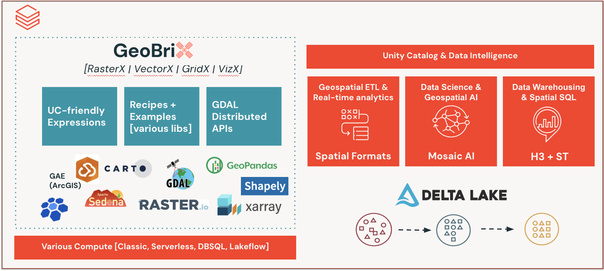

import CodeFromTest from '@site/src/components/CodeFromTest';
import GeoBrixLogo from '../../resources/images/brand/GeoBriX.png';

# Introduction

GeoBrix is a high-performance [Databricks Labs](https://www.databricks.com/learn/labs) spatial processing library. It has one function set and one Python API. The **lightweight** implementation is pure Python/PySpark (no JAR, no native GDAL; runs on Serverless, standard/shared, Lakeflow, and ARM compute). The **heavyweight** implementation is Scala/GDAL on Apache Spark, for dedicated clusters. Put the GeoBrix JAR beside the env wheel, or use the GeoBrix [DCS image](./installation/dcs.mdx); see [Choose an install path](./installation.mdx#choose-an-install-path). `gbx.register(spark)` picks the faster one for the compute, so your code does not change. The lightweight implementation covers all of **RasterX**. It covers all of **VectorX** (MVT, TIN surfaces, legacy-geometry migration). It covers all of **GridX** (CARTO quadbin, British National Grid (BNG), custom grids, and H3). RasterX's lightweight implementation is, in large part, [distributed rasterio](./api/rasterio-distributed): the familiar rasterio/NumPy raster stack run as Spark UDFs across the cluster. See [Surfaces and levels](./api/execution-tiers).

{/*
  Function counts — generated from python/geobrix/src/databricks/labs/gbx/manifest/functions.json
  (the canonical source; `gbx:manifest:gen --check` guards them).
  Update these numbers if functions are added or removed.
*/}

  {/* Total — wider box that encloses the logo above the count */}
  

    
    
256

    
Functions

  

  {[
    {n: '165', label: 'RasterX'},
    {n: '66', label: 'GridX'},
    {n: '24', label: 'VectorX'},
    {n: '1', label: 'PMTiles'},
  ].map((s) => (
    

      
{s.n}

      
{s.label}

    

  ))}

{/* BEGIN GENERATED counts: edit manifest/functions.json, then run gbx:manifest:gen */}
GridX's 66 functions break down as **BNG (27)**, **Quadbin (17)**, **custom grids (15)**, and **H3 (7)**.
{/* END GENERATED counts */}

## Supported Databricks Runtimes

GeoBrix supports the following Databricks Runtime releases. A **single wheel + single JAR** runs on **17.3, 18, and 19**. Scala 2.13 minor versions are binary-compatible. The JAR is compiled to Java-17 bytecode so it loads on all three JVMs, and Spark is a `provided` dependency.

| DBR | Ubuntu | Spark | Python | Scala | Java | GeoBrix |
|---|---|---|---|---|---|---|
| **17.3** | 24.04 | 4.0.0 | 3.12.3 | 2.13.16 | 17 | ✅ Supported |
| **18** | 24.04 | 4.1.0 | 3.12.3 | 2.13.16 | 21 | ✅ Supported |
| **19** | 24.04 | 4.2.0 | 3.12.3 | 2.13.18 | 21 | ✅ Supported |

GeoBrix Light is **Serverless-first**. Install the env wheel for your runtime: `geobrix-<version>+env6` on Serverless environment v6 (recommended) and DBR 19, `geobrix-<version>+env5` on environment 5 and DBR 17.3 / 18. There is no light extra to pick. See [Installation](./installation#whl-only) for details.

## Background

Product built-in [Spatial SQL Functions](https://docs.databricks.com/aws/en/sql/language-manual/sql-ref-st-geospatial-functions) have reached public preview as of DBR17.1. We are now seeking to deliver the next generation of product-augmenting capabilities to help our customers. GeoBrix project is a streamlined iteration to the existing, and quite popular, [DBLabs Mosaic](https://databrickslabs.github.io/mosaic/index.html) project. 

Beyond just porting existing Mosaic code, GeoBrix is modernized with expressions designed to work with our [Data Intelligence Platform](https://www.databricks.com/product/data-intelligence-platform). GeoBrix will be a combination of heavy-weight (e.g. JAR) as well as lightweight (e.g Python, SQL) code artifacts. It also will focus on techniques to use the Databricks platform more widely.

## Why GeoBrix?

Databricks first acquired [MosaicML](https://www.databricks.com/company/newsroom/press-releases/databricks-completes-acquisition-mosaicml) and has now made a product line, [Mosaic AI](https://www.databricks.com/product/artificial-intelligence). It has become clear that the DBLabs Mosaic project, which shares the name, needs to be revamped in name. Existing Mosaic capabilities that compete with product investments need to be revamped too. 

If this were not the case, we would have simply iterated on DBLabs Mosaic "in-place" keeping the same name for what is now called GeoBrix. DBLabs Mosaic is in maintenance mode. The latest/last version of Mosaic targets DBR 13.3 LTS since product introduced ST functions starting with private preview work in DBR 14. As such, Mosaic does not have any awareness of advancements in recent runtimes, including product support for spatial sql and types. It will be retired with [DBR 13.3 EoS](https://docs.databricks.com/aws/en/release-notes/runtime/#supported-databricks-runtime-lts-releases) in AUG 2026.

## Key Features

- **High Performance**: Built on Apache Spark for distributed processing
- **GDAL-Powered**: Leverages GDAL for heavy-weight spatial operations
- **Databricks Native**: Designed specifically for Databricks Runtime
- **Multi-Language Support**: APIs available in Scala, Python, and SQL
- **Comprehensive Readers**: Support for various geospatial file formats
- **Three Specialized Packages**: RasterX, GridX, and VectorX for different spatial needs

## What's Next?

- [Install GeoBrix](./installation) on your Databricks cluster
- Follow the [Quick Start Guide](./quick-start) to get up and running
- Explore the [Functions](./api/overview) to understand what GeoBrix offers
- Check out the [Readers](./readers/overview) for data ingestion options
- Keep tables in sync with landing folders with [Ingestion Pipelines](./ingestion/overview)
