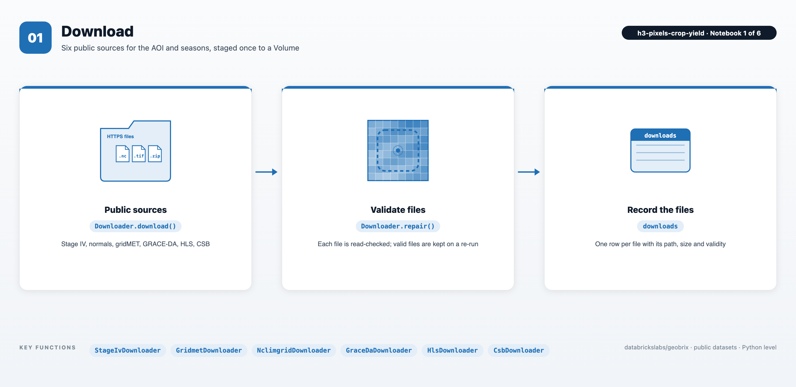
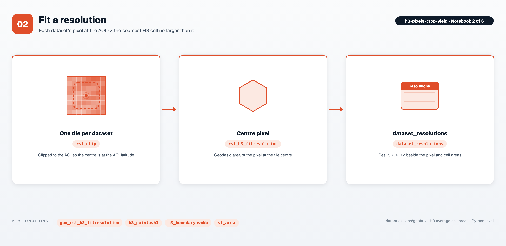
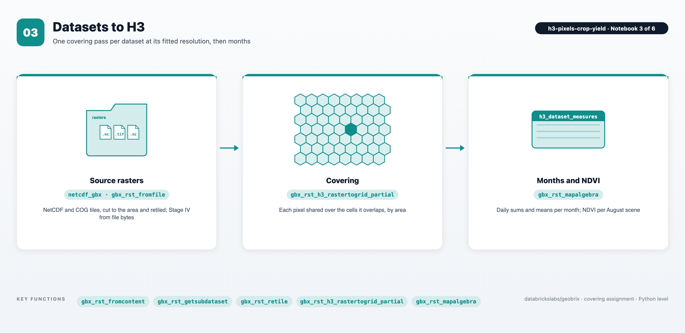
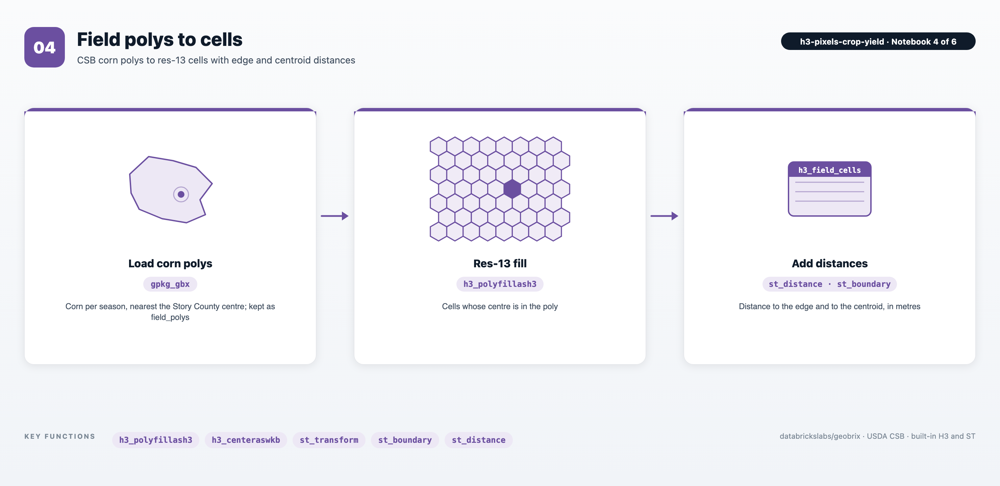
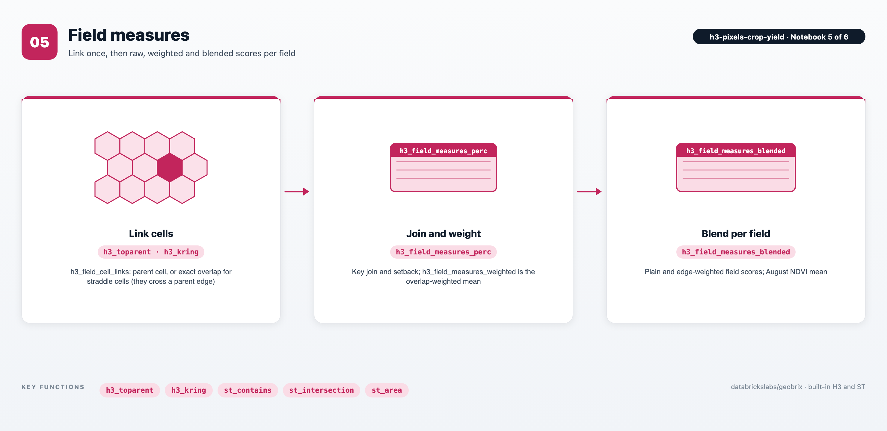
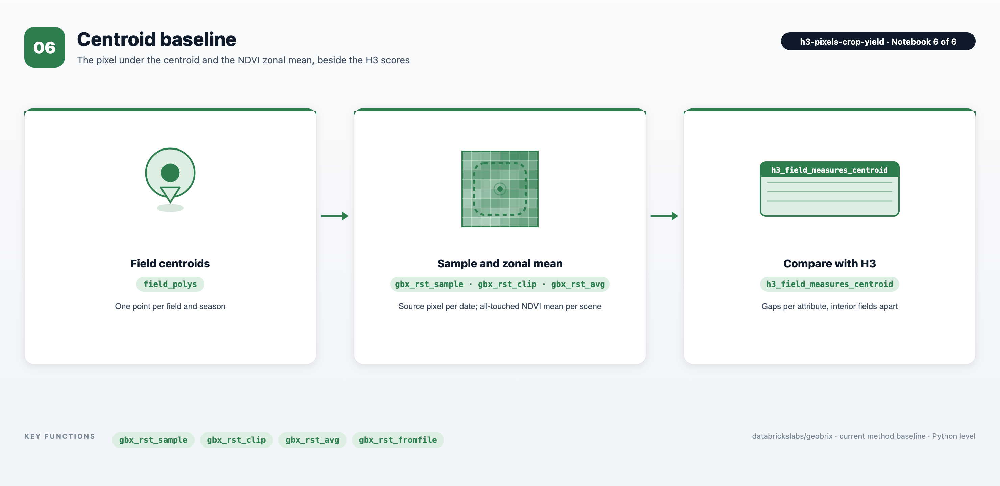

import Tabs from '@theme/Tabs';
import TabItem from '@theme/TabItem';

# H3 Pixels — Crop Yield Features

Turn a corn-yield model's raster inputs into H3 features per field. The series puts six public datasets for Iowa on H3, each at a resolution fitted to its pixels. It then scores every field poly on res-13 cells and compares the result with the pixel under the field centroid.

:::note Minimum GeoBrix version
GeoBrix 0.6.1 or newer. The series uses `gbx_rst_h3_fitresolution` and the crop-data downloaders. `netcdf_gbx` must honour `bbox`, which it does from 0.6.1.
:::

<Tabs groupId="h3-pixels-flavor" queryString="flavor">
<TabItem value="notebooks" label="Notebook Series" default>

## Notebook series {#notebook-series}

Each weather, soil and vegetation dataset goes onto H3 once, at the resolution that fits its pixel. USDA field polys become res-13 cells. Field cells then join to dataset cells on integer keys. The result is a score per field, per attribute and per date, ready for a model.

:::tip View on GitHub
**[examples/notebooks/h3-pixels-crop-yield](https://github.com/databrickslabs/geobrix/tree/main/examples/notebooks/h3-pixels-crop-yield)**: open the series from a Git folder, or download the folder and import it into your workspace.
:::

:::info Runs on Serverless by default
The series runs on Serverless environment 6 with the `+env6` env wheel, at the Python level, with no JAR. HLS and GRACE-DA need an Earthdata Login token in a Unity Catalog secret. See [Choose an install path](../installation#choose-an-install-path).
:::

:::note Data sources
Precipitation is the NWS Stage IV daily CONUS NetCDF, with the NCEI 2006-2020 monthly normals beside it. Wind is gridMET. Groundwater and soil moisture are NASA GRACE-DA. Vegetation is NASA HLS (Landsat and Sentinel-2 at 30 m). Field polys are the USDA NASS Crop Sequence Boundaries (CSB). NOAA nClimGrid monthly precipitation is an optional cross-check.
:::

### 01 — Download



- Download Stage IV, the 2006-2020 precipitation normals, gridMET wind, GRACE-DA, HLS and CSB for the area and seasons.
- A re-run keeps valid files and fetches only missing or broken ones.
- The national CSB zip is fetched once and clipped to Iowa.

### 02 — Fit a resolution



- `gbx_rst_h3_fitresolution` returns the coarsest H3 resolution whose average cell is no larger than the pixel.
- Stage IV, the normals and gridMET fit res 7, GRACE-DA res 6, HLS res 12.
- Field cells use res 13, at least as fine as the finest dataset.

### 03 — Datasets to H3



- Covering assignment shares each pixel over the cells it overlaps, so a cell holds the area-weighted mean.
- `pixel_weight` is the sum of the pixel-area shares in a cell, not a pixel count.
- Daily totals and weeks become months. HLS scenes become NDVI with the cloud bit masked.

### 04 — Field polys to cells



- `h3_polyfillash3` fills each corn field poly with res-13 cells whose centre is inside.
- Each cell keeps its distance to the edge and to the centroid; a 10 m setback drops the edge cells.
- The setback applies in notebook 05, so changing it needs no re-fill.

### 05 — Field measures



- A field cell links to its dataset cell once; a cell that straddles more than one gets exact overlap shares.
- Field scores are a plain mean and an edge-weighted mean, `w = min(1, d / 30 m)`.

### 06 — Centroid baseline



- The baseline samples each source raster at the field centroid and takes an all-touched NDVI mean per field.
- The notebook compares the baseline with the H3 scores, interior fields apart from edge fields.

## Measured on the demo area {#measured}

Measured on Serverless environment 6 for the 2023 season in Story and Boone counties.

| Measure | Value |
|---|---|
| Corn field polys | 3,500 (of 5,250 in the two counties) |
| Res-13 field cells / after the 10 m setback | 18,557,719 / 16,865,043 |
| Raw rows (`h3_field_measures_perc`), size and write time | 782,383,772 rows, 5.3 GB, 1 min |
| H3 covering time per HLS scene at res 12 | 24 s for 3.1 million cells with a valid pixel; 85 s for 15.5 million cells with every covered cell |

## Tables {#tables}

| Notebook | Table | One row per |
|---|---|---|
| 01 | `downloads` | staged file |
| 02 | `dataset_resolutions` | dataset |
| 03 | `h3_dataset_measures` | dataset, date, attribute, cell |
| 04 | `field_polys`, `h3_field_cells` | field poly per season; res-13 cell of a field |
| 05 | `h3_field_cell_links` | field cell and overlapping dataset cell |
| 05 | `h3_field_measures_perc`, `_weighted`, `_blended` | raw overlap row; field cell; field |
| 06 | `h3_field_measures_centroid` | field, attribute and date |

## Files {#files}

| File | Purpose |
|---|---|
| `config_nb.ipynb` | Shared setup, run with `%run ./config_nb`. Installs the wheel, registers GeoBrix, and holds the settings, the Volume tree, the downloaders and the helpers. |
| `01_download.ipynb` | Stages every dataset for the area and seasons. |
| `02_fit_resolution.ipynb` | Fits an H3 resolution per dataset. |
| `03_datasets_to_h3.ipynb` | Puts each dataset on H3 at its fitted resolution. |
| `04_field_polys.ipynb` | Loads CSB corn polys and fills them with res-13 cells. |
| `05_field_measures.ipynb` | Links field cells to dataset cells, then scores them. |
| `06_centroid.ipynb` | Runs the centroid baseline and the comparison. |

## Prerequisites {#prerequisites}

- **Serverless environment 6.** The series runs at the Python level, with no JAR.
- **The `+env6` wheel.** `config_nb` installs it from the sample-data Volume, with the `vizx` extra.
- **Unity Catalog.** Set `catalog_name` and `schema_name` in `config_nb`. A Volume named `data` must already exist under the schema.
- **An Earthdata Login token.** GRACE-DA and HLS need it. `config_nb` reads it from the Unity Catalog secret named by `EARTHDATA_UC_SECRET`. Without it, the other datasets still run.
- **Network access.** All downloaders fetch over HTTPS.

## Run order {#run-order}

1. Open `config_nb.ipynb`. Set `catalog_name` and `schema_name`, and check that the Volume exists.
2. Run the notebooks in order: 01, 02, 03, 04, 05, 06. Each starts with `%run ./config_nb`.

Each notebook is safe to re-run. Set `FORCE_REBUILD = True` after `%run ./config_nb` to rebuild its outputs.

The area is Story and Boone counties. `SEASONS` defaults to `[2023]`, and any season from 2018 to 2025 works without a new CSB download. `FULL_AOI = True` switches downloads and the dataset layer to all of Iowa.

## Data flow {#data-flow}

```text
Stage IV, normals, gridMET, GRACE-DA, HLS  ──>  downloads
                                                   │
                       dataset_resolutions (a fitted resolution per dataset)
                                                   │
                                          h3_dataset_measures
                                                   │
CSB ──> field_polys ──> h3_field_cells ────────────┤
                                                   ▼
                                          h3_field_cell_links
                                                   │
                                          h3_field_measures_perc
                                                   │
                                          h3_field_measures_weighted
                                                   │
                                          h3_field_measures_blended

source rasters + field_polys  ──>  h3_field_measures_centroid
```

## Key functions {#functions}

- GeoBrix: [`gbx_rst_h3_fitresolution`](../api/raster-functions.mdx#rst_h3_fitresolution), `gbx_rst_h3_rastertogrid_partial`, `gbx_rst_retile`, `gbx_rst_mapalgebra`, `gbx_rst_sample`, `gbx_rst_clip`, `gbx_rst_avg`, `gbx_rst_fromfile`, `gbx_rst_fromcontent`, `gbx_rst_getsubdataset`, and the `netcdf_gbx` (with `bbox` and `bandDim`) and `gpkg_gbx` readers.
- Databricks built-ins: `h3_polyfillash3`, `h3_toparent`, `h3_kring`, `h3_boundaryaswkb`, `h3_centeraswkb`, `h3_pointash3`, `st_transform`, `st_distance`, `st_boundary`, `st_centroid`, `st_contains`, `st_intersects`, `st_intersection`, `st_area`.
- See [Choosing a resolution](../api/grid-raster-tessellation.mdx#choosing-a-resolution) and the [crop-data downloaders](../sample-data/overview.mdx#bring-your-own-aoi-downloaders).

## Gotchas {#gotchas}

- **No HLS before 2013.** Landsat HLS starts in April 2013, and Sentinel-2 HLS has full seasons from 2016. CSB windows start earlier.
- **HLS tiles overlap.** A pixel seen in two neighbouring tiles enters a cell twice. The mean barely moves, but `pixel_weight` doubles there.
- **`FULL_AOI` field tables are huge.** All Iowa corn at res 13 is about 1.2 B cells. Use `FULL_AOI` for downloads and the dataset layer only.
- **The Stage IV 12Z day.** A file dated D is the 24 hours ending 12Z on D. The series counts it for D − 1.
- **A missing Stage IV day.** If the NWS archive lacks a day, the downloader raises. The error names NCAR GDEX d507005, where the archive keeps the day.
- **The normals overlap model years.** The 2006-2020 normals include seasons you may train on. Keep that in mind before a model uses the anomaly.

## Related {#related}

- [Choosing a resolution](../api/grid-raster-tessellation.mdx#choosing-a-resolution)
- [Raster functions](../api/raster-functions.mdx)
- [Bring-your-own-AOI downloaders](../sample-data/overview.mdx#bring-your-own-aoi-downloaders)
- [Examples overview](../examples/overview.mdx)

</TabItem>
</Tabs>
