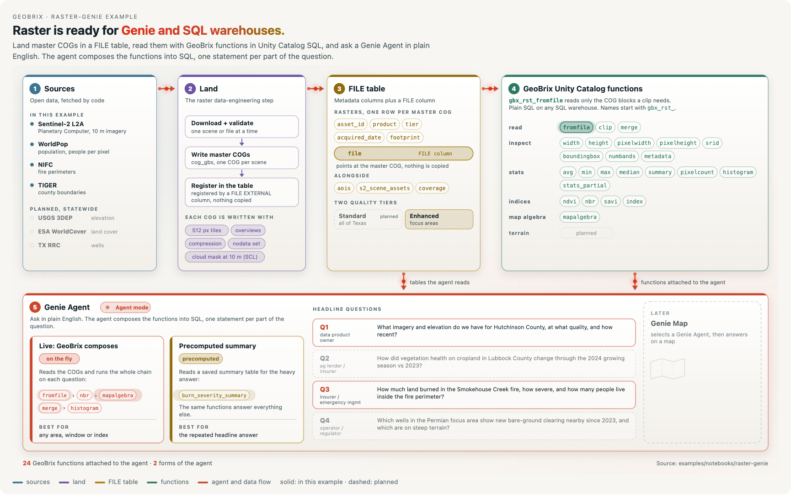

# Raster Genie — Raster in FILE Columns, Queried in SQL and Asked in Plain English

An end-to-end example that lands Cloud Optimized GeoTIFFs (COGs) in **FILE** columns and queries them with the `gbx_rst_*` functions in plain SQL. It then asks a **Genie Agent** the same questions in plain English.

The notebook works one event: the **2024 Smokehouse Creek fire** in the Texas Panhandle. It answers three questions from Sentinel-2 and WorldPop rasters: how much land burned, how severe it was, and how many people live there.

It takes the data through five steps:

1. **Land** the incident perimeter, the counties it touches, Sentinel-2 scenes from before and after the fire, and WorldPop population.
2. **Stack** each Sentinel-2 scene into one seven-band master COG, and register every COG in a `rasters` table through a `FILE EXTERNAL` column. Nothing is copied.
3. **Query** burn severity in SQL. `gbx_rst_fromfile` reads only the COG blocks the perimeter needs. `gbx_rst_nbr` and `gbx_rst_mapalgebra` build the burn index. `gbx_rst_histogram` counts the severity classes.
4. **Map** the severity classes over an Esri basemap.
5. **Ask** two Genie Agents the same question and compare the SQL each one wrote and the time each one took.



:::tip View on GitHub
**[examples/notebooks/raster-genie](https://github.com/databrickslabs/geobrix/tree/main/examples/notebooks/raster-genie)** — open the series from a Git folder, or download the whole folder, and import `config_nb.ipynb` and `01_smokehouse_creek.ipynb` into your Databricks workspace to run.
:::

`genie/seed_agent.py` creates two Genie Agents for the example. The live agent, below, answers from the four tables and composes the GeoBrix Unity Catalog raster functions itself, starting from `gbx_rst_fromfile` on the `rasters` FILE table.


:::info Runs on Serverless by default
`config_nb` installs the `geobrix[stac,vizx,databricks]` env6 wheel, so the notebook runs on **Serverless environment 6** with no JAR. The `gbx_rst_*` functions run in the session at the Python level. The same calls run in Unity Catalog once the GeoBrix Unity Catalog functions are installed. See [Query FILE columns from Unity Catalog](../readers/file#query-file-columns-from-unity-catalog), [Choose an install path](../installation#choose-an-install-path) and [Surfaces & Levels](../api/execution-tiers).
:::

:::note Data sources
Sentinel-2 L2A comes from Microsoft Planetary Computer through [`StacClient`](../api/stac). The incident perimeter comes from NIFC WFIGS through [`FirePerimeterDownloader`](../sample-data/fire-perimeter-downloader). Population comes from WorldPop through [`WorldPopDownloader`](../sample-data/worldpop-downloader). County and state boundaries come from the US Census TIGER cartographic files. The notebook fetches all of them over HTTPS, so it runs online only.
:::

---

## What the notebook shows

### FILE columns and master COGs

Each Sentinel-2 scene becomes one seven-band master COG. The bands are B02, B03, B04, B08, B11, B12 and the scene classification layer (SCL). The COG has 512-pixel blocks, average overviews at 2, 4, 8 and 16, and nodata 0.

The scene is cloud-masked once, when the COG is written. SCL classes 0, 1, 3, 8, 9, 10 and 11 become nodata in the reflectance bands at 10 m. No query needs an SCL mask afterwards. SCL stays as band 7, valid at full resolution only.

The `rasters` table has one row per COG. Its `FILE EXTERNAL` column points at the COG on the Volume. The table is the catalog, and Unity Catalog opens the file under the caller's grants. The committed run holds 9 assets: 8 Sentinel-2 scenes (3.43 GB over about 32,885 km²) and 1 population COG.

### Windowed reads and burn severity in SQL

`gbx_rst_fromfile(file, 'GTiff', <perimeter>, 'EPSG:4326', <resolution>)` reads only the COG blocks the perimeter needs, at a suitable overview. See [Read a window of a raster file](../api/uc-functions#read-a-window-of-a-raster-file).

A Unity Catalog function can return at most 64 MiB. The notebook sizes the perimeter's window first. At 20 m the window is 306.5 MiB. The read steps up through the 40 m overview to the 80 m overview, where each window is 19.2 MiB.

One SQL statement turns a pre-fire and a post-fire scene of each tile into dNBR severity classes (Key and Benson, 2006; USGS):

- **Pair** each tile's pre and post scene, on the same relative orbit where possible.
- **Index** each read with `gbx_rst_nbr`, then **difference** the pair with `gbx_rst_mapalgebra`.
- **Offset** each tile's dNBR by the mean dNBR of its unburned reference ring, the band 1 to 5 km outside the perimeter.
- **Classify** into five classes, **merge** the tiles with `gbx_rst_merge`, and **count** the pixels per class with `gbx_rst_histogram`.

The answer is saved as `burn_severity_summary`. WorldPop gives the people inside the perimeter, as the pixel mean times the count of valid pixels.

### The Genie Agents

A Genie Agent is given the same tables, the `gbx_rst_*` functions and a short set of instructions. It writes the query itself from a plain-English question, in Agent mode. [`databricks.labs.gbx.genie`](../api/genie) builds the spaces and asks the question.

There are two agents over the same data and the same attached functions:

- The **live** agent computes the whole answer from the COGs, following the method its instructions teach.
- The **precomputed** agent reads the saved `burn_severity_summary` table for severity. It uses the functions for everything else, such as another area, resolution or statistic.

Both spaces hold `rasters`, `aois`, `s2_scene_assets` and `coverage`. The precomputed space also holds `burn_severity_summary`. Both attach 24 GeoBrix `gbx_rst_*` functions from `geobrix_uc`. The notebook prints each agent's SQL, answer and time.

---

## Results in the committed run

The perimeter holds data over 1,053,900 acres. The burned total is the low, moderate-low, moderate-high and high classes together.

| Class | Severity | Acres | Share of valid pixels |
|---|---|---|---|
| 1 | Unburned | 421,906 | 40.0% |
| 2 | Low | 582,790 | 55.3% |
| 3 | Moderate-low | 46,779 | 4.4% |
| 4 | Moderate-high | 2,377 | 0.2% |
| 5 | High | 48 | 0.0% |

- **Burned land:** 631,994 acres at low severity or worse.
- **People:** about 3,849 inside the perimeter (WorldPop 2020). The count covers the whole perimeter, burned or not.
- **Agents:** the live agent answered in 151.8 s and the precomputed agent in 29.01 s. Both gave the same class table. They differ by one acre in the burned total, 631,993 against 631,994, from rounding.

These numbers come from one run. Read them with these points in mind:

- **Winter grass and brush.** The classes follow a table written for forest burns. A grass fire changes NBR far less than a forest fire, so most of this fire falls in the lower classes. The classes say more about relative severity than about absolute fuel loss.
- **The offset.** The ring offset removes the background difference between scene pairs. It cannot say which pair is nearer the truth, and it is only as good as the ring is unburned.
- **Overlapping tiles.** Where Sentinel-2 tiles overlap, a result depends on which tile's pixels win the merge. `gbx_rst_merge` applies a fixed order, and the last tile in that order wins. For Hutchinson County, an independent check of the area at moderate-low or worse gives two results. It finds 3,841 acres with the tile that wins the merge, and 3,010 acres with the other tile. The effect on the perimeter totals has not been measured.
- **Population coverage.** The population row of `coverage` shows a valid percent below 1%. WorldPop's constrained grid is nodata wherever nobody lives, so most pixels of a rural window hold no value.

---

## Files

| File | Purpose |
|---|---|
| `config_nb.ipynb` | Shared setup, run with `%run ./config_nb`. It installs the env6 wheel, registers the functions with `gbx.register(spark)` and holds the user settings: `catalog_name`, `schema_name`, the fire, the pre and post windows, `MAX_CLOUD`, `MAX_NODATA`, `BURN_RES_M`, `GENIE_SPACE_ID` and `GENIE_SPACE_ID_PRECOMPUTED`. It creates the schema and a `data` Volume. |
| `01_smokehouse_creek.ipynb` | The walk-through: `aois`, Sentinel-2 master COGs, WorldPop, the `rasters` FILE table, the `coverage` view, the burn severity query, a map and the Genie Agents. |
| `genie/agent_spec.py` | The two Genie Agents: their tables, attached GeoBrix functions, instruction text and example SQL. |
| `genie/seed_agent.py` | Creates or updates a Genie space from `agent_spec` and prints its id. Use `--variant live` or `--variant precomputed`. |
| `genie/run_questions.py` | Asks one or both agents plain-language questions in Agent mode, several times each. It re-runs the agent's SQL on the warehouse, judges the rows and writes one row per run to `evidence.json`. |
| `lakeflow/land/scenes.py` | `stack_scene`: per-band Sentinel-2 files in, one master COG out. It has unit tests in `lakeflow/tests/`. |

The notebook writes these tables to `geospatial_catalog.raster_genie`:

- `aois`: the perimeter, the counties it touches and the Texas outline.
- `s2_scene_assets`: the Sentinel-2 scenes chosen.
- `rasters`: one row per master COG, with a `FILE EXTERNAL` column.
- `coverage` (view): what the series holds per product, tier and area.
- `burn_severity_summary`: the saved severity answer.

---

## Prerequisites

- **Serverless environment 6, or Databricks Runtime 19** (Python 3.12). The series needs no JAR.
- **GeoBrix** (version 0.6.0). `config_nb` installs the env6 wheel from the v0.6.0 GitHub release. For other installs, see [Installation](https://databrickslabs.github.io/geobrix/docs/installation).
- **The GeoBrix Unity Catalog functions**, installed in your catalog, if you want to query `rasters` from a SQL warehouse or Genie. The notebook itself calls the session functions. See [Unity Catalog functions](../api/uc-functions) and the [Unity Catalog SQL examples](../examples/uc-functions).
- **Unity Catalog permissions.** `config_nb` creates the schema and a Volume named `data` if they are missing. You need `CREATE SCHEMA` and `CREATE VOLUME` on the catalog.
- **The whole folder.** Notebook 01 imports `stack_scene` from `lakeflow/land/scenes.py`. Open the series from a Git folder, or copy `lakeflow/` next to the notebooks.
- **Genie spaces, for the last step only.** The spaces need a SQL warehouse and the GeoBrix Unity Catalog functions in `geospatial_catalog.geobrix_uc`. Until `GENIE_SPACE_ID` is set, the Genie step prints a message and skips. The precomputed agent is skipped while its id is empty.
- **Network access** to Planetary Computer, NIFC, WorldPop and Census.

---

## Run order

1. Open `config_nb.ipynb`. Check `catalog_name` and `schema_name`. Optionally set `GENIE_SPACE_ID` and `GENIE_SPACE_ID_PRECOMPUTED`.
2. Run `01_smokehouse_creek.ipynb` top to bottom. It starts with `%run ./config_nb`.
3. To ask the agents, create the two spaces with `genie/seed_agent.py` (once per variant). Paste the ids it prints into `config_nb`. Then run `genie/run_questions.py` with `--space both`.

The first run downloads the national WorldPop file once, about 0.5 GB, and the Sentinel-2 windows, a few GB. Every step is guarded: files already on the Volume are not downloaded again, and existing tables are not rewritten. A master COG written by an older `stack_scene` is rebuilt. Set `FORCE_REBUILD = True` in the cell right after `%run ./config_nb` to rebuild everything.

Run `run_questions.py` after the notebook, not during it. The notebook rewrites the tables the agents read. The script judges two of the questions against truth values recorded from one maintainer run. A different perimeter or scene pick needs refreshed truth values.

---

## Data flow

```text
NIFC WFIGS perimeter, Census TIGER counties            →  aois
Planetary Computer Sentinel-2 L2A (StacClient)         →  s2_scene_assets, band files
        │
        ▼  stack_scene: 7 bands, 512-px blocks, overviews, cloud-masked once
8 master COGs  +  1 WorldPop COG  (Volume)
        │
        ▼  FILE EXTERNAL column, nothing copied
rasters  ──▶  coverage (view)
        │
        ▼  gbx_rst_fromfile → gbx_rst_nbr → gbx_rst_mapalgebra → gbx_rst_merge → gbx_rst_histogram
burn_severity_summary  +  people inside the perimeter
        │
        ├─▶ severity map (vizx.plot_tile)
        └─▶ Genie Agents: live (from the COGs) and precomputed (from burn_severity_summary)
```

---

## Key GeoBrix functions shown

- **[`gbx_rst_fromfile`](../api/uc-functions#read-a-window-of-a-raster-file)** reads a window of a COG in a FILE column, clipped to a geometry and read at a chosen resolution.
- **`gbx_rst_nbr`, `gbx_rst_mapalgebra`, `gbx_rst_merge`, `gbx_rst_histogram`, `gbx_rst_avg` and `gbx_rst_pixelcount`** are [RasterX functions](../api/raster-functions). They build and count the severity classes and the population.
- **[`StacClient`](../api/stac)** searches Planetary Computer and downloads windowed band files.
- **[`FirePerimeterDownloader`](../sample-data/fire-perimeter-downloader)** and **[`WorldPopDownloader`](../sample-data/worldpop-downloader)** fetch the perimeter and the population grid.
- **[`databricks.labs.gbx.genie`](../api/genie)** builds a Genie space from tables, functions, instructions and example SQL, and asks it a question.
- **[`vizx.plot_tile`](../api/vizx)** draws the severity classes over a basemap.

For FILE columns see the [File reader](../readers/file). For preparing master COGs see the [COG writer](../writers/cog) and [Large Rasters](../api/large-rasters).
