import Tabs from '@theme/Tabs';
import TabItem from '@theme/TabItem';

# Vapor-Eyes — Permian Methane Monitoring

Vapor-Eyes works a satellite methane signal over the Permian Basin using [GeoBrix](https://databrickslabs.github.io/geobrix/)
on Databricks. It goes from a wide-area screen down to the operator whose well pad is leaking.
It comes in two flavors. One is a **Lakeflow pipeline** that can run
on a schedule to stay current. The other is an **interactive notebook series**. The series is more of a quick
start for understanding the GeoBrix functions involved in the detection cascade.

:::note Minimum GeoBrix version
- **Notebook series: GeoBrix 0.5.0 or newer (minimum)** — the series depends on capabilities introduced in
  0.4.1. These are the `netcdf_gbx` reader (Sentinel-5P swath → points) and the `TropomiDownloader` /
  `EmitDownloader` / `WellsDownloader` sample downloaders. It installs `geobrix[stac,vizx]` (the env6
  wheel, with `earthaccess` as a separate step; the env5 wheel on Serverless environment 5).
- **Lakeflow SDP pipeline: GeoBrix 0.6.0 or newer** — it reads its files with
  [`read_paths`](../ingestion/read-paths), new in 0.6.0. It installs the env wheel for its Lakeflow
  runtime channel (see the Lakeflow tab).
:::

<Tabs groupId="vapor-eyes-flavor" queryString="flavor">
<TabItem value="lakeflow" label="Lakeflow SDP + AI/BI Maps" default>

**Requires GeoBrix 0.6.0 or newer.**

A standalone Permian Basin methane-monitoring pipeline. It is a [Lakeflow Declarative Pipeline](https://docs.databricks.com/aws/en/dlt/) (SDP) plus an [AI/BI dashboard](https://docs.databricks.com/aws/en/dashboards/). It packages as a [Databricks Asset Bundle](https://docs.databricks.com/aws/en/dev-tools/bundles/) and runs at the GeoBrix Python level over Serverless compute.

This is the production counterpart to the notebook series (see the other tab). It uses the same Permian AOI and satellite sources. It runs on a schedule with incremental medallion tables instead of one-off notebook outputs. A fifth data source makes it a *current* (through 2026) monitoring view rather than a single historical case study.

:::tip View on GitHub
**[examples/notebooks/vapor-eyes/lakeflow](https://github.com/databrickslabs/geobrix/tree/main/examples/notebooks/vapor-eyes/lakeflow)** — the bundle, pipeline transformations, dashboard, and full setup instructions live here. See its [README](https://github.com/databrickslabs/geobrix/tree/main/examples/notebooks/vapor-eyes/lakeflow/README.md) for deploy/run steps, prerequisites, and good-citizen usage notes for Carbon Mapper.
:::

:::info Runs on Serverless
As of 0.6.0, Lakeflow Spark Declarative Pipelines run DBR 19 on the PREVIEW channel; the examples use it with the env6 wheel. The pipeline installs `geobrix[stac,vizx]` from the env6 wheel. Its `land` downloader task (Serverless environment version 6) installs the same wheel. To fall back to the CURRENT channel (DBR 18), set `pipeline_channel=CURRENT`, point `gbx_wheel` at the env5 wheel, and set the job `environment_version` to 5. Each task takes the staged wheel as a single pip dependency entry. The pipeline uses the `rasterx` and `vectorx` Python API with no JAR, on Serverless throughout. See [Surfaces & Levels](../api/execution-tiers).
:::

## How it works: from a raw satellite signal to a leaderboard

The bundle deploys one job, `vapor_eyes_lf_job`, with two tasks: `land` downloads the period's raw files, then `pipeline` refreshes the Lakeflow pipeline over them:

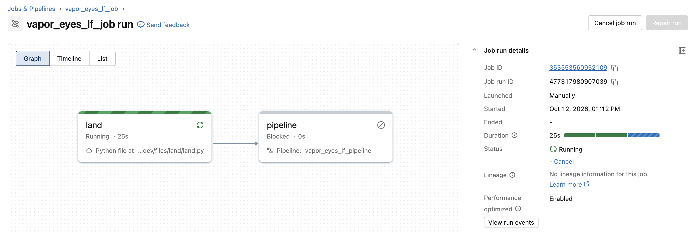

Opening the pipeline shows the lineage graph Lakeflow derived from the table-to-table dependencies, 34 tables in all. The streaming tables across the top (`s5p_granules`, `wells_raw`, `s2_swir_assets`, `emit_scenes`, `cm_scenes`) are the bronze inventory of what landed. The materialized views below them do the silver detection and attribution. They finish in the gold tables the dashboard reads, such as `plume_leaderboard_latest`, `operator_emissions_leaderboard`, and `cm_monitoring_status`. The PMTiles branch (`portfolio_mvt_tiles` → `pmtiles_shards`) runs alongside:

Every scheduled run turns raw satellite files into one ranked, map-ready answer — *who is leaking methane in the Permian, and where* — through five stages:

1. **Land** — a downloader task pulls the period's satellite scenes, plume catalogs, and well records onto a Unity Catalog Volume.
2. **Bronze — what landed** — Auto Loader records one row per file, lifting dates/IDs out of each filename, so re-runs pick up only new data.
3. **Silver — the detective work** — Sentinel-5P screens the basin for CH₄ hotspots. Sentinel-2 and EMIT sharpen and quantify a plume. Carbon Mapper adds current wind-corrected detections. The pipeline ties each plume to the operator whose well was valid *on the day it was seen*.
4. **Gold — ranked and map-ready** — findings roll up into the tables the dashboard reads. These tables are the leakiest-operators leaderboard, the monitoring panel, the regional CH₄ hotspot surface, and by-play / by-county rollups.
5. **Serve** — gold feeds the four-page AI/BI dashboard; a parallel branch folds the same findings into a self-contained PMTiles map you can drop into an app.

Each stage reads only the one before it. The pipeline declares these as table-to-table dependencies. Lakeflow then builds the lineage graph, orders the stages, and recomputes only what changed.

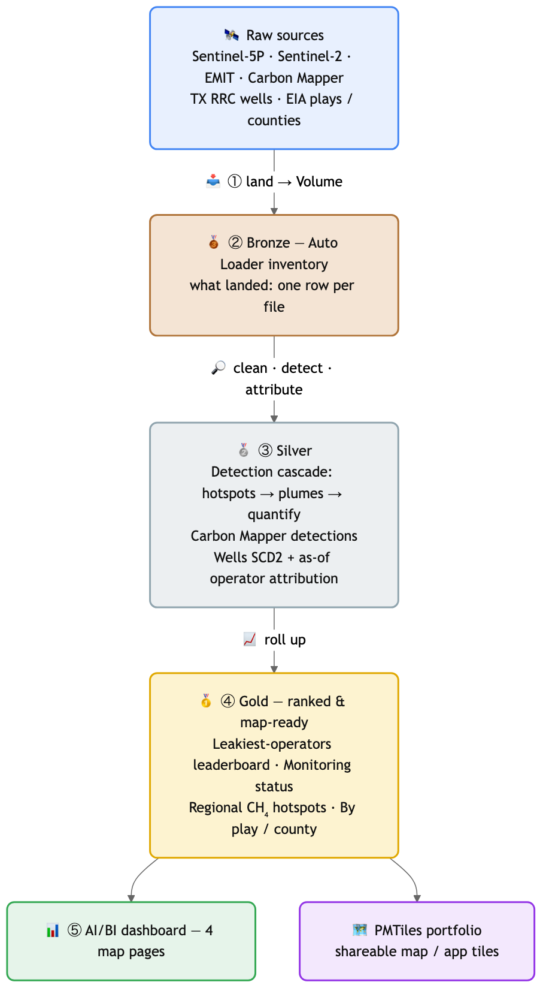

## What it uses from GeoBrix

- **Bronze**: plain Auto Loader `binaryFile` streams list the staged files, one row per file with the date and IDs lifted out of its name (`s5p_granules`, `s2_swir_assets`, `emit_scenes`, `wells_raw`). They read no payload data.
- **Silver**: [`read_paths`](../ingestion/read-paths) reads exactly the files an inventory lists. It reads the Sentinel-5P granules with `netcdf_gbx` (one point per observation, spread over 256 tasks) for `s5p_hotspots`. It reads the Sentinel-2 band files with `gtiff_gbx` for `s2_plume_cells`. Each row's `_source_path` joins it back to its inventory row. As a result, `observation_date`, `band` and `item_id` come from bronze. With `on_error="skip"`, the reader skips a file that cannot be read and writes a warning in the executor logs. The pipeline keeps going instead of failing the update. The pipeline pairs the Sentinel-2 B11 and B12 band files per scene (`item_id` plus `observation_date`), not just per date. Two scenes captured on the same day therefore each get their own index. The files never change once landed, so the example does not need `declare_ingest`. See [Lakeflow SDP](../ingestion/lakeflow-sdp) for the pipeline setup.
- **Detection and tiles**: RasterX (`rst_mapalgebra`, `rst_h3_tessellate`, `rst_clip`, `rst_summary`), VectorX MVT and PMTiles, on Serverless.

## Spatial functions used

The pipeline composes **GeoBrix** functions with Databricks' **built-in spatial SQL and H3**. RasterX does the raster ops, VectorX + PMTiles the tiles, and native `st_*` / `h3_*` the geometry and gridding. The `*_gbx` readers, run over the bronze inventories by `read_paths`, ingest on Serverless.

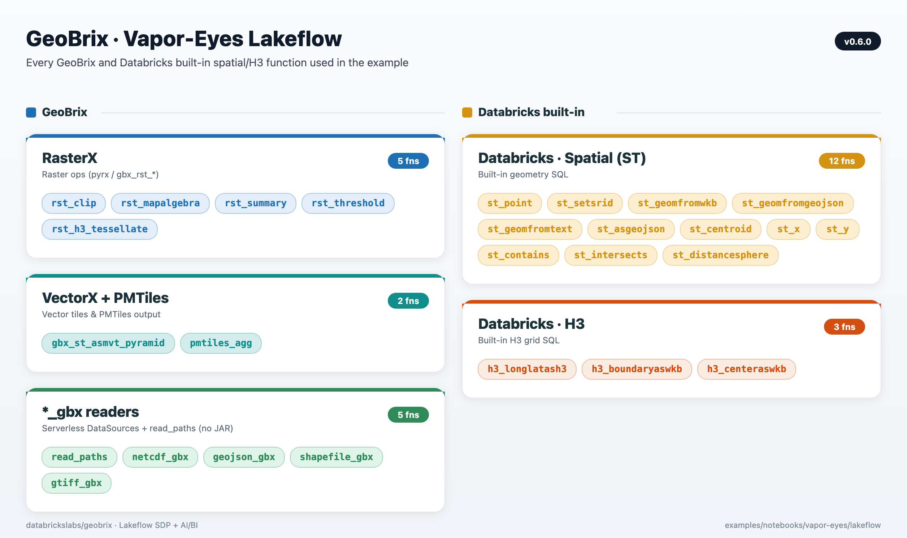

## Five data sources

| Source | License | Role |
|---|---|---|
| Sentinel-5P TROPOMI | Copernicus, open | Regional CH4 screen (H3 hotspot surface) |
| Sentinel-2 SWIR | Copernicus, open | Targeted band-ratio detection at the strongest hotspot |
| EMIT | NASA LP DAAC, open (Earthdata token) | Spectral validation — GeoBrix `rst_clip`/`rst_summary` cross-check against JPL's reported concentration |
| **Carbon Mapper Tanager** | Carbon Mapper, public-good (free token) | The authoritative **current**, quantified (`emission_rate_kg_hr`), wind-corrected plume layer |
| TX RRC WellSHL | Public (ArcGIS REST) | Attribution — nearest-well / operator lookup |

EMIT is a science mission on the ISS with sparse revisit and roughly a 10-month lag before plume products publish. It therefore validates historical detections rather than driving current status. Carbon Mapper is what keeps the pipeline current. It's the only source here with a wind-corrected emission rate. The headline leaderboard and monitoring-status panels are built on it.

Two small **context geometries** ride alongside: EIA shale plays and Census TIGER counties. The GeoBrix vector reader reads them straight from source. They give the detections a "where in the basin" home.

## The leaderboard, done defensibly

`operator_emissions_leaderboard` ranks operators by **number of high-confidence Carbon Mapper plume detections**, with mean/max per-detection emission rate (kg/hr) as the intensity columns — not a summed flow rate. A detection's `emission_rate_kg_hr` is an instantaneous rate at one overpass. Summing it across a multi-year window would double-count repeat detections of the same source rather than describe a continuous flow. The sum is therefore retained only as a clearly-labeled secondary column, never used to rank.

`cm_monitoring_status` and `cm_activity_monthly` give the "is anything active right now" read (last detection date, plumes in the trailing 90 days, active operators) and the month-by-month activity timeline. `hotspot_latest` and `hotspot_persistence` carry the Sentinel-5P side: a current regional CH4 screen and a chronic-vs-transient emitter view.

## Dashboard

Four pages, all built on AI/BI's native-geometry map widgets. They use H3 hexagon choropleths for the regional CH4 screen and region choropleths for the play and county rollups. A point map shows Carbon Mapper detections colored by emission rate.

### Current Status & Leakiest Operators

Monitoring-status KPIs, the operator leaderboard, and the Carbon Mapper point map with attribution.

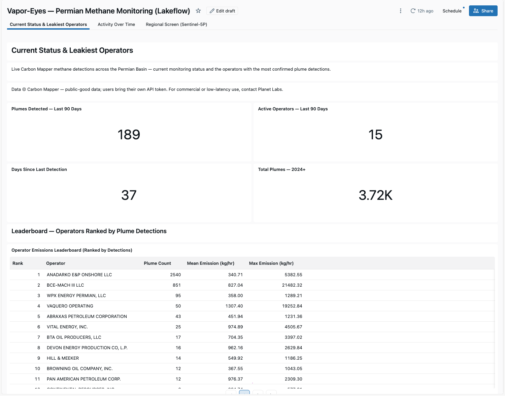

### Activity Over Time

Monthly Carbon Mapper activity and the regional CH4 trend, both scoped by a shared date-range filter.

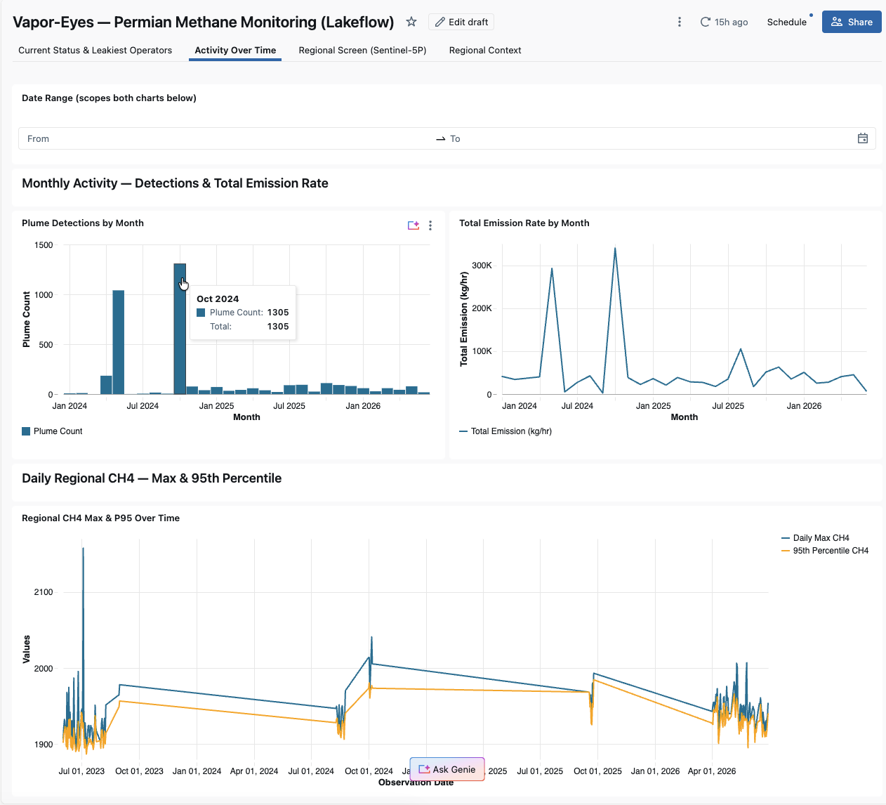

### Regional Screen (Sentinel-5P)

The wide-area CH4 hotspot choropleth and the persistence choropleth.

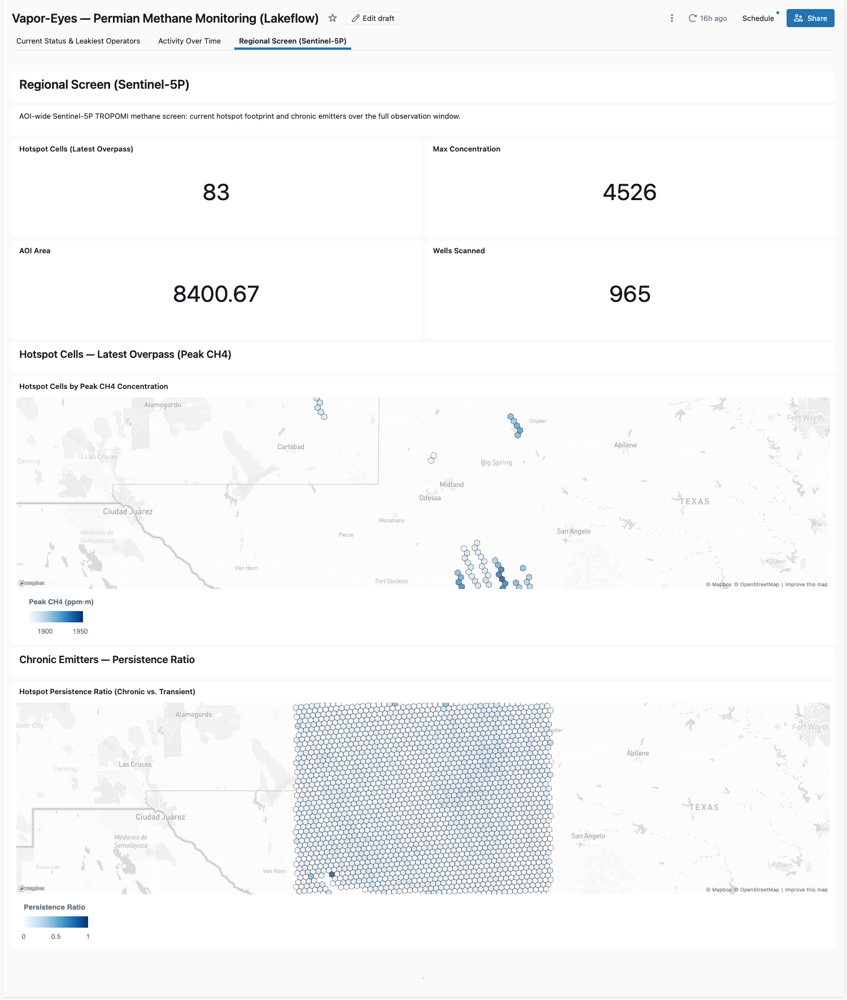

### Regional Context

This page rolls up Carbon Mapper detections to the Permian's named shale plays (EIA) and its TX/NM counties (Census TIGER). The GeoBrix vector reader reads the plays and counties straight from source. Two choropleths show where detections concentrate.

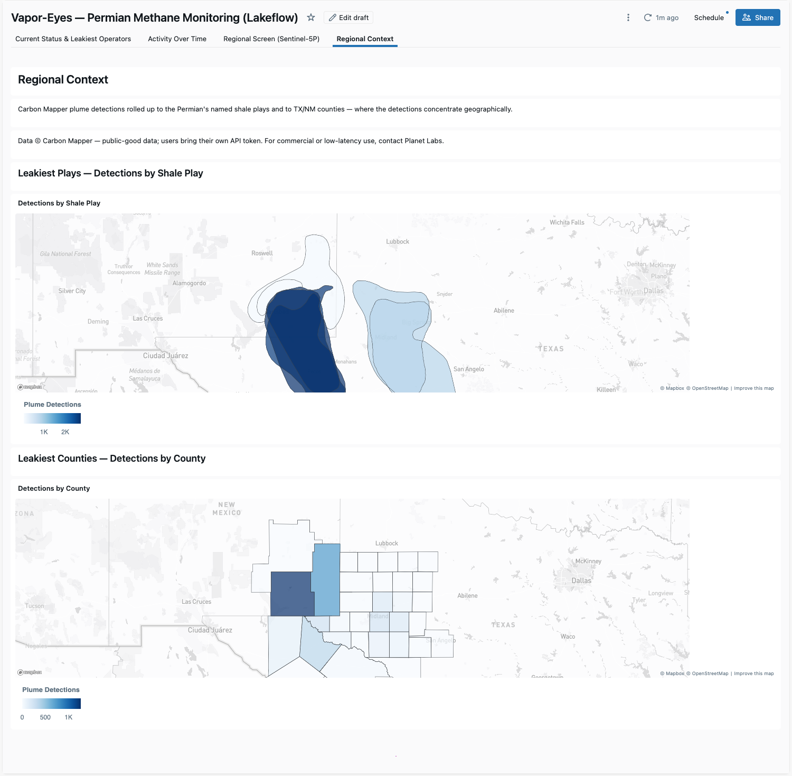

## Good-citizen use of Carbon Mapper

Carbon Mapper's plume catalog is public-good data. This example is built to use it responsibly. Every user brings their own free token (BYOT — the pipeline is a client, not a redistributor). The dashboard shows a "Data © Carbon Mapper" attribution wherever Carbon Mapper data appears. No Carbon Mapper data is ever committed to the repository. The pipeline fetches it at runtime straight to your own Unity Catalog Volume. This example is scoped for public-good analytics and demonstration; for commercial or low-latency operational use of Carbon Mapper/Tanager data, contact Planet Labs. See the [lakeflow README](https://github.com/databrickslabs/geobrix/tree/main/examples/notebooks/vapor-eyes/lakeflow/README.md#good-citizen-use--carbon-mapper) for the full terms-of-use notes and token setup.

</TabItem>
<TabItem value="notebooks" label="Notebook Series">

A five-notebook series that takes one Permian (Delaware Basin) bounding box. It works a satellite methane signal from a wide-area screen down to a named operator's candidate well pads. It then packages the whole result as a shareable [PMTiles](https://protomaps.com/docs/pmtiles) map. Each tier narrows and sharpens the last, composing GeoBrix functions with Databricks-native `st_*` / `h3_*` spatial SQL.

:::tip View on GitHub
**[examples/notebooks/vapor-eyes](https://github.com/databrickslabs/geobrix/tree/main/examples/notebooks/vapor-eyes)** — the five notebooks, shared `config_nb`, and full prerequisites live here. This is an interactive, historical case study you step through cell by cell; the other tab is the scheduled production version.
:::

:::info Runs on Serverless by default
The `rasterx` and `vectorx` Python API plus the `geobrix[stac,vizx]` env6 wheel (with `earthaccess` as a separate step) — no JAR. It features the net-new **`netcdf_gbx` reader** (`databricks.labs.gbx.ds`), which transcodes the Sentinel-5P netCDF-4 swath directly to points with no regridding. See [Surfaces & Levels](../api/execution-tiers).
:::

### 01 — Wide-area screening (Sentinel-5P)

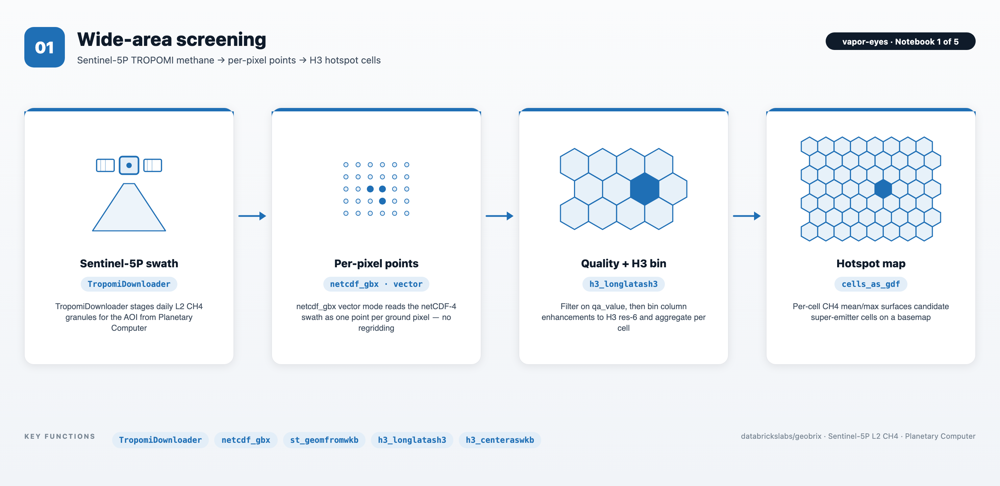

The `netcdf_gbx` reader transcodes each Sentinel-5P L2 CH4 granule to one point per ground pixel (no regridding, `qa_value` passed through). The `h3_longlatash3` function bins pixels into res-6 cells aggregated to per-cell CH4 mean/max, which is the candidate super-emitter surface. The strongest cell feeds NB02.

### 02 — Targeted detection (Sentinel-2 SWIR)

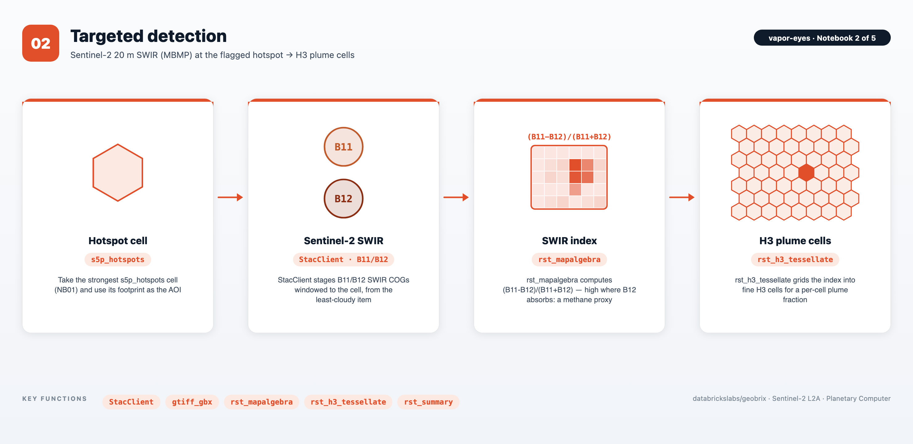

`StacClient` pulls the least-cloudy Sentinel-2 scene over the hotspot and downloads the B11/B12 SWIR assets windowed to the cell. The `gbx_rst_mapalgebra` function computes the `(B11 − B12)/(B11 + B12)` SWIR proxy, and `gbx_rst_h3_tessellate` shreds it into fine H3 plume cells. (Illustrative proxy, not an operational retrieval — EMIT is the purpose-built instrument.)

### 03 — Quantification (EMIT)

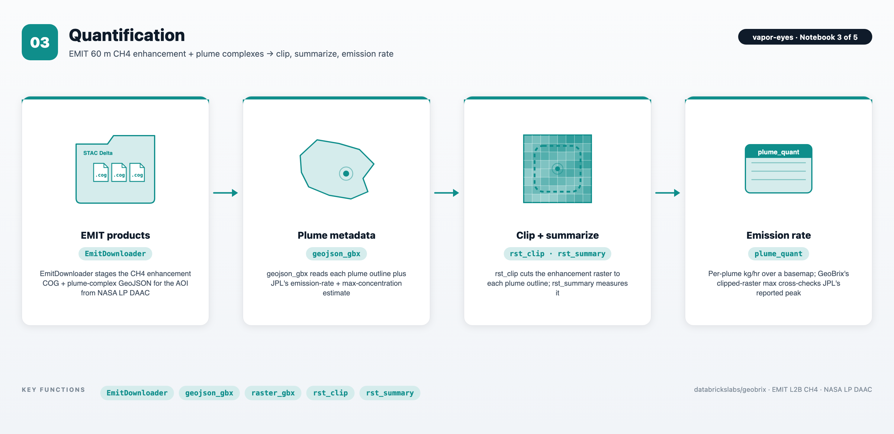

`EmitDownloader` stages the EMIT L2B CH4 enhancement COG and plume-complex GeoJSON (Earthdata-authenticated). The `gbx_rst_clip` function cuts the raster to each plume outline, and `gbx_rst_summary` measures it. GeoBrix's clipped-raster max reproduces JPL's reported max concentration, an independent cross-check on real product data.

### 04 — Attribution (TX RRC wells)

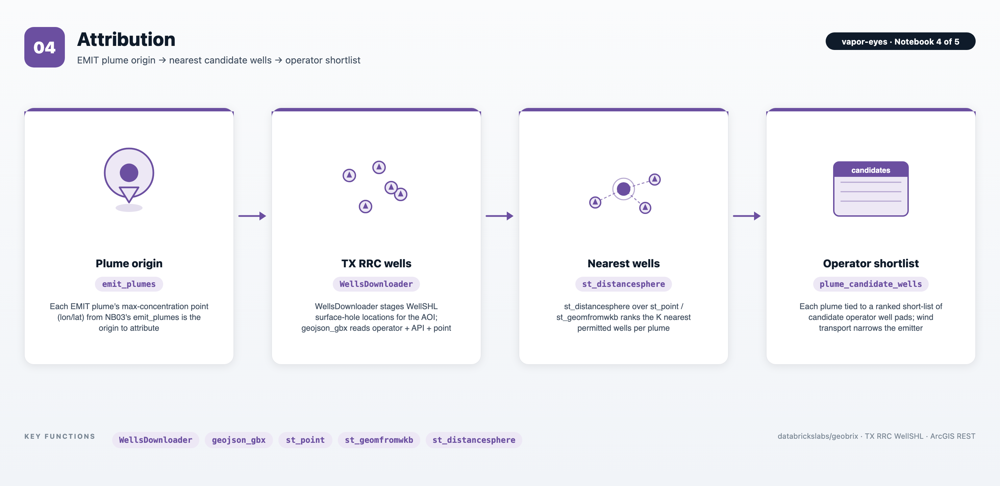

`WellsDownloader` pages the open TX RRC `WellSHL` service for wells in the AOI. The `st_distancesphere` function ranks the K nearest candidate wells per plume via a window function. This ties each plume to a short-list of candidate operator well pads. (Wind transport, not proximity alone, narrows the true super-emitter.)

### 05 — Synthesis (vector PMTiles portfolio)

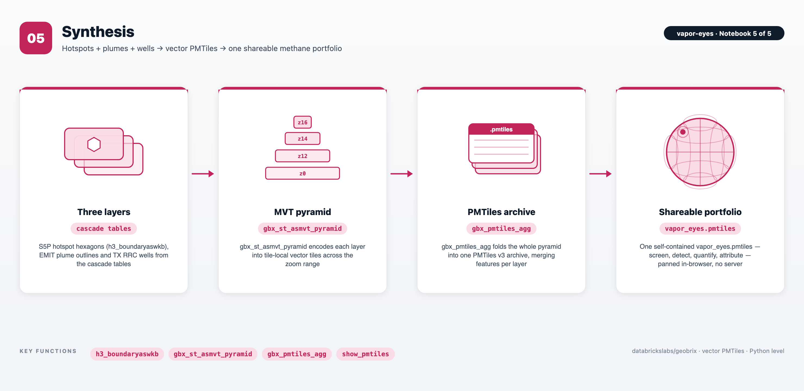

The cascade's three layers are S5P hotspot hexagons, EMIT plume outlines, and TX RRC wells. The `gbx_st_asmvt_pyramid` UDTF encodes them into tile-local Mapbox Vector Tiles across a basin-to-local zoom range. The `gbx_pmtiles_agg` function then folds them into a single `vapor_eyes.pmtiles` v3 archive. The archive is a self-contained methane portfolio anyone can pan and zoom in a browser, with no tile server.

</TabItem>
</Tabs>
