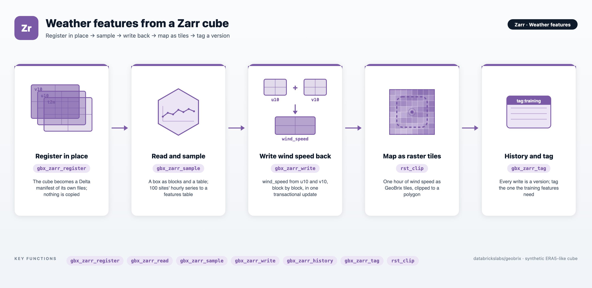

# Weather Features with Zarr — Register, Sample, Write Back and Version a Weather Cube

An end-to-end example showing how to run a feature workflow on a weather cube stored as Zarr, with GeoBrix's [transactional Zarr stores](../formats/zarr): every write is all-or-nothing, every version of the store stays readable, and the cube itself is never copied.

The notebook uses the GeoBrix sample cube: two days of synthetic, ERA5-like hourly weather on a global one-degree grid.

- **Dimensions:** `time` (48 hours) × `latitude` (181) × `longitude` (360).
- **Variables:** 2 m temperature (`t2m`), the 10 m wind components (`u10` and `v10`), and mean sea level pressure (`msl`).

It takes the cube through seven steps:

1. **Register** the cube in place as a Unity Catalog manifest table, without copying it: `gbx_zarr_register`.
2. **Read** a box over Europe, first as N-dimensional blocks and then as a table of cells: `gbx_zarr_read`.
3. **Sample** the hourly series at 100 sites into a features table: `gbx_zarr_sample`.
4. **Write back** a new variable. Wind speed is computed from `u10` and `v10`, block by block, and added to the store in one transaction: `gbx_zarr_write(mode="update")`.
5. **Look back** at the store's history, and read the store as it was before the write: `gbx_zarr_history` and `version_as_of`.
6. **Map** one hour of wind speed as raster tiles, first the whole grid and then clipped to a polygon around Australia: `gbx_zarr_read(output="tiles")` and `rst_clip`.
7. **Tag** the version the features came from, so it stays readable after the store's `retain` period: `gbx_zarr_tag`.



:::tip View on GitHub
**[examples/notebooks/zarr-weather-features](https://github.com/databrickslabs/geobrix/tree/main/examples/notebooks/zarr-weather-features)** — download `01_zarr_weather_features.ipynb` and import it into your Databricks workspace to run.
:::

:::info Runs on the lightweight tier (`geobrix[light_env6,zarr_env6,vizx]`)
Zarr stores run only in the **lightweight tier**, so there is no JAR. The notebook targets **Serverless environment 6** with the `geobrix[light_env6,zarr_env6,vizx]` wheel; on a classic **Databricks Runtime 19** cluster, install `geobrix[light_dbr19,zarr_dbr19,vizx]` instead (the same packages). The committed outputs are from a run on Serverless environment 6, and the notebook gives the same results on a Databricks Runtime 19 dedicated cluster. See [Zarr Stores](../formats/zarr#what-you-need) and [Execution Tiers](../api/execution-tiers).
:::

---

## Files

| File | Purpose |
|---|---|
| `01_zarr_weather_features.ipynb` | The walk-through: register → read → sample → write back → history → tiles → tag, with a last check that the cube's files are unchanged. |
| `README.md` | Setup instructions, requirements, and a summary of each step. |

---

## Prerequisites

- **Serverless environment 6, or Databricks Runtime 19** (Python 3.12). Zarr stores need one of the two.
- **GeoBrix** (version 0.6.0). The `%pip install` cell installs the wheel with the extras for your compute (above): the lightweight raster core, the Zarr libraries (`zarr`, `numcodecs`, `zarrs`, `tensorstore`, `obstore`) and the `vizx` plotting helpers. Point it at your staged `geobrix-0.6.0-py3-none-any.whl` if its Volume path differs from the default.
- **The sample cube.** The notebook reads `era5_like_v3.zarr`, a sharded Zarr v3 store of 19 files (about 3.6 MB). It is generated, not downloaded: run `write_era5_cube` from `databricks.labs.gbx.sample.zarr_era5` into a Volume of yours and point `CUBE` at it (see [the sample cube](../sample-data/raster-data#zarr---era5-like-weather-cube-global)).
- **A schema and a Volume you can write to.** The notebook creates two tables in `CATALOG.SCHEMA` (the store's manifest table and the features table) and writes the files of its writes to a folder under `WORK_DIR`. Each run gets its own `RUN_ID`, so its tables and folder never collide with another run's. The registered cube is only read.

---

## Run order

1. **Install and restart** — the `%pip install` cell is followed by `%restart_python`; run the cells in order without skipping the restart.
2. **Settings** — `CUBE`, `CATALOG`, `SCHEMA` and `WORK_DIR`; a new `RUN_ID` names this run's two tables and its folder. A fingerprint of the cube's files (19 files, 3,643,352 bytes) is taken before anything else.
3. **Register in place** — `gbx_zarr_register(spark, CUBE, STORE, writable=True, overlay_root=...)` lists the store's 19 objects (the documents of 7 arrays and 1 group, and 11 chunk and shard objects) and commits version 1. Nothing is copied. Writes to a writable registration go to its overlay folder; the cube itself is never written.
4. **Read a box** — `gbx_zarr_read` with `sel` (latitude 60 to 35, longitude 0 to 40, the first day) returns six blocks of 12 × 26 × 41 cells, one per variable and time chunk, then `output="table"` returns the same box as 25,584 cells.
5. **Sample 100 sites** — `gbx_zarr_sample` reads 100 seeded random points at their nearest cell for all 48 hours; with a derived `wind_speed` column (`sqrt(u10² + v10²)`) and the store version, they are saved as a 4,800-row features table.
6. **Write wind speed back** — a pandas UDF turns each pair of `u10` and `v10` blocks into a `wind_speed` block on the executors. A cell missing in either input stays missing. `gbx_zarr_write(..., mode="update", variables=["wind_speed"])` creates the new variable as one transaction: version 2. Sampled back at the sites, the stored variable equals the feature column in all 4,800 rows.
7. **History and the earlier version** — `gbx_zarr_history` lists the registration (version 1) and the update (version 2). Read with `version_as_of=1`, the store has only the four original variables, asking for `wind_speed` there raises an error with a `Fix:`, and `u10` is unchanged.
8. **Map as raster tiles** — `gbx_zarr_read(output="tiles", tile_size=(360, 181))` reads one hour of wind speed as one tile of the whole grid, drawn with `plot_raster`. `rst_clip` clips the same hour to a polygon around Australia: a window of 41 × 28 cells, where `rst_avg` and `rst_max` give a mean wind speed of 3.23 m/s and a maximum of 4.32 m/s (the maps have no colour scale, so these printed statistics are the values to read).
9. **Tag for training** — `gbx_zarr_tag(spark, STORE, "training", version_as_of=2)` names the version that holds every variable of the features. Sampling the sites with `version_as_of="tag:training"` gives back all 4,800 feature rows, with none different.
10. **Check the cube, and clean up** — the cube has the same files, sizes and modification times as before. The overlay holds 5 files, about 1.45 MB in all: the pack file of `wind_speed` and the folder's ownership records. `CLEAN_UP = True` drops the run's two tables and deletes its folder; the default keeps them.

---

## Data flow

```text
era5_like_v3.zarr  (time 48 x latitude 181 x longitude 360; t2m, u10, v10, msl; 19 files)
        │
        ▼  gbx_zarr_register(writable=True, overlay_root=...)      nothing copied
Manifest table era5_weather_RUN_ID  (Delta; a row per array document, shard and chunk)   [version 1]
        │
        ├─▶ gbx_zarr_read(sel=box)        6 blocks, then output="table": 25,584 cells
        │
        ├─▶ gbx_zarr_sample(100 sites)  ──▶  features table era5_site_features_RUN_ID
        │                                     4,800 rows (+ wind_speed = sqrt(u10² + v10²))
        │
        ▼  u10 + v10 blocks → wind_speed blocks (pandas UDF, on the executors)
           gbx_zarr_write(mode="update", variables=["wind_speed"])   → one pack file in the overlay
Manifest + wind_speed                                                                     [version 2]
        │
        ├─▶ gbx_zarr_history; gbx_zarr_read(version_as_of=1)
        │
        ├─▶ gbx_zarr_read(output="tiles") → plot_raster; rst_clip(Australia) → plot_raster
        │
        ▼  gbx_zarr_tag("training", version_as_of=2)
Tagged version: outlives retain and vacuum; the 4,800 feature rows reproduce from it
```

---

## Key GeoBrix functions shown

- **[`gbx_zarr_register`](../api/zarr-functions#gbx_zarr_register)** — registers an existing Zarr store in place as a manifest table: one row per array document and per chunk or shard object, each pointing at the store's own file. `writable=True` with an `overlay_root` lets GeoBrix write to the registration without touching the store. See [Register a store in place](../formats/zarr#register-a-store-in-place).
- **[`gbx_zarr_read`](../api/zarr-functions#gbx_zarr_read)** — reads a store by label (`sel`) or position (`isel`), at any readable version (`version_as_of`), as blocks, a table of cells, or GeoBrix raster tiles. `block_to_numpy` turns a block into a NumPy array. See the [Zarr Reader](../readers/zarr).
- **[`gbx_zarr_sample`](../api/zarr-functions#gbx_zarr_sample)** — reads a store at the points of a DataFrame (WKT, WKB, EWKT or EWKB), at the nearest cell, repeating each point for every step of the dimensions left in. See [Sampling at points](../readers/zarr#sampling-at-points).
- **[`gbx_zarr_write`](../api/zarr-functions#gbx_zarr_write)** — writes blocks to a store as one transaction; `mode="update"` with `variables=` creates a variable the store lacks. See the [Zarr Writer](../writers/zarr).
- **[`gbx_zarr_history`](../api/zarr-functions#gbx_zarr_history)** and **[`gbx_zarr_tag`](../api/zarr-functions#gbx_zarr_tag)** — one row per commit, and a name that keeps a version readable for as long as the tag exists. See [Snapshots, time travel and tags](../formats/zarr#snapshots-time-travel-and-tags).
- **`rst_clip`, `rst_width`, `rst_height`, `rst_avg`, `rst_max`** — lightweight [RasterX functions](../api/raster-functions) applied to tiles cut from the cube, which open their chunks on demand ([Virtual Tiles](../api/virtual-tiles)).
- **`plot_raster`** — the [`gbx.vizx`](../api/vizx) renderer for a tile that holds its pixels.

---

## Gotchas

- **A registered store is never written.** Writes to a writable registration land in its `overlay_root` as new pack files, and the overlay rows win over the store's for the keys they touch. Other Zarr readers see the store as it was until you publish the overlay with `gbx_zarr_export(method="publish")`, which needs write access to the store.
- **Name a new variable.** An `update` that creates a variable the store lacks needs `variables=[...]`; without it the writer only knows the store's own arrays and refuses the block.
- **Longitudes 0 to 359.** The sample cube's longitude axis runs from 0 to 359, so its tiles are `EPSG:4326` with x above 180: they reach x = 359.5 and are not shifted into -180..180. The sites and the clip polygon use the same 0 to 359 longitudes.
- **Not every Delta version is a GeoBrix commit.** A store version is a version of the manifest table, and Delta may compact the table on its own. In the committed run the tag landed at version 4, because version 3 was an automatic `OPTIMIZE`; `gbx_zarr_history` lists only GeoBrix commits, so it shows versions 1, 2 and 4.
- **Versions last for `retain`.** Old versions stay readable for the store's `retain` period (7 days by default); a tag keeps one for as long as the tag exists.
- **The data is synthetic.** The sample cube's fields are smooth made-up patterns, so values such as the sites' mean wind speeds sit close together; they illustrate the workflow, not the weather.
