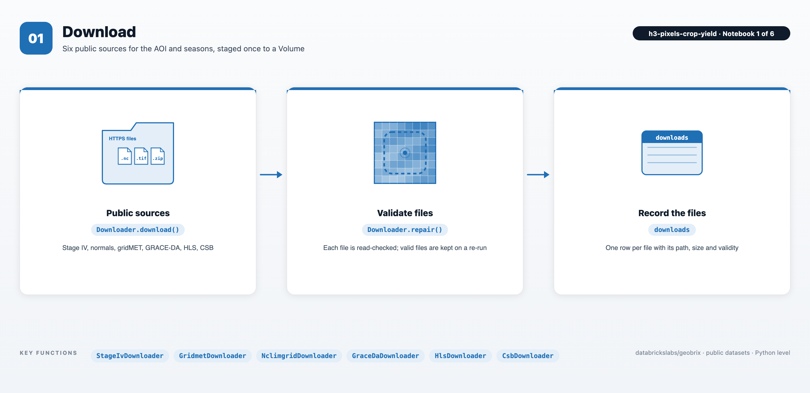
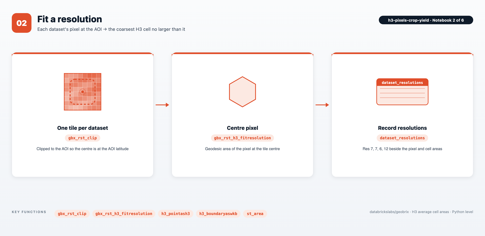
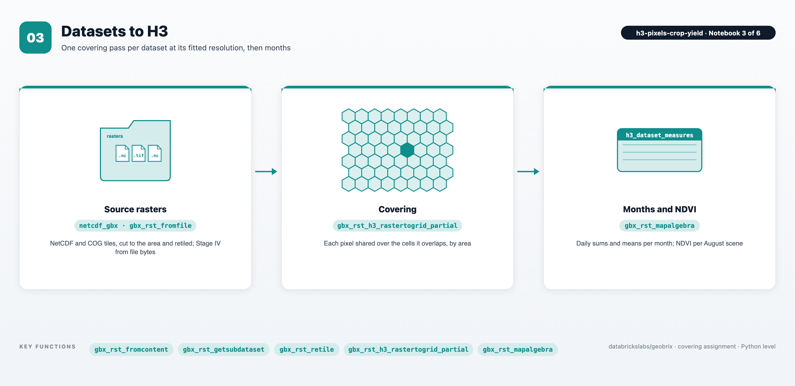
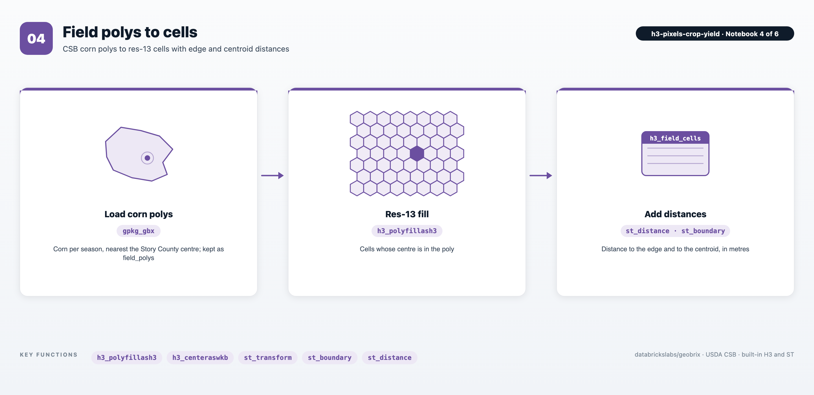
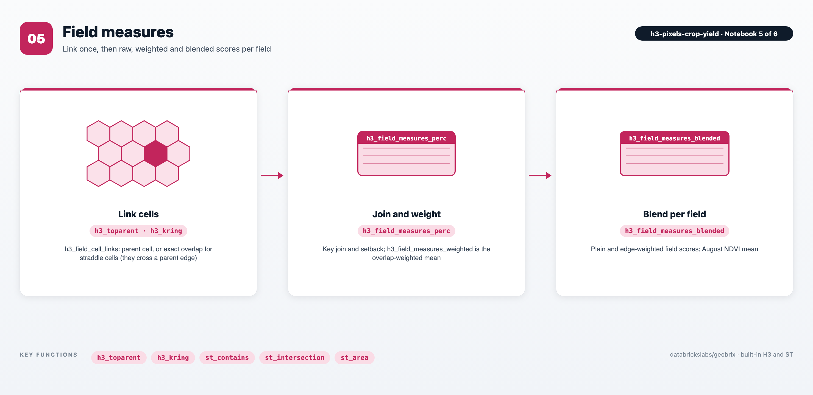
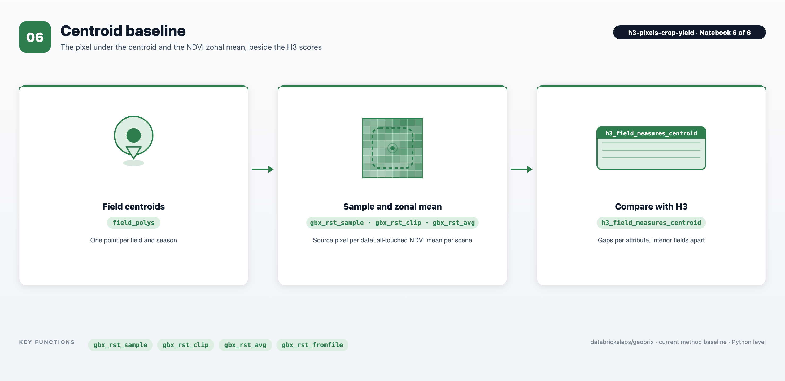

# H3 Pixels (Crop Yield)

A six-notebook series that predicts corn yield in Iowa as a data engineering pattern. It uses [GeoBrix](https://databrickslabs.github.io/geobrix/) and the Databricks built-in H3 and ST functions.

Each weather, soil and vegetation dataset goes onto H3 once, at the resolution that fits its pixel. Field polys from USDA become res-13 H3 cells. Field cells then join to the dataset cells on integer keys. The result is a score per field, per attribute and per date, ready for a model. The last notebook runs the centroid baseline, the pixel under the field centroid, and compares it with the H3 scores.

> **Requires GeoBrix 0.6.1 or newer.** The series uses the recommender `gbx_rst_h3_fitresolution` and the six new downloaders. `netcdf_gbx` now honours `bbox`, and the series relies on it.

> **Data sources.** Precipitation is the NWS Stage IV daily CONUS NetCDF, with the NCEI 2006-2020 monthly normals beside it. NOAA nClimGrid monthly precipitation is an optional cross-check. Wind is gridMET (CC0). Groundwater and soil moisture are NASA GRACE-DA, and vegetation is NASA HLS (Landsat and Sentinel-2 at 30 m). GRACE-DA and HLS need an Earthdata Login token. Field polys are the USDA NASS Crop Sequence Boundaries (CSB, public domain). Every downloader lives in `databricks.labs.gbx.sample` and stages to a Volume. A re-run skips valid files.

---

## Notebooks at a glance

### 01 — Download



- **Six sources, one Volume.** `StageIvDownloader`, `GridmetDownloader`, `NclimgridDownloader`, `GraceDaDownloader`, `HlsDownloader` and `CsbDownloader` stage the files for the AOI and `SEASONS`.
- **Idempotent.** Each file is read-checked. Valid files stay on a re-run, and `repair()` re-fetches only the broken ones.
- **One CSB download.** The national CSB zip (2018-2025) is fetched once and clipped to Iowa. The Iowa file holds 628,672 polys.

### 02 — Fit a resolution



- **One rule.** `gbx_rst_h3_fitresolution` returns the coarsest H3 resolution whose average cell is no larger than the pixel at the tile centre.
- **Result.** Stage IV (HRAP, 4,762.5 m) and the 1/24 degree grids fit res 7. GRACE-DA (0.125 degrees) fits res 6. HLS (30 m) fits res 12.
- **Fields are finer.** Field cells use res 13. The notebook asserts that the field resolution is at least the finest dataset resolution. It shows the pixel area and the cell area beside each resolution.

### 03 — Datasets to H3



- **One covering pass per dataset.** `gbx_rst_h3_rastertogrid_partial` with `assignment='covering'` shares each pixel over the cells it overlaps, by area. `attr_measure` is the area-weighted mean. `pixel_weight` is the sum of the pixel-area shares.
- **Months from days.** Stage IV daily totals sum to a month, and gridMET wind averages to a month. The normals and GRACE-DA go to months too. The precipitation anomaly is the Stage IV month minus the normal.
- **NDVI per August scene.** `gbx_rst_mapalgebra` masks Fmask bit 1 (cloud) and computes NDVI. Each scene goes to H3 at res 12.

### 04 — Field polys to cells



- **Demo fields.** The demo keeps 3,500 corn polys near the Story County centre. For 2023 there are 5,250 corn polys in Story and Boone counties.
- **Res-13 fill.** `h3_polyfillash3` keeps the cells whose centre is in the poly. Each cell gets `edge_dist_m` and `centroid_dist_m` in metres (`st_distance`, `st_boundary`, `st_centroid`).
- **Setback later.** `h3_field_cells` keeps every filled cell. The 10 m setback applies in notebook 05, so changing it needs no re-fill.

### 05 — Field measures



- **Link once.** `h3_field_cell_links` maps each field cell to dataset cells. A cell inside one parent gets `h3_toparent` and 100 percent. A straddle cell, one that crosses a parent edge, gets the exact overlap share from `st_intersection`. `h3_kring` finds the neighbouring parents to test.
- **Raw, then weighted.** `h3_field_measures_perc` is a key join of the links to `h3_dataset_measures`. `h3_field_measures_weighted` is the overlap-weighted mean per field cell.
- **Blended per field.** `h3_field_measures_blended` holds a plain score and an edge-weighted score (`w = min(1, d / 30)`). It also holds the August NDVI mean.

### 06 — Centroid baseline



- **The centroid baseline.** `gbx_rst_sample` reads the source pixel under each field centroid, for every dataset except NDVI.
- **NDVI the same way.** `gbx_rst_clip` with an all-touched cutline cuts each August scene to the field poly. `gbx_rst_avg` takes the mean, then the scene means are averaged.
- **Comparison.** The notebook sets `h3_field_measures_centroid` beside the blended scores. It shows the gaps per attribute and keeps interior fields apart from edge fields.

---

## Files

| File | Purpose | Output tables |
|---|---|---|
| `config_nb.ipynb` | Shared setup. Installs the wheel, registers GeoBrix, holds the USER SETTINGS, the Volume tree, the downloaders and the helpers. Run through `%run ./config_nb`. | none |
| `01_download.ipynb` | Stages every dataset for the AOI and `SEASONS`. | `downloads` |
| `02_fit_resolution.ipynb` | Fits an H3 resolution per dataset. | `dataset_resolutions` |
| `03_datasets_to_h3.ipynb` | Puts each dataset on H3 at its fitted resolution. | `h3_dataset_measures` |
| `04_field_polys.ipynb` | Loads CSB corn polys and fills them with res-13 cells. | `field_polys`, `h3_field_cells` |
| `05_field_measures.ipynb` | Links field cells to dataset cells, then scores them. | `h3_field_cell_links`, `h3_field_measures_perc`, `h3_field_measures_weighted`, `h3_field_measures_blended` |
| `06_centroid.ipynb` | The centroid baseline and the comparison. | `h3_field_measures_centroid` |

---

## Prerequisites

- **Serverless environment 6.** The series runs at the Python level, with no JAR.
- **The `+env6` wheel.** `config_nb` installs `geobrix-0.6.1+env6-py3-none-any.whl` from the sample-data Volume, with the `vizx` extra. See [Choose an install path](https://databrickslabs.github.io/geobrix/docs/installation#choose-an-install-path).
- **Unity Catalog.** Set `catalog_name` and `schema_name` in `config_nb`. The defaults are `geospatial_docs` and `h3_pixels_crop_yield`. A Volume named `data` must already exist under the schema. The notebooks create folders in it but not the Volume.
- **An Earthdata Login token.** GRACE-DA and HLS need it. `config_nb` reads it from the Unity Catalog secret named by `EARTHDATA_UC_SECRET`, with `dbutils.secrets.get(catalog, schema, key)`. The default is `geospatial_docs.vapor_eyes.earthdata_token`, the secret the Vapor Eyes series uses. Without it, the other datasets still run.
- **Network access.** All downloaders fetch over HTTPS.

---

## Run order

1. Open `config_nb.ipynb`. Set `catalog_name` and `schema_name`, and check that the Volume exists.
2. Run the notebooks in order: **01 → 02 → 03 → 04 → 05 → 06**. Each starts with `%run ./config_nb`.

Each notebook is safe to re-run. Set `FORCE_REBUILD = True` after `%run ./config_nb` to rebuild its outputs. The notebooks ship with `INTERACTIVE_PLOTS = False`, so GitHub shows static maps.

The AOI is Story and Boone counties. `SEASONS` defaults to `[2023]`, and any season from 2018 to 2025 works without a new CSB download. `FULL_AOI = True` switches downloads and the dataset layer to all of Iowa.

---

## Data flow

```
Stage IV, normals, gridMET, GRACE-DA, HLS ──> downloads
                                                │
                              dataset_resolutions (fit a resolution per dataset)
                                                │
                                        h3_dataset_measures
                                                │
CSB ──> field_polys ──> h3_field_cells ─────────┤
                                                ▼
                                        h3_field_cell_links
                                                │
                                        h3_field_measures_perc
                                                │
                                        h3_field_measures_weighted
                                                │
                                        h3_field_measures_blended

source rasters + field_polys ──> h3_field_measures_centroid
```

---

## Serverless notes

- One tile per task. `gbx_rst_retile` keeps each tile small before any raster function runs.
- Parallelism comes from `repartition(N, column)`. The notebooks do not call `spark.conf.set`.
- Tables are written, not cached. Later notebooks read them back.
- Downloads and the CSB extract run on the driver. Workers read the staged files from the Volume.

---

## Gotchas

- **No HLS before 2013.** Landsat HLS starts in April 2013, and Sentinel-2 HLS has full seasons from 2016. CSB windows start earlier.
- **HLS tiles overlap.** A pixel seen in two neighbouring tiles enters a cell twice. The mean barely moves, but `pixel_weight` doubles there.
- **`FULL_AOI` field tables are huge.** All Iowa corn at res 13 is about 1.2 B cells. Use `FULL_AOI` for downloads and the dataset layer. Keep the field tables on the demo AOI.
- **The Stage IV 12Z day.** A file dated D is the 24 hours ending 12Z on D. The series counts it for D − 1.
- **A missing Stage IV day.** If the NWS archive lacks a day, the downloader raises. The error names NCAR GDEX d507005, where the archive keeps the day.
- **The normals overlap model years.** The 2006-2020 normals include seasons you may train on. Keep that in mind before a model uses the anomaly.

---

## Functions shown

**GeoBrix**

- RasterX: `gbx_rst_h3_fitresolution`, `gbx_rst_h3_rastertogrid_partial`, `gbx_rst_mapalgebra`, `gbx_rst_retile`, `gbx_rst_clip`, `gbx_rst_avg`, `gbx_rst_sample`, `gbx_rst_fromfile`, `gbx_rst_fromcontent`, `gbx_rst_getsubdataset`
- Readers: `netcdf_gbx`, `gpkg_gbx`
- Downloaders: `StageIvDownloader`, `GridmetDownloader`, `NclimgridDownloader`, `GraceDaDownloader`, `HlsDownloader`, `CsbDownloader`, `EarthdataClient`

**Databricks built-ins**

- H3: `h3_pointash3`, `h3_polyfillash3`, `h3_toparent`, `h3_kring`, `h3_boundaryaswkb`, `h3_centeraswkb`, `h3_h3tostring`
- ST: `st_transform`, `st_area`, `st_distance`, `st_boundary`, `st_centroid`, `st_contains`, `st_intersects`, `st_intersection`, `st_geomfromwkb`
