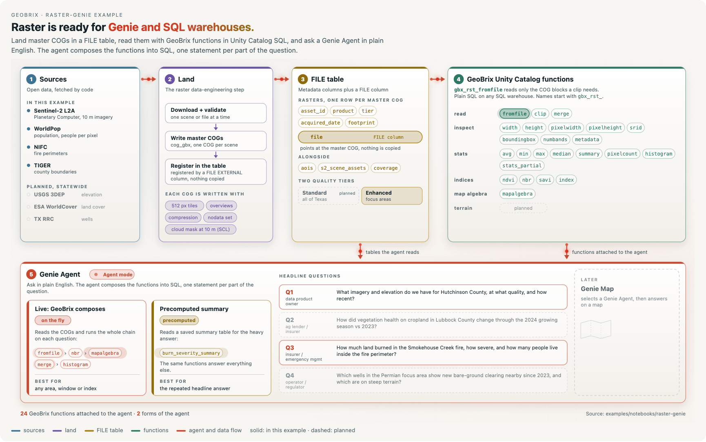

# raster-genie — Raster in Genie and SQL warehouses

A notebook series that lands master Cloud Optimized GeoTIFFs in **FILE** columns, queries them with the `gbx_rst_*` functions in plain SQL, and then asks a **Genie Agent** the same questions in plain English, using [GeoBrix](https://databrickslabs.github.io/geobrix/) on Databricks.

The first notebook is a vertical slice on one event: the **2024 Smokehouse Creek fire** in the Texas Panhandle. It answers *how much land burned, how severe was it, and how many people live there* from Sentinel-2 and WorldPop rasters.

> **Runs on Serverless by default.** `config_nb` installs the `geobrix[stac,vizx,databricks]` env6 wheel, so the notebook runs on Serverless environment 6 with no JAR. The `gbx_rst_*` functions run in the session; the same calls run in Unity Catalog once the GeoBrix UC functions are installed (see [Query FILE columns from Unity Catalog](https://databrickslabs.github.io/geobrix/docs/readers/file#query-file-columns-from-unity-catalog)).

> **Data sources.** Sentinel-2 L2A from Microsoft Planetary Computer (`StacClient`), the incident perimeter from NIFC WFIGS (`FirePerimeterDownloader`), population from WorldPop (`WorldPopDownloader`), and county and state boundaries from the US Census TIGER cartographic files. All are fetched over HTTPS, online only.



`genie/seed_agent.py` creates two Genie Agents for the example. The live agent, below, answers from the four tables and composes the GeoBrix Unity Catalog raster functions itself, starting from `gbx_rst_fromfile` on the `rasters` FILE table.


---

## Notebooks at a glance

### 01 — Smokehouse Creek

- **FILE + COG** — each Sentinel-2 scene becomes one seven-band master COG (`stack_scene`: 512-pixel blocks, average overviews 2/4/8/16, GeoBrix compression, nodata 0). The scene is cloud-masked once, when the COG is written: SCL classes 0, 1, 3, 8, 9, 10, 11 become nodata in the reflectance bands at 10 m, so no query needs an SCL mask. SCL stays as band 7, valid at full resolution only, registered in the `rasters` table by a `FILE EXTERNAL` column. Nothing is copied.
- **Windowed reads** — `gbx_rst_fromfile(file, 'GTiff', <perimeter>, 'EPSG:4326', <resolution>)` fetches only the COG blocks the perimeter needs, at a suitable overview.
- **Burn severity in SQL** — the notebook first sizes the perimeter's window against the 64 MiB a Unity Catalog function can return and picks the overview to read. `gbx_rst_nbr`, `gbx_rst_mapalgebra` (dNBR, and each tile's offset from an unburned ring), `gbx_rst_merge` and `gbx_rst_histogram` turn a pre-fire and a post-fire scene of each tile (same relative orbit where possible) into dNBR severity classes (Key & Benson, 2006; USGS) and an area per class. WorldPop gives the people inside the perimeter.
- **Map and Genie** — the severity classes over an Esri basemap, then the same question asked of two Genie Agents in Agent mode, with the SQL each wrote and the time each took: the **live** agent writes the whole GeoBrix chain from the COGs, following the method its instructions teach; the **precomputed** agent reads the saved `burn_severity_summary` table for severity and writes the rest the same way.

---

## Files

| File | Purpose |
|---|---|
| `config_nb.ipynb` | Shared setup (`%run ./config_nb`). Installs the env6 wheel with extras, registers the functions with `gbx.register(spark)`, holds the USER SETTINGS (`catalog_name`, `schema_name`, the fire, the pre and post windows, `MAX_CLOUD`, `MAX_NODATA`, `BURN_RES_M`, `GENIE_SPACE_ID`, `GENIE_SPACE_ID_PRECOMPUTED`), creates the schema, the `data` Volume and its directory tree, and defines `finalize_delta`. |
| `01_smokehouse_creek.ipynb` | The Smokehouse Creek slice: `aois`, Sentinel-2 master COGs, WorldPop, the `rasters` FILE table, the `coverage` view, the burn severity query, a map and the Genie Agent. |
| [`genie/agent_spec.py`](genie/agent_spec.py) | The two Genie Agents (live and precomputed): their tables, attached GeoBrix functions, instruction text and example SQL. |
| [`genie/seed_agent.py`](genie/seed_agent.py) | Creates or updates a Genie space from `agent_spec` and prints its id: `python genie/seed_agent.py --profile <name> --warehouse-id <id> --variant live\|precomputed [--space-id <id>]`. |
| [`genie/run_questions.py`](genie/run_questions.py) | Asks one or both agents (`--space live\|precomputed\|both`) plain-language questions in Agent mode, `--runs` times each, and writes a row per run (answer, SQL, seconds, correct) to `evidence.json`. Ids come from `--live-id`, `--precomputed-id`, `--warehouse-id` or the environment (`GENIE_SPACE_ID`, `GENIE_SPACE_ID_PRECOMPUTED`, `GENIE_WAREHOUSE_ID`). `--questions Q3,Q1,Q5n` picks the questions (live: all three; precomputed: Q3 and Q1). The agent's SQL is re-run on the warehouse and its rows are judged; `--no-rerun` judges the answer text alone. Q5n has no example in the agent: it asks for Hutchinson County's mean burn severity and acres at moderate-low or worse, and the row records whether the SQL differs from every example (`novel`) and how close it is (`similarity`). `--rejudge EVIDENCE_JSON --out FILE` judges a saved evidence file again with the current gates, without asking Genie; a Q1 answer with no re-run rows is `unverified`, not correct. |
| [`lakeflow/land/scenes.py`](lakeflow/land/scenes.py) | `stack_scene`: per-band Sentinel-2 files in, one master COG out. Tested in `lakeflow/tests/`. |

Tables in `geospatial_catalog.raster_genie`: `aois` (the perimeter, the counties it touches and the Texas outline), `s2_scene_assets` (the Sentinel-2 scenes chosen), `rasters` (one row per master COG, with a `FILE EXTERNAL` column), the `coverage` view, and `burn_severity_summary`. The population row of `coverage` shows a low valid percent (below 1% for the fire area): WorldPop's constrained grid is nodata wherever nobody lives, so most pixels of a rural window hold no value.

---

## Prerequisites

- **Serverless environment 6** (or Databricks Runtime 19), Python 3.12. The series needs no JAR.
- **GeoBrix 0.6.0.** `config_nb` installs the env6 wheel from the v0.6.0 GitHub release: `https://github.com/databrickslabs/geobrix/releases/download/v0.6.0/geobrix-0.6.0+env6-py3-none-any.whl`. For other installs, see [Installation](https://databrickslabs.github.io/geobrix/docs/installation).
- **The GeoBrix UC functions installed** in your catalog, if you want to query the `rasters` table from a SQL warehouse or Genie. The notebook itself calls the session functions.
- **Unity Catalog.** `config_nb` creates the schema and a Volume named `data` under it (`CREATE ... IF NOT EXISTS`), so you need `CREATE SCHEMA` and `CREATE VOLUME` on the catalog. Edit `catalog_name` and `schema_name` to change them.
- **The whole folder.** Open the series from a Git folder, or copy the `lakeflow/` folder next to the notebooks, so that `lakeflow/land/scenes.py` sits beside notebook 01: it imports `stack_scene` from `./lakeflow` and stops with a Fix if the file is missing.
- **Genie spaces (last step only).** Create them with `genie/seed_agent.py` (`--variant live`, and `--variant precomputed` for the second), then paste the ids it prints into `GENIE_SPACE_ID` and `GENIE_SPACE_ID_PRECOMPUTED` in `config_nb`; until `GENIE_SPACE_ID` is set the Genie step prints a message and skips, and the precomputed agent is skipped while its id is empty. The spaces need the GeoBrix UC functions installed in `geospatial_catalog.geobrix_uc` and a SQL warehouse.
- **Network access.** Planetary Computer, NIFC, WorldPop and Census are all fetched over HTTPS.

---

## Run order

1. Open `config_nb.ipynb`, check `catalog_name` / `schema_name`, and (optionally) set `GENIE_SPACE_ID` and `GENIE_SPACE_ID_PRECOMPUTED`.
2. Run `01_smokehouse_creek.ipynb` top to bottom. It starts with `%run ./config_nb`.

The first run downloads the national WorldPop file once (about 0.5 GB) and the Sentinel-2 windows (a few GB). Every step is guarded: files already on the Volume are not downloaded again and existing tables are not rewritten. A master COG without the current `GBX_STACK_VERSION` tag (written by an older `stack_scene`) is rebuilt, so master COGs written before the tag existed are rebuilt on the next full run. Set `FORCE_REBUILD = True` in the cell right after `%run ./config_nb` to rebuild everything.

Rebuilt master COGs cascade: when any master COG is written in a run, the `rasters` table (the FILE size and checksum of each COG) is rewritten from the new files, the `coverage` view follows it, and `burn_severity_summary` is dropped and rebuilt by the burn step. The notebook stamps `gbx.stack_version` as a table property on `rasters`, so a table written for an older stack version is rewritten on the next run too. The cell that rebuilds the COGs prints which COGs were written.

### Asking the agents

After a run, seed the two spaces (`genie/seed_agent.py`, once per variant) and ask them the headline questions. Run both scripts with the same catalog and schema you set in `config_nb`: pass `--catalog` and `--schema`, and `--uc-schema` for the schema of the GeoBrix UC functions (defaults `geospatial_catalog`, `raster_genie`, `geobrix_uc`).

```bash
python examples/notebooks/raster-genie/genie/run_questions.py --profile <name> --space both \
  --live-id <id> --precomputed-id <id> --warehouse-id <id> --runs 3
```

Run it after the notebook, not during it: the notebook rewrites the tables the agents read. Q3 (the fire's burned land, severity and people) and Q1 (the coverage of Hutchinson County) are judged against truth values recorded from one maintainer run of the notebook (`GROUND_TRUTH` and `COVERAGE_TRUTH` in `run_questions.py`); a different perimeter or scene pick needs refreshed truth values. Q5n is a question no example answers, judged against a direct GeoBrix SQL run with the same method (mean dNBR within 0.002, acres within 2%), which a rasterio/numpy computation without GeoBrix reproduces. For Q5n the agent applies the method its instructions teach (dNBR, the per-tile ring offset, the USGS classes) to a new area and a new aggregate; there is no worked example for it, but it does not invent the method, and the evidence records how close its SQL is to the examples. Where Sentinel-2 tiles overlap, a result depends on which tile's pixels win the merge. `gbx_rst_merge` applies a fixed order (tiles sorted by their bytes) and the last tile in that order wins. For Hutchinson County the independent check gives 3,841 acres at moderate-low or worse with the tile that wins the merge, and 3,010 acres with the other tile; the effect on the perimeter totals has not been measured. Averaging overlapping tiles is planned.

---

## Tests

`stack_scene` has unit tests that write real small rasters and check the COG layout (blocks, overviews, compression, nodata, no mask band, band descriptions, resampling, the `GBX_STACK_VERSION` tag). `agent_spec` has tests for its function names, instruction count and example SQL:

```bash
bash scripts/commands/gbx-test-python.sh --path examples/notebooks/raster-genie/lakeflow/tests
```

---

## Learn more

- [Raster functions](https://databrickslabs.github.io/geobrix/docs/api/raster-functions): `rst_fromfile`, `rst_nbr`, `rst_mapalgebra`, `rst_merge`, `rst_histogram`
- [File reader](https://databrickslabs.github.io/geobrix/docs/readers/file): FILE columns and querying them from Unity Catalog
- [STAC client](https://databrickslabs.github.io/geobrix/docs/api/stac): search and windowed download
- [COG writer](https://databrickslabs.github.io/geobrix/docs/writers/cog) and [Large rasters](https://databrickslabs.github.io/geobrix/docs/api/large-rasters): master COG preparation
